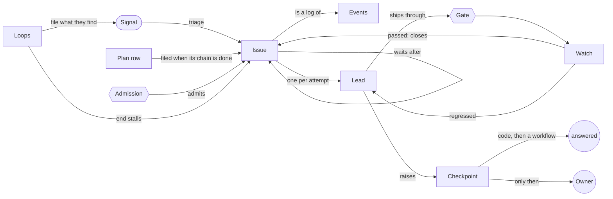
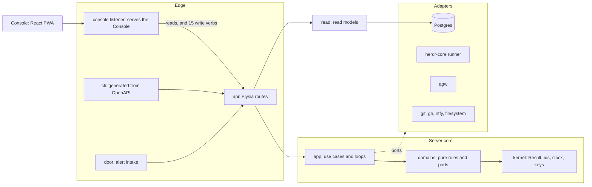
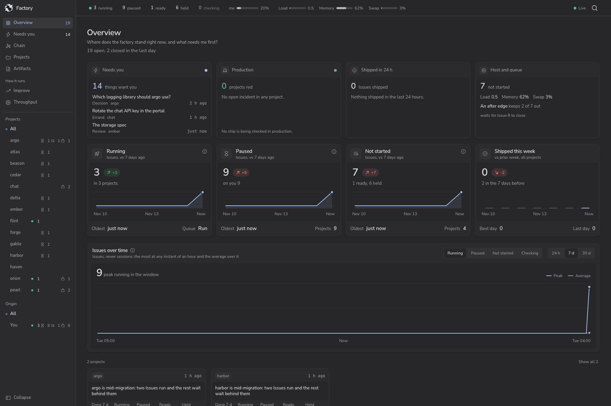

# Software Factory

**The design of a closed loop that turns signals into verified production changes. Agents do the work, code supervises them, and one person decides only what a person must.**

This README explains the concept: what a software factory is, its mental model, its domain model and the rules that hold it together. The code in this repo is one working implementation. It is the example throughout, and the last part of this page describes it. What it has done is counted, not claimed: [the result](#the-result) is read from the factory itself.

Everything here is a recommendation drawn from one implementation, not a standard. Every factory is set up for its place: take the parts that fit ([MIT](LICENSE)). The [guide](docs/guide/README.md) ([software-factory.jkrumm.com](https://software-factory.jkrumm.com)) goes through the implementation chapter by chapter.

## Contents

Short on time: [the loop](#the-loop), then [the result](#the-result) and [one Issue's life](#one-issues-life).

- **[The idea](#the-idea):** [the problem](#the-problem) · [what a software factory is](#what-a-software-factory-is) · [the result](#the-result) · [dark for code, lit for decisions](#dark-for-code-lit-for-decisions) · [what it gives and what it costs](#what-it-gives-and-what-it-costs)
- **[The mental model](#the-mental-model):** [the loop](#the-loop) · [four questions](#four-questions) · [the ladder of judgment](#the-ladder-of-judgment) · [attention is the budget](#attention-is-the-budget)
- **[The domain model](#the-domain-model):** [the language](#the-language) · [Signal](#signal) · [Triage and incidents](#triage-and-incidents) · [Issue](#issue) · [Event](#event) · [State and the transition table](#state-and-the-transition-table) · [Wait and stall](#wait-and-stall) · [Admission](#admission) · [Chain and plan](#chain-and-plan) · [Lead and attempt](#lead-and-attempt) · [Gate](#gate) · [Ship, watch and verify](#ship-watch-and-verify) · [Checkpoint](#checkpoint) · [Loop](#loop) · [Friction](#friction)
- **[Design principles](#design-principles):** [claim, commit, call, record](#claim-commit-call-record) · [every effect has a key](#every-effect-has-a-key) · [a caller is its token](#a-caller-is-its-token) · [supervision never speaks](#supervision-never-speaks) · [rules are pure, I/O sits behind ports](#rules-are-pure-io-sits-behind-ports) · [the build holds the words](#the-build-holds-the-words)
- **[The example implementation](#the-example-implementation):** [architecture](#architecture) · [one Issue's life](#one-issues-life) · [where it falls short](#where-it-falls-short) · [the Console](#the-console) · [layout](#layout) · [run it](#run-it)
- **[Further reading](#further-reading)**

# The idea

## The problem

A coding agent writes a change faster than a person can supervise it. Put a person at the spec, at every question and at the merge, and the person is the queue: ten agents wait on one inbox. Take the person out without replacing what they did, and nothing checks the work.

Better models do not solve this. The limit is not how well one agent codes. It is everything around the agent: what it should work on, whether it may start, what proves it is done, and who decides when it cannot.

## What a software factory is

A software factory is the system around the agents. It takes in everything that might be work and decides what is. It gives each piece to one agent, which owns it until it is verified in production. It escalates to a person only what no machine may decide.

It is not one of these, though it uses all three:

| Thing | What it does | What it leaves open |
|-|-|-|
| A coding agent | carries out one task in one session | which task, when, and whether the result holds |
| An orchestrator of agents | splits one task across several sessions | the same, plus the handoffs between them |
| CI/CD | moves a finished change to production | where the change came from and whether it did what was asked |

A factory owns the whole lifecycle: intake, admission, supervision, gates, verification, escalation, and the measurement of its own waste.

## The result

Read from the factory on the day shown:

<!-- results:start -->
From 2026-11-15 11:03 UTC (the counting epoch) to 2026-11-21 12:57 UTC, all projects. Read on 2026-11-21 with `factory read kpis` and `factory read friction`; `bun scripts/readme-results.ts --refresh` reads them again.

| What | Result |
|-|-|
| Issues filed | 1,388, of which the factory's own loops filed 267 |
| Issues closed | 1,450 |
| Median time from filed to closed | 85 minutes (the target is at most 3.0 h) |
| Queue wait, 90th percentile | 3.7 h (the target is at most 8.0 h) |
| First verifications that passed | 97.3 % of 1,220 (the target is at least 90 %) |
| Decisions answered | 48: the Judge 36, a default 6, the owner 5, his delegate 1 |
| Times the owner stepped in where the factory should have settled it | 6 (0.005 per Issue filed by a person, an agent or an alert; the target is at most 0.07) |
| Answers of the owner that changed nothing | 43.4 % of 83 answers to Specs, Concepts and Decisions (the target is at most 20 %) |
| Errands that reached the owner | 3.4 per 100 Issues (47; no target yet) |
| Quota used at the weekly reset | 97.0 % over 4 resets (the target is at least 90 %) |
<!-- results:end -->

The owner's part is in the table: the Decisions the factory could not settle, the Specs and Concepts it handed over, the Errands only hands can do.

## Dark for code, lit for decisions

The position this design takes:

- **Dark for code.** No person reviews a change before production. The agent's own review, gates, a watch window and probes do that job. [Warp](https://www.warp.dev/blog/adapting-for-a-world-of-software-factories) keeps a person at spec, question and merge and calls dark factories "not realistic right now"; this repo exists to show how far past that one person can go.
- **Lit for decisions.** What reaches the owner is product direction, spend, irreversible data loss, other people, security policy, rare big architecture and taste. The factory handles everything else, and counts a touch it should have avoided as waste.

The two halves depend on each other. Taking the person out of the merge rests on the other half: the stops that remain have to be explicit, rare and counted.

## What it gives and what it costs

**What it gives:**

- Throughput is no longer bounded by one person's review time.
- Every stop for a person is a named thing with a contract, visible on one screen.
- Every change has a record by construction: where it came from, who built it, what proved it, what it could not prove.
- Alerts, bugs, feature requests and the system's own findings go through one path.
- Waste is counted, so the factory can be pointed at itself.

**What it costs:**

- **A contract per repo.** Each repo must check itself, deploy and prove it is live by a command. A repo that cannot prove a change by a command cannot be dark.
- **An always-on machine,** a database, and model subscriptions the factory fills.
- **The first weeks** go into the factory, not into the products.
- **A wrong gate is wrong at scale.** A check that passes bad changes passes two hundred a day.
- **One person stays on call** for the decisions that are theirs.

Do not build one for work a command cannot verify, or for a team whose process requires a person's review of every change.

# The mental model

## The loop


1. **Work arrives as signals.** A failing monitor, a GitHub issue, a voice note and a finding of the factory itself all arrive the same way, and triage decides what each becomes.
2. **Capacity admits work.** An Issue starts when the machine, the subscriptions and the repo can take it, and one that waits says why.
3. **One lead owns one Issue,** from root cause to verification.
4. **A ship is a change landed and deployed,** and a watch window checks it in production.
5. **A lead that needs a person raises a checkpoint.** Most are answered before a person sees them, and none is a merge.

The loop is closed twice. A regression goes back to the lead that shipped it. And the factory's own waste comes back in as signals.

## Four questions

Every factory, whatever it is built from, answers four questions. The domain model below is this design's answers.

| Question | Answered by | The rule |
|-|-|-|
| What becomes work? | [Signal](#signal), [Triage](#triage-and-incidents) | Nobody files around the state machine |
| Who may start, and when? | [Admission](#admission), [Chain](#chain-and-plan) | A waiting Issue names what keeps it out, with numbers |
| What proves it is done? | [Gate](#gate), [Watch](#ship-watch-and-verify) | A ship holds on facts a command produced. What the agent claims is recorded beside them, never taken as proof |
| Who decides when a machine cannot? | [Checkpoint](#checkpoint) | Code first, then a workflow, then the owner |

## The ladder of judgment

Every judgment in the factory has three rungs, tried in this order:

1. **Deterministic code.** A rule costs nothing to run and can be tested.
2. **A model workflow.** Cheap, and wrong sometimes, so it runs behind a typed question with an idempotency key, and only where the rules run out.
3. **The owner.** Neither cheap nor always there.

| Judgment | Code decides | A workflow decides | The owner decides |
|-|-|-|-|
| What a signal becomes | fingerprint, routes, correlation window | kind, origin, amend or new | whether quarantined outside text becomes work |
| What a stalled Issue needs | wake, re-check, requeue, deliver, break a claim deadlock | what to do when the rules do not say | nothing, unless it becomes a Decision |
| Whether a question is the owner's | the agent's declared default | whether a person is needed at all, given precedent | product direction, spend, data loss, other people, security policy, taste |

The lifecycle server itself calls no model. Model judgment lives in workflows outside it, behind a port, so every such call is visible, keyed and replaceable.

## Attention is the budget

The scarce resource is the owner's attention, so the factory measures its spending.

- A **touch** is the owner acting on an Issue. A touch the factory should have handled is **friction**.
- A touch that repeats becomes a rule, a default or a change to what agents are told.
- A stop the owner wanted (a Spec for a new screen, an Errand only hands can do) is not friction. It is the product working.

# The domain model



## The language

One word per thing, in code, CLI, events, screens and docs. This is the ubiquitous language of domain-driven design taken literally: a retired word in the source fails the build. The words to learn first are its [core tier](docs/language.md#core-tier); the full table, with what each word retires, is the rest of [`docs/language.md`](docs/language.md). Two lists the build checks against the code are kept here:

- An **Event** is a fact recorded on an Issue: **25 kinds**, among them `filed`, `admitted`, `shipped`, `watch_passed`.
- An Issue's **State** is `settling`, `queued`, `working`, `waiting`, `watching` or `closed`, and only an event moves it. Screens say Running, Paused, Ready, Held, Checking and Planned instead.

Each concept below has the same shape: what it is, its rules, why, example files in this repo, and where to read more.

## Signal

A signal is anything that arrives and may become work: an alert from a monitor, a GitHub issue, a piece of app feedback, the owner's words, a lead's follow-up, a finding of one of the factory's own loops.

Signals:

- Are the **way in for everything that arrives**. The owner and a plan can file an Issue directly, and it passes the same settling step before it queues: nobody files around the state machine.
- Carry a **kind** (an alert, a request, a piece of feedback or a remark), an **origin** and a **trust level**.
- Are **quarantined** when their text comes from outside, until a screening workflow or the owner lets them through. Outside text is data, never an instruction.
- Have a **fingerprint**, so the same thing arriving twice is recognised.
- Never name their own destination when they come from a machine: an alert's repo is looked up in a server-side route registry, never read from the payload.

**Why.** One way in means one place where duplicates are folded, trust is decided and noise is turned away, before any agent spends a token.

**Example files:**

- [`domains/intake/rules.ts`](apps/server/src/domains/intake/rules.ts): `fingerprintOf`, the rules that decide before a model is asked
- [`apps/door`](apps/door): the alert door, which holds one narrow token and no database credential

**Read more:** [Signals and Triage](docs/guide/signals.md), [Alertmanager: grouping and inhibition](https://prometheus.io/docs/alerting/latest/alertmanager/) (Prometheus)

## Triage and incidents

Triage decides what a signal becomes. It has five outcomes and no others:

| Outcome | Means |
|-|-|
| A new Issue | Nothing open covers it |
| An amendment | It is a note on an Issue that is already open |
| Part of an incident | One root cause seen through many alerts: they join one Issue |
| Held (quarantined) | Its text is from outside and waits for the screening workflow or the owner |
| Dropped | It is noise, a probe, or work the factory does not hear |

- Rules decide first: the fingerprint, the route registry, a correlation window. A workflow is asked only where the rules are unsure.
- An incident is correlated by host and time: alerts from one host inside a 30-minute window join one Issue, so twelve alerts from a dead database host get one lead.

**Why.** An agent started for a duplicate is the most expensive kind of waste: it costs a session, a slot and usually a conflict.

**Example files:**

- [`app/intake.ts`](apps/server/src/app/intake.ts): the path from a signal to one of the five outcomes

**Read more:** [Signals and Triage](docs/guide/signals.md)

## Issue

An Issue is one unit of work: one repo, one branch, one ship. It is the factory's aggregate: everything else (a lead, a wait, a Decision, a ship) hangs off an Issue.

Issues:

- Have **facts** written by whoever filed them: why, what is in scope, the change, and the acceptance (the checks that prove it). The agent cannot see the session that filed the Issue, so the facts carry everything.
- Are **one repo each**. Work for two repos is two Issues with an edge between them.
- End with an **outcome**: done, dropped, healed (an incident that went away before anyone started) or cancelled.
- Can be reopened within 30 days, by the owner or the factory.

**Why.** One repo, one branch and one ship is the largest unit that can be verified, reverted and reasoned about alone. Anything bigger is a plan of several Issues.

**Example files:**

- [`contract/vocab.ts`](packages/contract/src/vocab.ts) holds the states, kinds, outcomes, sizes and origins, and [`domains/work/issue.ts`](apps/server/src/domains/work/issue.ts) the waits

**Read more:** [Issues](docs/guide/issues.md)

## Event

An event is a fact recorded on an Issue. The log of events is the truth; the Issue's state is what its applied events made it.

Events:

- Are **stored, never derived**. A count or a timer the log can answer is never a column.
- Have a fixed list of **senders**. A lead may send `shipped`; only the factory may send `watch_passed`.
- Are applied by one **pure function**: the same Issue, event and time give the same answer, which is a move with its effects, a refusal with a reason, or an ignore with a reason.
- Are written with an **optimistic version guard**: a writer that lost a race is refused, not merged.

```ts
export function apply(issue: Issue, event: AnyIssueEvent, ctx: { now: Date }): Decided {
  const refusal = senderRefusal(event)
  if (refusal) return { result: 'refused', detail: refusal }
  if (event.kind === 'filed') return { result: 'ignored', detail: 'it is filed already' }
  const run = TABLE[issue.state][event.kind] as (ctx: Ctx) => Cell
  const cell = run({ issue, event, now: ctx.now })
  if ('refuse' in cell) return { result: 'refused', detail: cell.refuse }
  if ('ignore' in cell) return { result: 'ignored', detail: cell.ignore }
  // … the transition, the evolved Issue and the cell's effects
}
```

**Why.** Twenty agents, twenty loops and the owner write to the same Issues. A stored event stays what it was; a derived column has to be kept right by every writer. And every question about an Issue ("why did it wait?", "who answered?") is a read of its log.

**Note:** this is event sourcing kept small. There is no event bus and no projection framework: one table of events, one function, and the current state kept on the row because its version guards the next write.

**Example files:**

- [`domains/work/machine.ts`](apps/server/src/domains/work/machine.ts): `apply`, and `replay`, which rebuilds an Issue from its stored transitions and decides nothing new
- [`domains/work/events.ts`](apps/server/src/domains/work/events.ts): the payload of every kind, and `SENDERS`

**Read more:** [Issues](docs/guide/issues.md), [Event Sourcing](https://martinfowler.com/eaaDev/EventSourcing.html) (Martin Fowler), [Optimistic Offline Lock](https://martinfowler.com/eaaCatalog/optimisticOfflineLock.html) (Martin Fowler)

## State and the transition table

An Issue has six states. Every `(state, event)` pair has a cell, and a cell is one of three things: a move, a refusal with its reason, or an ignore with its reason.

```ts
export type Cell =
  | { to: 'waiting'; wait?: WaitSpec; update?: WaitSpec; heard?: true; effects: Effect[] }
  | { to: 'closed'; outcome: IssueOutcome; effects: Effect[] }
  | { to: 'settling' | 'queued' | 'working' | 'watching'; effects: Effect[] }
  | { refuse: string }
  | { ignore: string }

/** The total table: every state takes every event. A missing cell fails `tsc`. */
export type Table = { [S in IssueState]: { [E in EventKind]: (ctx: Ctx<E>) => Cell } }
```

- The table is **total**: a new state or a new event fills every cell before the build passes.
- A **refusal is an answer** the caller reads, so it says why: `admitted` on a settling Issue answers "triage is not done: it is not queued".
- The state diagram in the docs is **generated from the table**; a stale diagram fails the build.
- The stored states are for machines. A screen shows where work stands in six other words (Running, Paused, Ready, Held, Checking, Planned), because "queued" does not tell a person whether anything is wrong. They are not a rename: Ready and Held split the Issues no lead has begun by whether anything but capacity keeps them out, and Planned is a plan row that is not an Issue yet.


**Why.** The bugs of a lifecycle system live in the pairs nobody thought about: a ship that arrives after a cancel, an answer to a question a default already settled. A total table turns a pair nobody wrote a cell for into a compile error.

**Note:** no state-machine library and no workflow engine. A typed record of functions is the whole mechanism, and the type checker is the tool that holds it.

**Example files:**

- [`domains/work/table.ts`](apps/server/src/domains/work/table.ts): `TABLE`, 6 states by 25 events
- [`domains/work/diagram.ts`](apps/server/src/domains/work/diagram.ts): the diagram, generated

**Read more:** [The Issue, as the code has it](docs/language.md#the-issue-as-the-code-has-it), [Where work stands](docs/language.md#where-work-stands), [Effective ML Revisited](https://blog.janestreet.com/effective-ml-revisited/) (Yaron Minsky: make illegal states unrepresentable), [Parse, don't validate](https://lexi-lambda.github.io/blog/2019/11/05/parse-don-t-validate/) (Alexis King)

## Wait and stall

A wait is a pause with a named exit. A waiting Issue always says why it waits and what ends the wait. A **stall** is a wait nobody asked for: a full usage window, an agent that went silent or was lost, a block, a regression. A machine caused it and a machine, the steward, ends it.

| Wait | Ends when | Exit |
|-|-|-|
| timer | the clock reaches the time the lead deferred to | machine |
| dependency | every Issue it is after has closed | machine |
| external | the pull request it waits on is approved, commented, merged or closed | machine |
| wall | the subscription's usage window opens again | machine, a stall |
| unreported | the lead's next turn, or the steward | machine, a stall |
| blocked | the steward re-checks the cause | machine, a stall |
| lead gone | the steward starts a new attempt | machine, a stall |
| regressed | the steward wakes it, or turns it into a Decision | machine, a stall |
| decision | the question is answered, by the Judge, a default or the owner | person |
| review | the verdict on the Concept or Spec is given | person |
| errand | the owner has done it by hand, or turned it back with a note | person |
| paused | the owner's word, or the time he paused it until | person |

**Why.** "Stuck" is not a state. If the exit is a machine's, a loop owns it and a person never hears of it. If the exit is a person's, it is on one screen with what it holds back.

**Example files:**

- [`domains/work/issue.ts`](apps/server/src/domains/work/issue.ts): `WAITS`, each wait with its exit and whether it is a stall

**Read more:** [Loops](docs/guide/loops.md)

## Admission

Admission decides when a queued Issue may start. A queued Issue does not "wait for capacity": a rule keeps it out, the first rule that says no names itself, and the answer carries its numbers.

```ts
const REFUSALS = [
  'drain', 'doctor', 'boot', 'load', 'memory', 'disk', 'tests', 'lane', 'claim', 'window', 'cap',
] as const
export type RefusalKind = (typeof REFUSALS)[number]
```

- Admission is **decided again at every claim**, from measured samples: the subscriptions' usage windows, the host's memory and load, the repo's claims, the test slots.
- The queue can always **explain itself**: one sentence per queued Issue, with the number that binds.
- Limits should be **measured resources**. A cap that measures nothing is a guess that idles a paid-for agent.

**Why.** The owner's most frequent question is "why does nothing move?". A queue that answers it in one sentence needs no person to investigate, and its answers are data the factory tunes itself from.

**Example files:**

- [`domains/capacity/admission.ts`](apps/server/src/domains/capacity/admission.ts): the rules in the order they are asked
- [`packages/accounts`](packages/accounts): the picker that spreads agents over N subscriptions

**Read more:** [Capacity](docs/guide/capacity.md)

## Chain and plan

A chain is what waits on what. An Issue can be **after** other Issues, in its own repo or another, and is held until they close. A **plan** is rows not yet filed: the factory files each row as an Issue when the rows it is after are done.

- Edges are **stated by whoever files**, and a stated edge is final. Where none is stated, triage may add one, by rule first.
- An edge exists **only where one Issue needs what another shipped**. Independent work runs side by side.
- A cycle is refused when it is written, not found when nothing moves.

**Why.** Without edges, parallel agents rebase against each other and build on things that do not exist yet. With edges used as a queue, the factory runs one thing at a time and the subscriptions idle.

**Example files:**

- [`docs/plan.yaml`](docs/plan.yaml): this repo's own plan, and [`docs/plan.md`](docs/plan.md), its format

**Read more:** [Chains and Plans](docs/guide/chains.md)

## Lead and attempt

A lead is the agent session that owns an Issue. An attempt is its *n*th try. In this implementation a lead is an interactive Claude Code session in a terminal the server started.

Leads:

- Own the Issue **end to end**: root cause, build, their own review, landing, deploy, and stating each acceptance line met or not met.
- Are **one per Issue**. There is no planner agent, coder agent and reviewer agent passing an Issue along.
- Work from a **brief**: the Issue's facts and the standing orders, built by a pure function of its input.
- Are **supervised, never redone**. The factory reads what the session reports and derives its state; it does not repeat the lead's work or second-guess its diff.
- Are **interactive, never headless**: a session a person could attach to and read.

**Why.** Splitting an Issue across specialised agents moves the context loss to the handoffs. One session that owns the outcome holds the whole context and can be held to its own acceptance lines.

**Example files:**

- [`domains/leads/brief.ts`](apps/server/src/domains/leads/brief.ts): `buildBrief`
- [`adapters/hc`](apps/server/src/adapters/hc): the terminals the leads run in

**Read more:** [Leads](docs/guide/leads.md), [Building effective agents](https://www.anthropic.com/research/building-effective-agents) (Anthropic), [Harness engineering](https://openai.com/index/harness-engineering/) (OpenAI)

## Gate

A gate is a machine check a lead cannot talk past. What an agent is told does not change what it can do.

Gates:

- Take **facts a command produced** as input: a merge base, a CI run, a probe. Never an agent's statement.
- **Refuse with the reason and the next step.** A refusal is the most-read message in the factory.
- **Fail closed.** A lock that cannot be read refuses the deploy; a route with no rule refuses everyone.
- Treat a **review as evidence, never as a gate**. If an agent's opinion could refuse a ship, the gate would be a negotiation between two agents.

```ts
const refuse = (why: string): ShipVerdict => ({ accepted: false, error: `ship refused: ${why}` })
if (input.reported.length === 0) return refuse('ship names no merged commit')
```

**Why.** An agent under pressure to finish will argue, and it argues well. A gate whose inputs are facts leaves nothing to argue with.

**Example files:**

- [`domains/quality/gate.ts`](apps/server/src/domains/quality/gate.ts): `judgeShip`, pure
- [`scripts/merge-guard.ts`](scripts/merge-guard.ts): refuses a head without green CI on its exact sha, and a red default branch
- [`apps/cli/src/deploy-lock.ts`](apps/cli/src/deploy-lock.ts): the deploy lock that fails closed

**Read more:** [Gates](docs/guide/gates.md)

## Ship, watch and verify

A ship is not a pull request. It is merged commits on the default branch and a deploy. After it the Issue is watching: the project's verify command and its probes answer, and only a passed watch closes the Issue as done.

- A watch is **pass or fail, never averaged**.
- A regression goes **back to the lead that shipped it**, as a note with what failed.
- **Fix forward:** a bad change gets a new change, not a revert by reflex.
- The lead's acceptance lines are **recorded as stated**, met or not met, each with its reason. What a change could not prove stays on the record.

**Why.** "Merged" proves that a diff was accepted. "Live and green in production" proves that the change runs and broke nothing a probe sees. Without a person at the merge, the second is the only one that counts.

**Example files:**

- [`domains/quality/watch.ts`](apps/server/src/domains/quality/watch.ts) and [`app/quality-watch.ts`](apps/server/src/app/quality-watch.ts)

**Read more:** [Gates](docs/guide/gates.md), [Canarying Releases](https://sre.google/workbook/canarying-releases/) (Google SRE Workbook)

## Checkpoint

A checkpoint is where the factory stops for a person. There are three, and a merge is not one of them.

| Checkpoint | What the lead hands over | Answered before the owner by |
|-|-|-|
| **Decision** | one question with its class, an optional exhibit, two to four options and the lead's own recommendation | the Judge workflow (which reads the owner's earlier answers), then the lead's declared default |
| **Concept or Spec** | a Concept before a product's direction; a Spec is the lead's plan before it builds a new surface or data model | a Spec is no stop: the lead's plan builds at once, and rules send only an owner gate, a filed Spec, a revision after Changes and a Replan that changes the plan to the owner |
| **Errand** | something only the owner's hands can do: a secret, a device, a portal | rules that turn away what a command or a token could do |

- A checkpoint is a **contract**: at most a few open choices, each with a default, and what changing it later costs.
- **The one who knows most decides.** The lead has read the code: a Spec is its plan, never a question. What is the owner's (product direction, an unseen look, spend, security policy, other people's data, a change that cannot be undone) is a Decision raised beside it.
- **The queue never waits on the owner by accident.** A Spec or Concept that waits, bar an owner gate, goes ahead on the defaults it named after 24 hours without a verdict.
- A Decision passes the steps in order and stops at the first that answers it. `policy` is history: no step of that name runs any more, but old rows still hold it.

  ```ts
  export const STEPS = ['policy', 'judge', 'default', 'owner'] as const
  ```

- What the owner answers becomes **precedent** the Judge reads the next time the question comes up.

**Why.** This is the ladder of judgment applied to the scarce resource. [The result](#the-result) counts which step answered the Decisions of the window: the Judge answers most, and the owner the fewest that no machine could.

**Example files:**

- [`domains/checkpoints/decision.ts`](apps/server/src/domains/checkpoints/decision.ts): the steps of a Decision
- [`adapters/agw`](apps/server/src/adapters/agw): the one place that calls a workflow

**Read more:** [Checkpoints](docs/guide/checkpoints.md)

## Loop

A loop is a named recurring pass with one way to act. The main path (triage, admission, leads, watch) is loops; so is everything that keeps it honest.

- **The steward** ends stalls: it wakes, re-checks, requeues and delivers, and asks a workflow only when its rules run out.
- **The Judge** tries to answer a Decision before the owner sees it.
- **Hygiene** runs probes over every project (the repo's own check, advisories, dead code, stale documents) and files what is red.
- **Selfwatch and throughput** watch the host and the queue: a loop that stopped, a process that grows, a step that outgrew its budget.

Every loop obeys the same rules: it claims a row and commits before it acts, its effects carry keys, and a replayed pass acts once ([Design principles](#design-principles)).

**Example files:**

- [`app/loops`](apps/server/src/app/loops): the passes of the loops

**Read more:** [Loops](docs/guide/loops.md)

## Friction

Friction is counted waste: a refusal, a stall, a lost lead, a ship with no review, a touch of the owner the factory should have handled. A loop counts it over a window and files the pattern that repeats, as a signal, through the same triage as everything else.

- A finder that is mostly dropped or cancelled **stops filing** until it is asked again.
- The counted waste is the backlog of the factory's own improvement.

**Why.** A factory that closes 200 Issues a day drifts faster than a person can notice. The only reviewer with enough attention for it is the factory.

**Example files:**

- [`packages/contract/src/hygiene-catalogue.ts`](packages/contract/src/hygiene-catalogue.ts): every probe, with its cadence and how to silence it

**Read more:** [Learnings](docs/guide/learnings.md), [DORA's software delivery metrics](https://dora.dev/guides/dora-metrics/) (DORA)

# Design principles

The domain model says what the factory does. These six rules say how it stays correct while twenty agents and twenty loops run at once and any of them can die mid-step. None is specific to agents.

## Claim, commit, call, record

An external call is never made inside a database transaction. A pass claims a row and commits, makes the call, and records the outcome in a new transaction.

- Every call to the outside has a **process timeout** and returns a `Result`.
- `git`, the terminal runner and a verify command **never run while a row is locked**.
- Only three files may open a transaction at all.

**Why.** A shell command that hangs inside a transaction holds its locks for as long as it hangs, and with twenty agents that is the whole queue. A claim that is committed first can be retaken when the process dies between the call and the record.

**Example files:**

- [`adapters/postgres/unit-of-work.ts`](apps/server/src/adapters/postgres/unit-of-work.ts)
- [`scripts/boundaries.ts`](scripts/boundaries.ts): reads the import graph and the SQL and fails the build on a violation

**Read more:** [Pattern: Transactional outbox](https://microservices.io/patterns/data/transactional-outbox.html) (Chris Richardson), the neighbouring answer to the same problem

## Every effect has a key

Every effect the factory has on the world carries a deterministic key: a terminal's label, a prompt's id, a comment's marker, a signal's fingerprint. Before an effect runs, the runner looks for its key. A terminal with that label, or a comment with that marker, means the effect already happened.

```ts
/** The one way to build a key: its parts joined by `:`. A part is a non-empty string or a whole number. */
export function key(...parts: readonly (string | number)[]): Key
```

**Why.** Claim, commit, call, record means a pass can die after the call and before the record, and the next pass repeats the call. With a key, the repeat finds the terminal that already runs, the prompt that was already typed, the comment that is already posted, and does nothing.

**Example files:**

- [`kernel/keys.ts`](apps/server/src/kernel/keys.ts)

**Read more:** [Designing robust and predictable APIs with idempotency](https://stripe.com/blog/idempotency) (Brandur Leach, Stripe)

## A caller is its token

Who may call what is one table. A caller is decided by its bearer token alone, and a route with no row is refused for everyone.

- Tokens decide the caller (`owner`, `orchestrator`, `agent`, `machine`, `signal`, `read`).
- An agent's token lets it ship, ask and file a signal on its own Issue. It cannot file an Issue or cancel one, and on its own Decision it can only take the default it declared.
- The surface a browser reaches holds the owner's token on the server and forwards a fixed list of writes; it can never start a session.

```ts
export const POLICY: readonly Rule[] = [
  rule('GET', '/health', 'public'),
  rule('POST', '/signals/alerts', DOOR),
  rule('POST', '/v1/issues/:id/close', LEAD),
  // … one row per route; a route with none is 403 for everyone
]
```

**Why.** The owner's token can start an agent with full permissions on the machine. Deny by default, in one table, means a new route is shut until someone decides who may call it.

**Example files:**

- [`api/policy.ts`](apps/server/src/api/policy.ts), held by a test that walks the OpenAPI document and fails on a route without a row

**Read more:** [Authorization Cheat Sheet](https://cheatsheetseries.owasp.org/cheatsheets/Authorization_Cheat_Sheet.html) (OWASP: deny by default)

## Supervision never speaks

The factory hears an agent through hooks: small programs the agent's harness runs when a turn ends or a tool runs. A hook appends to a spool first, then posts to a socket, and exits 0 whatever happens. The one exception is a Stop the server sends back, which exits 2.

- A hook's **output stays empty**, because the harness injects a hook's output into the session: a chatty hook is the factory talking into its own agent's context. One event prints one line on purpose: after a compaction, a lead's session start tells it what to read again.
- The server reads the spool on every pass, so an event the socket missed is not lost.
- A hook does nothing in a session the factory did not start.

**Why.** Supervision must not change what it supervises, and it must not be able to break it: a hook that fails the session turns an observability bug into lost work.

**Example files:**

- [`apps/cli/src/hook.ts`](apps/cli/src/hook.ts), which imports `node:fs` and the spool contract and nothing else
- [`integrations/claude-code`](integrations/claude-code): the hook entries a machine installs

**Read more:** [Hooks reference](https://code.claude.com/docs/en/hooks) (Claude Code docs)

## Rules are pure, I/O sits behind ports

The rules of each domain are functions with no I/O.

- A domain imports only the shared kernel and itself.
- It reaches the database, git, the terminal runner and the workflows through **ports it owns**.
- When one domain needs another, a **use-case layer** coordinates them in one transaction.

**Why.** A rule that does no I/O is tested by calling it: the state machine, the gate and admission need no database and no agent. A fake runner and a fake workflow port let the whole lifecycle run end to end in a test.

**Example files:**

- [`scripts/boundaries.ts`](scripts/boundaries.ts): a domain that imports a SQL client, `node:fs` or the web framework fails the build
- [`tests/scenarios`](tests/scenarios): the use cases against a real server and Postgres with a fake runner and fake workflows

**Read more:** [Hexagonal architecture](https://alistair.cockburn.us/hexagonal-architecture/) (Alistair Cockburn), [A Philosophy of Software Design](https://web.stanford.edu/~ouster/cgi-bin/aposd.php) (John Ousterhout: deep modules)

## The build holds the words

Documentation the build does not check is a second system that drifts from the first.

| Claim | Held by |
|-|-|
| One word per thing; a retired word fails the build | [`scripts/retired-words.ts`](scripts/retired-words.ts) |
| A stored state word never appears on a screen | [`scripts/vocabulary.ts`](scripts/vocabulary.ts) |
| This README's counts and lists are the code's | [`scripts/readme-check.ts`](scripts/readme-check.ts) |
| No private data in a public repo | [`scripts/public-scan.ts`](scripts/public-scan.ts) |
| The CLI is the API | generated from the OpenAPI document; a stale file fails the build |

**Read more:** [Ubiquitous Language](https://martinfowler.com/bliki/UbiquitousLanguage.html) (Martin Fowler)

# The example implementation

Everything above is the design. This part is the code in this repo: a lifecycle server on Bun and Postgres, built and run by one developer on one always-on machine against a few Claude Code subscriptions. It builds itself; its changes go through its own Issues.

## Architecture

**A modular monolith:** TypeScript and zod, Postgres as the store (the bodies of artifact revisions are files beside it), domains with no I/O behind ports, Elysia at the edge, a generated CLI. One process, one schema, one contract. The reasons are in [`docs/decisions.md`](docs/decisions.md).



Ten domains, each owning its tables. A domain imports only the kernel and itself. When one needs another, `app/` coordinates them in one transaction.

| Domain | Owns |
|-|-|
| `intake` | the signal envelope, trust, fingerprints, correlation into incidents, amend-or-new |
| `planning` | plans, the chain (dependencies across repos), queue order, the steward's stall rules, settling an Issue |
| `capacity` | accounts, windows, memory, load, repo claims, test slots |
| `work` | the Issue: a total state machine and its events |
| `leads` | attempts, briefs, notes, session state derived from hook events |
| `quality` | gates, evidence, watch, verify |
| `checkpoints` | Decisions, artifacts and revisions, annotations, verdicts, collections |
| `errands` | Errands and requests, what an Errand needs, the screen's rules, matching, the desk |
| `hygiene` | the probes of a repo, their findings and lifecycle, scripted fixes, dependency refresh |
| `improve` | the loops that watch the factory itself: selfwatch, throughput, friction, retro, digest, the findings ledger |

- **A lead** is an interactive Claude Code session in a [herdr-core](integrations/README.md) terminal.
- **A workflow** is an [agent-workflows](https://github.com/jkrumm/agent-workflows) (`agw`) run. The server holds no model SDK.
- **The Console listener** is a second loopback port. It holds the owner's token on the server. Beside the reads it forwards fourteen write verbs and nothing else.
- **One process.** A session-level Postgres advisory lock is taken first; a second copy waits, then exits.
- **One contract.** Request, response and event shapes are zod schemas in `packages/contract`; the server builds every body through its schema and the CLI parses with the same one.

What is where, mechanism by mechanism: [`docs/architecture.md`](docs/architecture.md).

## One Issue's life

`factory issue show issue_1809`, 2026-11-17, repo `software-factory`, times in UTC. The factory's own selfwatch loop filed it.

| Time | Event | What happened |
|-|-|-|
| 01:03:01 | `filed` | The loop's signal became an Issue |
| 01:03:07 | `settled` | Triage was done six seconds later |
| 02:13:33 | `admitted` | 1 h 10 min in the queue, then capacity let a lead start |
| 02:14:28 | `lead_started` | `lead-1809-1`, on sonnet at high effort |
| 03:04:20 | `shipped` | 3 commits, the review covered them, 3 acceptance lines; the watch began |
| 03:11:00 | `watch_passed` | CI green, all 4 checks passed; the Issue closed `done` |

Two hours and eight minutes from filed to closed, 12.7 minutes of lead working time over 8 turns, one attempt, 2.19 dollars. No Decision, no Errand, no note.

The lead stated one acceptance line met and two not met, each with its reason. The Issue still closed `done`: the watch judges that the change is live and production is green, and the acceptance lines are recorded as the lead stated them, never judged. What the change could not prove stays on the record.

The guide follows this Issue through five chapters, starting at [Issues](docs/guide/issues.md).


## Where it falls short

An audit of 2026-11-20 ([`docs/research/2026-11-maturation`](docs/research/2026-11-maturation/README.md)) found the core sound and four weaknesses around it. The `mat-*` rows of [`docs/plan.yaml`](docs/plan.yaml) are the ones still open; the figures below are the audit's, counted on 2026-11-20.

- **It measured more than it acted on.** 28 KPIs, 5 with a target, and no code acted on one; the friction loop had thresholds of its own. Since then seven KPIs carry their targets in one table with the friction rules, and a KPI off its target over a whole window is a friction finding.
- **Most loops do not check their own effect.** They filed 18 % of all Issues in the audit's week, and only throughput looks again after the ship to see whether its number moved.
- **A lead pays for what the server knows.** The gate refused 101 ships in the audit's week, about 70 for a commit sha typed by hand.
- **The reference documents were too long.** `docs/architecture.md` was 201 KB and is now about 60 KB; this page and the guide are the way in.


## The Console

The Console is the owner's window: a React PWA the server itself serves. Every screenshot shows the seeded demo data of the end-to-end suite (`make e2e`) at 1800 by 1200, not the owner's real projects.

**Needs you** lists what waits on the owner and nothing else: a Decision with the lead's recommendation, a Spec to judge, an Errand that only hands can do.


**Overview** is home: what needs the owner, whether production is red, what shipped in the last day and why the queue does not move, then the numbers and their charts.



**Chain** shows what waits on what, across repos.


**Projects** has one page per project: what moves now, what is next and what shipped, then Work, Plan, Shipped, Hygiene and Setup. **Artifacts** holds the Concepts, Specs and Reports leads hand over, with revisions and the owner's annotations. An **Issue** page reads one Issue end to end, from signal to verify.


**Improve** holds the KPIs against their targets in 7-day windows. **Throughput** shows where the host's memory and the leads' hours go. **Accounts** answers, per Claude Code subscription, whether it will be full at its reset, and sets a mode with its expiry.

More screens: [a project page](docs/demo/project.png), [an artifact](docs/demo/artifact.png), [Improve](docs/demo/improve.png), [Throughput](docs/demo/throughput.png), and the same on a phone ([Needs you](docs/demo/phone-needs-you.png), [Overview](docs/demo/phone-overview.png)).


## Layout

| Path | What |
|-|-|
| `apps/server` | the server: API, Console listener, domains, use cases, loops, adapters, read models, migrations |
| `apps/cli` | the `factory` CLI, generated from the server's OpenAPI document plus hand-written hook and slot verbs |
| `apps/door` | the alert door: alerts from monitors become signals |
| `apps/console` | the Console, a React PWA: Overview, Needs you, Chain, Projects, Artifacts, Improve, Throughput and Accounts, and a page per Issue |
| `packages/contract` | zod schemas for every request, response and event; the source of the OpenAPI document |
| `packages/client` | the typed client shared by the CLI and the door |
| `packages/accounts` | the picker for N Claude Code subscriptions and the `claude-account` CLI; independent of the server |
| `tests/scenarios` | use cases run end to end against a real server and Postgres with fake runner and agw: the acceptance suite |
| `tests/e2e` | Playwright against a seeded server: every Console screen, and the source of the demo screenshots |
| `integrations/` | the client pieces other machines install: the Claude Code hooks, a Herdr mod, `rd`, a Hermes skill |
| `scripts/`, `deploy/` | release-directory deploy, verify, launchers, and the checks of the build |
| `docs/` | the guide, product, language, architecture, operations, decisions |


## Run it

You need [Bun](https://bun.sh) and a PostgreSQL install (`initdb`, `pg_ctl` on `PATH`, or `PG_BIN_DIR` set). The tests start a throwaway cluster of their own and touch nothing else.

```sh
bun install
make check   # the whole gate: format, lint, types, boundaries, README, generated files, tests, scenarios, Console build and Playwright
make test    # the unit tests and the scenarios only
```

The scenarios run the use cases against a real server and Postgres, with a fake runner and a fake agw, so a green run covers intake, queueing, leads, shipping and checkpoints.

To run the server you provide a Postgres database (it keeps everything in the schema `factory` and applies its migrations at start), a port, and the owner's bearer token (16 characters or more). Every other caller gets its own optional token, and a caller without one does not exist: `FACTORY_AGENT_TOKEN` (a lead's session), `FACTORY_ORCHESTRATOR_TOKEN`, `FACTORY_DOOR_TOKEN`, `FACTORY_SIGNAL_TOKEN` (the narrow caller that files the owner's words) and `FACTORY_READ_TOKEN`.

```sh
bun run --cwd apps/console build
DATABASE_URL=postgres://… PORT=7793 FACTORY_TOKEN='<owner-token>' bun apps/server/src/main.ts
```

With the Console built, the server also listens for it on `127.0.0.1`. The port is `FACTORY_CONSOLE_PORT`, default 7795, so the Console is at `http://127.0.0.1:7795`.

Past that you wire it to your own machine: Claude Code subscriptions, herdr-core for the lead terminals, agw for the workflows, and a `project.yaml` per repo. The shipped launchers (`scripts/launch.sh`, `deploy/`) show one wiring for macOS and LaunchAgents; they resolve secrets through a secrets shim and are not meant to be copied unchanged. [Running a Factory](docs/guide/running.md) walks through it.

To refresh the demo screenshots: `make e2e`, then copy the `desktop-xl-dark-*` files you need from `tests/e2e/out/screenshots` into `docs/demo`.


# Further reading

**In this repo:**

- [The guide](docs/guide/README.md): the implementation chapter by chapter, with one Issue followed through.
- [`docs/product.md`](docs/product.md): what it is, for whom, and how we know it works.
- [`docs/language.md`](docs/language.md): every word, and what it retires.
- [`docs/architecture.md`](docs/architecture.md) and [`docs/decisions.md`](docs/decisions.md): what is where, and why.
- [`AGENTS.md`](AGENTS.md): the rules a contributing agent follows.

**On software factories:**

- [Software Factories And The Agentic Moment](https://factory.strongdm.ai/) (StrongDM): code neither written nor reviewed by people, validated by scenarios held outside the codebase.
- [The Five Levels: from Spicy Autocomplete to the Dark Factory](https://simonwillison.net/2026/jan/28/the-five-levels/) (Simon Willison, on Dan Shapiro's levels).
- [Adapting for a world of software factories](https://www.warp.dev/blog/adapting-for-a-world-of-software-factories) (Warp): the case for keeping a person in the loop, and the source of the quote above.
- [Harness engineering](https://openai.com/index/harness-engineering/) (OpenAI): a product built with no hand-written code, held by linters and structural tests.
- [Building effective agents](https://www.anthropic.com/research/building-effective-agents) (Anthropic): workflows against agents, and starting with the simplest thing.

**On the patterns underneath:**

- [Event Sourcing](https://martinfowler.com/eaaDev/EventSourcing.html) and [Optimistic Offline Lock](https://martinfowler.com/eaaCatalog/optimisticOfflineLock.html) (Martin Fowler).
- [Hexagonal architecture](https://alistair.cockburn.us/hexagonal-architecture/) (Alistair Cockburn).
- [Designing robust and predictable APIs with idempotency](https://stripe.com/blog/idempotency) (Stripe).
- [Canarying Releases](https://sre.google/workbook/canarying-releases/) (Google SRE Workbook) and [DORA's software delivery metrics](https://dora.dev/guides/dora-metrics/).
- [Domain-Driven Hexagon](https://github.com/Sairyss/domain-driven-hexagon) (Sairyss): the README whose way of teaching a design this page follows.


## Licence

[MIT](LICENSE). The factory is one owner's setup, published as a reference, with no promise of support.
