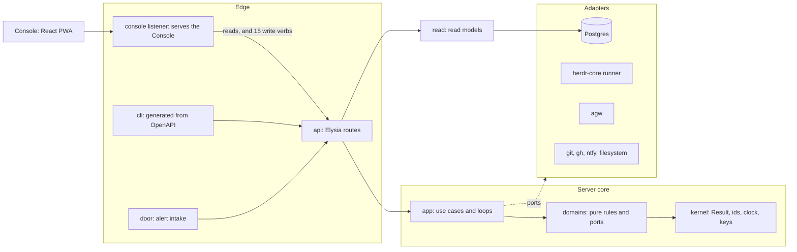

# software-factory

**A closed loop that turns signals into verified production changes. Agents do the work, code supervises them, and one person decides only what a person must.**

This repo is one implementation of that loop: a lifecycle server on Bun and Postgres. One developer built it and runs it, on one always-on machine against a few Claude Code subscriptions. It builds itself; its changes go through its own Issues.

This page explains the design pattern by pattern, each with its rule, the reason for it and the code that holds it.

It is a reference, not a product. Every factory is set up for its place. Read it, fork it, take the parts you want ([MIT](LICENSE)).

**The guide** tells the same story chapter by chapter with one Issue followed through all of them: [software-factory.jkrumm.com](https://software-factory.jkrumm.com), or [`docs/guide/`](docs/guide/README.md) on GitHub.

## Contents

- [The problem](#the-problem)
- [The idea](#the-idea)
- [The result](#the-result)
- [What it costs](#what-it-costs)
- [The language](#the-language)
- [One Issue's life](#one-issues-life)
- [The patterns](#the-patterns)
  - [Everything enters as a signal](#everything-enters-as-a-signal)
  - [Facts are stored, state is derived](#facts-are-stored-state-is-derived)
  - [The transition table is total](#the-transition-table-is-total)
  - [A wait names its exit](#a-wait-names-its-exit)
  - [Admission is a decision with numbers](#admission-is-a-decision-with-numbers)
  - [One Issue, one lead](#one-issue-one-lead)
  - [Gates are code](#gates-are-code)
  - [Ship means land and deploy, and a watch ends it](#ship-means-land-and-deploy-and-a-watch-ends-it)
  - [Deterministic first, then a workflow, then the owner](#deterministic-first-then-a-workflow-then-the-owner)
  - [Claim, commit, call, record](#claim-commit-call-record)
  - [Every effect has a key](#every-effect-has-a-key)
  - [A caller is its token](#a-caller-is-its-token)
  - [Hooks never speak](#hooks-never-speak)
  - [The factory files against itself](#the-factory-files-against-itself)
  - [The build holds the words](#the-build-holds-the-words)
- [Where it falls short](#where-it-falls-short)
- [Architecture](#architecture)
- [The Console](#the-console)
- [Layout](#layout)
- [Run it](#run-it)
- [Read next](#read-next)

## The problem

A coding agent writes a change faster than a person can supervise it. Put a person at the spec, at every question and at the merge, and the person is the queue: ten agents wait on one inbox. Take the person out without replacing what they did, and nothing checks the work.

The scarce resource is the owner's attention. A factory is the machinery that spends none of it on what a machine can settle, and knows exactly what it cannot settle.

## The idea

**Dark for code, lit for decisions.**

- **Dark for code.** No person reviews a change before production. The lead's own review, gates, a watch window and probes do that job. [Warp](https://www.warp.dev) keeps a person at spec, question and merge and calls dark factories "not realistic right now"; this repo exists to show how far past that one person can go.
- **Lit for decisions.** What reaches the owner is product direction, spend, irreversible data loss, other people, security policy, rare big architecture and taste. The factory settles everything else, and counts a touch it should have avoided as friction.


1. **Everything enters as a signal:** a failing monitor, an alert, a GitHub issue, a voice note, a finding of the factory itself. Triage decides what it becomes.
2. **Capacity admits it.** Subscriptions, their 5-hour and weekly windows, memory, load and per-repo claims decide when a lead may start.
3. **One lead per Issue.** A lead is an interactive Claude Code session in a terminal. It owns the Issue from root cause through build, its own review, ship and verification.
4. **Ship means land and deploy,** and a watch window checks the change in production.
5. **Checkpoints are rare.** A lead that needs a person raises a Decision, a Spec or an Errand. Most are settled before a person sees them, and none is a merge.

The server itself never calls a model. Every judgment goes deterministic code first, then an [agent-workflows](https://github.com/jkrumm/agent-workflows) workflow, then the owner. Every change to a repo is made by Claude Code.

## The result

The 7 days from 2026-11-13 09:38 UTC to 2026-11-20 09:38 UTC, all projects, from `factory read kpis` and `factory read friction`:

| What | Count |
|-|-|
| Issues filed | 1,545, of which the factory's own loops filed 282 |
| Issues closed | 1,604, or 229 a day |
| Median time from filed to closed | 85 minutes |
| First verifications that passed | 1,290 of 1,338 (96.4 %; the target is 90 %) |
| Decisions leads raised | 58: the Judge settled 45, a default 7, the owner 5, his delegate 1 |
| Specs, Concepts and Reports the owner judged | 95 |
| Errands that reached the owner's hands | 77 |
| Times the owner stepped in where the factory should have settled it | 58, mostly notes to a lead (0.038 per Issue; the target is at most 0.07) |

No person read a diff. What the owner did that week: judge 95 handed-over pages, answer 5 questions, and do 77 things only hands can do, such as a biometric prompt.

## What it costs

- **One always-on machine,** a Postgres database, a terminal multiplexer for the leads ([herdr-core](integrations/README.md)) and the workflow runner (agw).
- **Claude Code subscriptions.** The factory fills their windows; in the week above the accounts stood at 97 % of their weekly quota at reset.
- **A contract per repo.** A `project.yaml` names how the repo checks itself, deploys and proves it is live (`make check`, a deploy command, `make verify`). A repo that cannot prove a change by a command cannot be dark.
- **Discipline about what the owner is asked.** Every ask is counted, and a recurring one becomes a rule.

Do not build this:

- for work a command cannot verify,
- for a team whose process requires a person's review,
- to save effort this month. The first weeks go into the factory, not into the products.

## The language

One word per thing, in code, CLI, events, screens and docs. A retired word in the source fails the build. The full table, with what each word retires, is [`docs/language.md`](docs/language.md).

| Word | Means |
|-|-|
| **Signal** | Anything that arrives and may become work, with a kind, an origin and a trust level |
| **Issue** | One unit of work: one repo, one branch, one ship |
| **State** | `settling`, `queued`, `working`, `waiting`, `watching`, `closed`. Only an event moves it. Screens say Running, Paused, Ready, Held, Checking and Planned instead |
| **Event** | A fact recorded on an Issue. **24 kinds**, among them `filed`, `admitted`, `shipped`, `watch_passed` |
| **Lead / Attempt** | The Claude Code session that owns an Issue, and its *n*th try |
| **Gate** | A machine check a lead cannot talk past |
| **Watch / Verify** | The window after a ship, and the check that ends it |
| **Wait / Stall** | A pause with a named exit, and a wait whose cause is a machine's to end |
| **Checkpoint** | Where the factory stops for a person: a Decision, a Concept or Spec, an Errand. Never a merge |
| **Judge** | The workflow that tries to settle a Decision before the owner sees it |
| **Steward** | The loop over stalled Issues: wake, re-check, requeue, deliver; it asks a workflow only when the rules run out |
| **Touch / Friction** | The owner acting on an Issue, and any counted waste, such as a touch the factory should have settled |

The screen words are not a rename of the states. Ready and Held split the Issues no lead has begun by whether anything but capacity keeps them out, and Planned is a plan row that is not an Issue yet ([Where work stands](docs/language.md#where-work-stands)).


## One Issue's life

`factory issue show issue_1809`, 2026-11-17, repo `software-factory`, times in UTC. The factory's own selfwatch loop filed it.

| Time | Event | What happened |
|-|-|-|
| 01:03:01 | `filed` | The loop's signal became an Issue |
| 01:03:07 | `settled` | Triage was done six seconds later |
| 02:13:33 | `admitted` | 1 h 10 min in the queue, then capacity let a lead start |
| 02:14:28 | `lead_started` | `lead-1809-1`, on sonnet at high effort |
| 03:04:20 | `shipped` | 3 commits, the review covered them, 3 acceptance lines; the watch began |
| 03:11:00 | `watch_passed` | CI green, all 4 checks passed; the Issue closed `done` |

Two hours and eight minutes from filed to closed, 12.7 minutes of lead working time over 8 turns, one attempt, 2.19 dollars. No Decision, no Errand, no note.

The lead stated one acceptance line met and two not met, each with its reason. The Issue still closed `done`: the watch judges that the change is live and production is green, and the acceptance lines are recorded as the lead stated them, never judged. What the change could not prove stays on the record.

The guide follows this Issue through five chapters, starting at [Issues](docs/guide/issues.md).

## The patterns

Fifteen patterns, in the order an Issue meets them. Where a check holds a pattern, not a convention, "Held by" names the check.

| If you want | Read |
|-|-|
| the model | signals, stored facts, the total table, waits |
| how work runs | admission, one lead, gates, ship and watch |
| who decides | deterministic first, then a workflow, then the owner |
| what keeps it safe to replay | claim-commit-call-record, keys, tokens, hooks |
| how it stays true | the loops, the build that holds the words |

### Everything enters as a signal

A signal is anything that may become work. An alert from a monitor is one, and so is a GitHub issue, a piece of app feedback, the owner's words, a lead's follow-up or a finding of the factory's own loops. Nobody files around the state machine.

- A signal carries a **kind**, an **origin** and a **trust level**. Text from outside is held until a screen or the owner lets it through.
- Triage has **five outcomes**: a new Issue, a note on an open one, part of an incident (one root cause seen through many alerts), held, or dropped.
- Rules decide first: a fingerprint over repo and title, the route registry, a correlation window. A workflow decides only where the rules are unsure.
- The alert door takes the repo from a server-side route registry, never from the payload.

**Why.** Triage folds a repeat into the Issue it repeats before a lead spends a token. Twelve alerts about one dead database become one incident with one lead.

**In the code.** [`domains/intake/rules.ts`](apps/server/src/domains/intake/rules.ts) (`fingerprintOf`), [`app/intake.ts`](apps/server/src/app/intake.ts), [`apps/door`](apps/door).
**Read more.** [Signals and Triage](docs/guide/signals.md).

### Facts are stored, state is derived

An Issue is a log of events. Its state is what its applied events made it, kept on the row only because the row's `version` guards the next write.

- `apply(issue, event)` is **pure**: the same Issue, event and time give the same answer, which is the next state and its effects, a refusal with a reason, or an ignore with a reason.
- `app/` stores the event, the new state and the effects in one transaction, then runs the effects.
- A count or a timer the event log can answer is **never a column**.
- `replay` rebuilds an Issue from its stored transitions and decides nothing new.

```ts
export function apply(issue: Issue, event: AnyIssueEvent, ctx: { now: Date }): Decided {
  const refusal = senderRefusal(event)
  if (refusal) return { result: 'refused', detail: refusal }
  if (event.kind === 'filed') return { result: 'ignored', detail: 'it is filed already' }
  const run = TABLE[issue.state][event.kind] as (ctx: Ctx) => Cell
  const cell = run({ issue, event, now: ctx.now })
  if ('refuse' in cell) return { result: 'refused', detail: cell.refuse }
  if ('ignore' in cell) return { result: 'ignored', detail: cell.ignore }
  // … the transition, the evolved Issue and the cell's effects
}
```

**Why.** Twenty leads, twenty loops and the owner write to the same Issues. A stored event stays what it was; a derived column has to be kept right by every writer. Every question about an Issue ("why did it wait?", "who answered?") is a read of its log.

**In the code.** [`domains/work/machine.ts`](apps/server/src/domains/work/machine.ts) (`apply`, `replay`), [`domains/work/events.ts`](apps/server/src/domains/work/events.ts) (`PAYLOADS`, and `SENDERS`: who may send which event).
**Held by.** The optimistic `version` guard on every write; no XState, no workflow engine.
**Read more.** [Issues](docs/guide/issues.md).

### The transition table is total

Every `(state, event)` pair has a cell, and a cell is one of three things: a move, a refusal with its reason, or an ignore with its reason.

```ts
export type Cell =
  | { to: 'waiting'; wait?: WaitSpec; update?: WaitSpec; effects: Effect[] }
  | { to: 'closed'; outcome: Outcome; effects: Effect[] }
  | { to: 'settling' | 'queued' | 'working' | 'watching'; effects: Effect[] }
  | { refuse: string }
  | { ignore: string }

/** The total table: every state takes every event. A missing cell fails `tsc`. */
export type Table = { [S in State]: { [E in EventKind]: (ctx: Ctx<E>) => Cell } }
```

- A new state or a new event **fills every cell** before the build passes: 6 states by 24 events.
- A refusal is an answer the caller reads, so it says why: `admitted` on a settling Issue answers "triage is not done: it is not queued".
- The state diagram in the docs is **generated from the table**; a stale diagram fails the build.

**Why.** The bugs of a lifecycle server live in the pairs nobody thought about: a ship that arrives after a cancel, an answer to a Decision that a default already settled. A total table turns a pair nobody wrote a cell for into a compile error.

**In the code.** [`domains/work/table.ts`](apps/server/src/domains/work/table.ts) (`TABLE`), [`domains/work/diagram.ts`](apps/server/src/domains/work/diagram.ts).
**Held by.** `tsc`; a seeded model test that plays random event sequences; `make check` regenerates the diagram.
**Read more.** [The Issue, as the code has it](docs/language.md#the-issue-as-the-code-has-it).

### A wait names its exit

A waiting Issue always says why it waits and what ends the wait. A **stall** is a wait whose cause is a machine's to end, and the steward ends it.

| Wait | Ends when | Exit |
|-|-|-|
| timer | the clock reaches the time the lead deferred to | machine |
| dependency | every Issue it is after has closed | machine |
| external | the pull request it waits on is approved, commented, merged or closed | machine |
| wall | the account's window opens again | machine, a stall |
| unreported | the lead's next turn, or the steward | machine, a stall |
| blocked | the steward re-checks the cause | machine, a stall |
| lead gone | the steward starts a new attempt | machine, a stall |
| regressed | the steward wakes it, or turns it into a Decision | machine, a stall |
| decision | the question is answered | person |
| review | the verdict on the Concept or Spec is given | person |
| errand | the hands' work is done, or turned back with a note | person |

**Why.** "Stuck" is not a state. If the exit is a machine's, a loop owns it and a person never hears of it. If the exit is a person's, it is on one screen with what it holds back.

**In the code.** [`domains/work/issue.ts`](apps/server/src/domains/work/issue.ts) (`WAITS`).
**Read more.** [Where work stands](docs/language.md#where-work-stands).

### Admission is a decision with numbers

A queued Issue does not "wait for capacity". A rule keeps it out, the first rule that says no names itself, and the answer carries its numbers.

```ts
export const REFUSALS = [
  'drain', 'doctor', 'boot', 'load', 'memory', 'disk', 'tests', 'lane', 'claim', 'window', 'cap',
] as const
```

- Admission is **decided again at every claim**, from measured samples: the accounts' 5-hour and weekly windows, the host's memory and load, the repo's claims and lanes, the test slots.
- `factory queue order` prints every queued Issue with the one sentence that keeps it queued.
- An edge to another Issue (an `after`) holds an Issue before capacity is asked at all; a plan is rows not yet filed.

**Why.** The owner's most frequent question is "why does nothing move?". A queue that answers it in one sentence with numbers needs no person to investigate, and its answers are data the factory tunes itself from.

**In the code.** [`domains/capacity/admission.ts`](apps/server/src/domains/capacity/admission.ts), [`packages/accounts`](packages/accounts) (the picker for N subscriptions).
**Read more.** [Capacity](docs/guide/capacity.md), [Chains and Plans](docs/guide/chains.md).

### One Issue, one lead

A lead is an interactive Claude Code session in a terminal the server started. It owns one attempt of one Issue and works from a brief that is a contract.

- The lead owns the Issue **end to end**: root cause, build, its own review, landing, deploy, and stating each acceptance line met or not met.
- The factory **supervises through hooks and never redoes the work**. It reads what the session reports (a turn ended, a tool ran) and derives the session's state from those events.
- The brief is a **pure function of its input**: no clock, no randomness, and standing orders that are byte-identical for every lead. Every prompt the server types has a key, so a replayed pass types nothing twice.
- Never headless: a lead is a session a person could attach to and read.

**Why.** Splitting an Issue across a planner, a coder and a reviewer agent moves the context loss to the handoffs. One session that owns the outcome asks fewer questions and can be held to its own acceptance lines.

**In the code.** [`domains/leads/brief.ts`](apps/server/src/domains/leads/brief.ts) (`buildBrief`), [`adapters/hc`](apps/server/src/adapters/hc) (the terminals), [`apps/cli/src/hook.ts`](apps/cli/src/hook.ts).
**Read more.** [Leads](docs/guide/leads.md).

### Gates are code

What an agent is told does not change what it can do. A gate is a machine check a lead cannot talk past.

- **The ship gate** accepts a ship only when git finds its commits on the default branch. The review and the CI result are recorded as evidence, with the reason when one is missing.

  ```ts
  const refuse = (why: string): ShipVerdict => ({ accepted: false, error: `ship refused: ${why}` })
  if (input.reported.length === 0) return refuse('ship names no merged commit')
  ```

- **A review is evidence and never refuses a ship.** A gate that an agent's opinion can close is a negotiation.
- **The merge guard** refuses a branch that lacks the default branch's head, a head with no green CI run on its exact sha, and a red default branch.
- **Deploy locks fail closed.** A lock that cannot be read refuses the deploy; only a dead holder is reclaimed.

**Why.** An agent under pressure to finish will argue. The gate's inputs are facts a command produced (a merge base, a CI run, a probe), so there is nothing to argue with.

**In the code.** [`domains/quality/gate.ts`](apps/server/src/domains/quality/gate.ts) (`judgeShip`, pure), [`scripts/merge-guard.ts`](scripts/merge-guard.ts), [`apps/cli/src/deploy-lock.ts`](apps/cli/src/deploy-lock.ts).
**Read more.** [Gates](docs/guide/gates.md).

### Ship means land and deploy, and a watch ends it

A ship is not a pull request. It is merged commits on the default branch and a deploy. After it the Issue is `watching`: the project's verify and its probes answer, and only `watch_passed` closes the Issue as done.

- A watch is **pass or fail, never averaged**.
- A regression goes **back to the same lead** as a note with what failed.
- **Fix forward:** a bad change gets a new change, not a revert by reflex.

**Why.** "Merged" proves that a diff was accepted. "Live and green in production" proves that the change runs and broke nothing a probe sees. In the week above 48 first watches caught a change that was merged and wrong: red CI on the default branch, a red verify, a deploy that lacked the commit.

**In the code.** [`domains/quality/watch.ts`](apps/server/src/domains/quality/watch.ts), [`app/quality-watch.ts`](apps/server/src/app/quality-watch.ts).
**Read more.** [Gates](docs/guide/gates.md).

### Deterministic first, then a workflow, then the owner

Every judgment has three tiers, in this order, and the server holds no model SDK.

| Loop | Code decides | A workflow decides | The owner decides |
|-|-|-|-|
| Triage | fingerprint, routes, correlation window | kind, origin, amend or new | whether held outside text becomes work |
| Steward | wake, re-check, requeue, deliver, break a claim deadlock | what a stalled Issue needs when the rules do not say | nothing, unless it becomes a Decision |
| Judge | standing policy, precedent lookup, the lead's declared default | whether a Decision is the owner's at all | product direction, spend, data loss, other people, security policy, taste |

- A lead that needs a person raises a **checkpoint**: a **Decision** (a question with options and its own recommendation), a **Concept or Spec** (one page before it builds a new surface), or an **Errand** (something only the owner's hands can do).
- A Decision passes the steps the code names and stops at the first that settles it:

  ```ts
  export const STEPS = ['policy', 'judge', 'default', 'owner'] as const
  ```

- A Spec first goes to the Spec screen, a workflow that gives the factory's own `looks_good` to a Spec that is not the owner's to read. Without a verdict in 24 hours the lead goes on with the defaults it named.
- A workflow is called through a port with an idempotency key and an idle watchdog, never a wall-clock limit.

**Why.** A rule is free, instant and testable. A model call is cheap and wrong sometimes. The owner is neither cheap nor always there. Spending them in that order is the whole economy of the factory: of 58 Decisions in the week above, 5 reached him.

**In the code.** [`domains/checkpoints/decision.ts`](apps/server/src/domains/checkpoints/decision.ts) (`STEPS`), [`adapters/agw`](apps/server/src/adapters/agw), [`app/loops`](apps/server/src/app/loops).
**Read more.** [Checkpoints](docs/guide/checkpoints.md), [Loops](docs/guide/loops.md).

### Claim, commit, call, record

A port is never called inside a transaction. A pass claims a row and commits, calls the port, and records the outcome in a new transaction.

- Every port call has a **process timeout** and returns a `Result`.
- `git`, the terminal runner and `make verify` **never run while a row is locked**.
- Three files may open a transaction: the unit of work, the migration runner and the read models' bounded read.

**Why.** A shell command that hangs inside a transaction holds locks for as long as it hangs, and with twenty leads that is the whole queue. A claim that is committed first can be retaken when the process dies between the call and the record.

**In the code.** [`adapters/postgres/unit-of-work.ts`](apps/server/src/adapters/postgres/unit-of-work.ts).
**Held by.** [`scripts/boundaries.ts`](scripts/boundaries.ts), which reads the import graph and the SQL in `make check`.

### Every effect has a key

Terminal labels, prompt ids, comment markers, signal fingerprints: every effect the factory has on the world is named by a deterministic key, and the runner looks before it acts.

```ts
/** The one way to build a key: its parts joined by `:`. A part is a non-empty string or a whole number. */
export function key(...parts: readonly (string | number)[]): Key
```

**Why.** Claim, commit, call, record means a pass can die after the call and before the record. The next pass repeats the call. With a key, the repeat finds the terminal that already runs, the prompt that was already typed, the comment that is already posted, and does nothing.

**In the code.** [`kernel/keys.ts`](apps/server/src/kernel/keys.ts).

### A caller is its token

Who may call what is one table. A caller is decided by its bearer token alone, and a route with no row is refused for everyone.

- Tokens decide the caller (`owner`, `orchestrator`, `agent`, `machine`, `signal`, `read`).
- A lead's session holds the agent token: it can ship, ask and file a signal on its own Issue. It cannot file an Issue or cancel one, and on its own Decision it can only take the default it declared.
- The API binds to loopback. The Console listener is a second loopback port that holds the owner's token on the server. Beside the reads it forwards fifteen write verbs and nothing else; it can never start a session.

```ts
export const POLICY: readonly Rule[] = [
  rule('GET', '/health', 'public'),
  rule('POST', '/signals/alerts', DOOR),
  rule('POST', '/v1/issues/:id/close', LEAD),
  // … one row per route; a route with none is 403 for everyone
]
```

**Why.** The owner's token can start an agent with full permissions on the machine. Fail-closed by table means a new route is shut until someone decides who may call it.

**In the code.** [`api/policy.ts`](apps/server/src/api/policy.ts) (`POLICY`), [`api/console.ts`](apps/server/src/api/console.ts).
**Held by.** A test that walks the OpenAPI document and fails on a route without a row.

### Hooks never speak

The factory hears a lead through Claude Code hooks. A hook appends to a spool first, then posts to a unix socket, and exits 0 whatever happens. The one exception is a Stop the server sends back, which exits 2.

- A hook's **stdout stays empty**, because Claude Code injects a hook's stdout into the session: a chatty hook is the factory talking into its own agent's context. One event prints one line on purpose: after a compaction, a lead's session start tells it what to read again.
- The server reads the spool on every pass, so an event the socket missed is not lost.
- A hook does nothing in a session the factory did not start.

**Why.** Supervision must not change what it supervises, and it must not be able to break it: a hook that fails the session turns an observability bug into lost work.

**In the code.** [`apps/cli/src/hook.ts`](apps/cli/src/hook.ts), which imports `node:fs` and the spool contract and nothing else; [`integrations/claude-code`](integrations/claude-code).

### The factory files against itself

Loops beside the main path watch the factory and file what they find as signals, through the same triage as everything else.

- **Friction** counts waste over a window (refusals, stalls, lost leads, owner touches) and files the pattern that repeats.
- **Hygiene** runs probes over every project (the repo's own check, advisories, dead code, stale documents, broken links) and files what is red.
- **Selfwatch** and **throughput** watch the host and the queue: a loop that stopped, a process that grows, a step that outgrew its budget.
- A finding class that is mostly dropped or cancelled **stops filing** until it is asked again.

**Why.** A factory that closes 200 Issues a day drifts faster than a person can notice. The counted waste is the backlog of the factory's own improvement.

**In the code.** [`app/loops`](apps/server/src/app/loops), [`packages/contract/src/hygiene-catalogue.ts`](packages/contract/src/hygiene-catalogue.ts).
**Read more.** [Loops](docs/guide/loops.md), [Learnings](docs/guide/learnings.md).

### The build holds the words

Documentation that a build does not check is a second system that drifts from the first.

| Claim | Held by |
|-|-|
| One word per thing; a retired word fails the build | [`scripts/retired-words.ts`](scripts/retired-words.ts) |
| A stored state word never appears on a screen | [`scripts/vocabulary.ts`](scripts/vocabulary.ts) |
| This README's counts and lists are the code's | [`scripts/readme-check.ts`](scripts/readme-check.ts) (`make docs-check`) |
| No private data in a public repo | [`scripts/public-scan.ts`](scripts/public-scan.ts) |
| Domains do no I/O; `read/` writes nothing | [`scripts/boundaries.ts`](scripts/boundaries.ts) |
| The CLI is the API | generated from the OpenAPI document; a stale file fails `make check` |

## Where it falls short

An audit of 2026-11-20 ([`docs/research/2026-11-maturation`](docs/research/2026-11-maturation/README.md)) found the core sound and four weaknesses around it. They are the open rows of [`docs/plan.yaml`](docs/plan.yaml).

- **It measures more than it acts on.** 28 KPIs, 5 with a target, and no code acts on one; the friction loop has thresholds of its own.
- **Most loops do not check their own effect.** They file 18 % of all Issues, and only throughput looks again after the ship to see whether its number moved.
- **A lead pays for what the server knows.** The gate refused 101 ships that week, about 70 for a commit sha typed by hand.
- **The reference documents are too long.** `docs/architecture.md` is 200 KB; this page and the guide are the way in.

## Architecture

**A modular monolith on Bun:** TypeScript and zod, Postgres as the store (the bodies of artifact revisions are files beside it), domains with no I/O behind ports, Elysia at the edge, a generated CLI. One process, one schema, one contract. The reasons are in [`docs/decisions.md`](docs/decisions.md).



Eight domains, each owning its tables. A domain imports only the kernel and itself. When one needs another, `app/` coordinates them in one transaction.

| Domain | Owns |
|-|-|
| `intake` | the signal envelope, trust, fingerprints, correlation into incidents, amend-or-new |
| `planning` | plans, the chain (dependencies across repos), queue order |
| `capacity` | accounts, windows, memory, load, repo claims, test slots |
| `work` | the Issue: a total state machine and its events |
| `leads` | attempts, briefs, notes, session state derived from hook events |
| `quality` | gates, evidence, watch, verify |
| `checkpoints` | Decisions, artifacts and revisions, annotations, verdicts, Errands |
| `loops` | the steward's stall rules, settling a Decision, the self-improvement loops, the ports to the workflows |

**One process.** A session-level Postgres advisory lock is taken first; a second copy waits, then exits. **One contract.** Request, response and event shapes are zod schemas in `packages/contract`; the server builds every body through its schema and the CLI parses with the same one. **One schema** in the database, with migrations that expand, then contract, and are never edited once applied.

What is where, mechanism by mechanism: [`docs/architecture.md`](docs/architecture.md).

## The Console

The Console is the owner's window: a React PWA the server itself serves. Every screenshot shows the seeded demo data of the end-to-end suite (`make e2e`) at 1800 by 1200, not the owner's real projects.

**Needs you** lists what waits on the owner and nothing else: a Decision with the lead's recommendation, a Spec to judge, an Errand that only hands can do.


**Overview** is home: what needs the owner, whether production is red, what shipped in the last day and why the queue does not move, then the numbers and their charts.


**Chain** shows what waits on what, across repos.


**Projects** has one page per project: what moves now, what is next and what shipped, then Work, Plan, Shipped, Hygiene and Setup. **Artifacts** holds the Concepts, Specs and Reports leads hand over, with revisions and the owner's annotations. An **Issue** page reads one Issue end to end, from signal to verify.


**Improve** holds the KPIs against their targets in 7-day windows. **Throughput** shows where the host's memory and the leads' hours go. **Accounts** answers, per Claude Code subscription, whether it will be full at its reset, and sets a mode with its expiry.

More screens: [a project page](docs/demo/project.png), [an artifact](docs/demo/artifact.png), [Throughput](docs/demo/throughput.png), and the same on a phone ([Needs you](docs/demo/phone-needs-you.png), [Overview](docs/demo/phone-overview.png)).

## Layout

| Path | What |
|-|-|
| `apps/server` | the server: API, Console listener, domains, use cases, loops, adapters, read models, migrations |
| `apps/cli` | the `factory` CLI, generated from the server's OpenAPI document plus hand-written hook and slot verbs |
| `apps/door` | the alert door: alerts from monitors become signals |
| `apps/console` | the Console, a React PWA: Overview, Needs you, Chain, Projects, Artifacts, Improve, Throughput and Accounts, and a page per Issue |
| `packages/contract` | zod schemas for every request, response and event; the source of the OpenAPI document |
| `packages/client` | the typed client shared by the CLI and the door |
| `packages/accounts` | the picker for N Claude Code subscriptions and the `claude-account` CLI; independent of the server |
| `tests/scenarios` | use cases run end to end against a real server and Postgres with fake runner and agw: the acceptance suite |
| `tests/e2e` | Playwright against a seeded server: every Console screen, and the source of the demo screenshots |
| `integrations/` | the client pieces other machines install: the Claude Code hooks, a Herdr mod, `rd`, a Hermes skill |
| `scripts/`, `deploy/` | release-directory deploy, verify, launchers, and the checks of the build |
| `docs/` | the guide, product, language, architecture, operations, decisions |

## Run it

You need [Bun](https://bun.sh) and a PostgreSQL install (`initdb`, `pg_ctl` on `PATH`, or `PG_BIN_DIR` set). The tests start a throwaway cluster of their own and touch nothing else.

```sh
bun install
make check   # the whole gate: format, lint, types, boundaries, README, generated files, tests, scenarios, Console build and Playwright
make test    # the unit tests and the scenarios only
```

The scenarios run the use cases against a real server and Postgres, with a fake runner and a fake agw, so a green run covers intake, queueing, leads, shipping and checkpoints.

To run the server you provide a Postgres database (it keeps everything in the schema `factory` and applies its migrations at start), a port, and the owner's bearer token (16 characters or more). Every other caller gets its own optional token, and a caller without one does not exist: `FACTORY_AGENT_TOKEN` (a lead's session), `FACTORY_ORCHESTRATOR_TOKEN`, `FACTORY_DOOR_TOKEN`, `FACTORY_SIGNAL_TOKEN` (the narrow caller that files the owner's words) and `FACTORY_READ_TOKEN`.

```sh
bun run --cwd apps/console build
DATABASE_URL=postgres://… PORT=7793 FACTORY_TOKEN='<owner-token>' bun apps/server/src/main.ts
```

With the Console built, the server also listens for it on `127.0.0.1`. The port is `FACTORY_CONSOLE_PORT`, default 7795, so the Console is at `http://127.0.0.1:7795`.

Past that you wire it to your own machine: Claude Code subscriptions, herdr-core for the lead terminals, agw for the workflows, and a `project.yaml` per repo. The shipped launchers (`scripts/launch.sh`, `deploy/`) show one wiring for macOS and LaunchAgents; they resolve secrets through a secrets shim and are not meant to be copied unchanged. [Running a Factory](docs/guide/running.md) walks through it.

To refresh the demo screenshots: `make e2e`, then copy the `desktop-xl-dark-*` files you need from `tests/e2e/out/screenshots` into `docs/demo`.

## Read next

- [The guide](docs/guide/README.md): the story, chapter by chapter, with one Issue followed through.
- [`docs/product.md`](docs/product.md): what it is, for whom, and how we know it works.
- [`docs/language.md`](docs/language.md): every word, and what it retires.
- [`docs/architecture.md`](docs/architecture.md) and [`docs/decisions.md`](docs/decisions.md): what is where, and why.
- [`AGENTS.md`](AGENTS.md): the rules a contributing agent follows.

## Licence

[MIT](LICENSE). The factory is one owner's setup, published as a reference, with no promise of support.
