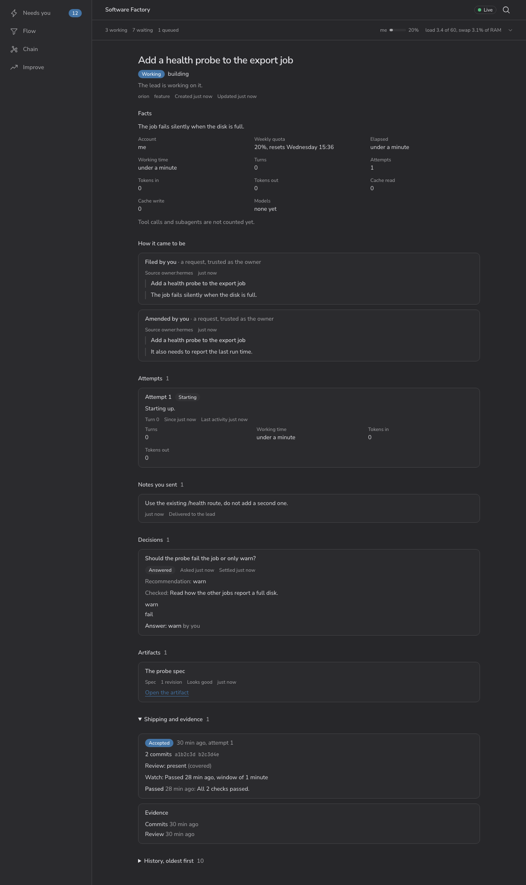
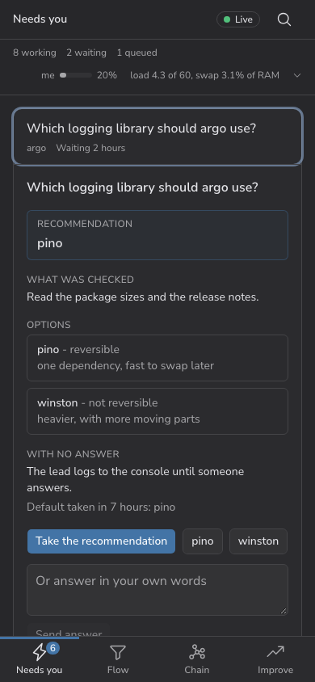
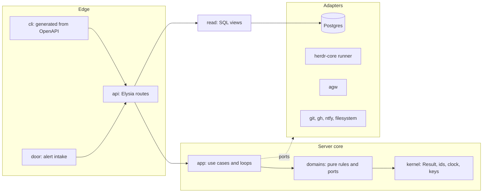

# software-factory

**A closed loop that turns signals into verified production changes. Agents do the work, code supervises them, and
one person decides only what a person must.**

This repo is one implementation: a lifecycle server on Bun and Postgres, built and run by one developer on one
always-on machine against a few Claude Code subscriptions. It is a reference for people building a factory of their
own, and it builds itself: its changes go through its own Issues. It is not a product. Every factory is set up for its
place; this one shows the language, the patterns and how far the automation reaches.

MIT licensed. Read it, fork it, take the parts you want.

## Position

**Dark for code, lit for decisions.**

- **Dark for code.** No person reviews a change before production. The lead's own review, gates, a watch window and
  probes do that job. [Warp](https://www.warp.dev) keeps a person at spec, question and merge and calls dark
  factories "not realistic right now"; this repo exists to show how far past that one person can go.
- **Lit for decisions.** What reaches the owner is product direction, spend, irreversible data loss, other people,
  security policy, rare big architecture and taste. Everything else the factory settles, and an avoidable touch is
  counted as friction.

## How it works

```
signal ──▶ triage ──▶ Issue ──▶ queue ──▶ lead ──▶ ship ──▶ watch ──▶ verify ──▶ closed
 alert      filed      one repo   capacity   one Claude    land and     window     make verify
 request    amended    one branch windows,   Code session  deploy       after the  and probes
 feedback   incident   one ship   claims     owns it                    ship
            held
            dropped
```

1. **Everything enters as a signal:** a failing monitor, an alert, a GitHub issue, a voice note. Triage decides what it
   becomes: a new Issue, an amendment to an open one, part of an incident (one root cause seen through many alerts),
   held, or dropped. Nobody files around the state machine.
2. **Capacity admits it.** Subscriptions, 5-hour and weekly windows, memory, load and per-repo claims decide when a
   lead may start. A queued Issue always says why it is queued, in one sentence with its numbers.
3. **One lead per Issue.** The lead is an interactive Claude Code session in a herdr-core
   terminal. It owns the Issue from root cause through build, its own review, ship and verification in production.
   The factory supervises it through hooks and never redoes its work.
4. **Ship means land and deploy.** After it, a watch window opens and Verify (`make verify` and probes) ends it. A
   failure goes back to the lead as a note. Fix forward: a bad change gets a new change.
5. **Checkpoints are rare.** A lead raises a Decision, hands over a Concept or Spec, or asks for an Errand (something
   only the owner's hands can do). A Decision passes standing policy, then the Judge, then a default, and only then the
   owner.

The factory itself never calls a model. Every judgment goes **deterministic code first, then an
[agent-workflows](https://github.com/jkrumm/agent-workflows) workflow, then the owner**, and every change to a repo
is made by Claude Code.

## See it

One Issue, signal to verify, as the Console shows it. The data is a seeded demo (`make e2e`), not a real estate.



| Screen | Question it answers |
|-|-|
| **Needs you** | What waits on the owner, and nothing else |
| **Flow** | Every Issue by state, across projects |
| **Issue** | One Issue end to end, the event log in plain words |
| **Chain** | What waits on what, across repos |
| **Improve** | The factory's KPIs against their targets, in 7-day windows |



The Console is a React PWA served by the factory's own server. It holds no logic the API could hold, and its listener
forwards five owner answers and otherwise only reads (see [Gates are code](#gates-are-code)).

## The language

One word per thing, in code, CLI, events, screens and docs. A retired word in the source fails `make check`.
The full table, with what each word retires, is [`docs/language.md`](docs/language.md).

| Word | Means |
|-|-|
| **Signal** | Anything that arrives and may become work, with a kind, an origin and a trust level |
| **Issue** | One unit of work: one repo, one branch, one ship |
| **State** | `settling`, `queued`, `working`, `waiting`, `watching`, `closed`. Only an event moves it |
| **Event** | A fact recorded on an Issue. 21 kinds, among them `filed`, `admitted`, `shipped`, `watch_passed` |
| **Lead / Attempt** | The Claude Code session that owns an Issue, and its *n*th try |
| **Steward** | The loop over stalled Issues: wake, re-check, requeue, deliver, break a claim deadlock; asks a workflow only when the rules run out |
| **Judge** | The workflow that tries to settle a Decision before the owner sees it |
| **Gate** | A machine check a lead cannot talk past |
| **Watch / Verify** | The window after a ship, and the check that ends it |
| **Wait / Stall** | A pause with a named exit, and a wait whose cause is a machine's to end |
| **Checkpoint** | Where the factory stops for a person once policy, the Judge and a default have had their turn: Decision, Concept or Spec, Errand. Never a merge |
| **Touch / Friction** | The owner acting on an Issue, and any counted waste, such as a touch the factory should have settled |

## What it proves

Patterns a factory needs, each one held by a check and not by a convention:

| Pattern | Held by |
|-|-|
| **The state machine is a total table.** A new state or event must fill every cell | `tsc`; a seeded model test plays random event sequences |
| **Facts are stored, state is derived.** No count or timer that the event log can answer is a column | the optimistic `version` guard; `make check` regenerates the state diagram |
| **Claim, commit, call, record.** A port is never called inside a transaction | `scripts/boundaries.ts`; only `unit-of-work.ts` and `migrate.ts` open one |
| **Every effect has a deterministic key.** A replayed pass spawns, prompts and posts nothing twice | `kernel/keys.ts`; the runner looks before it acts |
| **Deterministic first, then a workflow, then the owner.** The server never calls a model | no model SDK in the tree; judgment goes through one port per loop |
| **A caller is its token.** A route with no policy row is refused for everyone | `api/policy.ts` and the test that fails without a row |
| **Hooks never speak.** Claude Code injects a hook's stdout into the session | the hook imports two modules and prints nothing |
| **One word per thing.** A retired word fails the build | `scripts/retired-words.ts` |
| **No private data in a public repo** | `scripts/public-scan.ts` (hosts, addresses, accounts, secrets, work repos) |

## Architecture

**A modular monolith on Bun:** TypeScript and zod, Postgres as the only store, domains with no I/O behind ports,
Elysia at the edge, a generated CLI. One process, one schema (`factory`), one contract. Rationale for each choice is
in [`docs/architecture.md`](docs/architecture.md) and [`docs/decisions.md`](docs/decisions.md).



### Domains

Eight domains, each owning its tables. A domain imports only the kernel and itself. When one needs another, `app/`
coordinates them in one transaction.

| Domain | Owns |
|-|-|
| `intake` | the signal envelope, trust, fingerprints, correlation into incidents, amend-or-new |
| `planning` | plans, the chain (dependencies across repos), queue order |
| `capacity` | accounts, windows, memory, load, repo claims, test slots |
| `work` | the Issue: a total state machine and its events |
| `leads` | attempts, briefs, notes, session state derived from hook events |
| `quality` | gates, evidence, watch, verify; a review is evidence and never refuses a ship |
| `checkpoints` | Decisions, artifacts and revisions, annotations, verdicts, Errands, the ledger |
| `loops` | the steward's stall rules, settling a Decision, the ports to the workflows |

### Rules, enforced

`scripts/boundaries.ts` reads the import graph in `make check` and fails on a violation:

- **`domains/` is pure.** No Elysia, no SQL client, no `node:fs`, no `Bun.*` I/O.
- **Ports are interfaces in the domain; adapters implement them.** Tests use fakes of the same interface, not mocks
  of the implementation.
- **Only `app/` opens a transaction, and a port is never called inside one.** The pattern is claim, commit, call,
  record. A replayed tick acts on what the first one stored.
- **Every port returns `Result<T, PortError>`.** Only a programming error throws.
- **`read/` is read-only.** Cross-domain SQL lives there and nowhere else.
- **Every effect has a deterministic key** (terminal names, prompt ids, comment markers), so a replay never spawns,
  prompts or posts twice.

### The Issue machine

Facts are stored, state is derived. The event log is the truth; an Issue's state is what its latest event made it.
The machine is a **total table**: every `(state, event)` cell is written down as a move, a refusal with a reason, or
an ignore with a reason, and a missing cell fails `tsc`.

```ts
type Cell =
  | { to: State; reason?: WaitReason; effects: Effect[] }
  | { refuse: string }
  | { ignore: string }
const TABLE: { [S in State]: { [E in EventKind]: (ctx: Ctx) => Cell } } = {
  /* every cell */
}
```

`apply(state, event)` is pure. `app/` stores the event, the new state (`UPDATE … WHERE id = $1 AND version = $2`) and
its effects in an outbox in one transaction, then runs the effects. A seeded model test plays random event sequences
and checks that a machine wait always has an exit that needs no person. The state diagram in
[`docs/language.md`](docs/language.md#the-issue-as-the-code-has-it) is generated from `TABLE`, and `make check`
fails when it is stale. No XState, no workflow engine.

### Loops and agw

A loop is a tick with a trigger and a budget. Its deterministic part runs in the server; its judgment is a dedicated
agw workflow with its own prompt and tools, called through a port with a hang guard.

| Loop | Deterministic | Workflow decides |
|-|-|-|
| Steward | wake, re-check, requeue, deliver, break a claim deadlock | what a stalled Issue needs when the rules do not say |
| Judge | standing policy, precedent lookup | whether a Decision needs the owner |
| Triage | fingerprint, routes, correlation window | kind, origin, amend-or-new |

### Gates are code

What an agent is told does not change what it can do. Tokens decide the caller (`owner`, `orchestrator`, `agent`, `machine`, `read`).
The API listens on loopback only. A hook appends to a spool first, then posts to a unix socket, and exits 0 whatever
happens. Its stdout stays empty, because Claude Code injects a hook's stdout into the session. The alert door holds no factory
token and takes the repo from a server-side route registry, never from the payload.

## Layout

| Path | What |
|-|-|
| `apps/server` | the server: API, domains, use cases, loops, adapters, read models, migrations |
| `apps/cli` | the `factory` CLI, generated from the server's OpenAPI document plus hand-written hook and slot verbs |
| `apps/door` | the alert door: alerts from monitors become signals |
| `apps/console` | the Console: a React PWA with Needs you, Flow, Issue, Chain and Improve |
| `packages/contract` | zod schemas for every request, response and event; the source of the OpenAPI document |
| `packages/client` | the typed client shared by the CLI and the door |
| `tests/scenarios` | use cases run end to end against a real server and Postgres with fake runner and agw: the acceptance suite |
| `tests/e2e` | Playwright against a seeded server: every Console screen, and the source of the demo screenshots |
| `integrations/` | the client pieces other machines install: the Claude Code hooks, a Herdr mod, `rd`, a Hermes skill |
| `scripts/`, `deploy/` | release-directory deploy, verify, launchers, boundary and retired-word checks |
| `docs/` | product, language, architecture, decisions, design, research, evidence |

## Run it

You need [Bun](https://bun.sh) and a PostgreSQL install (`initdb`, `pg_ctl` on `PATH`, or `PG_BIN_DIR` set). The
tests start a throwaway cluster of their own and touch nothing else.

```sh
bun install
make check   # format, lint, shellcheck, types, boundaries, retired words, generated files, unit tests, scenarios
make test    # the unit tests and the scenarios only
```

`make check` is the gate (it also builds the Console and runs its Playwright suite). The scenarios run the use cases against a real server and Postgres, with a fake runner and a
fake agw, so a green run covers intake, queueing, leads, shipping and checkpoints.

To run the server you provide a Postgres database (it keeps everything in the schema `factory` and applies its
migrations at start), a port, and the owner's bearer token (16 characters or more). The agent, orchestrator, door and read callers
get their own tokens through `FACTORY_AGENT_TOKEN`, `FACTORY_ORCHESTRATOR_TOKEN`, `FACTORY_DOOR_TOKEN` and `FACTORY_READ_TOKEN`; a caller without
one does not exist:

```sh
DATABASE_URL=postgres://… PORT=7793 FACTORY_TOKEN=<owner-token> bun apps/server/src/main.ts
```

Past that you wire it to your own machine: Claude Code subscriptions, herdr-core for the lead terminals, agw for
the workflows, and a `project.yaml` per repo (deploy command, which signals it hears, how many leads). The shipped
launchers (`scripts/launch.sh`, `deploy/`) show one wiring for macOS and LaunchAgents; they resolve secrets through
a secrets shim and are not meant to be copied unchanged.

To refresh the demo screenshots: `make e2e`, then copy from `tests/e2e/out/screenshots`.

## Read next

Start with [`docs/product.md`](docs/product.md) (what it is and how we know it works), then
[`docs/language.md`](docs/language.md), [`docs/architecture.md`](docs/architecture.md) and
[`docs/decisions.md`](docs/decisions.md) (what was decided and why). [`AGENTS.md`](AGENTS.md) holds the rules a
contributing agent follows.

## Licence

[MIT](LICENSE). The factory is one owner's setup, published as a reference, with no promise of support.
