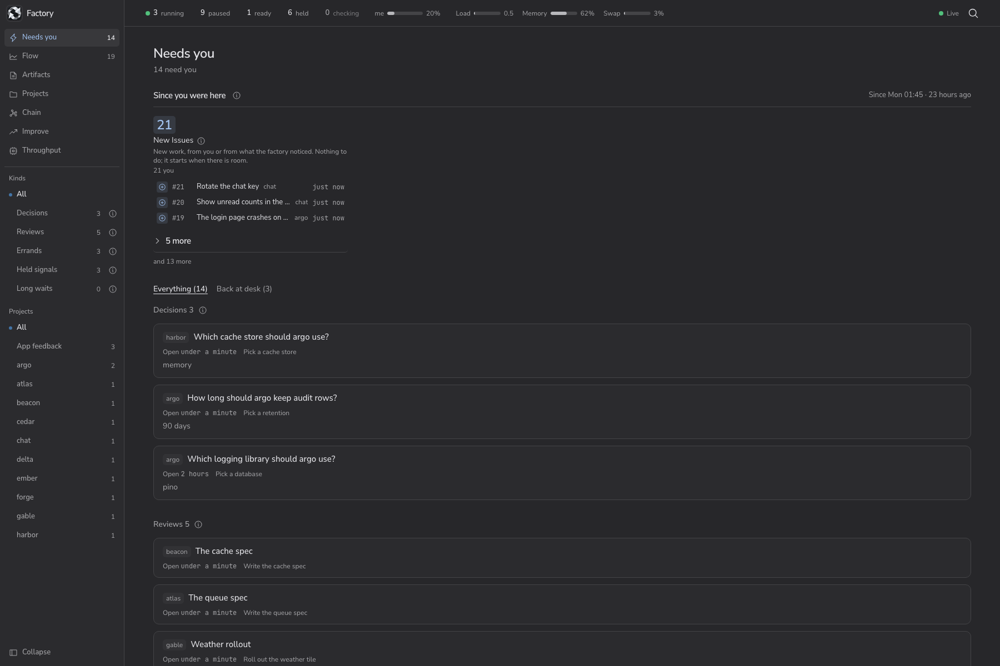
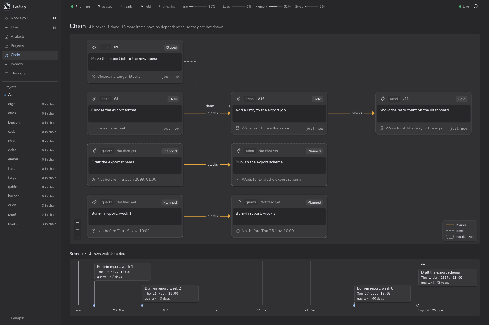
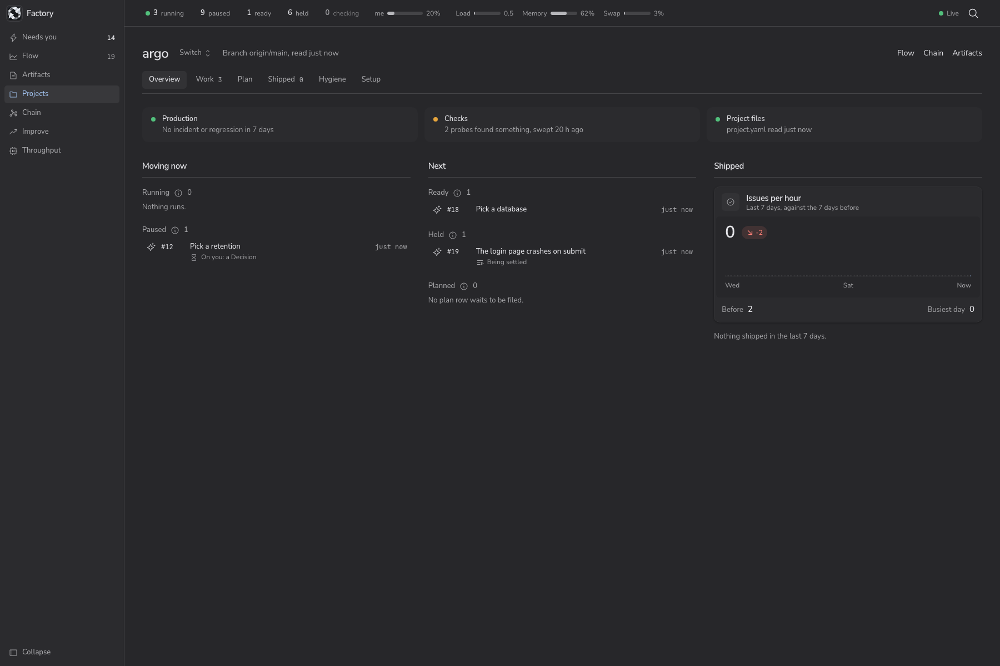
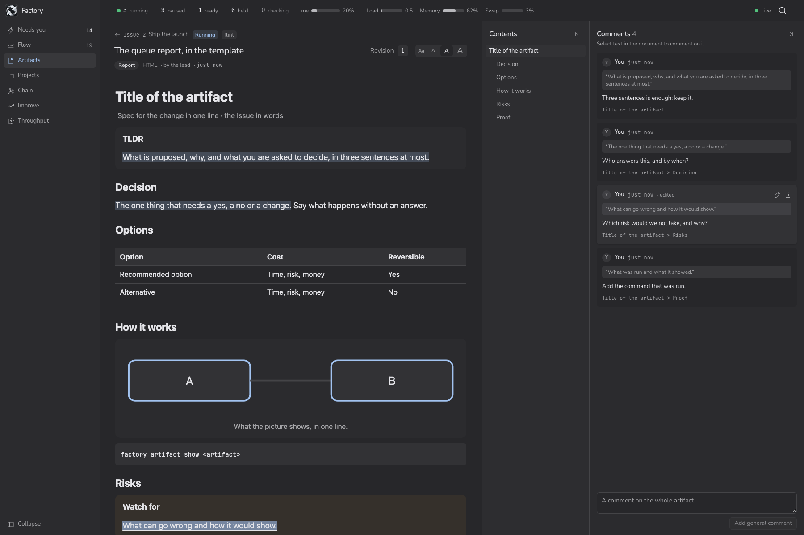
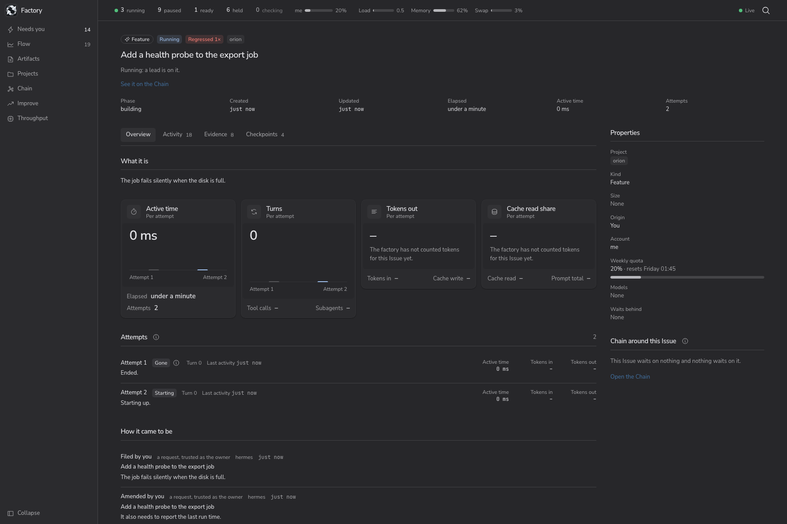
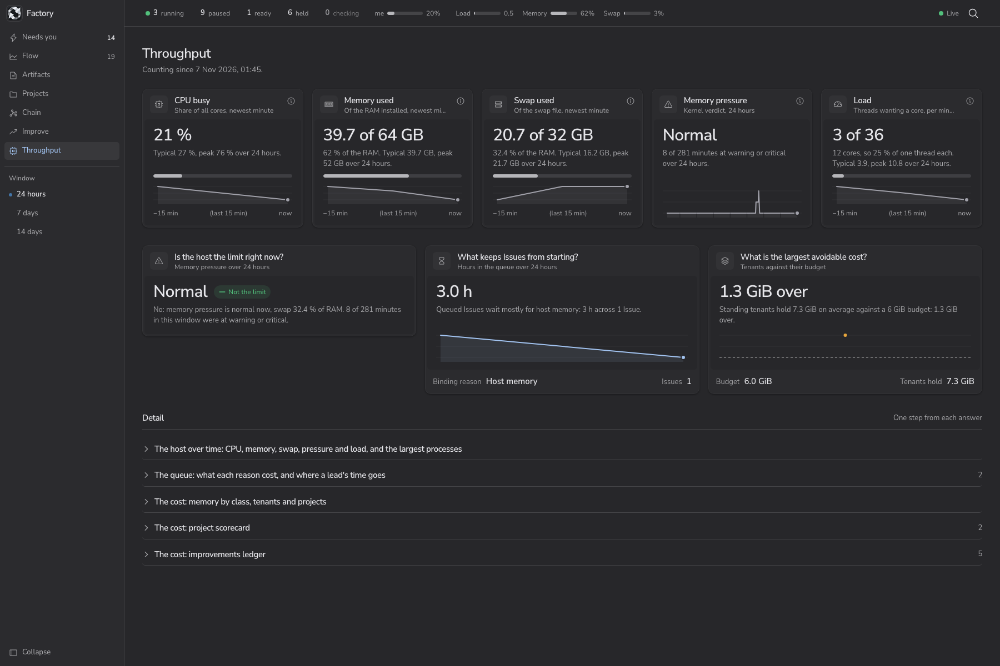
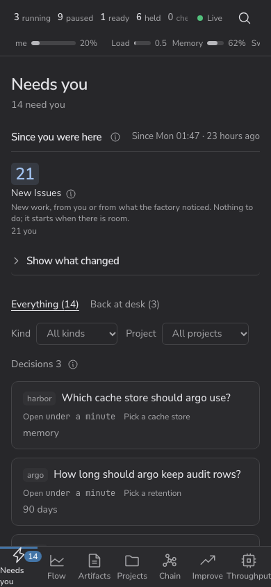
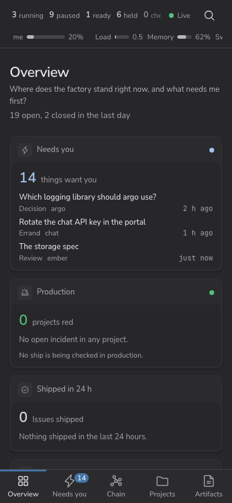

# software-factory

**A closed loop that turns signals into verified production changes. Agents do the work, code supervises them, and
one person decides only what a person must.**

This repo is one implementation: a lifecycle server on Bun and Postgres, built and run by one developer on one
always-on machine against a few Claude Code subscriptions. It is a reference for people building a factory of their
own, and it builds itself: its changes go through its own Issues. It is not a product. Every factory is set up for its
place; this one shows the language, the patterns and how far the automation reaches.

MIT licensed. Read it, fork it, take the parts you want.

**The guide** explains the factory chapter by chapter, each idea next to the code that implements it and the Issue it
came from: [software-factory.jkrumm.com](https://software-factory.jkrumm.com). The same pages read on GitHub in
[`docs/guide/`](docs/guide/README.md).

## Position

**Dark for code, lit for decisions.**

- **Dark for code.** No person reviews a change before production. The lead's own review, gates, a watch window and
  probes do that job. [Warp](https://www.warp.dev) keeps a person at spec, question and merge and calls dark
  factories "not realistic right now"; this repo exists to show how far past that one person can go.
- **Lit for decisions.** What reaches the owner is product direction, spend, irreversible data loss, other people,
  security policy, rare big architecture and taste. Everything else the factory settles, and an avoidable touch is
  counted as friction.

## See it

The Console is the owner's window: a React PWA the server itself serves. Every screenshot below is the seeded demo
data of the end-to-end suite (`make e2e`) at 1800 by 1200, not a real estate.

**Needs you** lists what waits on the owner and nothing else: a Decision with the lead's recommendation, a Spec to
judge, an Errand that only hands can do.



**Overview** is home: what needs the owner, whether production is red, what shipped in the last day and why the queue
does not move, then the numbers and their charts (Issues running, paused and not started, what shipped this week, the
trend by the hour or the day). A filter opens the list behind a number. Every screen says under its title the one
question it answers, `?` lists every key, and the palette (Mod+K) opens any Issue by number or project by name.


**Chain** shows what waits on what, across repos.



**Projects** has one page per project, in tabs: an overview of what moves now, what is next and what shipped, then Work, Plan, Shipped, Hygiene and Setup.



**Artifacts** holds the Concepts, Specs and Reports leads hand over, with revisions, comparison and the owner's
annotations. An **Issue** page reads one Issue end to end, from signal to verify.





**Improve** holds the KPIs against their targets in 7-day windows. **Throughput** shows where the host's memory and
the leads' hours go, and the improvements the loop filed. **Accounts** answers, per Claude Code subscription, whether it will be full at its
reset and if not why, shows the order each lane gets now, and sets a mode (Fill first, Hold for a model, Pause) with its expiry.



The same screens fit a phone:





## How it works

```
signal ──▶ triage ──▶ Issue ──▶ queue ──▶ lead ──▶ ship ──▶ watch ──▶ verify ──▶ closed
 alert      filed      one repo   capacity   one Claude    land and     window     make verify
 request    amended    one branch windows,   Code session  deploy       after the  and probes
 feedback   incident   one ship   claims     owns it                    ship
            held
            dropped
```

1. **Everything enters as a signal:** a failing monitor, an alert, a GitHub issue, a voice note. Triage decides what it
   becomes: a new Issue, an amendment to an open one, part of an incident (one root cause seen through many alerts),
   held, or dropped. Nobody files around the state machine.
2. **Capacity admits it.** Subscriptions, 5-hour and weekly windows, memory, load and per-repo claims decide when a
   lead may start. A queued Issue always says why it is queued, in one sentence with its numbers.
3. **One lead per Issue.** The lead is an interactive Claude Code session in a herdr-core
   terminal. It owns the Issue from root cause through build, its own review, ship and verification in production.
   The factory supervises it through hooks and never redoes its work.
4. **Ship means land and deploy.** After it, a watch window opens and Verify (`make verify` and probes) ends it. A
   failure goes back to the lead as a note. Fix forward: a bad change gets a new change.
5. **Checkpoints are rare.** A lead raises a Decision, hands over a Concept or Spec, or asks for an Errand (something
   only the owner's hands can do). A Decision passes standing policy, then the Judge, then a default, and only then the
   owner.

The factory itself never calls a model. Every judgment goes **deterministic code first, then an
[agent-workflows](https://github.com/jkrumm/agent-workflows) workflow, then the owner**, and every change to a repo
is made by Claude Code.


The Console listener is a second loopback port. It forwards `/health` and `/v1/*` to the API with the owner's token
held on the server, and forwards fifteen write verbs (the owner's answers, annotations, a collection's pin and an account's mode) and
nothing else. It can never start a session.

## The language

One word per thing, in code, CLI, events, screens and docs. A retired word in the source fails `make check`.
The full table, with what each word retires, is [`docs/language.md`](docs/language.md).

| Word | Means |
|-|-|
| **Signal** | Anything that arrives and may become work, with a kind, an origin and a trust level |
| **Issue** | One unit of work: one repo, one branch, one ship |
| **State** | `settling`, `queued`, `working`, `waiting`, `watching`, `closed`. Only an event moves it. Screens say Running, Paused, Ready, Held, Checking and Planned instead |
| **Event** | A fact recorded on an Issue. **24 kinds**, among them `filed`, `admitted`, `shipped`, `watch_passed` |
| **Lead / Attempt** | The Claude Code session that owns an Issue, and its *n*th try |
| **Steward** | The loop over stalled Issues: wake, re-check, requeue, deliver, break a claim deadlock; asks a workflow only when the rules run out |
| **Judge** | The workflow that tries to settle a Decision before the owner sees it |
| **Gate** | A machine check a lead cannot talk past |
| **Watch / Verify** | The window after a ship, and the check that ends it |
| **Wait / Stall** | A pause with a named exit, and a wait whose cause is a machine's to end |
| **Checkpoint** | Where the factory stops for a person once policy, the Judge and a default have had their turn: Decision, Concept or Spec, Errand. Never a merge |
| **Touch / Friction** | The owner acting on an Issue, and any counted waste, such as a touch the factory should have settled |

## What it proves

Patterns a factory needs, each one held by a check and not by a convention:

| Pattern | Held by |
|-|-|
| **The state machine is a total table.** A new state or event must fill every cell | `tsc`; a seeded model test plays random event sequences |
| **Facts are stored, state is derived.** No count or timer that the event log can answer is a column | the optimistic `version` guard; `make check` regenerates the state diagram |
| **Claim, commit, call, record.** A port is never called inside a transaction | `scripts/boundaries.ts`; only `unit-of-work.ts` and `migrate.ts` open one |
| **Every effect has a deterministic key.** A replayed pass spawns, prompts and posts nothing twice | `kernel/keys.ts`; the runner looks before it acts |
| **Deterministic first, then a workflow, then the owner.** The server never calls a model | no model SDK in the tree; judgment goes through one port per loop |
| **A caller is its token.** A route with no policy row is refused for everyone | `api/policy.ts` and the test that fails without a row |
| **Hooks never speak.** Claude Code injects a hook's stdout into the session | the hook imports two modules and prints nothing |
| **One word per thing.** A retired word fails the build | `scripts/retired-words.ts` |
| **One vocabulary for where work stands.** A stored state word on a screen fails the build | `scripts/vocabulary.ts` |
| **No private data in a public repo** | `scripts/public-scan.ts` (hosts, addresses, accounts, secrets, work repos) |
| **The README tells the truth.** Its counts and lists are read from the code | `make docs-check` (`scripts/readme-check.ts`), also a weekly hygiene probe |

## Architecture

**A modular monolith on Bun:** TypeScript and zod, Postgres as the only store, domains with no I/O behind ports,
Elysia at the edge, a generated CLI. One process, one schema (`factory`), one contract. Rationale for each choice is
in [`docs/architecture.md`](docs/architecture.md) and [`docs/decisions.md`](docs/decisions.md).

Eight domains, each owning its tables. A domain imports only the kernel and itself. When one needs another, `app/`
coordinates them in one transaction.

| Domain | Owns |
|-|-|
| `intake` | the signal envelope, trust, fingerprints, correlation into incidents, amend-or-new |
| `planning` | plans, the chain (dependencies across repos), queue order |
| `capacity` | accounts, windows, memory, load, repo claims, test slots |
| `work` | the Issue: a total state machine and its events |
| `leads` | attempts, briefs, notes, session state derived from hook events |
| `quality` | gates, evidence, watch, verify; a review is evidence and never refuses a ship |
| `checkpoints` | Decisions, artifacts and revisions, annotations, verdicts, Errands, the ledger |
| `loops` | the steward's stall rules, settling a Decision, the ports to the workflows |

`scripts/boundaries.ts` reads the import graph in `make check` and fails on a violation: `domains/` is pure (no
Elysia, no SQL client, no `node:fs`), ports are interfaces the domain owns, `read/` is read-only, every port returns
`Result<T, PortError>`.

**The Issue machine** stores facts and derives state. The event log is the truth; an Issue's state is what its latest
event made it. The machine is a **total table**: every `(state, event)` cell is a move, a refusal with a reason, or an
ignore with a reason, and a missing cell fails `tsc`. `apply(state, event)` is pure; `app/` stores the event, the new
state and its effects in one transaction, then runs the effects. The state diagram in
[`docs/language.md`](docs/language.md#the-issue-as-the-code-has-it) is generated from the table, and `make check`
fails when it is stale. No XState, no workflow engine.

**Loops** are a tick with a trigger and a budget. The deterministic part runs in the server; the judgment is a
dedicated agw workflow called through a port with an idle watchdog (no wall-clock limit).

| Loop | Deterministic | Workflow decides |
|-|-|-|
| Steward | wake, re-check, requeue, deliver, break a claim deadlock | what a stalled Issue needs when the rules do not say |
| Judge | standing policy, precedent lookup | whether a Decision needs the owner |
| Triage | fingerprint, routes, correlation window | kind, origin, amend-or-new |

**Gates are code.** What an agent is told does not change what it can do. Tokens decide the caller (`owner`, `orchestrator`, `agent`, `machine`, `signal`, `read`).
The API and the Console listener bind to loopback. A hook appends to a spool first, then posts to a unix socket, and exits 0 whatever
happens; its stdout stays empty, because Claude Code injects a hook's stdout into the session. The alert door holds no factory
token of the owner's and takes the repo from a server-side route registry, never from the payload.

## Layout

| Path | What |
|-|-|
| `apps/server` | the server: API, Console listener, domains, use cases, loops, adapters, read models, migrations |
| `apps/cli` | the `factory` CLI, generated from the server's OpenAPI document plus hand-written hook and slot verbs |
| `apps/door` | the alert door: alerts from monitors become signals |
| `apps/console` | the Console, a React PWA: Overview, Needs you, Chain, Projects, Artifacts, Improve, Throughput and Accounts, and a page per Issue |
| `packages/contract` | zod schemas for every request, response and event; the source of the OpenAPI document |
| `packages/client` | the typed client shared by the CLI and the door |
| `packages/accounts` | the picker for N Claude Code subscriptions and the `claude-account` CLI (`docs/accounts.md`); independent of the server |
| `tests/scenarios` | use cases run end to end against a real server and Postgres with fake runner and agw: the acceptance suite |
| `tests/e2e` | Playwright against a seeded server: every Console screen, and the source of the demo screenshots |
| `integrations/` | the client pieces other machines install: the Claude Code hooks, a Herdr mod, `rd`, a Hermes skill |
| `scripts/`, `deploy/` | release-directory deploy, verify, launchers, and the checks of the build (boundaries, retired words, README) |
| `docs/` | product, language, architecture, operations, decisions, design, research, evidence |

## Run it

You need [Bun](https://bun.sh) and a PostgreSQL install (`initdb`, `pg_ctl` on `PATH`, or `PG_BIN_DIR` set). The
tests start a throwaway cluster of their own and touch nothing else.

```sh
bun install
make check   # the whole gate: format, lint, types, boundaries, README, generated files, tests, scenarios, Console build and Playwright
make test    # the unit tests and the scenarios only
```

The scenarios run the use cases against a real server and Postgres, with a fake runner and a fake agw, so a green run
covers intake, queueing, leads, shipping and checkpoints.

To run the server you provide a Postgres database (it keeps everything in the schema `factory` and applies its
migrations at start), a port, and the owner's bearer token (16 characters or more). Every other caller gets its own
optional token, and a caller without one does not exist: `FACTORY_AGENT_TOKEN` (a lead's session), `FACTORY_ORCHESTRATOR_TOKEN`,
`FACTORY_DOOR_TOKEN`, `FACTORY_SIGNAL_TOKEN` (the narrow caller that files the owner's words) and `FACTORY_READ_TOKEN`.

```sh
bun run --cwd apps/console build
DATABASE_URL=postgres://… PORT=7793 FACTORY_TOKEN=<owner-token> bun apps/server/src/main.ts
```

With the Console built, the server also listens for it on `127.0.0.1`. The port is `FACTORY_CONSOLE_PORT`, default 7795, so the Console is at `http://127.0.0.1:7795`.

Past that you wire it to your own machine: Claude Code subscriptions, herdr-core for the lead terminals, agw for
the workflows, and a `project.yaml` per repo (deploy command, which signals it hears, how many leads). The shipped
launchers (`scripts/launch.sh`, `deploy/`) show one wiring for macOS and LaunchAgents; they resolve secrets through
a secrets shim and are not meant to be copied unchanged.

To refresh the demo screenshots: `make e2e`, then copy the `desktop-xl-dark-*` files you need from `tests/e2e/out/screenshots` into `docs/demo`.

## Read next

Start with [`docs/product.md`](docs/product.md) (what it is and how we know it works), then
[`docs/language.md`](docs/language.md), [`docs/architecture.md`](docs/architecture.md) and
[`docs/decisions.md`](docs/decisions.md) (what was decided and why). [`AGENTS.md`](AGENTS.md) holds the rules a
contributing agent follows.

## Licence

[MIT](LICENSE). The factory is one owner's setup, published as a reference, with no promise of support.
