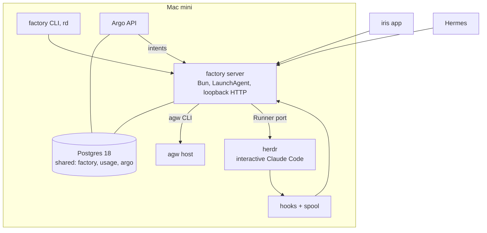
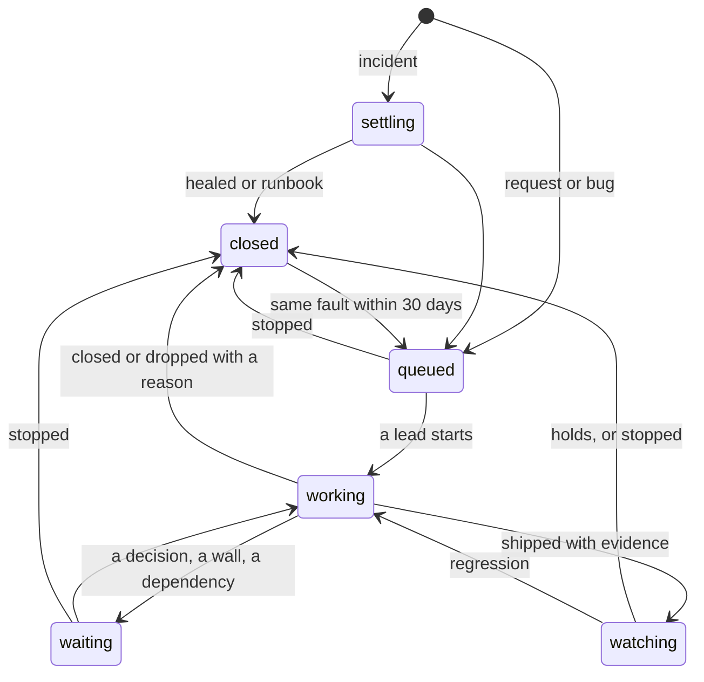

# Design

**TLDR.** One Bun server on the mini owns long-lived state in Postgres: sessions, the queue, capacity, later
Issues. Interactive Claude Code in herdr-core terminals does all the thinking; `agw` workflows do every model call the
factory needs; plain code does the rest. Hooks report what sessions do as facts, the server derives state from
those facts when read, and every effect carries a deterministic key, so a replay never spawns, types or posts
twice. The fleet layer (§3) ships first and carries today's `/wave`. The Issue machine (§4) sits on top of it.

**This page wins over TDD v2.4 wherever they disagree.** The reasons behind each choice are in `docs/decisions.md`,
the build order is in `docs/program.md`. The code is plain TypeScript and zod (SF6).

## 1. Principles

A design choice that breaks one is wrong.

1. **The factory runs the lifecycle; Claude Code does the thinking.** What a script can decide, a script
   decides. Routine words and judgments (same symptom? which project? how big?) are `agw` workflows. Anything
   that needs understanding a problem or code goes to a lead.
2. **The factory never calls a model.** No SDK, no key. `agw` is its only model path, called like any client.
3. **Max reasons about code, API tokens do the routine.** Claude Code on the Max accounts is the only thing that
   diagnoses or changes a repo. A full pool means waiting, never spilling.
4. **Hand over the problem, not a conclusion.** A brief holds facts, evidence and verified history, never a
   cheaper model's guess at the cause.
5. **One lifecycle, no side doors.** Every piece of work enters as an Issue and leaves with evidence or a stated
   reason. Until F2, a wave is the unit and the same rule applies to its close-out.
6. **Facts are stored, state is derived.** The one stored exception: an Issue's lifecycle state (§4), written by
   one module with an event per transition. Liveness ("working", "stuck", "walled") is always computed on read.
7. **Done means observed in production.** A lead's "done" is a claim. The evidence and the factory's own
   `make verify` after the hold are the proof. Wrong in production means fix forward.
8. **A self-improving platform, as code.** A fix verified twice becomes a runbook or a job check. Rules, probes,
   thresholds and prompts live in repos and change through an Issue with evidence, the factory's own included.
9. **The owner decides business, nothing else.** Product direction, spend, irreversible data loss, other people,
   plus security policy. Anything else that reaches the owner is a defect. Everything written for the owner is
   short, verdict-first and free of internal names.

Fixed boundaries:

- **Network:** no public endpoint. The tailnet plus the owner's GitHub user is the security boundary.
- **Liveness:** no turn limits and no wall-clock ceilings on a lead. The stall rule (§6) is the one liveness rule.
- **Scope:** `~/SourceRoot` only; IuRoot stays outside.
- **Instructions:** `AGENTS.md` only, no `CLAUDE.md` in any repo.

## 2. Shape of the system



- **One process.** A LaunchAgent, deployed like agw: release directories, health check, rollback of its own
  release. A Postgres advisory lock makes a second copy exit. Running sessions never notice a restart; they live
  in herdr, and their hooks spool what the server cannot take.
- **The database.** One database named `shared` on the mini's Postgres 18, a schema per writer (`factory`,
  `usage`, `argo`). agw keeps `agent_workflows` and grants read-only roles. F1 does not wait for A1, so whichever
  ships first creates the database, idempotently, through a target both repos can run.
- **API.** Loopback HTTP. One schema defines each operation, and both the HTTP route and the CLI verb come from
  it, as in agw's capabilities. Reads for dashboards are views in the `factory` schema; live updates are
  `LISTEN/NOTIFY`. Writes from any surface are intents through the API, never direct table writes.
- **CLI.** agw's contract (`--format json|plain`, data on stdout, messages on stderr, the same exit codes, never
  prompts). The block agents see stays small: `factory status`, `factory issue …`, `factory session …`,
  `factory project check`. The rest exists for the owner, the orchestrator and Argo, documented once.
- **Ticks and wake-ups.** `NOTIFY` wakes the worker on a new row; a tick every 5 seconds catches the rest and
  handles deadlines. `issues.wake_at` is the one Issue timer; `resume_at` on a spawn request is the fleet's.
- **Effects.** Each outside effect goes through a port (`Runner`, `Agw`, `GitHub`, `Notify`) and has a key
  recorded before it happens. A replay finds the key and stops.
- **Every start reconciles.** Before any effect: replay the spool, then look at the world once (herdr, worktrees,
  GitHub) for each open session and Issue. Open deadlines move by the downtime. Missed job slots run once. There
  is no separate adopt mode.
- **Dependencies point one way.** factory → agw, herdr-core, GitHub, the intake sources. agw never knows the factory.
  `rd` and the account picker stay in dotfiles and become clients or adapters (§3).

## 3. The fleet layer (F1)

Deterministic babysitting of the sessions `/wave` and `rd` start today. It replaces `wave-watch.sh`,
`fleet-keepalive.sh` and the Hermes babysitter cron (FL8). Issues do not exist yet at this layer, and the layer
does not need them: `issue_id` on a session is nullable.

### Sessions and events

A **session** is one Claude Code process the factory or `rd` started, identified by its Claude session id, with
its pane, worktree, repo, role, account, model, effort and parent. `rd` sets `FACTORY_SESSION` at spawn; without
it every hook exits at once, so the owner's own sessions never see them. Hooks are installed for every account's
config directory.

| Hook | Event | Used for |
|-|-|-|
| `SessionStart` | `session_started` (with the matcher: `startup`, `resume`, `compact`, `fork`) | binds session id and transcript path to the spawn |
| `UserPromptSubmit` | `turn_started` | prompt delivery proof, "no new turn" in the watchdog |
| `Stop` | `turn_ended` | turn boundaries; the send-back rule |
| `StopFailure rate_limit` | `limit_stop` | the resume watchdog |
| `Notification quota_auto_resume_*` | `quota_resume` (`fired`, `stale`, `disabled`) | the resume watchdog |
| `Notification permission_prompt`, `idle_prompt` | `prompt_blocked`, `prompt_idle` | blocked sessions |
| `SessionEnd` | `session_ended` | closes the session |

`UserPromptSubmit` is an addition to FL5's list: a turn's start is the only proof that a typed prompt arrived.

**The hook never blocks a session.** It appends the event to a spool file first, then posts with a 300 ms
timeout, and exits. `SessionEnd` has a 1.5-second budget, so the append is the part that must fit. The server
replays the spool on start and on each tick. The key is session id plus event name plus turn number.

The runner (herdr-core) is the backstop for what hooks cannot show. A tool call in progress produces no hook event, so
silence alone proves nothing; `stuck` needs the runner's agent status and the worktree's activity too. The witness follows
the core's event stream (a status shows at once, a lost or finished terminal asks for a pass) and runs a pass every minute
from that cache; it records the server identity (core pid and id; a change is a runner restart, an event) and the account
in effect, and reports dead panes.

### Derived session state

| State | Read from |
|-|-|
| `starting` | spawn recorded, no hook has spoken |
| `working` | latest `turn_started` has no `turn_ended` after it |
| `idle` | latest event is `turn_ended`, or `session_started` with no turn yet; no open wait |
| `waiting` | a declared wait is open (`factory session wait --on workers\|deploy\|owner`); `--done` or a delivered wake ends it |
| `walled` | a `limit_stop` or `quota_resume` with no later `turn_started`; a turn that ends after `quota_resume` fired stays `walled` |
| `blocked` | `prompt_blocked` with no later `turn_started` or `turn_ended` |
| `stuck` | `working`, the runner agrees, no commit or file change in the worktree for 45 minutes |
| `dead` | `session_ended`, or the pane is gone |

State reads from the latest `session_started`, so a resumed session starts clean. Hooks carry no token: they post
to a unix socket (mode 0600) and fall back to the spool. The socket serves the routes a session needs, not only events and waits (see "Hooks and the socket" below).

### The queue (FL1, FL3)

A **spawn request** is a row: repo, role, prompt, model and effort from the role table, a deterministic key, and
later the account, a `resume_at`, and the session it became. A spawn without capacity gets a `resume_at` and stays
in the table; nothing is dropped. The tick starts it when the time comes and admission says yes.

A key is spent when its spawn has ended. `ended` is derived at read time, never stored: the spawn is `started`, and its
session is `dead` or its pane is no terminal of the current core. Creating under a spent key is a `409 key_spent` that
carries the stored spawn; a live or queued key still answers 200 with its row. Reviving the row would start work a second
time, so the caller picks a new key (`rd`: `-r2`, `-r3`).

**Queue state** is `run`, `pace` or `drain`, set per scope: global, project, initiative. The most restrictive scope
that applies wins.

| State | Effect |
|-|-|
| `run` | admission decides |
| `pace` | lower concurrency; spends only toward weekly pace |
| `drain` | no new spawn. A running wave finishes its current wave; the chain stops at the boundary: its successor's spawn is held (`queued: drain`) and starts by itself when the drain lifts. Nothing is interrupted |

### Capacity and admission

- **Accounts come from the registry,** `dotfiles/config/claude-accounts.json`, never a constant. N accounts,
  today three. The picker stays in dotfiles; the factory calls `claude-account` through an adapter and stores
  each reading as a fact (`quota_readings`), so history survives and tests can inject a wall.
- **An account is eligible** if it is enabled, its auth is fine, and it keeps the owner's reserve: 15 % of the
  5-hour window and the last 5 % of the week, so new spawns stop at 95 %. A session already running there
  rotates at 94 % (below), one point earlier, so its successor can still be spawned elsewhere before the wall.
- **One active wave per repo,** across repos as many as capacity allows.
- **Never spill.** With every account walled the queue waits for the first reset.
- **A spawn holds its account** while queued or starting, and once started until a reading taken after its start
  shows it. A burst starts only as many spawns as there are open accounts; there is no per-spawn cost estimate. A
  spawn a rule holds back (`drain`, `pace`, one wave per repo, no capacity) stays queued with a hold reason.

### Rules that act

| Rule | Trigger | Action | Key |
|-|-|-|-|
| **Resume watchdog** (FL2) | a session is `walled`, its account's reset has passed, no new turn for 5 minutes | one delivery-checked "continue" | `resume:<session>:<reset_at>` |
| **Send-back** (FL5) | `Stop` with live child sessions and no declared wait, `stop_hook_active` false, the turn did not end on a limit | the hook exits 2 with one line | turn number |
| **Rotation** | a `mother` or `lead` session's account reaches 94 % of its week | one note: write the handoff and rotate; the next rotation lands on another account | `rotate:<session>:<week>` |
| **Folder trust** | any spawn | pre-trust the path before starting the agent, for new repos as well as worktrees | none, idempotent |
| **Blocked** | `blocked` for 2 minutes | a line in `factory status`, and to the session's parent if it has one | event id |
| **Wake** | a session `waiting` on its workers, with child sessions, none unfinished (`dead`, or `idle` after a turn; a spawn without a session yet is unfinished) | one note listing the children and their states; once a turn proves it, the wait it answers is cleared (unless a newer wait was declared) | `wake:<session>:<wait event id>` |
| **runner restart** | the server identity (core pid or id) changed | each affected session resumes by id, with a note that a turn was cut off; one the kept terminal's own resume (`hc-resume`) already brought back gets the note typed instead | `restart:<server>:<session>` |

The send-back counts only child sessions the factory knows. A background shell inside a session is invisible to
a hook; that gap stays until a measured failure says otherwise.

**The tick.** Four rules, each from a defect both spike arms shipped (`docs/spikes/2026-10-30-effect/verdict.md`):

- **Never call a port inside a transaction.** Claim the row and commit, call `Runner`, record the result in a new
  transaction. The key recorded at the claim is what makes a crash between the two safe.
- **Every port call has a timeout.** A hung `hc` must fail the call, not stall the tick.
- **Attempts are capped.** A spawn out of attempts is `failed` with a reason and leaves the batch, so it cannot starve
  the ones behind it. The tick loop itself survives any single failure and logs it.
- **Eligibility is rechecked at start,** not only when the spawn is queued. A stored account is a hint.

**Prompt delivery.** `factory session note` is the one way anything types into a session; `rd say` becomes this. The full behaviour is under "Prompt delivery" in *As built* below.

**One space per repo (FL6).** A space is keyed by path; a second space for the same path is explicit (`new_space`), for a separate plan or worktree; the full rules are under "Spaces (FL6)" in *As built* below.

**Test slots (FL7).** `factory slot run -- <cmd>` wraps `make check` and test runs in a host-wide semaphore: a
leased row, two slots to start and tuned from the load record, released on exit or lease expiry. It fails open: with the server down
or the wait over its limit, the command runs anyway, because a slot exists to reduce flakes and must never block
work.

**The role table (FL4).** One table for mother, lead, worker, mechanical and the subagent types, giving tier and
effort. `rd --role` and agent frontmatter read it; values move only on data from track U. Model ids stay in agw's
and dotfiles' route tables; this repo names tiers.

### `rd` becomes a client

`rd wave`, `fan`, `say` and `close` call the server when it answers and keep today's path when it does not. A dead
factory must never stop the waves that would repair it. The gate logic (`wave-gate.py`) stays until the server
covers each check. The verbs move under `factory` once F4 is running, and `rd` stays as an alias.

### As built

What runs today, moved here from `AGENTS.md`, which keeps the rules and points at this section. Where the design above and this section differ, this section is the code's behaviour.

#### The tick, retries and admission at the claim

**Never call a port inside a transaction.** The tick claims a row and commits, calls the `Runner` (every call has a
process timeout), records the result in a new transaction. A failing start is retried until a time budget from the
first claim (30 min, `FACTORY_RETRY_BUDGET_MS`), then `failed` with a logged reason; `factory spawn requeue <key>`
starts a failed spawn over. Admission is decided again at every claim except a reclaim (an expired lease: its agent may
already run, so it finishes on its account), and only due rows are selected
(`docs/design.md` §3, "The tick").

#### Spaces (FL6)

**One space per repo (FL6), keyed by path.** A spawn has a `space` (a path, default its `repo`, resolved like the repo and inside
the same roots, and containing the repo: 422 otherwise; `POST /spawns` takes `space` and `new_space`). The space is an id the
Runner puts in the label `herdr.space`: the entry of the Herdr app's document `herdr-app` whose `folder` is the resolved space
path (found by path, so two repos named `app` have two spaces and a worktree's `space` is its main checkout), else
`sp-<dir>-<12 hex of sha256 of the realpath>` (the full root is hashed, so `~/SourceRoot/x` and `~/IuRoot/x` differ). A second
spawn in a repo is a new tab in its space. `new_space: true` makes a second space for a path that already has one (the id also
hashes the key, so a retry makes the same); on a path with none it takes the first. **A space the factory names is seeded**
(`seedSpace`, `app-doc.ts`) in the app's document before the terminal runs, or the app adopts the label with `name: ""` and
the terminal's cwd as `folder` (a worktree, so the sidebar shows `w9-…` and the next spawn at the main checkout finds nothing):
`{ id, name: basename(space path), folder: space path, tabs: [] }` appended to `spaces[]`, compare-and-set on `version`, a
conflict reads again (3 tries), a value of null (never written) starts `{ spaces: [] }`. The path is the space's (the main
checkout for a worktree). A second space for a folder that already has an entry is named `<basename> <n>` (`app 2`). An entry
with the id is never touched, nor a document with no `spaces` array or with an entry that has no id (not the app's). Best effort like `nameTab`: a failure does not fail the
start, the id stays the label's, and the next start for that id seeds again. Not seeded: an id found in the document, a foreign
id with a terminal in it, a hidden child. The result names the terminal, the tab and
the space (`spawns.session|tab|workspace`; `Spawn.pane` is `session`). A try that fails reports its space
(`RunnerError.workspace`), the tick records it, and a retry or a runner-restart resume passes it back as `StartInput.workspace`:
it wins when it is an id the Runner made (`sp…`) or a live terminal is in it.

#### The runner

**The runner looks before it acts.** `HcRunner` (`hc-runner.ts`, herdr-core 0.1.15 over `hc connect`; `HcClient` in `hc.ts` is one
short-lived process per JSON-RPC call: `hello`, the request, stdin closed, the reply read by id, each under the process timeout
and the start budget, `childEnv()` stripping the factory's secrets; `HC_BIN`, and `HC_SESSION` for tests, pick the binary and the
core). Every terminal carries `factory.key=<spawn key>`: a live one running claude is never started again, only proven; a
finished one that reported, had a status or a turn is started (its prompt ran; a second run would repeat the work), one that never
reported, or a live one that is no longer claude (the shell the core puts in a kept terminal after a `kill -9`), is
killed if needed, `terminal.rm`'d and the spawn started afresh (a retry may be on another account); an error is a transient
`RunnerError`. Finding, placing and running go one at a time per runner (two starts never both take an empty space's id).
**The prompt is the last argument of the program** (`claude --dangerously-skip-permissions --model <tier> --effort <effort>
[--resume <id>] <prompt>`; `claude --resume <id> "<prompt>"` takes the id as the option's value), `cwd` is always the repo, `keep: true`, the
name an hc-valid `agentName`; so nothing is typed at start. The agent is started when `terminal.get` shows it reported (`reported`,
a status or `turn >= 1`) inside the deliver window (30 s), else a transient error. `claude-pretrust.sh` runs before every
spawn (a test pins that a path never seen before is trusted first). A prompt cannot start with `-`. The account is in the `env` of
`terminal.run` (`accountEnv`): `CLAUDE_CONFIG_DIR` only for a non-default account, never empty, never inherited, plus
`CLAUDE_ACCOUNT_PICKED`, `USAGE_LANE`, `FACTORY_SESSION`, `FACTORY_ROLE`.
Placement is by labels, no window needed: a **tab** (any role, or a worker whose parent session has no known terminal) has
`no_parent`, `herdr.space`, `herdr.tab` (`tb-<12 hex of sha256 of the key>`) and `factory.tab_name`; its entry in the app's
document is named after the key once the app has one (compare-and-set on `version`, `app-doc.ts`; the witness retries on a label
or document event). A **hidden child** is a spawn whose parent session has a terminal (`StartInput.parentTerminal`, the parent's `pane`), is not
`new_space`, and is placed `child`: by the caller's `placement` (`POST /spawns`, token and socket; `factory spawn create
--placement tab|child`; stored in `spawns.placement`, answered by `Spawn.placement`, part of the idempotent replay, which answers
the stored row), else by the role's default (`worker`/`mechanical`/`deep` child, every other role a tab). The caller says it
because the role cannot: a lead spawns both its waves (children) and its successor (a tab). Such a child is that terminal's
hidden child, whatever its role: `parent`, `outlive_parent`, `no_notify` (the factory wakes parents itself), no
labels but the key; its result has no tab (null) and the space of the nearest ancestor that has a `herdr.space` label (up to 8 hops, so a lead's wave under a mother has the mother's; null if none or unreadable); a resume of a child (`prompts.ts`) passes the parent session's current pane again, except for a `new_space` spawn; a parent
that is gone (`not_found`), or a `child` with no parent terminal at all, makes that try a tab. An older server drops an unknown
`placement` (the schema is not strict) and answers a row without it, so a client can tell by the missing field. The app's document is read for spaces: only a confirmed absence (`not_found`, never
written) falls back to a hashed id; a call that fails is an error for the retry. `type` reads `terminal.get` and sends only to `idle` (guarded with `if`) or `done`, otherwise `busy`; a core
refusal is nothing typed (`blocked` or a changed status: `busy`), a lost call is `UncertainTyping`. The doc shape of
`herdr-app` (`spaces[].{id, folder, tabs[].{id, name}}`) is read loosely; the live document (2026-11-01) confirms it.

**A failed spawn leaves its terminal.** It is labelled with the key and `factory spawn requeue` finds it again (an agent already
running keeps the account it started on); closing it is a decision, not a side effect of `failed`. A finished terminal is
removed and made again on every try, so a retry on another account gets that account's environment.

#### The trust boundary

**Trust boundary.** The token can start Claude Code with `--dangerously-skip-permissions`, so a spawn's `repo` must be
inside an allow-listed root: `FACTORY_REPO_ROOTS` (colon-separated, default `$HOME/SourceRoot:$HOME/IuRoot`). The path
is resolved with `realpath` and must be strictly inside a resolved root, so neither `..` nor a symlink leaves it;
otherwise `POST /spawns` answers 422 and stores nothing (the row keeps the resolved path). Within the roots the token is
shell access as the mini user by design. The API is loopback only and the tailnet plus the owner's GitHub
user is the perimeter (`docs/design.md` §1). `FACTORY_REF=<branch>` runs whatever is on that origin branch with the
server's secrets, the same boundary; `make deploy` without it deploys `master`.

The factory door (§11) is on the same side of this line as a pane. It posts to the hook socket, which has no caller identity (SF11),
so a compromised door can call any route the socket serves: `POST /intake`, but also `POST /issues` and `POST /spawns`, which
starts Claude Code inside `FACTORY_REPO_ROOTS`, as any process of the mini user already can. Accepted, as SF11 accepted it for
panes; what the door lacks is the token, a database credential and the queue's writes. A socket of its own for `/intake` alone is
the change that would narrow it.

#### Hooks and the socket

**Hooks: spool first, then post.** `factory hook <event>` (session-start, user-prompt-submit, stop, stop-failure,
notification, session-end) does nothing without `FACTORY_SESSION` (set at spawn: the Runner puts the spawn key in the
pane's `--env`, `rd` its agent name). Otherwise it appends one line to `~/.local/share/factory/spool/<session>.jsonl`
(`FACTORY_SPOOL_DIR`, one `O_APPEND` write), posts it to the server's unix socket (`FACTORY_SOCKET`, default
`~/.local/share/factory/hook.sock`, 300 ms timeout) and exits 0 whatever happens, with one exception: the send-back
(below). The hook has no token and the Runner
keeps secrets out of the panes, so the socket (mode 0600, owner only) is its credential; the socket serves
`POST /events`, `POST /sessions/:id/wait` (`factory session wait`), `POST /sessions/:id/note` (`factory session note`),
`POST /sessions/:id/stop-check`, `PUT|DELETE /slots/:id` (`factory slot run`), `POST /spawns` (a pane starts work, below),
`POST /issues` and `GET /issues[/:id]` (a pane files work, §4), `POST /intake` (the door's alerts, §11), and
three reads a spawner needs to follow it, `GET /spawns/:key`, `GET /sessions/:id` and `GET /queue[?project=]` (`factory spawn get`,
`session get`, `queue get` use the socket when `FACTORY_TOKEN` is not set), which a session in a pane runs without a token, and
nothing else (not the spawn list, requeue, status, quota or any write to the queue); bound under umask 0177. Any session on it can note any other and file events for any other (the socket is the trust boundary and has no caller
identity; a same-user pane can already drive any terminal through hc, so this adds no capability, and it is a known and accepted
cross-session path); an event of
kind `runner_restarted` or `pane_gone`, or filed under `_runner`, is refused there and in the spool: only the witness records them. It imports nothing but `node:fs` and `@software-factory/contract/spool`: keep zod and
the rest of the CLI out of `src/hook.ts` (`bin/factory.ts` loads it alone). **Stdout stays empty for every event, and
stderr too except for a send-back**: Claude Code injects a SessionStart/UserPromptSubmit hook's stdout into the
session's context (tested per event). `session-start` also reports `CLAUDE_ACCOUNT_PICKED` as `account` (only if it is a name in the registry's alphabet, checked in the hook and again by the server), which is how
the factory knows the account of a session no spawn describes (`rd`'s); a spawn's own account wins.

#### Prompt delivery

**Prompt delivery** (`prompts.ts`) is the one way anything types into a session. `factory session note <session> <text>`
(`POST /sessions/:id/note`, socket or token; `--id` makes a repeated call one note) and every rule below record a row in
`factory.prompts` under its id first (`ON CONFLICT DO NOTHING`: the same id is one prompt). The tick types it through
`Runner.type` (`terminal.send`; `busy` while the runner says `working`) once the derived state is `idle`, `waiting` or
`walled`, so a `working`, `blocked`, `starting` or `dead` session holds it until its turn ends; the claim is committed
before the call and the result recorded after it. `sent` becomes `delivered` on the next `turn_started` after the claim.
No turn within a minute: typed once more (`MAX_SENDS` 2), then `failed` with the reason, which stays in `factory status` for
a day from when it failed. A Runner error that says nothing was typed is retried every 30 s, five times; one that cannot say
(`UncertainTyping`: hc timed out or died after the call) counts as sent and waits for a turn; the one retry after a
minute without one is the only second typing, as for a claim left `typing` by a crashed tick (after the start budget plus a minute).
`Runner.type` types only into an agent the core calls `idle` or `done` (`working` queues the text, `blocked` would answer its dialog). A `pending` prompt expires after 6 h
(a rule's) or 24 h (a note). A rule whose prompt failed or expired asks again after 30 min while its condition holds
(the same row starts over; a delivered prompt, a note, or a prompt recorded as undeliverable never does). One prompt is
typed per session per pass. A later prompt for a session waits while an earlier one is `typing` or `sent` and unproven. A retry is not typed if a turn has shown up since its claim; a `busy` answer clears the claim, so a later turn proves nothing. A prompt resumes a session only while it has shown no life since the prompt was recorded. Only
prompts that reach the Runner count against a tick's batch of 10. A note cannot start with `-` (it could read as a
flag) and cannot use a rule's id prefix (`resume:`, `rotate:`, `blocked:`, `wake:`, `restart:`), which would take the rule's place.
The blocked note names the worker but not its prompt text: that is agent-produced and stays in `factory status`.

#### Rules that act

**Rules that act** (`rules.ts`, run at the start of every tick after the spool replay and the quota poll; each records its
effect under a key, so a replay records nothing):
- *Resume watchdog* (FL2): a `walled` session whose account has a reading naming the wall's end (the first reading after
  the wall that carries one: `exhausted_until`, else the reset of each window at 95 % or more, the later; else the 5-hour
  reset), with 5 minutes passed since the later of that reset and the last wall event and no more than 6 hours (a wall
  older than that is history, so a deploy wakes nobody): a `continue` prompt, `resume:<session>:<reset_at>`. Needs the
  session's account.
- *Send-back* (FL5): on `Stop` the hook asks `POST /sessions/:id/stop-check` (300 ms) before it records anything: a stop that is
  sent back is no end, so it writes no `turn_ended` and the turn stays open (the session stays `working`, nothing is typed into
  it); a stop that is let through is spooled and posted as usual. The server
  answers `sendBack` when the session has live child sessions (sessions of spawns whose `parent` is it; `parent` comes
  from `POST /spawns`, `factory spawn create` defaults it to `FACTORY_SESSION`), no open wait, is not `walled`, and the
  hook says `stop_hook_active` is false; once per turn (`effects` key `sendback:<session>:<turn>`, recorded when the answer is given: an answer the hook
  cannot wait for, 300 ms, spends that turn's send-back). The hook then exits 2 with the one line on stderr. A server that is down, slow or odd means exit 0. A pane has no token and
  starts work through the socket (below), so the children of a session in a pane carry its `FACTORY_SESSION` as `parent`:
  the send-back sees them whoever started the pane.
- *Rotation*: role `mother` or `lead`, its account at 94 % of the week or more on a fresh reading: one note, `rotate:<session>:<week reset>`.
- *Blocked*: `blocked` for 2 minutes is a line in `factory status`; if the session has a live parent, also a note to it,
  `blocked:<event key>`.
- *Wake*: a session `waiting` with `--on workers`, with at least one child session and none unfinished, gets one note,
  `workers done: <child> <state>, …`, `wake:<session>:<the wait's declared event key>` (one per declared wait; a new wait
  can wake again). A child is finished when `dead` or `idle` after a turn of its current life (`liveSessions`' `finished`);
  a spawn of the session's that has no session yet (queued, held, waiting for capacity, starting) is not. A failed spawn
  does not hold the wake: it is a line in `factory status`. A parent that is not `waiting` gets nothing (send-back covers
  a working one). This is what resumes an orchestrator that ended its turn on a wait. **A delivered wake ends the wait it
  answers:** in the transaction that records the delivery (the `turn_started` that proves the note, in `settlePrompts` and
  in the retry path of `deliverPrompts`) the factory records a `wait_cleared` (key `<session>:wait_cleared:<prompt id>`,
  dated 1 ms before that turn's start, never before the wait it ends; the Stop hook's `stop-check` settles the session's own wake first), so the session reads `idle` when the woken turn ends and send-back sees no wait again; the
  orchestrator needs no `--done`. Only while the wake's wait is still the session's latest wait event: a `wait_declared`
  after it (the woken turn waits again) or a `--done` already there is left alone. At delivery, not at creation: until a
  turn proves the note the session stays `waiting` (true: it has not woken), and a wake that fails or expires clears
  nothing, so the rule can ask again after 30 min.
- *runner restart*: a `runner_restarted` event at least 3 minutes and at most 2 hours old: each session that had a turn open
  at that time, has had no hook event since and that the runner has not shown since is resumed by id (`Runner.start` with
  `resume`: `claude --resume <claude session id>` in a new tab on the spawn's account, the note as its first prompt),
  `restart:<new server identity>:<session>`. A resume starts an agent, so it is admitted like a spawn claim (held under
  `drain`, `pace` or a full account, only on the account the conversation lives in; the hold shows in the prompt's error) and
  reserves that account in the same locked transaction that admits it (given back if the start fails), so a spawn claim in between
  sees it taken. A restart prompt never re-arms. **One resumer per session:** `hc-resume` (dotfiles) types `claude --resume`
  into every kept terminal with the resume labels, factory spawns included, and types no prompt. A session whose only events since
  the cut-off turn are `session_started` with source `resume` (an idle notice may follow; no turn; the resume may precede the
  witness's `runner_restarted` by up to 2 minutes; a resume from an earlier restart does not count) was resumed in place: the same note is typed into it (`via: type`,
  the same id), nothing is started. A resume prompt recorded before that resume landed is turned into a typed one at delivery, so the
  factory never starts a second copy of a conversation something else resumed. `hc-resume` is not changed: skipping factory terminals
  would leave idle and waiting sessions (an orchestrator waiting on its workers) as a shell nobody resumes. A session that is not a factory spawn (or never reported its Claude session
  id) gets a `failed` prompt with the reason: that is its line in status.

#### `factory status`

**`factory status`** (`status.ts`, `GET /status`, token): attention lines (blocked 2+ minutes, stuck, walled, failed notes
and spawns), sessions not `dead` (walled, blocked, stuck, working, waiting, starting, idle), the queue with hold reasons,
the accounts' readings, prompts not delivered (failed first, at most 100, the rest counted as "N more not shown"). `--format plain` prints it as one screen.

#### The spool and the event key

**The key is session, event name, turn number** (`<session>:turn_ended:3`), counted from the spool, written into the
line, so a replay carries it. Counting and appending happen under a per-session lock (`<file>.lock`, a `mkdir`; the
server's rotation takes it too); a hook that cannot get it in 200 ms writes a key with a random suffix instead. A kind that repeats inside a turn gets `:2`, `:3`. Event time is strictly increasing per
session. `SpoolReplayer` (`spool.ts`) reads the directory at the start of every tick and stores whole lines past its
in-memory offset (a restart re-reads: the unique key makes it harmless). A quiet, fully read file over 64 KiB is
rotated: its sums (`turns`, current-turn counts) go to `<file>.base` first, so numbering never starts over, then the
file is retired. Spool files of dead sessions are kept (a reused `rd` name must not reuse keys). A rotation that died after moving the
file leaves `<file>.retired`; the next pass stores it and removes it. The lock holds a token, so a holder taken for
dead cannot release its successor's lock.

#### Derived state

**Derived state** (`sessions.ts`, first match wins; turns, walls and prompts count from the latest `session_started`):
`dead` (last of session_started / session_ended / pane_gone is not a start; a `pane_gone` is withdrawn by a later hook
event or by the runner showing the agent again), `starting` (the factory has the row, nothing proves it is up), `walled` (limit_stop or quota_resume with no
later turn_started; a turn that ends after `quota_resume fired` ends it too), `blocked` (prompt_blocked with no later
turn_started or turn_ended), `working` (open turn; `stuck` when the runner says working within 5 minutes and neither the
worktree nor the turn moved for 45 minutes), `waiting` (an open `factory session wait --on workers|deploy|owner`, no
open turn; the wait ends with `--done` or when a delivered wake answers it), `idle`. Events are ordered by event time, then arrival. Only `limit_stop` from `StopFailure rate_limit`
is a wall; other stop failures are ignored.

#### Sessions

**`factory.sessions` is what the factory follows; `usage` owns the session entity.** Row id = `FACTORY_SESSION`; a spawn
gets its row when the tick claims it (`starting` until its first event; the pane is added when the Runner returns it; a
spawn that fails for good without a pane or event takes its row with it), an `rd` name when its first event arrives. `session_started` binds
Claude's session id, transcript path and cwd (the join key with `usage`); an older start delivered late does not
overwrite a newer binding. The hook also reports what the pane knows of itself: `FACTORY_ROLE` (the role; a spawn's own
role wins) and its terminal (`HC_TERMINAL_ID` as `pane`, with no tab), so `session get` answers `pane` for an `rd` session too (nothing in the factory reads `tab`).

#### The witness

**The witness** (`witness.ts`, `hc-events.ts`) follows herdr-core's event stream: one long-lived `hc connect` (`events.subscribe`)
keeps a map of every terminal (the snapshot, then `created`/`restarted`/`status`/`turn`/`foreground`/`labels`/`lost`/`finished`/
`removed`; `missed` replaces the map; a line that is not JSON is dropped and the map read again). The stream ending (a core
restart, a dead `hc`, 45 s without a heartbeat) reconnects with a wait that doubles to 30 s and reads `server.status`: a changed
`pid@core id` asks for a pass. While the stream is down `agents()` asks `terminal.list` directly, and a core that does not
answer records nothing. A pass runs every minute, on a debounced `lost`/`finished`/`removed`/`restarted` event of a known
session's terminal, and on a restart; a `status`/`turn` event stores the agent's status at once (`agent_status`). A pass records each session's agent status, the worktree's last
change (`git log` + `git status` with `GIT_OPTIONAL_LOCKS=0`, only for an agent that is working), and the server
(`pid@core id` from `server.status`): a change is the event `runner_restarted` (pseudo-session `_runner`); a stored identity in the
old format (`pid@start time`) is replaced without one. A session is matched to a terminal by its `factory.key` label, Claude session
id, address, then name (a terminal carrying another session's key is never matched, by any of them, nor by a status event); a `terminal.list` never undoes a newer stream event; a record that does not parse fails the whole snapshot or list (the stream reconnects with its backoff), and a failed refresh after an unreadable line makes `agents()` ask the core directly; a finished terminal, or one the core put a shell into after the program died (no status, Claude not in the
foreground), is no agent. A session whose pane is a terminal of this core (`t7`, `t1n`: `t` and base 36, so letters follow `t19`; a classic pane `w4V:p3J` is none) and that no agent matches in two passes in a row
gets `pane_gone` (= `dead`, key per disappearance); a pass in which the runner restarted or could not be identified counts nobody
as missing, and an agent that returns revives the session. Git runs without the server's secrets, `core.fsmonitor` or hooks (the
agent controls `.git/config`), four probes at a time. `GET /sessions` answers with the newest 200.

#### Panes are clients (SF11)

**Panes are clients (SF11).** `POST /spawns` on the socket takes the HTTP route's body, validation (400), role check (422) and
`FACTORY_REPO_ROOTS` check for `repo` and `space` (422, nothing stored), and is idempotent by key (a second create answers the
stored spawn, 200) **while the key is live**. A `started` spawn whose agent is gone reads as `ended` in every view
(`spawn list|get`, the create's answer; nothing stores it): its session is `dead`, or its pane is no terminal of the
current core (a classic-herdr pane, or none). A create under an ended spawn's key answers **409** `{error, code:
"key_spent", spawn}` and never revives the row; the CLI exits 5 (`conflict`) with `code` and `details.spawn` on the error
line, and `rd` derives the next key (`<key>-r2`, …). `factory status` lists neither `started` nor `ended` spawns. The caller is `parent`, which the CLI takes from `--parent`, else `FACTORY_SESSION`. `factory spawn create`
uses the token when `FACTORY_TOKEN` is set and the socket otherwise; `spawn get`, `session get` and `queue get` the same. The
socket has no caller identity, so a pane can name any `parent`: the accepted boundary of SF11, now with spawning in it (the
repo roots still bound where it can start, and a same-user pane can already start Claude Code through hc).
The contract `rd` reads: `Spawn` (`status` `queued` with a `hold` is held, `starting` claimed, `waiting` for capacity; `pane`, `tab`,
`workspace`, `space`, `repo`), `Session` (`pane`, `tab`, `role`), `QueueView` (`effective`), all in `packages/contract`.

#### Test slots (FL7)

**Test slots (FL7)** (`slots.ts`, table `slots`): `factory slot run [--name <label>] -- <cmd>` asks `PUT /slots/:id` on the socket
until it is granted (once a second), renews the lease every 10 s while the command runs (30 s lease; a holder that stops renewing
loses it at the next call of anyone), and gives it back with `DELETE` on exit or `SIGTERM`/`SIGHUP`/`SIGINT`. `FACTORY_SLOTS` slots
(default 2; a signal sent to the wrapper is passed on to the command, and a renewal answered "wait" says once that the lease lapsed), granted to callers in the order they first asked (a waiter that stops polling for 15 s leaves the line), all behind
one advisory lock. The exit code, stdout and stderr are the command's own (killed by a signal: 128 plus it; can't start: 127).
**Fails open:** no answer from the server, or no slot within `FACTORY_SLOT_WAIT_MS` (client side, default 600000), runs the
command anyway with one stderr line. `make test` (so `make check`) runs `bun test` through this checkout's CLI when `factory`
is installed, and bare otherwise (CI).

#### Quota

**Quota is a stored fact, read from the picker.** `ClaudeAccountSource` (`quota.ts`) runs `claude-account usage --json`
(`FACTORY_CLAUDE_ACCOUNT_BIN`, default `~/.local/bin/claude-account`, the Wave 1 process timeout) and parses it with zod: one
row per account of the registry (`dotfiles/config/claude-accounts.json`), so accounts are never listed here and a fourth
appears when the picker lists it. The tick polls at most once a minute (a failed attempt counts; the error goes into the
tick's `errors`, never crashes it); `factory quota refresh` / `POST /quota/refresh` polls now, `factory quota get` /
`GET /quota` shows the newest row per account. `quota_readings` keeps every row: percent of the 5-hour window and the week
(null = no sample), both resets, `enabled`, `auth_ok`, `exhausted_until`, `read_at`, and `sampled_at` (read time minus the
sample's age). `PUT /quota/accounts/:account` stores a reading by hand (tests, operators); the next poll supersedes it.
A reading not renewed for 10 minutes is stale and admits nothing (a stopped poller, an account that left the registry); the
age of the picker's own sample is not judged, only stored. A window the picker has no number for counts as unused (as the
picker weighs it); both without, or no sample time, is no sample and the account is closed. Rows older than a week are
deleted, the newest of each account kept.

#### Admission

**Admission** (`admission.ts`, one function, used at `POST /spawns` and at every claim; first rule that says no wins):
1. queue state `drain`: hold. 2. role `wave` while another live session (derived state not `dead`) of a `wave` spawn
has the same repo: hold `wave`, except a session that has finished (`idle` after a turn that ended since its last `session_started`, or resumed (`source: resume`) with no
turn since a life that had finished, whoever resumed it: a chain wave leaves its tab open once it spawned its successor, and must not hold it
forever, nor a restart that resumed it) (fan workers and other roles are never limited; sessions `rd` starts count by the role their pane reports (`FACTORY_ROLE`, recorded at `session_started`) and by the
directory they started in; a session belongs to the repo when it started there or below it, or when the repo is a `.claude/worktrees/…` worktree of the directory it started in (a session in a parent folder is in no repo); a `failed` spawn whose agent still runs, and a spawn waiting to retry its start, are live sessions: the tab is kept and the
agent may run). 3. `pace` and any live session of the project: hold `pace`. 4. an account: enabled,
auth fine, a sample, not `exhausted_until`, below 85 % of its 5-hour window and below 95 % of its week; under `pace` also
weekly use at or below the elapsed share of its week. Never spills: with no account open the spawn is `waiting` with
`resume_at` the first time any account opens by its own reading (a window's reset; both windows closed: the later one; under
pace the moment the elapsed share reaches the use); none if no reading names a time, or if an account is open by its standing
and only its load keeps it from being picked (a far reset of another account is no opening then), a new reading wakes it.
**The spawn cost is not a number:** an account takes one new spawn per sample. A queued or starting spawn holds its account (no agent runs yet, no sample
can show it); a started one holds it until a sample is taken after the moment it started (`assigned_at`, moved to the start;
`sampled_at` is stamped before the picker is asked). Then the account is offered again (the poll shows it within about a
minute). A burst starts as many spawns as there are open accounts
and the rest wait for the next sample.

#### Queue state

**Queue state `run|pace|drain`** (`queue.ts`, table `queue_states`): per scope, global (`project` null) or a project (the
repo path, resolved like a spawn's); `initiative` is a nullable column for F4, not read yet. No row is `run`. The most
restrictive scope that applies wins. `drain` starts nothing and never interrupts; `pace` as above. A spawn held by a rule
stays `queued` with `hold` set (`drain|pace|wave`) and no account, looked at again every 30 s (`HOLD_RECHECK_MS`), and
`queue set` makes held and waiting spawns due at once. `factory queue get|set [--project <path>]`, `GET|PUT /queue`.

#### Roles

**Roles** (`config/roles.json`, schema in `packages/contract/src/roles.ts`): role → tier (`haiku|sonnet|opus`, never a
model id) and effort (`low|medium|high|xhigh|max`). `deep` is a worker raised for novel hard logic (opus, high): placed like a worker. `POST /spawns` takes `role` (default `worker`; unknown = 422, but a replay
of a known key answers with its row) and
stores the table's tier and effort on the row; the Runner starts Claude Code with exactly those. The server reads the file
at boot (`FACTORY_ROLES_FILE`; it refuses to start on an unusable one), so an edit needs a deploy or restart, and a
spawn keeps the tier and effort it was queued with. `factory role list|get <role>` reads the file
itself, with no server and no token: `rd --role` depends on `role get <role> --format json` printing exactly
`{"role","tier","effort"}` (exit 0; unknown role is exit 4). Values change only on measured data.

#### Process, health, contract, schema and API

**One process.** A session-level Postgres advisory lock is taken before anything else, and a watchdog exits the server
if its connection loses it; a second copy exits 1. Every
advisory key lives in `src/locks.ts` and they must stay distinct.

**`/health` is the ticker's pulse:** the last successful tick and the last tick error; no success within three
intervals (or a pass past its lease) is 503, which fails `make verify` and the deploy health check.

**One contract.** Response shapes are zod schemas in `packages/contract`; the server builds every body through its
schema and the CLI parses with the same one (a body that does not parse is exit 9).

**One schema, `factory`,** in the shared database; migrations are advisory-locked and qualify every name.
The `factory` role owns the schema in the database `shared` (`vps: make db-shared`), holds no CREATE on the database
and has 10 connections; `launch.sh` builds `DATABASE_URL` from its password (`.env.tpl` refs through `secrets-run`),
never from a tracked file.
Migrations are expand, then contract.

**The API is authenticated.** Every route but `GET /health` needs `Authorization: Bearer <FACTORY_TOKEN>`; a body
needs `application/json` (415), at most 64 KiB (413), and the Host must be loopback (421). The CLI reads the token
from `FACTORY_TOKEN`; run it under `secrets-run run --env-file=.env.tpl -- factory ...`.

## 4. The Issue machine (F2)

An Issue lives for hours or days, so no run does: **each Issue is a state machine in Postgres, driven by an
inbox.** No DBOS and no Effect Cluster or Workflow (SF6). engrams' ADR 0119 states the rule ("the automation is
stateful; no run is"), and DBOS's version gating stranded their runs on deploy.



*Parked* is `waiting` with a reason (`reason`: `wait`, `blocked`, `decision`, `wall`, `dependency`, `parked`, `unreported`: a lead that stopped twice with nothing reported). A `wait` needs a time in `until`, which sets `wake_at`. A stopped Issue
is closed as dropped, from any open state: `outcome` is `done`, `dropped` or `healed`. Pausing is a flag on the project.

- **One writer.** `issues.state` changes in one module, `src/issues/lifecycle.ts`: its `TABLE` (event → state → step) is the
  transition table, a test pins its edges to this diagram, and the same transaction writes an `issue_events` row for every event
  it applies. What is not the table lives beside it: `create.ts` (a create, always `queued`), `deps.ts`, `decisions.ts`, `timers.ts`, `shared.ts`.
  The reversal bound measures the table's module (about 250 lines in Wave 3). An event a state has no entry for moves nothing: a session event is `ignored`, anything else `refused` with a
  line in `issue_events`. No entry leads to `settling` and a create is always `queued`, so a request cannot reach it (F3).
- **One inbox.** Everything that concerns an Issue is a row in `issue_inbox` with a unique key. A session event on
  a session with an `issue_id` is copied in by the same transaction that stores it (`recordIn`, the only writer of session
  events, so the live post, the spool replay and the witness all pass there). A `turn_started` takes back only what a wall parked, and only from the session that hit the wall (`wall_session`).

| Event | Sent by | Key |
|-|-|-|
| `signal` | dedup: a repeat (recorded, the state stays) or, with `regression: true` in its payload while `watching`, a regression | the source's event id |
| `admitted` | the admission tick | `admit:<issue>:<attempt>` |
| `phase`, `wait`, `ship`, `close`, `block`, `ask`, `drop` | the lead, via `factory issue` (`POST /issues/:id/:verb`, port or socket; the call id is `--id` or generated; the attempt is in the key, so a second attempt's `--id 1` is its own event) | `<issue>:<attempt>:<verb>:<call id>` |
| `unreported` | the send-back: a second stop of a turn with nothing reported | `unreported:<issue>:<session>:<turn>` |
| session events | hooks, live or from the spool | as in §3 |
| `hold_over`, `wake`, `answer`, `lapsed` | the tick, when `wake_at` passes (`answer` with the default of a question whose expiry passed; `lapsed` when it had none) | `hold:<issue>:<attempt>:<hold>`, `wake:<issue>:<waits>`, `answer:<issue>:expired:<decision>`, `lapse:<issue>:<decision>`: `hold` counts the ships and `waits` the timed waits, as a second ship or a second wait for the same time is a timer of its own |
| `verified` | the check after the hold (W4), naming its `hold`: proof of an earlier hold is refused | the check's id |
| `note`, `stop`, `answer`, `prio`, `dep`, `retier`, `park`, `reopen` | the owner or the orchestrator | the intent's id |
| `settled`, `healed` | settle (F3) | the run's id |

- **One Issue at a time.** A tick pass takes the Issue with the oldest unhandled row and locks its row with `FOR NO KEY UPDATE
  SKIP LOCKED`, the form that leaves foreign keys alone: copying a session event in needs `KEY SHARE` on the Issue and never waits
  for a worker. It works through up to 50 rows in one transaction, oldest event first and failed rows after the rest, with a savepoint per
  row: a handler that throws undoes that row alone, leaves the error on it and in the tick's errors, and the rows behind it, an
  owner's `stop` among them, still apply. The failed row stays unhandled and is tried again every pass until the Issue moves past it: then it is refused as
  superseded, so a retry never acts on a later attempt.
  Events carry what they end: a wake its `for`, the end of a hold and its proof their `hold`, so one that arrives late refuses.
- **Effects run after the commit.** A step's effects (`start_lead`, `note_lead`, `verify`, `finalize`; every step into `closed`
  has `finalize`) are rows in `issue_effects` under `<effect>:<inbox key>`, in the transition's transaction. `runEffects` calls
  the port outside any transaction, only for each Issue's oldest open effect, so nothing overtakes an effect that has no port yet
  or failed, least tried first. A step into `closed` cancels the Issue's open effects but `finalize` (`cancelled_at`): a closed Issue
  gets no lead, note or check, and `finalize` waits behind nothing. A crash after the
  call calls it again under the same key, so a port must find its own work by that key. A kind with no port stays recorded
  and undone (`TickDeps.issuePorts`): Wave 3 wires `start_lead` and `note_lead` (`issues/lead.ts`), and Wave 4 brings `verify` and
  `finalize`; until then a `verify` with no port holds nothing back, so a lead is still told of an answer or a regression. `hold_over` asks for `verify` and
  closes nothing: until W4's check reports `verified` the Issue stays `watching`.
- **Dependencies.** `dep` refuses a closed Issue, itself and a cycle, and locks the blocker's row so a close in flight is seen. A
  close removes every `issue_deps` row on and of the Issue: a row is a dep still open, and a blocker that reopens holds nobody back.
- **Intake.** `POST /issues` (token and socket, `factory issue new`; `GET /issues[/:id]`, `issue list|show`) and `createIssue`
  for what the server files itself. An Issue has `source` (`request|alert` through the API, open in the table), `source_key` (unique per
  source, required: the CLI makes one per call unless `--key` says otherwise), `repo` (resolved and checked like a spawn's,
  422), a title with control characters removed, and `facts` (any JSON, at most 32 KiB, data, never instructions; what Postgres
  cannot store is 422). A repeated key answers 200 with the stored row, a closed one too. An `alert` is refused (422, naming no path) when its path as given or resolved has an
  `IuRoot` segment, or resolves inside `$HOME/IuRoot` (configured or not) or a configured root of that name: decision 3, in the
  function the door uses too.
- **Classify.** A queued Issue with no `classified_at` is classified by `agw factory-classify --format json` (`issues/classify.ts`): the
  Issue's title and facts on stdin as JSON, exit 10 resumed with `agw run wait <runId>`, each call under a process timeout and `childEnv()`.
  It runs on its own, off the tick (a classify takes minutes, and the tick's health is judged on it): the pump starts at most two, and a
  result is stored by its own transaction with an `issue_events` line (`classified`, or `classify_failed` with the reason). The answer
  `{ project, kind, class, size, tier, effort }` is zod-parsed. The Issue's repo decides the project, never the answer. Tier and effort
  are cut to the role table's `lead` entry and never above `opus/high`. A classify that fails, times out, does not parse or whose
  command is missing stores the `lead` entry as the defaults: the Issue is admitted all the same, never stuck. A restart loses what was in
  flight and the next pass asks again. Only an Issue with `classified_at` is admitted.
- **Admission.** Each pass, under the capacity lock, the classified `queued` Issues (urgent first, then oldest) that the project's claim
  has room for hold the claim and get `admitted` (key `admit:<issue>:<attempt>`), which plans `start_lead`. Held back, and still `queued`:
  `drain` for the repo or globally, a paused project, a project not synced yet, a full claim, and an `alert` while `FACTORY_ALERT_LEADS`
  is unset (decision 3, until Wave 4 is live); `factory status` says which. Requests are not asked.
- **Attach or start.** `start_lead` makes the worktree `factory/<issue>-<attempt>` of the repo the way `rd fan` does (`issues/worktree.ts`: fetch
  origin, branch from the default branch, `wtp` where the repo has `.wtp.yml`, outside any transaction, each step under a timeout; the same
  branch answers its worktree again) and creates the spawn: role `lead`, tier and effort from Classify, key and pane
  `lead-<issue>-<attempt>`, cwd the worktree, space the main checkout, the brief as its argument. A spawn that exists is the attach. The
  spawn's `issue_id` goes on its session, and on the lead's session only: a wall parks the Issue from any session with an `issue_id`, so a
  worker's wall would strand the lead. The brief is recorded as a prompt (`issue:<id>:brief:<attempt>`, `delivered`) before the spawn can
  type it, and never typed a second time. A GitHub comment carries a marker, a card a key. A lead that cannot be started (no worktree) leaves
  its effect open and the reason in `factory status`; the effect is tried every pass.
- **The lead's verbs.** `factory issue phase|wait|ship|close|block|ask|drop <id>` is one inbox row each, key `<issue>:<attempt>:<verb>:<call id>`, on the
  token API and on the socket (a lead has no token). `FACTORY_SESSION` says which lead: a session may only report on the Issue it works, and only its current lead is heard (409; an earlier attempt's lead, still open, is not). A pane that names another session's id stays inside the trust boundary SF11 accepts: the socket's mode 0600 is the credential, as for `session note` and `wait`. On the socket, which has no token, a verb must name one. The `lead-<issue>-<attempt>` spawn keys are reserved (`POST /spawns` refuses them), and `start_lead` attaches only to a spawn of its own Issue.
  The row is handled by the next tick; `ship` and `close` are recorded with no evidence check yet (Wave 4 puts it in their `refuse`).
  `ask` records a `decisions` row, shows in `factory status`, and sets `wake_at` to its `expiresAt`: a passed expiry answers the lead with the
  default (an `answer` from `default`, and a note to the lead), or, with none (or on a `business` Issue, whose questions are the owner's whatever default the lead named), records `lapsed` and keeps the question open with a line for the owner:
  an answer is still taken. An expiry's answer names its question and applies to that one only.
- **The send-back.** On top of §3's workers rule, a stop of a session with an `issue_id` whose Issue is `working`, in a turn the factory
  started (the brief, or a prompt the prompt loop typed: not one the owner typed), with no `ship|close|block|ask|wait|drop` from that session
  since the turn began, is sent back with one line (`issue-sendback:<session>:<turn>`). The next stop of that turn, which arrives with
  `stop_hook_active` (the hook asks on every stop and forwards the flag), files `unreported:<issue>:<session>:<turn>`: the Issue is `waiting` for `unreported`, with a line in `factory status`. The same stop
  asked again records nothing.
- **Claims.** `repo:<name>` admits as many leads as the manifest's `leads` allows (one by default) plus one urgent.
- **Finalize once,** from every exit path: terminal state, release the claim, remove the worktree, promote the next.
- **Ids survive a restore.** After a restore the sequence moves past every id in pane names and the spool. A lead
  reporting an Issue the dump lost gets it rebuilt from the spool, or parked.
- **Schedules.** A Postgres lease; `job_runs` is unique per (job, slot).
- **Tests.** A golden test pins each path's sequence of transitions and effects. A replay test crashes after every
  effect and replays, and must end with zero duplicates.

Reversal condition: the lifecycle module passes about 500 lines, or the replay test finds a race the per-Issue lock
cannot close.

## 5. The loop

| Step | Owner | Engine | Out |
|-|-|-|-|
| Intake | factory | a poller per source; requests skip to Classify | Signal |
| Dedup by symptom | factory | rules; the judge once trusted (§8) | a new Issue, or a Signal attached |
| Settle + runbook | factory | a grace timer; a runbook from `project.yaml` | healed and closed, or queued |
| Classify | factory | one `agw` workflow | project, kind, class, size; the lead's tier and effort |
| Queue + admit | factory | §3, §7 | an account, or a `resume_at` |
| Spawn | factory | `Runner`, in a worktree of the lead's own | a lead with the brief |
| Root cause → production | **lead** | Claude Code on Max, alone or with workers | shipped with evidence, closed, blocked or asking |
| Watch | factory | the hold, `make verify`, the probes | closed, or a regression back to the lead |
| Learn | factory | `agw` workflows, from the lead's report | known fix, labels, runbook candidates, changelog |

**Three ways in.** Signals from sources and jobs go through dedup (until F3, an alert reaches the loop through the door, §11, as one Issue). Requests go straight to Classify: Argo, Hermes,
`factory issue new`, a TickTick item tagged `#factory`, a GitHub issue labelled `factory`, a `/factory` comment by
the owner. A label starts work rather than authorship, because every agent on the mini acts as the owner's GitHub
user; an issue labelled `alert` is a signal. The factory never triggers on its own comments, and text it cannot parse
triggers nothing. Initiatives are requests too big for one lead; the orchestrator plans them into child Issues.

Every repo under `~/SourceRoot` takes requests, with or without a manifest.

### The lead's job

| Phase | The lead | With |
|-|-|-|
| Investigate | reproduces, reads logs and traces, finds the cause; merges or splits Issues when the cause says so | `/otel`, `make logs`, `factory issue show\|merge\|split` |
| Plan | picks the shape: alone, subagents, `rd fan` or a `/wave` chain | `/research`, the project's docs |
| Build | implements and writes the tests | `@implementer`, `rd fan` |
| Check | `make check`, `make test`, a review | `/check`, `/review` |
| Verify locally | sees it work | `@verifier` |
| Ship | merges by the manifest's `ship` rules, deploys by its `deploy.mode` | `make deploy`, `/ship` |
| Check production | the same evidence against the running system | `make verify`, `/otel`, screenshots |
| Report | `factory issue ship` with a three-line summary and the evidence | `factory` |

Production says no: the lead fixes forward, while it still holds the context. A revert is its call, never a factory
reflex.

### Done means evidence

The factory derives the evidence an Issue needs from what its merged commits touched, so a lead cannot pick a
lighter bar: `ship` is refused without it, and `close` is refused when the commits touch deployable paths. The
factory checks that the evidence exists and is fresh. Judging it stays with the lead and the review.

| Change | Evidence |
|-|-|
| UI | a production screenshot of the changed screen, at phone width if the page is used there |
| API or service | `make verify`; error rate and p95 of the changed endpoints, before and after |
| Infra or config | the service's status and logs after the change |
| Data or migration | the queries that show the data is right |
| Nothing deployed | the commit or the document, via `factory issue close` |

**No lead edits a probe within the Issue it ships.** Each deployable project lists a few user-journey probes, pass
or fail, never averaged. The factory runs them after every hold. Tests a model wrote for its own change can give
false confidence; the probes are the check that does not depend on it.

### The brief

- **The ask:** the owner's words, or what the signals saw: what, where, since when, how often.
- **Facts:** the raw signals, the commands that pull their logs and traces, recent deploys and commits. Alert and
  issue text is marked as data, never instructions: the facts are a fenced block (the fence longer than any run of backticks inside), cut at
  16,000 characters with the way to the rest.
- **History:** closed Issues that looked similar, with the verified cause and fix, marked *past, may not apply*. Empty until F3.
- **The project:** make contract, deploy mode, how each path ships, production targets.
- **Done means:** the evidence table and the `factory` verbs.
- **Standing orders:** decide alone except the business classes; ask through `factory issue ask`; workers stay on
  Max; never end a turn on a background shell; every stop reports. Identical in every brief (a constant in `issues/brief.ts`, its hash pinned
  by a test), so they are a prompt-cache hit. For that the brief opens with the standing orders and the done-means text, which are the same
  in every brief, and then comes what is this Issue's: the ask, the facts, the history, the project.

Classification sets labels and routing, never a cause. The brief shows just kind and class.

### Following a lead

- **A send-back keeps the lead honest.** On top of §3's rule, the `Stop` hook sends a lead back with one line
  (report `ship`, `close`, `block`, `ask` or `wait`) when nothing was reported since the last prompt, no wait is
  declared and the turn did not end on a limit. A turn answering the owner is never sent back. A second unreported
  stop parks the Issue with a line for the owner, never a card, and from F4 also wakes the orchestrator.
- **New facts go to the running lead.** A *possibly related* signal reaches it as a note, not a second session.
  The lead records whether it shares the cause; that answer is the judge's label.
- **The owner can step in at any time** by typing in the tab. The lead treats it like a note.
- **After ship** the lead stays open through the 30-minute hold, so a regression reaches a warm context. Once the
  hold, `make verify` and the probes are green, the factory closes the tab and removes the worktree.
- **Where a lead works.** A worktree per attempt on `factory/<issue>-<attempt>`, made the way `rd fan` does. It
  merges by rebase and push, or through a PR it reviews and merges itself where `ship` says `pr`.
- **The session id is the durable handle, not the pane.** At close the factory copies the attempt's transcripts
  into an archive (Claude Code deletes its own after 30 days). `factory issue resume` opens one with
  `--fork-session`. The transcript format is internal to Claude Code, so the factory stores, links and searches
  transcripts and never parses them for decisions.

## 6. The orchestrator (F4)

Under the factory's code run two kinds of agent, one level deep. The factory itself is the conveyor.

| Layer | Does | Lives |
|-|-|-|
| **Orchestrator** | what code cannot decide: plans an initiative into waves and reviews each; steers a stuck lead; sets priority or dependency in a conflict; looks over queue and accounts | one fresh session per event; reads `factory status`, never raw logs |
| **Lead** | one Issue, root cause to production evidence | spawn → end of the hold |

**Wakes:**

- an initiative to plan, or one of its waves shipped
- a stalled lead: two hours of work time with no commit, phase change or declared wait
- a second unreported stop
- a pane dying three times in ten minutes
- three failed production checks, or an Issue reopened twice
- a decision about to take its default
- 06:30 daily, for exceptions only

**It acts through `factory` only:** `issue prio|dep|note|retier|park`, split and merge, `project pause`, a card for
the business classes, an upkeep Issue for a policy change. It never writes code, touches a repo or starts work the
queue does not hold. Until F4 runs, the program lead does this job.

Queue order, first rule first: stop the line, urgent, dependencies, the orchestrator's priority within a class, age.

## 7. Capacity at Issue level (F4)

Extends §3. The scarce unit is the Max window.

| Class | Examples | Gets an account when |
|-|-|-|
| urgent | an owner app is down, data at risk | any account is eligible |
| normal | bugs, requests, initiative waves | an account is under its weekly pace |
| upkeep | upgrades, docs, code health, security | capacity would otherwise lapse at the next reset; every manifest repo still gets one a week |

- **5-hour headroom.** A lead starts on an account only if headroom covers a share per tier, set from measured
  session cost; leads admitted but not yet measured count against it.
- **Stop the line.** While a project's production is red, it gets only fixes.
- **Tier and effort.** xs and mechanical: Haiku, low. s–m: Sonnet, medium. l–xl, novel design, security: Opus,
  medium. A second attempt goes one tier up with its predecessor's notes. Values come from the role table.
- **Balance.** Every account's week ends close to full and work rarely changes account. Switching happens at spawn.
  One exception: a walled lead that would wait more than an hour resumes elsewhere if headroom exists, counted as a
  switch. The prompt cache is gone after such a wait anyway, and the accounts share one transcript store.

| Measure | Target |
|-|-|
| capacity unused at each weekly reset, per account | < 10 % |
| account changes of a running lead | walls only |
| minutes the owner's sessions waited on a wall | 0 |
| leads hitting a 5-hour wall mid-work | falling |
| Issues shipped per 1 % of weekly capacity | rising |

## 8. Dedup and learning (F3)

One cause should be one Issue, and a cause seen before should arrive with its verified fix. Deterministic grouping
scores F1 0.889 against 0.744 for the old system on a held-out set; v1's known-fix match scored 0.479, so "seen
before" stays unproven. Grouping is gated deterministically, with similarity beside the gate, not in it.

| Tier | Who | Asks |
|-|-|-|
| Symptom, at intake | rules; the judge once trusted | is this the same thing happening again? Never waits |
| Cause, during investigation | the lead | do these Issues share a cause? `factory issue merge\|split` with a reason |

- **Rules.** Stateful sources (Kuma, Beszel, containers): one episode per subject until healthy again. Stateless
  sources (CI, logs, `alert` issues): the same refined fingerprint within a window. Topology joins a container's
  failure to its host's.
- **The judge,** an `agw` workflow with an eval set, returns a probability on ambiguous pairs. At ≥ 0.8 it attaches
  them, at ≤ 0.2 it keeps them apart, and anything between is linked as *possibly related*. A failed call keeps
  them apart.
- **Off → shadow → trusted.** It logs verdicts and acts on none until merge precision is ≥ 0.95 over at least 30
  labelled pairs, with grouping F1 still ≥ 0.889. Below 0.95 over the last 30 pairs it returns to shadow. A wrong
  merge hides work and a missed merge costs one note, so precision is the gate.
- **Seen before.** Postgres full-text search over title, root cause and fix, ranked by project, subject and recency.
  No embeddings until full-text misses known fixes someone can name.

Learning keeps four things: labels (lead merges and splits are ground truth), known fixes, runbooks (a fix verified
twice becomes an upkeep Issue that adds it to `heal:`), thresholds (changed only by replaying labels and the frozen
golden set). Four monthly measures show whether it learns: missed-at-intake rate, wrong-join rate, seen-before hit
rate, runbook share. None improving over two months opens an Issue.

## 9. Projects

```yaml
apiVersion: factory/v2
name: weatherorb
deploy:
  mode: auto                 # auto: a push deploys · make · agentic · none
  targets: [{ name: prod, host: vps, verify: https://example.com/health }]
  hold: 30m
  migrations: [apps/api/drizzle/]
  probes:
    - { name: forecast-loads, http: https://example.com/api/forecast?q=berlin, expect: 200 }
ship:                        # first match wins; push or pr
  - { paths: ["**"], via: push }
signals:
  kuma: [weatherorb-web, weatherorb-api]
  hyperdx: { service: weatherorb-api }
heal:
  - { when: kuma.down, grace: 5m, runbook: make restart, max: 2 }
jobs: [deps, docs, code-health]
leads: 1
ticktick: { list: WeatherOrb }
```

- **v0 (F2):** name, `deploy`, `ship`, `leads`, hold, probes. **Later (F3):** signals, heal, jobs, ticktick: accepted and dropped, so an F3 manifest does not break F2.
- **A broken manifest** becomes an upkeep Issue; the factory keeps running on the last valid version.
- **Make contract:** `check`, `test`, `deploy`, `verify`, `restart`, `quality`, `logs`, `status`. `check`, `test` and
  `quality` take `BASE=<ref>`. Every target ends in a one-line verdict. A repo is onboarded when it first has signals
  or Issues, with the targets that path needs. The factory itself runs only `restart` and `verify`.
- **No manifest:** requests only, one lead, done means the commit or document.
- **Project key:** the repo's directory name under `~/SourceRoot`. `factory.projects` and the `usage` schema's
  normalised repos use the same slug (U4). No cross-schema foreign key until both exist.
- **TickTick** stays the list of things only the owner can do; `factory issue block --human` adds an item there.
- **The brain** keeps one page per project; the factory writes only its *Changelog* section.
- **homelab-private** stays self-contained: its manifest lives inside it, and nothing about it appears elsewhere.

### As built (F2 Wave 2)

`packages/contract/src/projects.ts` is the schema, `packages/server/src/projects/` the code (`manifest.ts`, `sync.ts`, `make.ts`,
`claims.ts`, `store.ts`, `pass.ts`), migration `015_projects.sql`.

- **The schema.** `apiVersion: factory/v2`, `name`, `deploy {mode auto|make|agentic|none, targets[{name, host, verify}], hold,
  migrations[], probes[{name, http, expect}]}`, `ship[{paths[], via push|pr}]`, `leads`. `verify` is an `http(s)` URL or `make <target>`; `hold` is
  `30s`, `30m`, `2h` or `1d`, at most `7d`, default `30m`; `expect` defaults to 200; `leads` is 1 to 8. Objects are strict: a key
  that is not in the schema is an error (a typo is not read as a default), except `signals`, `heal`, `jobs` and `ticktick`, which
  are accepted and dropped. Parsed with `yaml` (pinned): YAML 1.2 core, one document, duplicate keys refused, no merge keys, at
  most 100 aliases, at most 64 KiB. `name` must be the directory's name. **No manifest** is `defaultManifest`: one lead,
  `deploy.mode none`, `ship: [{ paths: ["**"], via: push }]` (the factory does not read `pr-required-repos`; a repo that needs a PR
  says so in a manifest), done means the commit or the document.
- **Sync** (`ProjectSync`). The manifest is read from the repo's **default branch** as committed, not from the working tree: a
  feature branch checked out, or an edit not committed, is not what the factory runs on. The branch is resolved first and only it is
  read: `origin/HEAD`'s (the local branch, else `origin/<it>`), else the first of `main` and `master` that exists. A file that is
  not a regular one, or is larger than 64 KiB, is a broken manifest (its size is read from the tree before the blob). A
  full pass visits every git repo directly under a `FACTORY_REPO_ROOTS` root that has a manifest, every repo that has a row and every
  repo an Issue or spawn names (a worktree path counts as its repo: the first directory below the root), at most every ten minutes and
  on `factory project sync` / `POST /projects/sync`. Every other tick looks only for a named repo that has no row. A repo with no
  manifest and nothing naming it is no project. All reading happens before any transaction; rows are written one after the other. Any
  `git` failure or timeout, and a repo with no default branch to find, leaves the row as it was (an error in the tick, not a
  deleted manifest); only a branch that has no `project.yaml` puts the project back on the defaults.
- **Keys.** The key is the directory's name. Two directories of one name (under different roots): the one stored first keeps
  `<name>`, the other is `<name>~<first 8 hex of the sha-256 of its real path>`, and a stored repo keeps its key whatever is
  added later. A claim and a project lookup go by the repo's path (the row whose `repo` is the path or contains it).
- **A broken manifest** (YAML, schema, a `name` that is not the directory): the row keeps `manifest` and `manifest_sha`, records
  `manifest_error` and the content's hash, and `createIssue` opens one upkeep Issue (`source: "upkeep"`, `source_key`
  `manifest:<project>:<sha-256 of the content>`). The same content again finds that Issue, whatever became of it; changed content
  that is still broken opens another. A manifest that parses clears the error.
- **The make contract** is a static read of `Makefile` (`GNUmakefile`, `makefile`) and the files it includes by a literal path or a
  glob (three levels, 64 files, 256 looked at, inside the repo; opened without following a link, 512 KiB at most): the rule targets of `check test deploy verify restart quality logs status`, stored
  as `make_targets` with `makefile`. Not `make -pn`: a Makefile may run `$(shell …)` while it is parsed, and this runs inside the
  server. A target-specific variable (`verify: FLAG=1`) or a pattern rule is not a target.
- **Claims.** `claims` has a row per (key `repo:<project>`, Issue): `held_at` set once it holds, NULL while it queues. A spawn with an
  `issue_id` (`createSpawn`'s `issueId`; the HTTP `POST /spawns` takes none) goes through `tryClaim` in `admit`, after `pace` and before
  capacity: ordinary holders are at most `leads`, all holders at most `leads + 1`, the extra place being for an urgent Issue
  (`issues.class = 'urgent'`), so an urgent holder never uses up an ordinary place. Otherwise the spawn is held with
  `hold: "claim"`, no account reserved, and looked at again every 30 s like `pace`. A place that frees goes to the oldest queued
  Issue by id (urgent ones first); only an Issue with a spawn still queued, waiting or starting counts as queued. A repo whose
  project has no row yet is held the same way: the tick syncs a named repo before it claims. A spawn for a closed Issue is
  refused (`IssueClosed`, nothing stored), and a queued or waiting one whose Issue closed fails in the tick's sweep. A spawn without an Issue (waves, fan
  workers, `rd`) takes no claim. The session of a spawn is not bound to its Issue here (Wave 3 does it with the lead).
- **Release.** `releaseClaim` is what finalize calls (Wave 4); until then `releaseClosed` in the tick's project pass gives back the
  claims of closed Issues, and the held claim of an Issue whose every spawn failed (no lead ever ran; `factory spawn requeue` asks
  again), before the spawns are claimed, so the next Issue is promoted in the same pass. The sweep and `requeueSpawn` run under the capacity
  lock like an admission; a requeue of such a spawn gives the place back first.
- **Read.** `GET /projects`, `GET /projects/:name` (token and socket), `POST /projects/sync` (token); `factory project list|show|sync`.

## 10. Jobs

A job is a small TypeScript module with a schedule. Code does the looking, an `agw` workflow writes up and groups
what it found, a lead does whatever needs understanding. A green run spends zero tokens. A job never edits a repo;
anything that needs a change becomes an Issue.

| Job | Probe | Opens |
|-|-|-|
| deps | outdated packages, release age, changelogs | one upgrade Issue per group that moves together; majors wait ≥ 14 days |
| docs and agent setup | AGENTS.md drift and size, skill count, resident tool tokens | upkeep when drifted or over budget |
| code health | `make quality` over the week's changes | one batched upkeep Issue per project |
| infra | disks, certs, backup age, a weekly restore test, containers, memory | an incident with its runbook |
| briefing | the night's closed, stuck and waiting Issues, decisions, capacity | the morning briefing to iris |
| changelog | the day's lead summaries | an entry per change in the brain page and Argo's project page |
| scorecard | the factory's facts plus monitors, git and usage, never the leads' reports alone | numbers on Argo; a measure off target for two weeks opens an upkeep Issue |

Later jobs get built when they have a consumer: perf baselines after a regression reaches the owner, scorers and
tuning at 50 closed Issues, security audits per repo at about 2,000 changed lines.

## 11. Surfaces

| Surface | Talks to the factory | Gets |
|-|-|-|
| **iris** | factory API | the live glance at fleet, waves and quota; decision cards and push (APNs waits on the Apple developer enrolment; until then cards go through `ask-human.sh`) |
| **Hermes** | factory API | "do X" becomes `factory issue new`; "how is X going" reads the factory. It never implements |
| **Argo** | reads `factory` views directly, forwards intents to the API | depth: queue history, scorecard, cost per Issue |
| **Agents** | `factory` CLI | §2's small block |

### The factory door (owner decision 2, 2026-11-01)

Today every alert goes to Slack only. The door makes a real alert one Issue, from the tailnet, before F3's dedup, settle and
runbooks exist: an alert-born Issue only queues until F2 Wave 4 (evidence and the hold) is live (decision 3).

- **A process of its own,** `packages/door`: one route, `POST /alert/<source>`, loopback only (`FACTORY_DOOR_PORT`, default 8796);
  `tailscale serve` terminates TLS on the mini's tailnet name and the ACL gives that port, and nothing else, to `tag:homelab` and
  `tag:vps`. A bearer token per source (`~/.config/factory/door-tokens.json`, mode 0600, `factory door token new <source>`) is
  checked in constant time, the body is capped at 64 KiB as it is read, JSON only. Nothing is logged but a status line.
- **It holds no factory token and no database credential.** It posts one line to the server's unix socket (`POST /intake`, the
  hook's boundary, SF11: a compromised door has what a pane has, see the trust boundary in §3). The socket down is a 503 (Kuma retries); nothing is spooled.
- **A parser per source** is a pure function from the payload to `{ monitor, event, status, title, facts }`: `kuma` and `hyperdx`
  (README of the package: the template the vps repo uses). The payload is data. Nothing in it picks a repo, a role, a path or a command.
- **The registry** is `factory.door_routes (source, monitor, repo)` in the database, not in git: monitor names and repos are the
  owner's estate (`factory door route set|rm|list`, `factory door unrouted`, on the token API). The repo is checked like a spawn's
  (422), and a route into IuRoot is refused when it is set, as an alert's Issue is when it is filed: one policy, in `createIssue`.
- **`POST /intake`** (`issues/intake.ts`, socket only) files in one transaction, the route row locked so one monitor's alerts go in
  one at a time: (1) no route, no Issue, one `door_unrouted` row counts it (202: Kuma attaches every provider to every monitor, so this is
  the common path); (2) routed, an Issue of this monitor not closed, the event is a `signal` inbox row (key `door:<source>:<monitor>:<event>`) on it, `regression: true` when
  down (200); (3) routed, none open, down: `createIssue` (`source: alert`, key `<source>:<monitor>:<event>`, the route's repo) (201);
  (4) routed, none open, up: only the route's counter (202). A replayed event is one effect: the Issue's key, the inbox key and the
  counters' last event (a counter keeps only its latest event, so an older retry counts again). The event that created an Issue, and one that was a
  signal, are not filed again later, whatever became of the Issue. The key escapes `:` and `%` in the monitor, so two monitors never share one. A signal carries the
  alert's facts. An open Issue keeps its monitor until it closes, also when the route has moved to another repo.
- **Run:** its own LaunchAgent, installed and restarted by `make deploy` from the same release directory; `make verify` ends with
  the door's 401 to an unauthenticated `POST /alert/kuma`. A door that cannot start (no tokens file) warns at deploy and fails that line. The door restarts at every deploy: for
  the seconds it is down a POST is refused at the connection, and Slack still gets every alert, so nothing is lost that was not already
  only in Slack.

Intake polls: Kuma, Beszel, Docker on the three hosts, HyperDX alerts and error clusters, GitHub issues and checks,
RollHook deploys, failed launchd jobs, CrowdSec, TickTick. Polling also catches a missed recovery on the next read.

**Dead-man.** The factory's health carries loop lag, last tick and a database write, and Kuma watches it through
its door (A3). Until that door exists, the factory pushes a heartbeat. Kuma alerts through its own channel, the one
alert outside the factory.

**Telemetry.** OpenTelemetry to ClickStack's authed tier, one trace per Issue. Usage stays in the `usage` schema.
`usage` owns the session entity for every lane; `factory.sessions` holds only what the factory started. They join on
the Claude session id, which gives cost per Issue without the factory writing usage rows.

**Backups.** A nightly `pg_dump` to the homelab and a weekly restore drill, from F1. Lead transcripts are archived to
the homelab.

**`agw` workflows the factory will need,** each with an eval set, built in agent-workflows when its station is
built: classify, dedup judge, brief wording, learnings, changelog, briefing. `agw llm classify` and `agw triage` exist
and are the starting points, not the answer.

## 12. Data model

Schema `factory`. Sessions and the queue land in F1, the rest in F2 and later; the spike builds a slice of the first
group.

| Table | Holds | Track |
|-|-|-|
| `sessions` | pane, worktree, Claude session id, transcript path, repo, role, parent, account in effect, model, effort, nullable `issue_id` (F2) | F1 |
| `events` | every hook and witness fact, unique key, payload, seen at | F1 |
| `spawn_requests` | key, repo, role, prompt, tier, effort, requested at, `resume_at`, account, resulting session | F1 |
| `queue_scopes` | scope, state (`run`, `pace`, `drain`), reason, who, when | F1 |
| `quota_readings` | account, 5-hour and weekly use, reset times, read at | F1 |
| `prompts` | prompt id, session, text, typed at, delivered at; a lead's brief is one, source `brief`, id `issue:<id>:brief:<attempt>`, recorded `delivered` before the spawn types it as its argument | F1 |
| `slots` | holder, lease, command | F1 |
| `projects` | every project: the last valid `project.yaml` (none: defaults) with its content hash and any error, make targets, pause flag; filled by sync since Wave 2 | F2 |
| `issues`, `issue_deps` | source, source key, repo, facts, kind, class, size, the lead's tier and effort, what Classify answered (`classify`) and when (`classified_at`), title, state, reason, outcome, attempt, parent, root cause, fix, summary, `wake_at` | F2 |
| `issue_inbox` | every event for an Issue, key, the session it came from, handled at, result, detail, error | F2 |
| `issue_effects` | what a transition asks of the world, key, attempts, error, done at | F2 |
| `issue_links` | Signal → Issue, Issue → Issue, who, why, whether it acted | F2 |
| `claims` | key `repo:<project>`, one row per Issue: urgent, queued at, held at (NULL while queued) | F2 |
| `issue_events` | phases, notes, orchestrator actions, state changes (`events` is the session store's name since F1) | F2 |
| `evidence` | per Issue: kind, link or payload, at, from whom | F2 |
| `decisions` | question, options, default, expiry, answer, who, when | F2 |
| `artifacts`, `comments` | plan or report as path@sha, comment threads | F2 |
| `signals` | source, source time, subject, fingerprint, payload | F3 |
| `job_runs` | job, slot, result, tokens spent | F3 |

`working`, `stuck` and `waiting` never appear as columns. Argo reads views over these tables, so a table can change
behind a stable view.

## 13. How we know it works

Neither the owner nor an agent says the factory works. These do:

**The golden set.** 959 labelled events from the old system. Every dedup rule or threshold change replays it; grouping
F1 may not drop below 0.889.

**Gamedays,** on scratch targets, each a gate:

| Gameday | Track | Pass |
|-|-|-|
| the server is killed mid-spawn and while sessions work | F1 | sessions keep working; on restart it reconciles; no duplicate effect |
| a usage wall, injected through `quota_readings` | F1 | the watchdog resumes the session once; nobody types "continue" |
| `drain` during a multi-wave run | F1 | the current wave finishes, the next does not start |
| a spawn with no capacity | F1 | it waits with a `resume_at` and starts by itself |
| the database restored from last night's dump | F1 | reconciliation; ids move past running panes; no duplicate effect |
| a lead stops with its Issue open and nothing reported | F2 | the hook sends it back |
| a seeded bug passes CI but breaks production | F2 | the production check catches it, or `make verify` after the hold reopens the Issue |
| a container stops | F3 | restarted by its runbook within 5 minutes of the grace ending; nothing reaches the owner |
| the server is killed mid-runbook | F3 | the runbook runs once to its end |
| every account walled with an outage open | F4 | settle and runbooks run; leads wait; nothing spills |

F1's own gate: an overnight multi-wave run across two repos with an injected limit wall and one `drain` needs no
owner "continue".

**Six numbers,** from SQL views the loop cannot edit, over 14 days:

| KPI | Target |
|-|-|
| non-business items that reached the owner | 0 |
| notifications to the owner | ≤ 2 a week plus the briefing |
| shipped changes whose deployed version lacked the merged commit at close | 0 |
| change failure rate within 7 days | < 5 % |
| time to heal an incident, median / p90 | ≤ 0.5 h / ≤ 4 h |
| green job runs that spent tokens | 0 |

**Edge cases handled in code:**

| Case | Handling |
|-|-|
| The factory deploys itself | stop, swap the release, start, health check; a failed check starts the previous release. The one automatic revert, because a dead factory watches nothing |
| The mini was down | open deadlines move by the downtime; missed job slots run once |
| A second copy starts | the advisory lock makes it exit |
| The factory is down when a hook fires | the event goes to the spool, replayed on start |
| A hook fires in the owner's own session | it exits at once: no `FACTORY_SESSION` |
| A runner restart moves a session to another account | the witness records the account in effect |
| A change edits its own checks | the review flags weakened tests; `make verify` and the probes run after the hold regardless |
| A merge absorbs an Issue in work | that lead pushes its work to a branch and drops the Issue as merged; its notes go to the surviving lead |
| Something else types into a `lead-*` pane | the factory alone owns them; the reaper skips them |
| A lead breaks a hook, the picker or `rd` | dotfiles and this repo carry a zero-token probe that runs each hook against a sample payload, so the break shows before the next lead starts |
