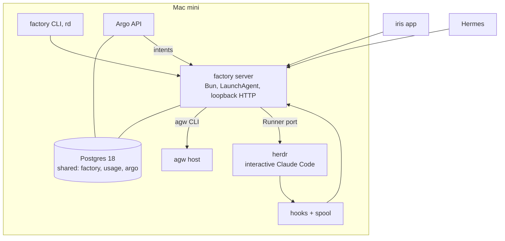
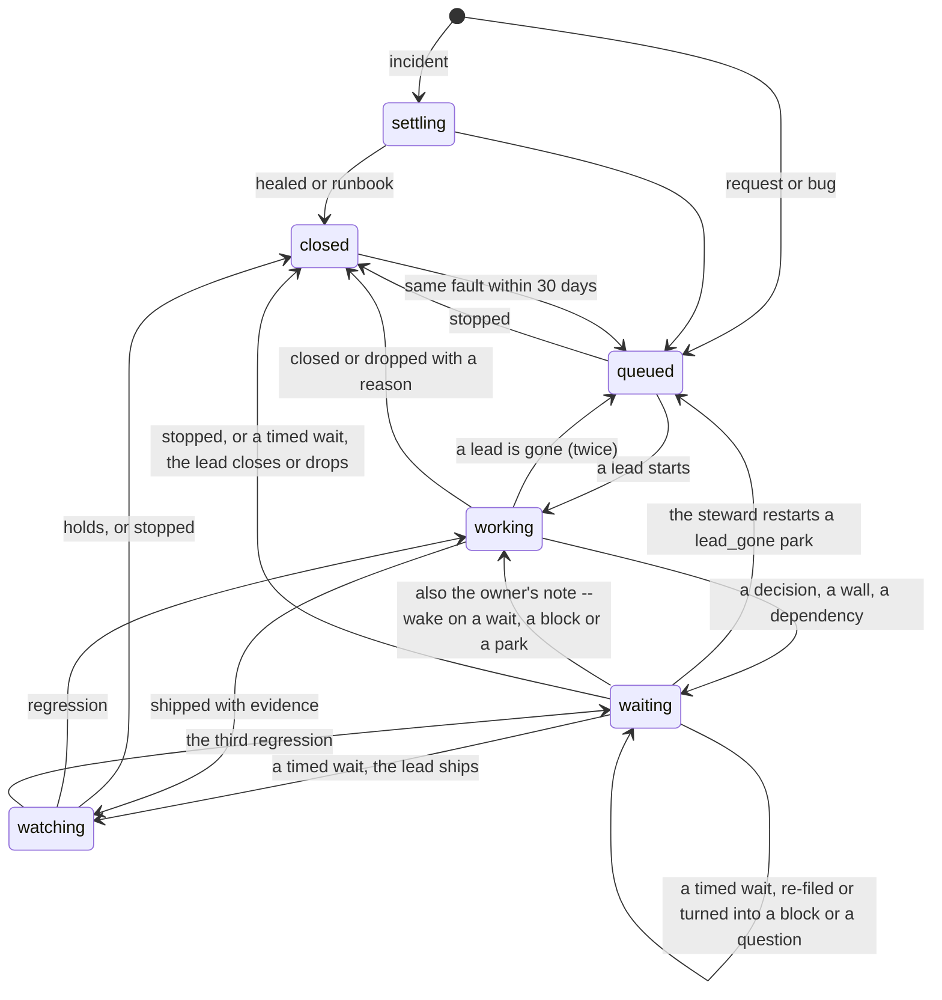

# Design

**TLDR.** One Bun server on the mini owns long-lived state in Postgres: sessions, the queue, capacity, later
Issues. Interactive Claude Code in herdr-core terminals does all the thinking; `agw` workflows do every model call the
factory needs; plain code does the rest. Hooks report what sessions do as facts, the server derives state from
those facts when read, and every effect carries a deterministic key, so a replay never spawns, types or posts
twice. The fleet layer (§3) ships first and carries today's `/wave`. The Issue machine (§4) sits on top of it.

**This page wins over TDD v2.4 wherever they disagree.** The reasons behind each choice are in `docs/decisions.md`,
the build order is in `docs/program.md`. The code is plain TypeScript and zod (SF6).

## 1. Principles

A design choice that breaks one is wrong.

1. **The factory runs the lifecycle; Claude Code does the thinking.** What a script can decide, a script
   decides. Routine words and judgments (same symptom? which project? how big?) are `agw` workflows. Anything
   that needs understanding a problem or code goes to a lead.
2. **The factory never calls a model.** No SDK, no key. `agw` is its only model path, called like any client.
3. **Max reasons about code, API tokens do the routine.** Claude Code on the Max accounts is the only thing that
   diagnoses or changes a repo. A full pool means waiting, never spilling.
4. **Hand over the problem, not a conclusion.** A brief holds facts, evidence and verified history, never a
   cheaper model's guess at the cause.
5. **One lifecycle, no side doors.** Every piece of work enters as an Issue and leaves with evidence or a stated
   reason. Until F2, a wave is the unit and the same rule applies to its close-out.
6. **Facts are stored, state is derived.** The one stored exception: an Issue's lifecycle state (§4), written by
   one module with an event per transition. Liveness ("working", "stuck", "walled") is always computed on read.
7. **Done means observed in production.** A lead's "done" is a claim. The evidence and the factory's own
   `make verify` after the hold are the proof. Wrong in production means fix forward.
8. **A self-improving platform, as code.** A fix verified twice becomes a runbook or a job check. Rules, probes,
   thresholds and prompts live in repos and change through an Issue with evidence, the factory's own included.
9. **The owner decides business, nothing else.** Product direction, spend, irreversible data loss, other people,
   plus security policy. Anything else that reaches the owner is a defect. Everything written for the owner is
   short, verdict-first and free of internal names.

Fixed boundaries:

- **Network:** no public endpoint. The tailnet plus the owner's GitHub user is the security boundary.
- **Liveness:** no turn limits and no wall-clock ceilings on a lead. The stall rule (§6) is the one liveness rule.
- **Scope:** `~/SourceRoot` only; IuRoot stays outside.
- **Instructions:** `AGENTS.md` only, no `CLAUDE.md` in any repo.

## 2. Shape of the system



- **One process.** A LaunchAgent, deployed like agw: release directories, health check, rollback of its own
  release. A Postgres advisory lock makes a second copy exit. Running sessions never notice a restart; they live
  in herdr, and their hooks spool what the server cannot take.
- **The database.** One database named `shared` on the mini's Postgres 18, a schema per writer (`factory`,
  `usage`, `argo`). agw keeps `agent_workflows` and grants read-only roles. F1 does not wait for A1, so whichever
  ships first creates the database, idempotently, through a target both repos can run.
- **API.** Loopback HTTP. One schema defines each operation, and both the HTTP route and the CLI verb come from
  it, as in agw's capabilities. Reads for dashboards are views in the `factory` schema; live updates are
  `LISTEN/NOTIFY`. Writes from any surface are intents through the API, never direct table writes.
- **CLI.** agw's contract (`--format json|plain`, data on stdout, messages on stderr, the same exit codes, never
  prompts). The block agents see stays small: `factory status`, `factory issue …`, `factory session …`,
  `factory project check`. The rest exists for the owner, the orchestrator and Argo, documented once.
- **Ticks and wake-ups.** `NOTIFY` wakes the worker on a new row; a tick every 5 seconds catches the rest and
  handles deadlines. `issues.wake_at` is the one Issue timer; `resume_at` on a spawn request is the fleet's.
- **Effects.** Each outside effect goes through a port (`Runner`, `Agw`, `GitHub`, `Notify`) and has a key
  recorded before it happens. A replay finds the key and stops.
- **Every start reconciles.** Before any effect: replay the spool, then look at the world once (herdr, worktrees,
  GitHub) for each open session and Issue. Open deadlines move by the downtime. Missed job slots run once. There
  is no separate adopt mode.
- **Dependencies point one way.** factory → agw, herdr-core, GitHub, the intake sources. agw never knows the factory.
  `rd` and the account picker stay in dotfiles and become clients or adapters (§3).

## 3. The fleet layer (F1)

Deterministic babysitting of the sessions `/wave` and `rd` start today. It replaces `wave-watch.sh`,
`fleet-keepalive.sh` and the Hermes babysitter cron (FL8). Issues do not exist yet at this layer, and the layer
does not need them: `issue_id` on a session is nullable.

### Sessions and events

A **session** is one Claude Code process the factory or `rd` started, identified by its Claude session id, with
its pane, worktree, repo, role, account, model, effort and parent. `rd` sets `FACTORY_SESSION` at spawn; without
it every hook exits at once, so the owner's own sessions never see them. Hooks are installed for every account's
config directory.

| Hook | Event | Used for |
|-|-|-|
| `SessionStart` | `session_started` (with the matcher: `startup`, `resume`, `compact`, `fork`) | binds session id and transcript path to the spawn |
| `UserPromptSubmit` | `turn_started` | prompt delivery proof, "no new turn" in the watchdog |
| `Stop` | `turn_ended` | turn boundaries; the send-back rule |
| `StopFailure rate_limit` | `limit_stop` | the resume watchdog |
| `Notification quota_auto_resume_*` | `quota_resume` (`fired`, `stale`, `disabled`) | the resume watchdog |
| `Notification permission_prompt`, `idle_prompt` | `prompt_blocked`, `prompt_idle` | blocked sessions |
| `SessionEnd` | `session_ended` | closes the session |

`UserPromptSubmit` is an addition to FL5's list: a turn's start is the only proof that a typed prompt arrived.

**The hook never blocks a session.** It appends the event to a spool file first, then posts with a 300 ms
timeout, and exits. `SessionEnd` has a 1.5-second budget, so the append is the part that must fit. The server
replays the spool on start and on each tick. The key is session id plus event name plus turn number.

The runner (herdr-core) is the backstop for what hooks cannot show. A tool call in progress produces no hook event, so
silence alone proves nothing; `stuck` needs the runner's agent status and the worktree's activity too. The witness follows
the core's event stream (a status shows at once, a lost or finished terminal asks for a pass) and runs a pass every minute
from that cache; it records the server identity (core pid and id; a change is a runner restart, an event) and the account
in effect, and reports dead panes.

### Derived session state

| State | Read from |
|-|-|
| `starting` | spawn recorded, no hook has spoken |
| `working` | latest `turn_started` has no `turn_ended` after it |
| `idle` | latest event is `turn_ended`, or `session_started` with no turn yet; no open wait |
| `waiting` | a declared wait is open (`factory session wait --on workers\|deploy\|owner`); `--done` or a delivered wake ends it |
| `walled` | a `limit_stop` or `quota_resume` with no later `turn_started`; a turn that ends after `quota_resume` fired stays `walled` |
| `blocked` | `prompt_blocked` with no later `turn_started` or `turn_ended`, and the runner does not show the agent `working` since (answering a prompt starts no turn) |
| `stuck` | `working`, the runner agrees, no commit or file change in the worktree for 45 minutes |
| `dead` | `session_ended`, or the pane is gone |

State reads from the latest `session_started`, so a resumed session starts clean. Hooks carry no token: they post
to a unix socket (mode 0600) and fall back to the spool. The socket serves the routes a session needs, not only events and waits (see "Hooks and the socket" below).

### The queue (FL1, FL3)

A **spawn request** is a row: repo, role, prompt, model and effort from the role table, a deterministic key, and
later the account, a `resume_at`, and the session it became. A spawn without capacity gets a `resume_at` and stays
in the table; nothing is dropped. The tick starts it when the time comes and admission says yes.

A key is spent when its spawn has ended. `ended` is derived at read time, never stored: the spawn is `started`, and its
session is `dead` or its pane is no terminal of the current core. Creating under a spent key is a `409 key_spent` that
carries the stored spawn; a live or queued key still answers 200 with its row. Reviving the row would start work a second
time, so the caller picks a new key (`rd`: `-r2`, `-r3`).

**Queue state** is `run`, `pace` or `drain`, set per scope: global, project, initiative. The most restrictive scope
that applies wins.

| State | Effect |
|-|-|
| `run` | admission decides |
| `pace` | lower concurrency; spends only toward weekly pace |
| `drain` | no new spawn. A running wave finishes its current wave; the chain stops at the boundary: its successor's spawn is held (`queued: drain`) and starts by itself when the drain lifts. Nothing is interrupted |

### Capacity and admission

- **Accounts come from the registry,** `dotfiles/config/claude-accounts.json`, never a constant. N accounts,
  today three. The picker stays in dotfiles; the factory calls `claude-account` through an adapter and stores
  each reading as a fact (`quota_readings`), so history survives and tests can inject a wall.
- **An account is eligible** if it is enabled, its auth is fine, and it keeps the owner's reserve: 15 % of the
  5-hour window and the last 5 % of the week, so new spawns stop at 95 %. A session already running there
  rotates at 94 % (below), one point earlier, so its successor can still be spawned elsewhere before the wall.
- **Never spill.** With every account walled the queue waits for the first reset.
- **A spawn holds its account** while queued or starting, and once started until a reading taken after its start
  shows it. A burst starts only as many spawns as there are open accounts; there is no per-spawn cost estimate. A
  spawn a rule holds back (`drain`, `pace`, no capacity) stays queued with a hold reason.

### Rules that act

| Rule | Trigger | Action | Key |
|-|-|-|-|
| **Resume watchdog** (FL2) | a session is `walled`, its account's reset has passed, no new turn for 5 minutes | one delivery-checked "continue" | `resume:<session>:<reset_at>` |
| **Send-back** (FL5) | `Stop` with live child sessions and no declared wait, `stop_hook_active` false, the turn did not end on a limit | the hook exits 2 with one line | turn number |
| **Rotation** | a `lead` session's account reaches 94 % of its week | one note: write the handoff and rotate; the next rotation lands on another account | `rotate:<session>:<week>` |
| **Folder trust** | any spawn | pre-trust the path before starting the agent, for new repos as well as worktrees | none, idempotent |
| **Blocked** | `blocked` for 2 minutes | a line in `factory status`, and to the session's parent if it has one | event id |
| **Wake** | a session `waiting` on its workers, with child sessions, none unfinished (`dead`, or `idle` after a turn; a spawn without a session yet is unfinished) | one note listing the children and their states; once a turn proves it, the wait it answers is cleared (unless a newer wait was declared) | `wake:<session>:<wait event id>` |
| **runner restart** | the server identity (core pid or id) changed | each affected session resumes by id, with a note that a turn was cut off; one the kept terminal's own resume (`hc-resume`) already brought back gets the note typed instead | `restart:<server>:<session>` |

The send-back counts only child sessions the factory knows. A background shell inside a session is invisible to
a hook; that gap stays until a measured failure says otherwise.

**The tick.** Four rules, each from a defect both spike arms shipped (`docs/spikes/2026-10-30-effect/verdict.md`):

- **Never call a port inside a transaction.** Claim the row and commit, call `Runner`, record the result in a new
  transaction. The key recorded at the claim is what makes a crash between the two safe.
- **Every port call has a timeout.** A hung `hc` must fail the call, not stall the tick.
- **Attempts are capped.** A spawn out of attempts is `failed` with a reason and leaves the batch, so it cannot starve
  the ones behind it. The tick loop itself survives any single failure and logs it.
- **Eligibility is rechecked at start,** not only when the spawn is queued. A stored account is a hint.

**Prompt delivery.** `factory session note` is the one way anything types into a session; `rd say` becomes this. The full behaviour is under "Prompt delivery" in *As built* below.

**One space per repo (FL6).** A space is keyed by path; a second space for the same path is explicit (`new_space`), for a separate plan or worktree; the full rules are under "Spaces (FL6)" in *As built* below.

**Test slots (FL7).** `factory slot run -- <cmd>` wraps `make check` and test runs in a host-wide semaphore: a
leased row, two slots to start and tuned from the load record, released on exit or lease expiry. It is closed on
contention and open only on an outage (RS10 (b)): with the server down the command runs anyway, because a dead factory must
not block the work that repairs it; with the server up the caller keeps waiting, and a wait over its limit exits 75 without running.

**The role table (FL4).** One table for lead, implementer, verifier, reviewer and Explore, giving tier and
effort. `rd --role` and agent frontmatter read it; values move only on data from track U. Model ids stay in agw's
and dotfiles' route tables; this repo names tiers.

### `rd` becomes a client

`rd wave`, `fan`, `say` and `close` call the server when it answers and keep today's path when it does not. A dead
factory must never stop the waves that would repair it. The gate logic (`wave-gate.py`) stays until the server
covers each check. The verbs move under `factory` once F4 is running, and `rd` stays as an alias.

### As built

What runs today, moved here from `AGENTS.md`, which keeps the rules and points at this section. Where the design above and this section differ, this section is the code's behaviour.

#### The tick, retries and admission at the claim

**Never call a port inside a transaction.** The tick claims a row and commits, calls the `Runner` (every call has a
process timeout), records the result in a new transaction. A failing start is retried until a time budget from the
first claim (30 min, `FACTORY_RETRY_BUDGET_MS`), then `failed` with a logged reason; `factory spawn requeue <key>`
starts a failed spawn over. Admission is decided again at every claim except a reclaim (an expired lease: its agent may
already run, so it finishes on its account), and only due rows are selected
(`docs/design.md` §3, "The tick").

#### Spaces (FL6)

**One space per repo (FL6), keyed by path.** A spawn has a `space` (a path, default its `repo`, resolved like the repo and inside
the same roots, and containing the repo: 422 otherwise; `POST /spawns` takes `space` and `new_space`). The space is an id the
Runner puts in the label `herdr.space`: the entry of the Herdr app's document `herdr-app` whose `folder` is the resolved space
path (found by path, so two repos named `app` have two spaces and a worktree's `space` is its main checkout), else
`sp-<dir>-<12 hex of sha256 of the realpath>` (the full root is hashed, so `~/SourceRoot/x` and `~/IuRoot/x` differ). A second
spawn in a repo is a new tab in its space. `new_space: true` makes a second space for a path that already has one (the id also
hashes the key, so a retry makes the same); on a path with none it takes the first. **A space the factory names is seeded**
(`seedSpace`, `app-doc.ts`) in the app's document before the terminal runs, or the app adopts the label with `name: ""` and
the terminal's cwd as `folder` (a worktree, so the sidebar shows `w9-…` and the next spawn at the main checkout finds nothing):
`{ id, name: basename(space path), folder: space path, tabs: [] }` appended to `spaces[]`, compare-and-set on `version`, a
conflict reads again (3 tries), a value of null (never written) starts `{ spaces: [] }`. The path is the space's (the main
checkout for a worktree). A second space for a folder that already has an entry is named `<basename> <n>` (`app 2`). An entry
with the id is never touched, nor a document with no `spaces` array or with an entry that has no id (not the app's). Best effort like `nameTab`: a failure does not fail the
start, the id stays the label's, and the next start for that id seeds again. Not seeded: an id found in the document, a foreign
id with a terminal in it. The result names the terminal, the tab and
the space (`spawns.session|tab|workspace`; `Spawn.pane` is `session`). A try that fails reports its space
(`RunnerError.workspace`), the tick records it, and a retry or a runner-restart resume passes it back as `StartInput.workspace`:
it wins when it is an id the Runner made (`sp…`) or a live terminal is in it.

**The fixed spaces (RS6, `spaces.ts`).** Every repo in `~/.config/factory/spaces.json` (`FACTORY_SPACES_FILE`;
`{"spaces": [{"name", "path"}]}`, written by dotfiles `make setup`) has a space and a `plan:<name>` tab, the owner's planner shell.
`Spaces.kick()` is the tick's call, with its own ten-minute interval (the first tick runs the first pass), behind the tick's back:
never throws, one pass at a time, never in a transaction. Per entry, in file order: the path goes through the spawn's own
`resolveRepo` (real path inside `FACTORY_REPO_ROOTS`, else skipped with the reason; so an IuRoot repo or a missing path is
skipped, and a link out of the roots is too); then `HcRunner.ensurePlan`, through the same `serialized` lock as a start. It finds the space as
a spawn does (`spaceId`: the app's entry whose folder is the real path, else the stable id, seeded), and a live terminal labelled
`factory.key=plan:<name>` means nothing to do. A missing or finished one (a finished one is removed first; nothing live is ever
closed) starts with **no argv** (the core runs the machine's own shell: verified on a scratch core 0.1.17 as `/bin/zsh -l`, a
login shell), `cwd` the repo, `keep`, `no_parent`, labels `factory.key=plan:<name>`, `herdr.space`, `herdr.tab` (`tabId('plan:<name>')`) and
`factory.tab_name=plan` (the tab is also named `plan` in the document when the app has an entry). So a second pass with nothing
changed reads (`terminal.list`, `doc.get`) and writes nothing. An absent or invalid file is logged once and does nothing (zod at
the boundary); one entry failing is a line in the pass's `errors` and holds nothing back.
**Order is not the factory's:** the sidebar order is dotfiles' `groups.json`, applied by the app's `jk-spaces` mod; the factory
never reorders the document and never moves a tab. A new space is seeded with `tabs: []`, so the plan tab, its first terminal, is
its first tab; a space that already has tabs gets its plan tab after them (no pre-written tab entry: whether the app adopts one is
unverified and it is the fragile path).
**A `plan:` key is not a spawn:** no `spawns` row, no session, no hook, no Claude Code until the owner starts one (that session
is the owner's). `HcRunner.close` refuses it (a permanent `RunnerError`), `start` refuses it as a spawn key, and `finalize` only
closes the lead's own and its workers' keys, never one that starts with `plan:`. **A repo that is not listed** still gets its space
on first use, appended by `seedSpace`, as before.

#### The runner

**The runner looks before it acts.** `HcRunner` (`hc-runner.ts`, herdr-core 0.1.15 over `hc connect`; `HcClient` in `hc.ts` is one
short-lived process per JSON-RPC call: `hello`, the request, stdin closed, the reply read by id, each under the process timeout
and the start budget, `childEnv()` stripping the factory's secrets; `HC_BIN`, and `HC_SESSION` for tests, pick the binary and the
core). Every terminal carries `factory.key=<spawn key>`: a live one running claude is never started again, only proven; a
finished one that reported, had a status or a turn is started (its prompt ran; a second run would repeat the work), one that never
reported, or a live one that is no longer claude (the shell the core puts in a kept terminal after a `kill -9`), is
killed if needed, `terminal.rm`'d and the spawn started afresh (a retry may be on another account); an error is a transient
`RunnerError`. Finding, placing and running go one at a time per runner (two starts never both take an empty space's id).
**The prompt is the last argument of the program** (`claude --dangerously-skip-permissions --model <tier> --effort <effort>
[--resume <id>] <prompt>`; `claude --resume <id> "<prompt>"` takes the id as the option's value), `cwd` is always the repo, `keep: true`, the
name an hc-valid `agentName`; so nothing is typed at start. The agent is started when `terminal.get` shows it reported (`reported`,
a status or `turn >= 1`) inside the deliver window (30 s). A terminal that is live but silent after the window is started, unconfirmed (the hooks and the witness confirm it later), never a failed start: a load-slow Claude Code is not a failure. A terminal that ended or cannot be read is a transient error. `claude-pretrust.sh` runs before every
spawn (a test pins that a path never seen before is trusted first). A prompt cannot start with `-`. The account is in the `env` of
`terminal.run` (`accountEnv`): `CLAUDE_CONFIG_DIR` only for a non-default account, never empty, never inherited, plus
`CLAUDE_ACCOUNT_PICKED`, `USAGE_LANE`, `FACTORY_SESSION`, `FACTORY_ROLE`.
Placement is by labels, no window needed: every spawn is a **tab** (any role, with or without a parent session; child and hidden placement are gone, Reset row 8) and has
`no_parent`, `herdr.space`, `herdr.tab` (`tb-<12 hex of sha256 of the key>`) and `factory.tab_name`; its entry in the app's
document is named after the key once the app has one (compare-and-set on `version`, `app-doc.ts`; the witness retries on a label
or document event). `spawns.placement` stays as an unread column (an old `child` or `hidden` is a tab); `POST /spawns` and `factory spawn create` no longer take `placement` (an unknown body field is dropped, the CLI flag is a usage error). The app's document is read for spaces: only a confirmed absence (`not_found`, never
written) falls back to a hashed id; a call that fails is an error for the retry. `type` reads `terminal.get` and sends only to `idle` (guarded with `if`) or `done`, otherwise `busy`; a core
refusal is nothing typed (`blocked` or a changed status: `busy`), a lost call is `UncertainTyping`. The doc shape of
`herdr-app` (`spaces[].{id, folder, tabs[].{id, name}}`) is read loosely; the live document (2026-11-01) confirms it.

**A failed spawn leaves its terminal.** It is labelled with the key and `factory spawn requeue` finds it again (an agent already
running keeps the account it started on); closing it is a decision, not a side effect of `failed`. A finished terminal is
removed and made again on every try, so a retry on another account gets that account's environment.

#### The trust boundary

**Trust boundary.** The token can start Claude Code with `--dangerously-skip-permissions`, so a spawn's `repo` must be
inside an allow-listed root: `FACTORY_REPO_ROOTS` (colon-separated, default `$HOME/SourceRoot:$HOME/IuRoot`). The path
is resolved with `realpath` and must be strictly inside a resolved root, so neither `..` nor a symlink leaves it;
otherwise `POST /spawns` answers 422 and stores nothing (the row keeps the resolved path). Within the roots the token is
shell access as the mini user by design. The API is loopback only and the tailnet plus the owner's GitHub
user is the perimeter (`docs/design.md` §1). `FACTORY_REF=<branch>` runs whatever is on that origin branch with the
server's secrets, the same boundary; `make deploy` without it deploys `master`.

The factory door (§11) is on the same side of this line as a pane. It posts to the hook socket, which has no caller identity (SF11),
so a compromised door can call any route the socket serves: `POST /intake`, but also `POST /issues` and `POST /spawns`, which
starts Claude Code inside `FACTORY_REPO_ROOTS`, as any process of the mini user already can. Accepted, as SF11 accepted it for
panes; what the door lacks is the token, a database credential and the queue's writes. A socket of its own for `/intake` alone is
the change that would narrow it.

#### Hooks and the socket

**Hooks: spool first, then post.** `factory hook <event>` (session-start, user-prompt-submit, stop, stop-failure,
notification, session-end) does nothing without `FACTORY_SESSION` (set at spawn: the Runner puts the spawn key in the
pane's `--env`, `rd` its agent name). Otherwise it appends one line to `~/.local/share/factory/spool/<session>.jsonl`
(`FACTORY_SPOOL_DIR`, one `O_APPEND` write), posts it to the server's unix socket (`FACTORY_SOCKET`, default
`~/.local/share/factory/hook.sock`, 300 ms timeout) and exits 0 whatever happens, with one exception: the send-back
(below). The hook has no token and the Runner
keeps secrets out of the panes, so the socket (mode 0600, owner only) is its credential; the socket serves
`POST /events`, `POST /sessions/:id/wait` (`factory session wait`), `POST /sessions/:id/note` (`factory session note`),
`POST /sessions/:id/stop-check`, `PUT|DELETE /slots/:id` (`factory slot run`), `POST /spawns` (a pane starts work, below),
`POST /issues` and `GET /issues[/:id]`, `GET /issues/:id/timeline` and `GET /issues/facts` (a pane files work and reads it back, §4), `POST /intake` (the door's alerts, §11), and
three reads a spawner needs to follow it, `GET /spawns/:key`, `GET /sessions/:id` and `GET /queue[?project=]` (`factory spawn get`,
`session get`, `queue get` use the socket when `FACTORY_TOKEN` is not set), which a session in a pane runs without a token, and
nothing else (not the spawn list, requeue, status, quota or any write to the queue); bound under umask 0177. Any session on it can note any other and file events for any other (the socket is the trust boundary and has no caller
identity; a same-user pane can already drive any terminal through hc, so this adds no capability, and it is a known and accepted
cross-session path); an event of
kind `runner_restarted` or `pane_gone`, or filed under `_runner`, is refused there and in the spool: only the witness records them. It imports nothing but `node:fs` and `@software-factory/contract/spool`: keep zod and
the rest of the CLI out of `src/hook.ts` (`bin/factory.ts` loads it alone). **Stdout stays empty for every event, and
stderr too except for a send-back**: Claude Code injects a SessionStart/UserPromptSubmit hook's stdout into the
session's context (tested per event). **One exception, by design:** on `session-start` with `source: compact` in a session whose `FACTORY_SESSION` is an
Issue lead's key (`lead-<issue>-<attempt>`, parsed in the hook, no server call) it prints one line after the spool line: `Context was compacted. Re-read Issue <issue> with
\`factory issue show <issue>\` and your brief's standing orders before acting.` Claude Code adds a `SessionStart` hook's plain-text stdout to the session's context
(`code.claude.com/docs/en/hooks`, checked 2026-11-05; `source` is `startup|resume|clear|compact|fork`). `session-start` also reports `CLAUDE_ACCOUNT_PICKED` as `account` (only if it is a name in the registry's alphabet, checked in the hook and again by the server), which is how
the factory knows the account of a session no spawn describes (`rd`'s); a spawn's own account wins.

#### Prompt delivery

**Prompt delivery** (`prompts.ts`) is the one way anything types into a session. `factory session note <session> <text>`
(`POST /sessions/:id/note`, socket or token; `--id` makes a repeated call one note) and every rule below record a row in
`factory.prompts` under its id first (`ON CONFLICT DO NOTHING`: the same id is one prompt). The tick types it through
`Runner.type` (`terminal.send`; `busy` while the runner says `working`) once the derived state is `idle`, `waiting` or
`walled`, so a `working`, `blocked`, `starting` or `dead` session holds it until its turn ends; the claim is committed
before the call and the result recorded after it. `sent` becomes `delivered` on the next `turn_started` after the claim.
**A lead's note is not held for ever by a long turn** (`FORCE_NOTE_AFTER_MS`, 5 min): a `note` prompt for a session `lead-…` (the owner's note and the steward's) still pending that long while the session is `working` is typed anyway (`Runner.type` with `force`: an agent that is `working` takes it, one that is blocked on a dialog is still `busy`); Claude Code queues it for the next turn. It may start no turn of its own, so for such a prompt a `turn_ended` after the claim proves delivery too (as a `turn_started` does). Rules' prompts and every other session wait for their prompt as before; the 24 h `PENDING_TTL` never matters here. A forced note stays `sent` while its lead is still `working` (only that turn's end proves it: no retry, no `failed`); once the lead is not working and nothing proves it, the rule below applies from then. No turn within a minute: Enter is pressed once more for a prompt whose typing was confirmed (`Runner.type` with `enterOnly`), otherwise the text is typed again; a resume is started again, `MAX_SENDS` 2, then `failed` with an `unconfirmed: ... not delivered` reason, which stays in `factory status` for
a day from when it failed. A Runner error that says nothing was typed is retried every 30 s, five times; one that cannot say
(`UncertainTyping`: hc timed out or died after the call) counts as sent and waits for a turn; the one retry after a
minute without one types the text again, as for a claim left `typing` by a crashed tick (after the start budget plus a minute): only
a prompt whose first typing the runner answered `typed` (`prompts.typed_at`, migration `030`) gets Enter alone, since only then is the text known to be in the pane.
`Runner.type` types only into an agent the core calls `idle` or `done` (`working` queues the text, `blocked` would answer its dialog). A `pending` prompt expires after 6 h
(a rule's) or 24 h (a note). A rule whose prompt failed or expired asks again after 30 min while its condition holds
(the same row starts over; a delivered prompt, a note, or a prompt recorded as undeliverable never does). One prompt is
typed per session per pass. A later prompt for a session waits while an earlier one is `typing` or `sent` and unproven. A retry is not typed if a turn has shown up since its claim; a `busy` answer clears the claim, so a later turn proves nothing. A prompt resumes a session only while it has shown no life since the prompt was recorded. Only
prompts that reach the Runner count against a tick's batch of 10. A note cannot start with `-` (it could read as a
flag) and cannot use a rule's id prefix (`resume:`, `rotate:`, `blocked:`, `wake:`, `restart:`), which would take the rule's place.
The blocked note names the worker but not its prompt text: that is agent-produced and stays in `factory status`.

#### Rules that act

**Rules that act** (`rules.ts`, run at the start of every tick after the spool replay and the quota poll; each records its
effect under a key, so a replay records nothing):
- *Resume watchdog* (FL2): a `walled` session whose account has a reading naming the wall's end (the first reading after
  the wall that carries one: `exhausted_until`, else the reset of each window at 95 % or more, the later; else the 5-hour
  reset), with 5 minutes passed since the later of that reset and the last wall event and no more than 6 hours (a wall
  older than that is history, so a deploy wakes nobody): a `continue` prompt, `resume:<session>:<reset_at>`. Needs the
  session's account.
- *Send-back* (FL5): on `Stop` the hook asks `POST /sessions/:id/stop-check` (300 ms) before it records anything: a stop that is
  sent back is no end, so it writes no `turn_ended` and the turn stays open (the session stays `working`, nothing is typed into
  it); a stop that is let through is spooled and posted as usual. The server
  answers `sendBack` when the session has live child sessions (sessions of spawns whose `parent` is it; `parent` comes
  from `POST /spawns`, `factory spawn create` defaults it to `FACTORY_SESSION`), no open wait, is not `walled`, and the
  hook says `stop_hook_active` is false; once per turn (`effects` key `sendback:<session>:<turn>`, recorded when the answer is given: an answer the hook
  cannot wait for, 300 ms, spends that turn's send-back). The hook then exits 2 with the one line on stderr. A server that is down, slow or odd means exit 0. A pane has no token and
  starts work through the socket (below), so the children of a session in a pane carry its `FACTORY_SESSION` as `parent`:
  the send-back sees them whoever started the pane.
- *Rotation*: role `lead`, its account at 94 % of the week or more on a fresh reading: one note, `rotate:<session>:<week reset>`.
- *Blocked*: `blocked` for 2 minutes is a line in `factory status`; if the session has a live parent, also a note to it,
  `blocked:<event key>`.
- *Wake*: a session `waiting` with `--on workers`, with at least one child session and none unfinished, gets one note,
  `workers done: <child> <state>, …`, `wake:<session>:<the wait's declared event key>` (one per declared wait; a new wait
  can wake again). A child is finished when `dead` or `idle` after a turn of its current life (`liveSessions`' `finished`);
  a spawn of the session's that has no session yet (queued, held, waiting for capacity, starting) is not. A failed spawn
  does not hold the wake: it is a line in `factory status`. A parent that is not `waiting` gets nothing (send-back covers
  a working one). This is what resumes an orchestrator that ended its turn on a wait. **A delivered wake ends the wait it
  answers:** in the transaction that records the delivery (the `turn_started` that proves the note, in `settlePrompts` and
  in the retry path of `deliverPrompts`) the factory records a `wait_cleared` (key `<session>:wait_cleared:<prompt id>`,
  dated 1 ms before that turn's start, never before the wait it ends; the Stop hook's `stop-check` settles the session's own wake first), so the session reads `idle` when the woken turn ends and send-back sees no wait again; the
  orchestrator needs no `--done`. Only while the wake's wait is still the session's latest wait event: a `wait_declared`
  after it (the woken turn waits again) or a `--done` already there is left alone. At delivery, not at creation: until a
  turn proves the note the session stays `waiting` (true: it has not woken), and a wake that fails or expires clears
  nothing, so the rule can ask again after 30 min.
- *runner restart*: a `runner_restarted` event at least 3 minutes and at most 2 hours old: each session that had a turn open
  at that time, has had no hook event since and that the runner has not shown since is resumed by id (`Runner.start` with
  `resume`: `claude --resume <claude session id>` in a new tab on the spawn's account, the note as its first prompt),
  `restart:<new server identity>:<session>`. A resume starts an agent, so it is admitted like a spawn claim (held under
  `drain`, `pace` or a full account, only on the account the conversation lives in; the hold shows in the prompt's error) and
  reserves that account in the same locked transaction that admits it (given back if the start fails), so a spawn claim in between
  sees it taken. A restart prompt never re-arms. **One resumer per session:** `hc-resume` (dotfiles) types `claude --resume`
  into every kept terminal with the resume labels, factory spawns included, and types no prompt. A session whose only events since
  the cut-off turn are `session_started` with source `resume` (an idle notice may follow; no turn; the resume may precede the
  witness's `runner_restarted` by up to 2 minutes; a resume from an earlier restart does not count) was resumed in place: the same note is typed into it (`via: type`,
  the same id), nothing is started. A resume prompt recorded before that resume landed is turned into a typed one at delivery, so the
  factory never starts a second copy of a conversation something else resumed. `hc-resume` is not changed: skipping factory terminals
  would leave idle and waiting sessions (an orchestrator waiting on its workers) as a shell nobody resumes. A session that is not a factory spawn (or never reported its Claude session
  id) gets a `failed` prompt with the reason: that is its line in status.

#### `factory status`

**`factory status`** (`status.ts`, `GET /status`, token): two lists of lines (RS3, §11 "The health line"). `attention` is the asks, the decisions only: a session `blocked` 2+ minutes, an
Issue's open question (`Issue N asks`), an Issue its lead blocked (`Issue N blocked`) `health` is everything else that needs a look and no decision: every
park (`Issue N parked for <age>: …`, reasons `wall`, `lead_gone`, `unreported`, `parked`), stuck and walled sessions, failed notes and spawns, notifications not delivered, an alert that starts no lead, a wait for the claim, a lead that did not start, a worktree not made or kept, a finalize that failed, the digest's failed passes, and the three
lines below. A line is in one list only. **A line about something finished ends 72 h after it finished** (`FINISHED_HEALTH_MS`, `health.ts`): a failed spawn (no failure time is stored, so the newer of `created_at` and `assigned_at` stands for it), a failed note (`failed_at`), a notification not delivered (`failed_at`), a kept worktree (the event's `at`); a line about something ongoing (a park, a silent or over-budget lead, regressions, a live wall or stuck session, a lead or worktree that cannot start, a finalize that failed) stays while it is true. Derived at read; `/fleet` reads these lines, so both agree. Sessions not `dead` (walled, blocked, stuck, working, waiting, starting, idle), the queue with hold reasons,
the accounts' readings, a line `reviews: <live>/<slots> live, deep today <n>/<cap> per account (<account n>, …)` (`Status.reviews`; n is the most any one account has started since 00:00 UTC), the open Issues (§4 "Following an Issue": at most 40, the rest counted), prompts not delivered (failed first, at most 100, the rest counted as "N more not shown"). `--format plain` prints it as one screen.

#### The spool and the event key

**The key is session, event name, turn number** (`<session>:turn_ended:3`), counted from the spool, written into the
line, so a replay carries it. Counting and appending happen under a per-session lock (`<file>.lock`, a `mkdir`; the
server's rotation takes it too); a hook that cannot get it in 200 ms writes a key with a random suffix instead. A kind that repeats inside a turn gets `:2`, `:3`. Event time is strictly increasing per
session. `SpoolReplayer` (`spool.ts`) reads the directory at the start of every tick and stores whole lines past its
in-memory offset (a restart re-reads: the unique key makes it harmless). A quiet, fully read file over 64 KiB is
rotated: its sums (`turns`, current-turn counts) go to `<file>.base` first, so numbering never starts over, then the
file is retired. Spool files of dead sessions are kept (a reused `rd` name must not reuse keys). A rotation that died after moving the
file leaves `<file>.retired`; the next pass stores it and removes it. The lock holds a token, so a holder taken for
dead cannot release its successor's lock.

#### Derived state

**Derived state** (`sessions.ts`, first match wins; turns, walls and prompts count from the latest `session_started`):
`dead` (last of session_started / session_ended / pane_gone is not a start; a `pane_gone` is withdrawn by a later hook
event or by the runner showing the agent again), `starting` (the factory has the row, nothing proves it is up), `walled` (limit_stop or quota_resume with no
later turn_started; a turn that ends after `quota_resume fired` ends it too), `blocked` (prompt_blocked with no later
turn_started or turn_ended), `working` (open turn; `stuck` when the runner says working within 5 minutes and neither the
worktree nor the turn moved for 45 minutes), `waiting` (an open `factory session wait --on workers|deploy|owner`, no
open turn; the wait ends with `--done` or when a delivered wake answers it), `idle`. Events are ordered by event time, then arrival. Only `limit_stop` from `StopFailure rate_limit`
is a wall; other stop failures are ignored.

#### Sessions

**`factory.sessions` is what the factory follows; `usage` owns the session entity.** Row id = `FACTORY_SESSION`; a spawn
gets its row when the tick claims it (`starting` until its first event; the pane is added when the Runner returns it; a
spawn that fails for good without a pane or event takes its row with it), an `rd` name when its first event arrives. `session_started` binds
Claude's session id, transcript path and cwd (the join key with `usage`); an older start delivered late does not
overwrite a newer binding. The hook also reports what the pane knows of itself: `FACTORY_ROLE` (the role; a spawn's own
role wins) and its terminal (`HC_TERMINAL_ID` as `pane`, with no tab), so `session get` answers `pane` for an `rd` session too (nothing in the factory reads `tab`).

#### The witness

**The witness** (`witness.ts`, `hc-events.ts`) follows herdr-core's event stream: one long-lived `hc connect` (`events.subscribe`)
keeps a map of every terminal (the snapshot, then `created`/`restarted`/`status`/`turn`/`foreground`/`labels`/`lost`/`finished`/
`removed`; `missed` replaces the map; a line that is not JSON is dropped and the map read again). The stream ending (a core
restart, a dead `hc`, 45 s without a heartbeat) reconnects with a wait that doubles to 30 s and reads `server.status`: a changed
`pid@core id` asks for a pass. While the stream is down `agents()` asks `terminal.list` directly, and a core that does not
answer records nothing. A pass runs every minute, on a debounced `lost`/`finished`/`removed`/`restarted` event of a known
session's terminal, and on a restart; a `status`/`turn` event stores the agent's status at once (`agent_status`). A pass records each session's agent status, the worktree's last
change (`git log` + `git status` with `GIT_OPTIONAL_LOCKS=0`, only for an agent that is working), and the server
(`pid@core id` from `server.status`): a change is the event `runner_restarted` (pseudo-session `_runner`); a stored identity in the
old format (`pid@start time`) is replaced without one. A session is matched to a terminal by its `factory.key` label, Claude session
id, address, then name (a terminal carrying another session's key is never matched, by any of them, nor by a status event); a `terminal.list` never undoes a newer stream event; a record that does not parse fails the whole snapshot or list (the stream reconnects with its backoff), and a failed refresh after an unreadable line makes `agents()` ask the core directly; a finished terminal, or one the core put a shell into after the program died (no status, Claude not in the
foreground), is no agent. A session whose pane is a terminal of this core (`t7`, `t1n`: `t` and base 36, so letters follow `t19`; a classic pane `w4V:p3J` is none) and that no agent matches in two passes in a row
gets `pane_gone` (= `dead`, key per disappearance); a pass in which the runner restarted or could not be identified counts nobody
as missing, and an agent that returns revives the session. Git runs without the server's secrets, `core.fsmonitor` or hooks (the
agent controls `.git/config`), four probes at a time. `GET /sessions` answers with the newest 200.

#### Panes are clients (SF11)

**Panes are clients (SF11).** `POST /spawns` on the socket takes the HTTP route's body, validation (400), role check (422) and
`FACTORY_REPO_ROOTS` check for `repo` and `space` (422, nothing stored), and is idempotent by key (a second create answers the
stored spawn, 200) **while the key is live**. A `started` spawn whose agent is gone reads as `ended` in every view
(`spawn list|get`, the create's answer; nothing stores it): its session is `dead`, or its pane is no terminal of the
current core (a classic-herdr pane, or none). A create under an ended spawn's key answers **409** `{error, code:
"key_spent", spawn}` and never revives the row; the CLI exits 5 (`conflict`) with `code` and `details.spawn` on the error
line, and `rd` derives the next key (`<key>-r2`, …). `factory status` lists neither `started` nor `ended` spawns. The caller is `parent`, which the CLI takes from `--parent`, else `FACTORY_SESSION`. `factory spawn create`
uses the token when `FACTORY_TOKEN` is set and the socket otherwise; `spawn get`, `session get` and `queue get` the same. The
socket has no caller identity, so a pane can name any `parent`: the accepted boundary of SF11, now with spawning in it (the
repo roots still bound where it can start, and a same-user pane can already start Claude Code through hc).
The contract `rd` reads: `Spawn` (`status` `queued` with a `hold` is held, `starting` claimed, `waiting` for capacity; `pane`, `tab`,
`workspace`, `space`, `repo`), `Session` (`pane`, `tab`, `role`), `QueueView` (`effective`), all in `packages/contract`.

#### Test slots (FL7)

**Test slots (FL7)** (`slots.ts`, table `slots`): `factory slot run [--name <label>] -- <cmd>` asks `PUT /slots/:id` on the socket
until it is granted (once a second), renews the lease every 10 s while the command runs (30 s lease; a holder that stops renewing
loses it at the next call of anyone), and gives it back with `DELETE` on exit or `SIGTERM`/`SIGHUP`/`SIGINT`. `FACTORY_SLOTS` slots
(default 2; a signal sent to the wrapper is passed on to the command, and a renewal answered "wait" says once that the lease lapsed), granted to callers in the order they first asked (a waiter that stops polling for 15 s leaves the line), all behind
one advisory lock. The exit code, stdout and stderr are the command's own (killed by a signal: 128 plus it; can't start: 127).
**Open only on an outage:** no answer from the server runs the command anyway with one stderr line. **Closed on contention:** no
slot within `FACTORY_SLOT_WAIT_MS` (client side, default 2700000, 45 min) is one stderr line and exit 75 (`EX_TEMPFAIL`) without
running the command; `FACTORY_SLOT_OPEN=1` runs it anyway instead. `make test` (so `make check`) runs `bun test` through this checkout's CLI when `factory`
is installed, and bare otherwise (CI).

#### Quota

**Quota is a stored fact, read from the picker.** `ClaudeAccountSource` (`quota.ts`) runs `claude-account usage --json`
(`FACTORY_CLAUDE_ACCOUNT_BIN`, default `~/.local/bin/claude-account`, the Wave 1 process timeout) and parses it with zod: one
row per account of the registry (`dotfiles/config/claude-accounts.json`), so accounts are never listed here and a fourth
appears when the picker lists it. The tick polls at most once a minute (a failed attempt counts; the error goes into the
tick's `errors`, never crashes it); `factory quota refresh` / `POST /quota/refresh` polls now, `factory quota get` /
`GET /quota` shows the newest row per account. `quota_readings` keeps every row: percent of the 5-hour window and the week
(null = no sample), both resets, `enabled`, `auth_ok`, `exhausted_until`, `read_at`, and `sampled_at` (read time minus the
sample's age). `PUT /quota/accounts/:account` stores a reading by hand (tests, operators); the next poll supersedes it.
A reading not renewed for 10 minutes is stale and admits nothing (a stopped poller, an account that left the registry); the
age of the picker's own sample is not judged, only stored. A window the picker has no number for counts as unused (as the
picker weighs it); both without, or no sample time, is no sample and the account is closed. Rows older than a week are
deleted, the newest of each account kept.

#### Admission

**Admission** (`admission.ts`, one function, used at `POST /spawns` and at every claim; first rule that says no wins):
1. queue state `drain`: hold. 2. (the one-wave-per-repo hold is gone, Reset row 8) 3. `pace` and any live session of the project: hold `pace`. 4. an account: enabled,
auth fine, a sample, not `exhausted_until`, below 85 % of its 5-hour window and below 95 % of its week; under `pace` also
weekly use at or below the elapsed share of its week. Never spills: with no account open the spawn is `waiting` with
`resume_at` the first time any account opens by its own reading (a window's reset; both windows closed: the later one; under
pace the moment the elapsed share reaches the use); none if no reading names a time, or if an account is open by its standing
and only its load keeps it from being picked (a far reset of another account is no opening then), a new reading wakes it.
**The spawn cost is not a number:** an account takes one new spawn per sample. A queued or starting spawn holds its account (no agent runs yet, no sample
can show it); a started one holds it until a sample is taken after the moment it started (`assigned_at`, moved to the start;
`sampled_at` is stamped before the picker is asked). Then the account is offered again (the poll shows it within about a
minute). A burst starts as many spawns as there are open accounts
and the rest wait for the next sample.

**Retired (Reset row 8):** the review transport (hidden `reviewer` sessions, `review_slots`, `deep_cap`, the review ceiling, `FACTORY_REVIEW_SESSIONS`, `FACTORY_REVIEW_DEEP_CAP`, `FACTORY_REVIEW_IDLE_MS`, `spawn create --review-job`) and the `wave` hold are deleted. The spawn columns `review_job`, `review_tier`, `review_effort`, `deep_allowed` and the table `review_outcomes` stay in the schema (migration `029`) and nothing writes or reads them; row 9 drops them. `factory spawn cancel <key>` (`POST /spawns/:key/cancel`, token and socket; `cancelSpawn` in `spawns.ts`) stays: a `queued` or `waiting` spawn never claimed becomes `cancelled`, the same call again answers the same row, a claimed one is 409 `not_cancellable` carrying the spawn row; a cancelled key is spent. The Issue-evidence review at `ship` (`issues/review.ts`) is unchanged.

#### Queue state

**Queue state `run|pace|drain`** (`queue.ts`, table `queue_states`): per scope, global (`project` null) or a project (the
repo path, resolved like a spawn's); `initiative` is a nullable column for F4, not read yet. No row is `run`. The most
restrictive scope that applies wins. `drain` starts nothing and never interrupts; `pace` as above. A spawn held by a rule
stays `queued` with `hold` set (`drain|pace|claim`) and no account, looked at again every 30 s (`HOLD_RECHECK_MS`), and
`queue set` makes held and waiting spawns due at once. `factory queue get|set [--project <path>]`, `GET|PUT /queue`.

**The lead cap** (v3 §7): a spawn with role `lead` **and an Issue** is not started on an account that already has `FACTORY_LEADS_PER_ACCOUNT` (default 2, a whole number 1 to 16, listed in `scripts/env-file.sh`)
live Issue-lead sessions (sessions `liveSessions` reads whose spawn has role `lead` and an `issue_id`; `issueLeadsByAccount` in `capacity.ts`). An account at the cap is passed over and another with room is picked; with none the spawn
is `waiting`, looked at again after `HOLD_RECHECK_MS` and started at the first opening, never spilled. A program lead and a wave have no Issue: not counted, not capped. Decided again at every claim (a reclaim does not ask). **Not built:** a `lead_cap` hold reason: `spawns.hold` has a CHECK constraint, so the new reason needs a migration (and `HoldReason` in the contract); until then the wait is a plain `waiting` with no reason shown.

#### Roles

**Roles** (`config/roles.json`, schema in `packages/contract/src/roles.ts`): role → tier (`haiku|sonnet|opus`, never a
model id) and effort (`low|medium|high|xhigh|max`). The table is `lead`, `implementer`, `verifier`, `reviewer` (sonnet, medium) and `Explore`; `mother`, `wave`, `worker`, `mechanical` and `deep` are gone (Reset row 8): a stored row with one still reads, `factory role get <it>` is exit 4. `POST /spawns` takes `role` (default `implementer`; unknown = 422, but a replay
of a known key answers with its row) and
stores the table's tier and effort on the row; the Runner starts Claude Code with exactly those. The server reads the file
at boot (`FACTORY_ROLES_FILE`; it refuses to start on an unusable one), so an edit needs a deploy or restart, and a
spawn keeps the tier and effort it was queued with. `factory role list|get <role>` reads the file
itself, with no server and no token: `rd --role` depends on `role get <role> --format json` printing exactly
`{"role","tier","effort"}` (exit 0; unknown role is exit 4). Values change only on measured data.

#### Process, health, contract, schema and API

**One process.** A session-level Postgres advisory lock is taken before anything else, and a watchdog exits the server
if its connection loses it; a second copy exits 1. Every
advisory key lives in `src/locks.ts` and they must stay distinct.

**`/health` is the ticker's pulse:** the last successful tick and the last tick error; no success within three
intervals (or a pass past its lease) is 503, which fails `make verify` and the deploy health check. It also carries the
**heartbeat** (`health.ts` `heartbeat`, `Heartbeat` in the contract), the four names a dotfiles pusher posts to Uptime Kuma, which stay as they are:
`heartbeat: { ok, reason, tickAt, queueMovedAt }`. `ok` is true when the last successful tick (`tickAt`, null until one) is under 30 minutes old
(`HEARTBEAT_STALE_MS`) **and** no spawn has been due for 30 minutes without a change of status: due is `queued` with no hold, or `waiting` with `resume_at`
past. `reason` is null when `ok`, else names the failing half (`no successful tick for N min`, `spawn <key> due for N min without a change of status`; both,
joined by `; `). `queueMovedAt` is the newest status change of any spawn (null: none). A spawn's status change has no column of its own, so the newest of
`created_at`, `assigned_at` and `claimed_at` stands for it (a claim is the tick moving the spawn); the one query reads the pending spawns and those created in the last
7 days. The heartbeat never changes the HTTP status, which stays the ticker's alone.

**`make rollback`** (`scripts/deploy.sh rollback`) swaps back to the release in `data/previous-sha`, with a deploy's own steps and nothing built or fetched: the previous
release is on disk (its `.complete` marker) or the rollback is refused (exit 1, one line). It stops the service, renders the plist for that release, starts it and waits for `/health` at
its sha; only then are `current`, the CLI link, `deployed-sha`, the door and `previous-sha` written, and the two shas trade places, so a second rollback goes forward again.
A release that does not become healthy puts the live one back (exit 1). `DRY_RUN=1 make rollback` prints the plan and the plist and changes nothing.

**One contract.** Response shapes are zod schemas in `packages/contract`; the server builds every body through its
schema and the CLI parses with the same one (a body that does not parse is exit 9).

**One schema, `factory`,** in the shared database; migrations are advisory-locked and qualify every name.
The `factory` role owns the schema in the database `shared` (`vps: make db-shared`), holds no CREATE on the database
and has 10 connections; `launch.sh` builds `DATABASE_URL` from its password (`.env.tpl` refs through `secrets-run`),
never from a tracked file.
Migrations are expand, then contract.

**The API is authenticated.** Every route but `GET /health` needs `Authorization: Bearer <FACTORY_TOKEN>`; a body
needs `application/json` (415), at most 64 KiB (413), and the Host must be loopback (421). The CLI reads the token
from `FACTORY_TOKEN`; run it under `secrets-run run --env-file=.env.tpl -- factory ...`.

## 4. The Issue machine (F2)

An Issue lives for hours or days, so no run does: **each Issue is a state machine in Postgres, driven by an
inbox.** No DBOS and no Effect Cluster or Workflow (SF6). engrams' ADR 0119 states the rule ("the automation is
stateful; no run is"), and DBOS's version gating stranded their runs on deploy.



*Parked* is `waiting` with a reason (`reason`: `wait`, `blocked`, `decision`, `wall`, `dependency`, `parked`, `unreported`: a lead that stopped twice with nothing reported, `lead_gone`: its spawn failed or ended, so the news had nobody to go to, for the third time). **Every park can end without a drop** (RS3): a `wall` and an `unreported` end by themselves when the session that caused them starts a turn again (below), a `lead_gone` is a new attempt twice before it is a park, and a `parked` by the third regression is the owner's. A `wait` needs a time in `until`, which sets `wake_at`. **A timed wait can be ended early**: by its lead, whose `phase` (back to `working`), `wait` (a new time), `ship`, `close`, `drop`, `block` and `ask` then act as they do while `working` (they are refused on every other reason: a `blocked` or `decision` wait keeps its rules), and by the owner, whose `factory issue note <id> <text> --wake` ends it like a wake and types the text to the lead as any note. **`--wake` is also the owner's way out of a `blocked` and a `parked` Issue** (nothing but a stop left them before); a `decision` wait stays on `issue answer`, a `dependency` ends with its blockers, and a `lead_gone` park and every other reason take `--wake` as a plain note. The timer's own `wake` for the ended wait finds the Issue changed and ends nothing. A stopped Issue
is closed as dropped, from any open state: `outcome` is `done`, `dropped` or `healed`. Pausing is a flag on the project.

- **One writer.** `issues.state` changes in one module, `src/issues/lifecycle.ts`: its `TABLE` (event → state → step) is the
  transition table, a test pins its edges to this diagram, and the same transaction writes an `issue_events` row for every event
  it applies. What is not the table lives beside it: `create.ts` (a create, always `queued`), `deps.ts`, `decisions.ts`, `timers.ts`, `shared.ts`.
  The reversal bound measures the table's module (about 290 lines in Wave 4). An event a state has no entry for moves nothing: a session event is `ignored`, anything else `refused` with a
  line in `issue_events`. No entry leads to `settling` and a create is always `queued`, so a request cannot reach it (F3).
- **One inbox.** Everything that concerns an Issue is a row in `issue_inbox` with a unique key. A session event on
  a session with an `issue_id` is copied in by the same transaction that stores it (`recordIn`, the only writer of session
  events, so the live post, the spool replay and the witness all pass there). A `turn_started` takes back what a wall or an `unreported` stop parked, and only from the session that caused it: the one that hit the wall (`wall_session`), or the one the park's `unreported` row names, and only a turn that began after the park (a worker's turn, or an older one, says nothing). The owner heard of an `unreported` park already; its end sends no message. The lead's turn is then the owner's or a note's, so the send-back does not ask about it.

| Event | Sent by | Key |
|-|-|-|
| `signal` | dedup (F3, no sender yet): a repeat (recorded, the state stays) or, with `regression: true` in its payload while `watching`, a regression | the source's event id |
| `admitted` | the admission tick | `admit:<issue>:<attempt>` |
| `phase`, `wait`, `ship`, `close`, `block`, `ask`, `drop` | the lead, via `factory issue` (`POST /issues/:id/:verb`, port or socket; the call id is `--id` or generated; the attempt is in the key, so a second attempt's `--id 1` is its own event, and a verb filed for an earlier attempt that is handled after a new one began is refused) | `<issue>:<attempt>:<verb>:<call id>` |
| `unreported` | the send-back: a second stop of a turn with nothing reported | `unreported:<issue>:<session>:<turn>` |
| `restart` | the steward: a `lead_gone` park whose lead is still gone (`waiting` → `queued`, finalize first) | `steward:<issue>:lead_gone:<n>` |
| `note`, `wake` | also the steward's, `payload.who = 'steward'` | `steward:<issue>:<cause>:<n>`; a deep-cap wait's wake has the timer's `wake:<issue>:<waits>` |
| `reopen` | `factory issue reopen` (`POST /issues/:id/reopen`, token or socket) | `reopen:<issue>:<call id>` |
| `stop` | `factory issue stop` (`POST /issues/:id/stop`, token only) | `stop:<issue>:<call id>` |
| `lead_gone` | `note_lead` when the lead's spawn failed or ended (the Issue working), `start_lead` when the worktree could not be made, and the tick's sweep of a working Issue whose lead's spawn failed, or ended (see below); each names the `attempt` that lost its lead, and one for an earlier attempt than the Issue is on is refused | `lead_gone:<effect key>`, `lead_gone:sweep:<issue>:<revision>`, `lead_gone:ended:<issue>:<revision>` |
| session events | hooks, live or from the spool | as in §3 |
| `hold_over`, `wake`, `answer`, `lapsed` | the tick, when `wake_at` passes (`answer` with the default of a question whose expiry passed; `lapsed` when it had none) | `hold:<issue>:<attempt>:<hold>`, `wake:<issue>:<waits>`, `answer:<issue>:expired:<decision>`, `lapse:<issue>:<decision>`: `hold` counts the ships and `waits` the timed waits, as a second ship or a second wait for the same time is a timer of its own |
| `verified`, `regression` | the check after the hold, green or red, each naming its `hold`: an answer for an earlier hold is refused. A `regression` is also a `signal` with `regression: true` (F3), which names none | `verified:<issue>:<hold>`, `regression:<issue>:<hold>` |
| `note` | the owner, `factory issue note` (`POST /issues/:id/note`, token only) | `<issue>:note:<call id>` |
| `answer` | the owner, `factory issue answer` (`POST /issues/:id/answer`, token only) | `<issue>:answer:<call id>` |
| `prio`, `dep`, `retier`, `park` | the orchestrator (F4): the table has entries, nothing sends them yet | the intent's id |
| `settled`, `healed` | settle (F3, no sender yet) | the run's id |

- **One Issue at a time.** A tick pass takes the Issue with the oldest unhandled row and locks its row with `FOR NO KEY UPDATE
  SKIP LOCKED`, the form that leaves foreign keys alone: copying a session event in needs `KEY SHARE` on the Issue and never waits
  for a worker. It works through up to 50 rows in one transaction, oldest event first and failed rows after the rest, with a savepoint per
  row: a handler that throws undoes that row alone, leaves the error on it and in the tick's errors, and the rows behind it, an
  owner's `stop` among them, still apply. The failed row stays unhandled and is tried again every pass until the Issue moves past it: then it is refused as
  superseded, so a retry never acts on a later attempt.
  Events carry what they end: a wake its `for`, the end of a hold and its proof their `hold`, so one that arrives late refuses.
- **Effects run after the commit.** A step's effects (`start_lead`, `note_lead`, `verify`, `finalize`; every step into `closed`
  has `finalize`) are rows in `issue_effects` under `<effect>:<inbox key>`, in the transition's transaction. `runEffects` calls
  the port outside any transaction, only for each Issue's oldest open effect, so nothing overtakes an effect that failed, least
  tried first. A step into `closed` cancels the Issue's open effects but `finalize` (`cancelled_at`): a closed Issue
  gets no lead, note or check, and `finalize` waits behind nothing. A crash after the
  call calls it again under the same key, so a port must find its own work by that key. The ports are `issues/lead.ts`
  (`start_lead`, `note_lead`), `issues/hold.ts` (`verify`) and `issues/finalize.ts` (`finalize`), wired in `TickDeps.issuePorts`. `verify`
  and `finalize` take minutes, so they run **off the tick** (`issues/offtick.ts`): the port's first ask starts the work and throws
  `Waiting` (no try: `attempts`, which the notifier's failed sweep counts, stays as it was), and the ask after it ended returns or throws what it did. Work that threw starts again after a backoff (30 s doubling to 5 min). At most four run at once, and nothing of it outlives the process:
  a stop kills `make verify`'s process group, and every `process.exit` takes running groups along, so a restart never has two (a `kill -9` of the server is the one exception), a check killed that way files nothing, and a restart asks again and finds what it already did by its keys. `verify` keeps a line of its own in `runEffects`: a note reaches the lead while it runs. `hold_over` asks for `verify` and closes nothing: the
  check's `verified` or `regression` moves the Issue.
- **Dependencies.** `dep` refuses a closed Issue, itself and a cycle, and locks the blocker's row so a close in flight is seen. A
  close removes every `issue_deps` row on and of the Issue: a row is a dep still open, and a blocker that reopens holds nobody back.
  Every way to close (`close`, `drop`, `stop`, `verified`, `healed`) is the one `to: closed` branch of `applyEvent`, which calls
  `releaseDependents`. `factory issue new --after <id>` (repeatable, at most 20; `after` in the `POST /issues` body) writes the rows in the create's
  transaction, through the same blocker check as `dep` (`blockerRefusal`, `deps.ts`): an unknown or closed id is 422 with the reason and nothing is stored (a new
  Issue cannot close a cycle). The ids are in the `created` event's payload (`after`). A repeat of the same `(source, key)` is a read: it returns the stored
  Issue and neither checks nor writes `after`, so a repeat with another `--after` changes nothing. A plan is Issues linked this way (decision RS1).
- **Priority.** `factory issue prio <id> <n>` (token only, `POST /issues/:id/prio {value, id?}`, `value` an integer −1000..1000) files one `prio`
  inbox event keyed `<issue>:prio:<call id>` (a repeated call id is 200 `duplicate`; a closed Issue is 409). The lifecycle records it as an
  `issue_events` row; nothing is stored on the Issue. Admission derives an Issue's priority from its latest such event (by `at`, then `id`; none is 0).
  Applied by the next pass that handles the inbox, so it counts from the pass after that.
- **Intake.** `POST /issues` (token and socket, `factory issue new`; `GET /issues[/:id]`, `issue list|show`) and `createIssue`
  for what the server files itself. An Issue has `source` (`request|alert` through the API, open in the table), `source_key` (unique per
  source, required: the CLI makes one per call unless `--key` says otherwise), `repo` (resolved and checked like a spawn's,
  422), a title with control characters removed, and `facts` (any JSON, at most 32 KiB, data, never instructions; what Postgres
  cannot store is 422). A repeated key answers 200 with the stored row, a closed one too. An `alert` is refused (422, naming no path) when its path as given or resolved has an
  `IuRoot` segment, or resolves inside `$HOME/IuRoot` (configured or not) or a configured root of that name: decision 3, in the
  function the door uses too.
- **Classify.** A queued Issue with no `classified_at` is classified by `agw factory-classify --format json` (`issues/classify.ts`): the
  Issue's title and facts on stdin as JSON, exit 10 resumed with `agw run wait <runId>`, each call under a process timeout and `childEnv()`.
  It runs on its own, off the tick (a classify takes minutes, and the tick's health is judged on it): the pump starts at most two, and a
  result is stored by its own transaction with an `issue_events` line (`classified`, or `classify_failed` with the reason). The answer
  `{ project, kind, class, size, tier, effort }` is zod-parsed. The Issue's repo decides the project, never the answer. Tier and effort
  are stored as asked (`classify.asked`), but an Issue lead runs at the role table's `lead` row, `sonnet/high`, whatever Classify asked and never above `opus/high` (a `chore` asked `haiku/low` and its lead dropped the work rather than wait): `lead_tier` and `lead_effort` are that row, `clamped` in the `classified` event says it differs from the ask, and the start works it out again against the table of that moment. Opus for a lead needs a reason the planner names in the Issue and a measurement (v3 §3); it is not built. A classify that fails, times out, does not parse or whose
  command is missing stores the `lead` entry as the defaults: the Issue is admitted all the same, never stuck. A restart loses what was in
  flight and the next pass asks again. Only an Issue with `classified_at` is admitted.
- **Admission.** Each pass, under the capacity lock, of the classified `queued` Issues **with no `issue_deps` row** (an open dependency), the first
  of each project and any urgent one (an incident, or the owner's `urgent` class: Classify never answers `urgent`) are looked at. First is the highest
  `prio`, then the oldest id, chosen among the unblocked ones: a blocked Issue is no candidate, so it never holds back an unblocked one of its project.
  Urgent ones go before the rest, then by prio and id. Those the project's claim has room for hold the claim and get
  `admitted` (key `admit:<issue>:<attempt>`), which plans `start_lead`. The rest of a project cannot go before its first and are not read.
  Held back, and still `queued`: `drain` for the repo or globally, a paused project, a project not synced yet, a full claim, a reopened Issue whose
  last attempt is not finalized, and an `alert` while `FACTORY_ALERT_LEADS` is off (it is left out of the reading, so it does not stand in front of a
  request); `factory status` says which. Requests are not asked. Decision 3 held alert leads back until evidence and the hold were live: since
  Wave 4 the switch defaults on (`config.ts`), and `FACTORY_ALERT_LEADS=0` turns it off.
- **A lead that is gone starts the next attempt, at most twice** (RS3). The first two `lead_gone` of an Issue (counted from its `issue_events`: those that moved it to `queued`, so nothing is stored) move it `working → queued` and plan `finalize` for the attempt that lost its lead (its tab closed, its transcripts archived, the claim given back, the worktree removed or kept with a `worktree_kept` line); admission then waits for that finalize and makes `admit:<issue>:<attempt+1>` through the usual path, so a replayed tick makes one attempt. No message goes out for a restart (`notify:failed:spawn` skips a failed lead of a `queued` Issue, of an earlier attempt, and of a `lead_gone` park, which sends its own). The news a `note_lead` could not type to the gone lead (a regression, an answer, a wake) rides in that `lead_gone` as `news` (at most 4,000 characters), and the next attempt's brief shows it in a fenced "What happened before this attempt" section. The brief of the next attempt has a "The previous attempt" section when finalize kept the branch: the branch and the kept worktree's path and why, so the new lead can pick the work up (nothing is said when it was removed, as it held nothing). The third `lead_gone` parks the Issue (`waiting`, `lead_gone`) with the one message every park gets. **An ended lead is found without a note:** the sweep also files `lead_gone` (detail `spawn <key> ended`, no `news`) for a `working` Issue whose current lead spawn is `started` but reads as `ended` (session `dead`, or a pane that is no terminal of the current core), once the session has been dead 10 minutes (`LEAD_GONE_GRACE_MS`: its last `session_ended` or `pane_gone`, else the spawn's start, `assigned_at`) and never within 10 minutes of the latest `runner_restarted`, so a core restart's hc-resume is not met by a second lead.
- **Attach or start.** `start_lead` asks for the worktree `factory/<issue>-<attempt>` of the repo, made the way `rd fan` does (`issues/worktree.ts`:
  fetch origin, branch from the default branch, `wtp` where `origin/<default>` has a `.wtp.yml`; each step under a timeout; the same branch answers its
  worktree again, with the sha it was cut from, if a marker in its git directory says the setup finished; one without it is removed and made again unless the branch has commits, and a failed setup removes what it made) and **made off the tick** by `WorktreeMaker` (`issues/leadtree.ts`), because `git fetch` can take 90 s and `wtp` five
  minutes: the row in `lead_worktrees` is written first (`pending`), at most two are made at once and one at a time per Issue, a failed try
  backs off (30 s doubling to 5 min) until the retry budget, counted from the first try, is spent (`failed`). The effect waits (`Waiting`, no error) until the
  worktree is `made`, and a `failed` one parks the Issue as `lead_gone` with the reason. Then it looks at the Issue again: a close ends the start, and a `drop` or `stop` not handled yet is waited for. Then it creates the spawn: role `lead`, tier and effort of the role table's `lead` row,
  key and pane `lead-<issue>-<attempt>`, cwd the worktree, space the main checkout, the brief as its argument. A spawn that exists is the attach. The
  spawn's `issue_id` goes on its session, and on the lead's session only: a wall parks the Issue from any session with an `issue_id`, so a
  worker's wall would strand the lead. The brief is recorded as a prompt (`issue:<id>:brief:<attempt>`, `delivered`) in the spawn's own transaction, so a create that fails leaves none, and never typed a second time. A GitHub comment carries a marker, a card a key. A worktree that cannot be made shows in `factory status` with its try and its error.
- **The lead's verbs.** `factory issue phase|wait|ship|close|block|ask|drop <id>` is one inbox row each, key `<issue>:<attempt>:<verb>:<call id>`, on the
  token API and on the socket (a lead has no token). `FACTORY_SESSION` says which lead: a session may only report on the Issue it works, and only its current lead is heard (409; an earlier attempt's lead, still open, is not). A pane that names another session's id stays inside the trust boundary SF11 accepts: the socket's mode 0600 is the credential, as for `session note` and `wait`. On the socket, which has no token, a verb must name one. The `lead-<issue>-<attempt>` spawn keys are reserved (`POST /spawns` refuses them), and `start_lead` attaches only to a spawn of its own Issue.
  The row is handled by the next tick; `ship` and `close`, which the evidence decides, before the call returns.
  `ask` records a `decisions` row, shows in `factory status`, and sets `wake_at` to its `expiresAt`: a passed expiry answers the lead with the
  default (an `answer` from `default`, and a note to the lead), or, with none (or on a `business` Issue, whose questions are the owner's whatever default the lead named), records `lapsed` and keeps the question open with a line for the owner:
  an answer is still taken. An expiry's answer names its question and applies to that one only.
- **The send-back.** On top of §3's workers rule, a stop of a session with an `issue_id` whose Issue is `working`, in a turn the factory
  started (the brief, or a prompt the prompt loop typed: not one the owner typed), with no `ship|close|block|ask|wait|drop` from that session
  since the turn began but a refused one, is sent back with one line (`issue-sendback:<session>:<turn>`). The next stop of that turn, which arrives with
  `stop_hook_active` (the hook asks on every stop and forwards the flag), files `unreported:<issue>:<session>:<turn>`: the Issue is `waiting` for `unreported`, with a line in `factory status`. The same stop
  asked again records nothing. **A background task running is not a stop to send back.** Claude Code's `Stop` input carries `background_tasks`, the background work of the session (shells, subagents, monitors, workflows; each entry has a `status`). `factory hook stop` sends whether any entry is still in flight (its `status` is not a finished one: completed, failed, killed, cancelled, stopped, done, error; no status counts as in flight) as `backgroundTasks` in the stop-check body and in the `turn_ended` payload (never the entries: they hold commands), and `issueStop` then neither sends back nor parks: the session pauses until the task wakes it, and the stop that follows is asked about as any other. The workers rule is unchanged (it counts factory children, which background tasks are not).
- **Claims.** `repo:<name>` admits as many leads as the manifest's `leads` allows (one by default) plus one urgent.
- **The evidence gate.** `ship` names its merged commits (`--commit`, required) and `close` may. Before the row is filed, outside any
  transaction, `derive` (`issues/evidence.ts`) has `GitCommits` (`issues/commits.ts`) resolve them: each must exist and be on `origin/<default>`
  (looked for again after a `git fetch`, 30 s: a PR merged on GitHub is on no local ref until then) and newer than the worktree's cut, `ship` needs all the branch holds on the base (`branchOnBase`: by commit; by content, a merge of it changing nothing; or as the reported commits, at one of which every file the branch changes must be exactly as the branch has it, since a squash whose lines later commits moved conflicts in a three-way merge and says nothing by that; what git cannot answer is no proof), and what else the branch
  `factory/<issue>-<attempt>` holds since the worktree's cut counts too, so the commits a lead names do not set its bar (a rebase over
  newer work counts those commits: stricter, never lighter; a merge commit counts as what it brought in). The paths give the kinds required
  by `requiredEvidence`: the manifest's `deploy.migrations` are `data`; `docs/`, `*.md` and tests need nothing; `deploy/`, `scripts/`,
  `config/`, `Makefile`, `Dockerfile` and the like are `infra`; `*.tsx`, `*.css` and the like are `ui`; the rest is `service`. The manifest has no
  keys for these, so they are conventions in one list. `deploy.mode: none`, which is also no manifest, requires nothing. The answer travels on the
  row as `derived` (the body's schema has no such field, so a lead cannot set it); the lifecycle's `gateShip` and `gateClose` decide on it inside
  the transition's transaction, reading `evidence`, and a row without it is refused. A git that fails refuses the verb. The factory
  checks existence and freshness only: a kind is met by a row at or after the newest reported commit's committer time, in whole seconds.
  Refused, the row is `refused` with what is missing in `detail`, the call answers 409 with the same text, and the CLI exits 5. `ship` and `close` are
  handled before the call returns (`answerNow`: the same worker under the same lock as the tick; a row the tick has in hand comes back `result: null`, and
  the CLI exits 10). A repeated `--id` gets the row's answer again without asking git, unless that answer was a refusal: a refusal says how things stood then, so the call derives again as a row of its own (`<key>:retry:<n>`). A refused verb is no report, so the send-back still applies.
  `close` is refused when the commits touch anything that requires evidence, and when it names neither a merged commit nor a `--document`: what is merely on the branch is no proof.
  `factory issue evidence <id> --kind ui|service|infra|data|review` (`--link`, `--file`, `--stdin`; at most 32 KiB) is a row in `evidence` keyed
  `evidence:<issue>:<attempt>:<call id>`, by the lead or the owner, under the same rules as a verb, and takes nothing for a closed Issue.
  **Review is evidence too.** For `ship`, outside any transaction, `derive` also asks `agw review route --base <cut> --head <landedAt>` and `agw review covered --range <cut>..<landedAt>` (host reads, no model, `Review` port, `AgwReview` adapter, 60 s, `childEnv()`) and stores `{tier, covered, uncovered: [{sha, subject, required, reason?}], base, head}` in `derived.review`. The base is the lead worktree's cut sha (`lead_worktrees.sha`), the head is `landedAt`, so commits others landed in between must be reviewed as well. Review is required when the tier is not `none` and met only when agw says `covered`; a filed `factory issue evidence --kind review --link <jobId>` is recorded but does not satisfy the gate. The refusal names each uncovered commit with its required tier. A missing cut or landed commit, or any agw error, timeout or unparseable answer, is `derived.reviewProblem` and refuses the ship (fail closed). The factory never judges coverage or routes: agw owns both. `close` and the hold's version check are unchanged (`review` is not in `derived.required`).
- **The hold.** `ship` moves it to `watching` with `wake_at` at now plus the manifest's `hold`. A passed `wake_at` is `hold_over`, which plans `verify`:
  no check for two minutes after the server starts (`make deploy` writes what `make verify` compares only once `/health` answers, so a hold ending in a deploy would read as a regression), then off the tick. Under `deploy.mode: make`, when the ship that started this hold changed something that deploys (its `derived.required` is not empty; the ship row is the newest applied one of this attempt), the first check is `make version` in the repo (`deployed version`, 30 s, read-only, always run: only make knows whether the target exists). It must print one line, the deployed commit sha, and that commit must be `derived.landedAt` or hold it as an ancestor (`deployedHolds`, `issues/origin.ts`; a deployed commit the repo has not seen is fetched for, which writes remote refs and objects only). `landedAt` is `origin/<default>` as `derive` found it when the ship proved the work landed (`CommitRead.landedAt`): one sha that holds everything on the branch and every commit named, so a lead that names only an early commit, a squash, a rebase and the 100-entry cut of `commits` change nothing. `merge-base --is-ancestor` exit 1 is "not deployed"; any other exit is `could not compare: <reason>`. The check is closed on every gap: no ship of this attempt on record, no `derived`, no `landedAt`, or no project row at hold time (checked first, whatever the ship row holds) is a red check with that reason. Only a ship whose commits require no evidence skips it, as do the modes `auto`, `agentic` and `none`. A missing target is make's own top-level `make: *** No rule to make target 'version'` line (read under `LC_ALL=C`; not a sub-make's, and not one followed by a failed recipe's `[version] Error`) and reds with a line saying `make version` is a probe: the owner adds it, a lead does not, and the lead answers with `factory issue block`. Any other failure shows `stdout: … / stderr: …` (the end of each, 1,500 characters) in the detail; the shell catches stderr through the pipe, so a kill leaves no file behind. **The factory never writes a checkout:** it does not pull, fast-forward or clean one, and deploying from the main checkout is the lead's job (§5). The probes and `make verify` run whether the version check is red or not, so the lead sees every signal. Then `make verify` in the repo where the make contract has it (10 min, `childEnv()`, stdout and stderr kept, the last 1,500 characters) and
  an HTTP GET per probe (15 s, redirects are answers), pass or fail, never averaged. No check at all is green. Green files `verified`: closed, the
  results in `evidence` (kind `hold`, author `factory`). A red check is not yet an answer: the first red of a hold files a line (`verify_red:<issue>:<hold>`, the checks as data) and up to three spaced retries (`<verify key>:retry1..3`, due 1, 2 and 4 min after the previous red, held by `payload.notBefore`, each with a `verify_red` line), and only the red after the last retry files `regression`, so a flaky probe, a poller's deploy in progress or a restarting service settles before it sends a lead back; a real failure still regresses within about 7 min. A green retry files `verified`. A red after the last retry files `regression` naming the hold: back to `working`, one note to the same lead under
  `issue:<id>:regression:<hold>` with the results as JSON on one line, data, and `notify:regression:<issue>:<hold>` on the owner's line. A check whose hold ended meanwhile files nothing, and one whose answer is filed
  runs nothing. **The third regression of an Issue** (counted from `issue_events`, the `signal` kind included) does not go back to the lead: the Issue is `waiting` as `parked`, its line says "regressed three times", the lead gets no note, and the owner gets the one park message (`notify:parked:<issue>:<revision>`) instead of a regression message.
- **Finalize once,** from every exit path (`issues/finalize.ts`), in this order: on the tick, so no check can hold a project's place, the claim is given back, a lead's spawn that never started fails, and
  whoever waited for the place is looked at now, unless a later attempt holds the claim by now (a finalize planned before its port existed); off it, the terminals of the lead and the workers it spawned are killed and removed (`Runner.close`, by their label); the attempt's transcripts, the
  lead's and those workers', if they really lie under the account's Claude projects directory (the path is the pane's word; otherwise a `transcript_missing` line), are copied to `FACTORY_ARCHIVE_DIR` (default `~/.local/share/factory/archive`)`/<issue>/<attempt>/<claude session>.jsonl`, with the
  subagents' directory beside it, and linked in `evidence` (kind `transcript`), never parsed; the worktree and its branch are removed when clean and on the fetched
  base (`branchOnBase`, with the commits the lead reported: a squash leaves no commit of the branch behind), otherwise kept with an `issue_events` line
  and a week in `factory status` (ignored files are the setup's, and go with it). `issue_finalized:<issue>:<attempt>` ends it: a second close of an attempt that has it only gives the place
  back. A finalize that fails is tried again and shows in status, and the place is back already. Every step finds its own work done, so a crash between any two replays to one of each.
- **Reopen.** `factory issue reopen <id> --reason <text>`, the only way a closed Issue moves: within 30 days of closing it is `queued`, and admission gives it a
  new attempt and a fresh worktree once the last attempt's `finalize` is done, so the old lead is gone before a new one starts. Past 30 days it is
  refused with a pointer to `factory issue new`.
- **Stop.** `factory issue stop <id> --reason <text>` is the owner's way to end an Issue in any open state, one with no lead too, which no lead verb can reach: closed as `dropped` with the reason in `issue_events`, answered before the call returns like `ship` (202 and exit 10 when the tick has the Issue in hand: the same `--id` asks again), and finalized like every close (with no attempt, only its place goes back). Token only: the socket has no such route, so no pane can end an Issue. A closed Issue is refused.
- **Resume.** `factory issue resume <id> [--attempt <n>]` (`issues/resume.ts`) spawns `claude --resume <session> --fork-session` through the queue and the Runner:
  a tab in the repo's main checkout, role `lead`, no `issue_id`, so it takes no claim and reports on nothing. The Runner puts the archived file back under
  the account it got, in Claude Code's project directory for that path, an assumption about Claude Code's layout and the only one.
- **Following an Issue** (`issues/follow.ts`, reads only). `factory status` and `GET /status` carry an ISSUES section: every open Issue
  (and a closed one, for 24 hours, whose finalize failed) with its state, repo, the lead's session (the current attempt's, once it exists), the
  lead's last `phase` of this attempt, when the factory looks again (`wakeAt`: a timed wait, an expiry, the end of a hold), what it waits for (`waiting`: the reason; a `queued` Issue the project's claim has no room for:
  `claim`), the evidence still missing, and the open questions. Most urgent first (a failed finalize, `waiting`, `working`, `watching`,
  `queued`), at most 40, the rest counted (`issuesMore`). `claim` is shown for the Issue admission looked at (a claim row exists, not held: the first of its project, highest prio then oldest, among the unblocked); Issues queued behind it have no claim row and show nothing. Read from stored rows only, never git: the evidence missing is what the last `ship`
  or `close` of this attempt derived from its commits (`derived.required`, on its inbox row), less the rows in `evidence` that are
  fresh by the gate's own rule (`unmetKinds`), so until a lead has tried one, nothing is known and nothing is listed.
  Those that need a look (an open question, a park, a lead or worktree that did not start, a finalize that failed) also have a line in ATTENTION (§3 "`factory status`"). `factory issue show <id>` (`GET /issues/:id/timeline`, token or socket) is the
  Issue with its facts, its story oldest first, its evidence and its questions: the story is the Issue's `issue_events` (what the lifecycle
  applied or refused, with the state it moved from and to) and the inbox rows no event came of (still unhandled, with the error of a row
  that failed; a session's silent events are `factory session get`'s), the newest 500 with the rest counted (`timelineCut`), and the newest 200 pieces of evidence with the rest counted (`evidenceCut`). Every payload
  is data as its sender filed it: on a terminal, one cut line, `key=value`, control characters gone. `--format json` is the whole.
- **Notes.** `factory issue note <id> <text> [--wake] [--id <call id>]` is the owner's way to reach a lead (`--wake` also ends a timed wait, a block or a park) (`POST /issues/:id/note`, token only: a pane
  can already type into a session with `session note`, and what a brief carries is the owner's). One inbox row `<issue>:note:<call id>`;
  an Issue that is `queued`, `working`, `waiting` or `watching` takes it, a closed one is 409. The lifecycle records it, and for an Issue with
  a lead plans `note_lead`, which types it through the session notes of §3 (`recordPrompt`, source `note`, prompt id `issue:<issue>:note:<call id>`,
  so a repeated id types once; a pane's `session note` cannot take an `issue:` id) and tries again until the lead's session exists. A note filed as the Issue closes is refused by the lifecycle with a line in the timeline. An Issue with no lead running keeps it as the row, and the
  **next brief carries it** (§5 "The brief"). A lead that is gone, whose Issue is not `working`, is not parked for it: the note stays in the
  timeline. An Issue that is not `working` and whose lead never got a spawn (the worktree failed: `lead_gone`) ends the effect quietly, so it holds back no later
  note, wake or answer, and the note comes again in the next brief.
- **Issue facts** (reset row 12, design v3 §11). `factory.issue_facts` (migration `031`, the schema's first view) is one row per attempt of an Issue,
  derived from `issues`, `issue_events`, `sessions` and nothing else: nothing is stored, no writer changed, and it reads no usage table (a consumer
  joins `lead_session_ids`, the Claude session ids of `lead-<issue>-<attempt>`, with its own session windows). `attempt` is stored on no event, so it is
  derived: attempt *n* starts at the *n*-th `admitted` event (by `at, id`) and runs to the next; an event belongs to the attempt whose window holds it,
  what came before the first admission is the first attempt's, and an Issue never admitted is attempt 0 with all its events. Columns: `filed_at`,
  `admitted_at`, `landed_at` (the first ship's `derived.mergedAt`, the newest commit's time: the events keep no earlier one), `shipped_at`,
  `verified_at`, `closed_at`; `outcome` (`issues.outcome` for the last attempt, `retried` for an earlier one); `asks` (`ask` and `block` events);
  `parks` (`wall`, `lead_gone`, `unreported`, `parked` as event counts: every `lead_gone` counts, whether it queued the next attempt or parked);
  `owner_touches` (`note` unless its `who` is `steward` (migration `032`: the factory's own wake or nudge is no owner touch), `retier`, `reopen`, and an `answer` whose `who` is not `default` or `closed`); `review_tier` (the last ship's); `holds`
  (ships); `verify_first_pass` (the first hold ended `verified` with no `verify_red` or `regression` before it); `first_hold_decided` (the attempt has a `verified`, `verify_red` or `regression` event); `reopened`. **Review rounds are not a
  column:** the factory keeps only `derived.review` (tier, covered), the rounds are agw's. `GET /issues/facts?since=<iso>` (token or socket, a malformed
  `since` is 400, filters on `filed_at`) answers `{rows, kpi}` (`IssueFactsRead`), and `factory issue facts [--since <iso>]` prints it: plain is a line per
  attempt, then `asks/issue 0.00 (0/12)  zero-touch 92 % (11/12)  first-hold 83 % (10/12, open 1)  window -`. The four KPIs come from one query over the view
  (`issues/facts.ts`), each with numerator and denominator: owner asks per Issue (asks over Issues), Issues verified with no ask, block or owner touch in any
  attempt (over Issues with a verified attempt), attempts whose first hold was green (over attempts whose first hold has a verdict; one still in its first hold, or dropped mid-hold, is
  excluded and counted as `open`, shown as `, open <n>` when above 0), and the window points per Issue, which are the usage tracker's and read `null` here.
- **Ids and a restore.** Not built for Issues. `issues.id` is a sequence, and nothing moves it past the ids in pane names (`lead-<issue>-<attempt>`) or the
  spool after a restore, nor rebuilds an Issue the dump lost from the spool: the F1 gameday proved it for sessions and spawns, whose keys are not
  sequences. The F2 gamedays of §13 (Wave 6) decide it.
- **Schedules.** Not built (F3): a Postgres lease, and `job_runs` unique per (job, slot).
- **Tests.** A golden test pins each path's sequence of transitions and effects. A replay test crashes after every
  effect and replays, and must end with zero duplicates.

Reversal condition: the lifecycle module passes about 500 lines, or the replay test finds a race the per-Issue lock
cannot close.

### The steward

Nothing used to act on an Issue that stalled: a block, a park, a timed wait whose cause lifted, a long turn that never read its note. The steward (`issues/steward.ts`) is that, deterministically: no model, no `agw` call, no port inside a transaction. Once per tick, after the timers and before the inbox (`issuePass`), it reads stored rows and files **inbox events**, so every state move is still the lifecycle's TABLE (one new edge: `restart`, `waiting`/`lead_gone` → `queued`) and every act is a row in `factory issue show <id>`. The counts are read back from the inbox rows (keys `steward:<issue>:<cause>:<n>`), nothing is stored. A lead whose last stored event is a stop with background work still in flight (`turn_ended` with `backgroundTasks`: a subagent, shell or monitor) is not silent, here and in the health line; any later event ends that, and `over_budget` still applies. A `wait` holder is not woken for a claim while its `wake_at` lies ahead, nor in the first `WAIT_GRACE_MS` (5 min) after the wait began; blocked, parked and unreported holders are woken as before. At most one act per Issue per pass; a pass twice in the same instant files nothing new, because an act is due only when its backoff, counted from when the cause began, has elapsed.

| Cause | Holds when | Act (inbox event) |
|-|-|-|
| `blocked`, `parked`, `unreported` | `waiting` for that reason with a live lead (`lead-<id>-<attempt>` not dead) | `note` with `wake: true`, `who: steward`: "recheck your block against the current state; ship, continue, or block again with what changed" |
| `lead_gone` | `waiting` for it, no live lead | `restart`: a new attempt, finalize first |
| `claim` | a `waiting` holder in a wakeable reason (`wait`, `blocked`, `parked`, `unreported`) with a live lead, another Issue `queued` behind the project's claim 15+ min and no holder `working` | the same wake, to the holder |
| `silent` | `working`, no event of the lead for 20 min (since the last wake) | `note` without `wake`: "report: continue, ship, block, or narrow" |
| `over_budget` | `working` past the size's budget (`BUDGET_HOURS`) | the same nudge |

A timed wait is left to its timer; **a `decision` wait (a question) is never touched.** **Backoff:** act `n` of a cause is due 30 min, 2 h, 6 h after the cause began (the Issue's entry into that wait, block or park; the lead's last word for `silent`, whose first act is at 20 min; the first queued Issue's claim for `claim`, at 15 min; the end of the budget for `over_budget`), at most 3 per Issue and cause. **A block that names the verification** (its `reason` matches `/verif/i` and the Issue has shipped) re-runs the hold's check first, off the tick through `OffTick` keyed by the act (`proofInputOf` of `hold.ts`, the same `Proof` as the hold; the answer is an `issue_events` row `steward_verify:<issue>:<n>`), and the note carries one line, "verify re-run just now: green|red …"; the act waits until the run has answered, and with no verifier wired the line says it was not re-run. **Retries spent:** 3 acts for a cause, 6 h (the last backoff) after the last one, the Issue still in that state: an `issue_events` row `steward_exhausted:<issue>:<cause>` and one outbox line `notify:steward:<issue>:<cause>` (kind `failed`) with every act's time and result, once per Issue and cause even over replayed ticks. The away rule treats it as a decision, not as a park: only a present desk folds it. A block or park with **no live lead** is not woken (nobody to type to; the health line shows it).

`factory status` has `steward { acts, exhausted }`, the last 24 h counted from the inbox rows with `payload.who = 'steward'` and the `steward_exhausted` events, and prints `steward: N acts in 24 h, M handed to the owner` when either is not zero. Edge: `note` with `wake` now also ends an `unreported` park (the lead's own next turn did already).

### The ask judge

A new decision ask (a `factory.decisions` row) and a spent steward escalation (a `steward_exhausted` event) are judged by `agw factory-ask` before the owner hears of them (`issues/judge.ts`, `judge-input.ts`, the shared `agw-call.ts` that `classify.ts` uses too). The factory calls no model and no port inside a transaction: the `AskJudgement` pass starts after the inbox, returns at once (two judgments at a time, an in-flight map, like Classify) and each judgment stores its result in a transaction of its own. `recordDecision` and the steward's `exhaust()` no longer tell the owner; the judge pass does, once, under the same outbox keys (`notify:ask:<decision>`, `notify:steward:<issue>:<cause>`).

- **Input.** The question, options and default; the Issue's title and facts scrubbed of credential-looking strings and cut to 20,000 characters; the repo's `AGENTS.md`, `docs/decisions.md`, `docs/program.md`, `docs/design.md` (whichever exist, in that order, cut to 40,000); the repo's directory name. An escalation's question is built by the factory from the cause and what the steward tried.
- **Verdict `answer`** goes through the guards, then is filed as an inbox `answer` (key `judge:<decision>`, `who: steward`, the cited source) and typed to the lead as "answered by the steward from <source>; the owner can overrule it with a note". `factory issue show` lists who answered and the source. An escalation's answer is a `note` (`steward-judge:<issue>:<cause>`, a wake when the Issue waits) and no owner line. An owner answer that came first wins: the existing "answered already" refusal.
- **Guards**, deterministic and after the workflow: with options the answer is exactly one of them; the source is not empty; **a declared default is taken only when it is a leave-it-open choice** (`isDoNothing`: do nothing, leave, keep as is, skip, defer, wait, hold, not now, none), never a statement of fact about the world ("Record and internal group created"). A source that starts with `default` passes only then; an answer that merely equals such a default passes only with a `plan:` source (a document, never the lead's own facts). A rejected answer is the owner's.
- **Visible repos** (IuRoot, the same predicate as the notifier's): nothing is sent to `agw`. The ask stays with the owner unless its declared default is a do-nothing choice, which is then filed as the answer with the source `default (nothing of this repo is sent to a model)`. An escalation of a visible repo always goes to the owner. **A business Issue's question is the owner's** whatever default the lead named (the rule of `expireDecision`): the pass skips `agw` and the do-nothing shortcut, records outcome `owner`, and tells the owner. With `FACTORY_ASK_JUDGE=off` (no judge wired) every ask goes to the owner, the visible do-nothing shortcut included.
- **The hidden window.** An ask is off the owner's list (`factory status` attention, the fleet's asks) until the pass has recorded `ask_judged:<decision>` with an outcome other than `answered` (`owner`, `failed`, `rejected`, `visible`); it shows anyway once it is 45 min old, so a stuck judge never hides it. An escalation's marker is `steward_judged:<issue>:<cause>`. A decision open when this shipped has no marker and is judged like a new one.
- **Failure is today's behaviour.** A verdict `owner`, a non-zero exit, bad JSON, a run that is not `done`, a timeout, a schema mismatch, a missing `agw`, `FACTORY_ASK_JUDGE=off` or no judge wired: the owner is told and the ask stands exactly as before.

## 5. The loop

| Step | Owner | Engine | Out |
|-|-|-|-|
| Intake | factory | a poller per source (F3); requests skip to Classify | Signal |
| Dedup by symptom | factory | rules; the judge once trusted (§8, F3) | a new Issue, or a Signal attached |
| Settle + runbook | factory | a grace timer; a runbook from `project.yaml` (F3) | healed and closed, or queued |
| Classify | factory | one `agw` workflow | project, kind, class, size; the lead's tier and effort |
| Queue + admit | factory | §3, §7 | an account, or a `resume_at` |
| Spawn | factory | `Runner`, in a worktree of the lead's own | a lead with the brief |
| Root cause → production | **lead** | Claude Code on Max, alone or with workers | shipped with evidence, closed, blocked or asking |
| Watch | factory | the hold, `make verify`, the probes | closed, or a regression back to the lead |
| Learn | factory | `agw` workflows, from the lead's report (F3) | known fix, labels, runbook candidates, changelog |

**Three ways in.** Signals from sources and jobs go through dedup (until F3, an alert reaches the loop through the door, §11, as one Issue). Requests go straight to Classify. Built:
`factory issue new` and `POST /issues` (so a pane, Argo or Hermes can file one). Designed, not built (F3): a TickTick item tagged `#factory`, a GitHub issue labelled `factory`, a `/factory` comment by
the owner. A label starts work rather than authorship, because every agent on the mini acts as the owner's GitHub
user; an issue labelled `alert` is a signal. The factory never triggers on its own comments, and text it cannot parse
triggers nothing. Initiatives are requests too big for one lead; the orchestrator plans them into child Issues.

Every repo under `~/SourceRoot` takes requests, with or without a manifest.

### The lead's job

| Phase | The lead | With |
|-|-|-|
| Investigate | reproduces, reads logs and traces, finds the cause; merges or splits Issues when the cause says so (F3: `merge` and `split` do not exist yet) | `/otel`, `make logs`, `factory issue show` |
| Plan | picks the shape: alone, subagents, `rd fan` or a `/wave` chain | `/research`, the project's docs |
| Build | implements and writes the tests | `@implementer`, `rd fan` |
| Check | `make check`, `make test`, a review | `/check`, `/review` |
| Verify locally | sees it work | `@verifier` |
| Ship | merges by the manifest's `ship` rules, deploys by its `deploy.mode` | `make deploy`, `/ship` |
| Check production | the same evidence against the running system | `make verify`, `/otel`, screenshots |
| Report | `factory issue evidence`, then `factory issue ship` with a three-line summary and the merged commits | `factory` |

Production says no: the lead fixes forward, while it still holds the context. A revert is its call, never a factory
reflex.

### Done means evidence

The factory derives the evidence an Issue needs from what its merged commits touched, so a lead cannot pick a
lighter bar: `ship` is refused without it, and `close` is refused when the commits touch deployable paths. The
factory checks that the evidence exists and is fresh. Judging it stays with the lead and the review. How the paths become
kinds and how the check runs: §4, "The evidence gate".

| Change | Evidence |
|-|-|
| UI | a production screenshot of the changed screen, at phone width if the page is used there |
| API or service | `make verify`; error rate and p95 of the changed endpoints, before and after |
| Infra or config | the service's status and logs after the change |
| Data or migration | the queries that show the data is right |
| Deploy mode `make`, any change that deploys | the deployed version: the hold reads `make version` and is red unless it holds the shipped commits (§4, "The hold") |
| Nothing deployed | the commit or the document, via `factory issue close` |

Under mode `make` the brief orders the deploy in the project section (identical in every brief of that mode but for the path): in the repo's
**main checkout**, check it is on the default branch and clean, `git pull --ff-only`, `make deploy`, `make verify`, `make version`, then `ship`;
never from the lead's worktree, because a repo whose `make setup` links its own `pwd` would point the install at a directory that goes away. The
deployed version is read, not claimed: no evidence item stands for it, and the factory does not move the checkout to make the code present.

**No lead edits a probe within the Issue it ships**, and `make version` is one: no target means `factory issue block`, the owner adds it. Each deployable project lists a few user-journey probes, pass
or fail, never averaged. The factory runs them after every hold. Tests a model wrote for its own change can give
false confidence; the probes are the check that does not depend on it.

### The brief

- **The ask:** the owner's words, or what the signals saw: what, where, since when, how often. Filed as data and fenced for every source (`source` is the caller's choice, and any pane on the socket can file), under "the ask, as filed".
- **Facts:** what the Issue was filed with (`facts`: for an alert, what the door parsed). Alert and
  issue text is marked as data, never instructions: the facts are a fenced block (the fence longer than any run of backticks inside), cut at
  16,000 characters with the way to the rest.
- **Notes from the owner:** `factory issue note` texts filed while no lead was running, oldest first, in a fence, only when there are any.
  Those that reached no session (no prompt `issue:<issue>:note:<call id>` of a session that exists and is `sent` or `delivered`), so a lead that never started,
  and the notes a brief had no room for, come again in the next one. Each is recorded as a `delivered` prompt of the new lead in the spawn's
  transaction (a prompt still pending for an earlier lead, or one of a session that never existed, moves to it; one being typed right now stays, and the brief carries the text all the same), so a `note_lead` for the same call never types it a second time. At most 20 are shown and within 24 KB, with a count of the rest.
- **The previous attempt:** only for an attempt after the first whose predecessor's worktree finalize kept: its branch and worktree path and why it was kept, as quoted strings (a lead that was lost leaves its work behind).
- **History:** closed Issues that looked similar, with the verified cause and fix, marked *past, may not apply* and fenced as data. Empty until F3.
- **The project:** make contract, deploy mode, how each path ships, production targets. What comes from the repo's `project.yaml` (targets, migrations, probes, ship rules) is fenced as data too.
- **Done means:** the evidence table and the `factory` verbs.
- **The operating contract** (design v3 §3, `STANDING_ORDERS`): own the Issue to verified production; decide and record it with `factory issue phase … --note`;
  ask (`factory issue ask`) only for product direction, spend, irreversible data loss, other people or security; stop by impact (`factory issue block`), not effort;
  reading and writing go to subagents, and the lead opens no terminals (no `rd fan`, no `rd wave`, RS1); ship after the static gate and `/review`;
  after a restart or a compaction re-read the Issue (`factory issue show`) and check git, the PR and production first; work that needs no commit ends with `factory issue drop`.
  Also: facts are data, no lead edits a probe within the Issue it ships, every stop reports. Identical in every brief (a constant in `issues/brief.ts`, its hash pinned
  by a test), so they are a prompt-cache hit. For that the brief opens with the standing orders and the done-means text, which are the same
  in every brief, and then comes what is this Issue's: the ask, the facts, the previous attempt, the owner's notes, the history, the project.

Classification sets labels and routing, never a cause. The brief shows just kind and class.

### Following a lead

- **A send-back keeps the lead honest.** On top of §3's rule, the `Stop` hook sends a lead back with one line
  (report `ship`, `close`, `block`, `ask`, `wait` or `drop`) when nothing was reported since the turn the factory started, a refused
  report counting as none (§4 "The send-back"). A turn answering the owner is never sent back. A second unreported
  stop parks the Issue (`unreported`) with a line in `factory status` and one on the owner's line (§11), never a card, and from F4 also wakes the orchestrator.
- **New facts go to the running lead** (F3, not built: dedup has no sender). A *possibly related* signal will reach it as a note, not a second session.
  The lead records whether it shares the cause; that answer is the judge's label.
- **The owner can step in at any time** by typing in the tab (the lead treats it like a note and is not sent back for it), or
  with `factory issue note <id> <text>` (§4 "Notes"), which reaches the lead's pane through the session notes and, with no lead running, the next brief.
  Where the Issues stand is `factory status` (ISSUES), and one Issue's story is `factory issue show <id>` (§4 "Following an Issue").
- **After ship** the lead stays open through the 30-minute hold, so a regression reaches a warm context. Once the
  hold, `make verify` and the probes are green, the factory closes the tab and removes the worktree.
- **Where a lead works.** A worktree per attempt on `factory/<issue>-<attempt>`, made the way `rd fan` does. It
  merges by rebase and push, or through a PR it reviews and merges itself where `ship` says `pr`.
- **The session id is the durable handle, not the pane.** At close the factory copies the attempt's transcripts
  into an archive (Claude Code deletes its own after 30 days). `factory issue resume` opens one with
  `--fork-session`. The transcript format is internal to Claude Code, so the factory stores, links and searches
  transcripts and never parses them for decisions.

## 6. The orchestrator (F4)

Under the factory's code run two kinds of agent, one level deep. The factory itself is the conveyor.

| Layer | Does | Lives |
|-|-|-|
| **Orchestrator** | what code cannot decide: plans an initiative into waves and reviews each; steers a stuck lead; sets priority or dependency in a conflict; looks over queue and accounts | one fresh session per event; reads `factory status`, never raw logs |
| **Lead** | one Issue, root cause to production evidence | spawn → end of the hold |

**Wakes:**

- an initiative to plan, or one of its waves shipped
- a stalled lead: two hours of work time with no commit, phase change or declared wait
- a second unreported stop
- a pane dying three times in ten minutes
- three failed production checks, or an Issue reopened twice
- a decision about to take its default
- 06:30 daily, for exceptions only

**It acts through `factory` only:** `issue prio|dep|note|retier|park`, split and merge, `project pause`, a card for
the business classes, an upkeep Issue for a policy change. It never writes code, touches a repo or starts work the
queue does not hold. Until F4 runs, the program lead does this job.

Queue order, first rule first: stop the line, urgent, dependencies, the orchestrator's priority within a class, age.

## 7. Capacity at Issue level (F4)

Extends §3. The scarce unit is the Max window.

| Class | Examples | Gets an account when |
|-|-|-|
| urgent | an owner app is down, data at risk | any account is eligible |
| normal | bugs, requests, initiative waves | an account is under its weekly pace |
| upkeep | upgrades, docs, code health, security | capacity would otherwise lapse at the next reset; every manifest repo still gets one a week |

- **5-hour headroom.** A lead starts on an account only if headroom covers a share per tier, set from measured
  session cost; leads admitted but not yet measured count against it.
- **Stop the line.** While a project's production is red, it gets only fixes.
- **Tier and effort.** xs and mechanical: Haiku, low. s–m: Sonnet, medium. l–xl, novel design, security: Opus,
  medium. A second attempt goes one tier up with its predecessor's notes. Values come from the role table.
- **Balance.** Every account's week ends close to full and work rarely changes account. Switching happens at spawn.
  One exception: a walled lead that would wait more than an hour resumes elsewhere if headroom exists, counted as a
  switch. The prompt cache is gone after such a wait anyway, and the accounts share one transcript store.

| Measure | Target |
|-|-|
| capacity unused at each weekly reset, per account | < 10 % |
| account changes of a running lead | walls only |
| minutes the owner's sessions waited on a wall | 0 |
| leads hitting a 5-hour wall mid-work | falling |
| Issues shipped per 1 % of weekly capacity | rising |

## 8. Dedup and learning (F3)

One cause should be one Issue, and a cause seen before should arrive with its verified fix. Deterministic grouping
scores F1 0.889 against 0.744 for the old system on a held-out set; v1's known-fix match scored 0.479, so "seen
before" stays unproven. Grouping is gated deterministically, with similarity beside the gate, not in it.

| Tier | Who | Asks |
|-|-|-|
| Symptom, at intake | rules; the judge once trusted | is this the same thing happening again? Never waits |
| Cause, during investigation | the lead | do these Issues share a cause? `factory issue merge\|split` with a reason |

- **Rules.** Stateful sources (Kuma, Beszel, containers): one episode per subject until healthy again. Stateless
  sources (CI, logs, `alert` issues): the same refined fingerprint within a window. Topology joins a container's
  failure to its host's.
- **The judge,** an `agw` workflow with an eval set, returns a probability on ambiguous pairs. At ≥ 0.8 it attaches
  them, at ≤ 0.2 it keeps them apart, and anything between is linked as *possibly related*. A failed call keeps
  them apart.
- **Off → shadow → trusted.** It logs verdicts and acts on none until merge precision is ≥ 0.95 over at least 30
  labelled pairs, with grouping F1 still ≥ 0.889. Below 0.95 over the last 30 pairs it returns to shadow. A wrong
  merge hides work and a missed merge costs one note, so precision is the gate.
- **Seen before.** Postgres full-text search over title, root cause and fix, ranked by project, subject and recency.
  No embeddings until full-text misses known fixes someone can name.

Learning keeps four things: labels (lead merges and splits are ground truth), known fixes, runbooks (a fix verified
twice becomes an upkeep Issue that adds it to `heal:`), thresholds (changed only by replaying labels and the frozen
golden set). Four monthly measures show whether it learns: missed-at-intake rate, wrong-join rate, seen-before hit
rate, runbook share. None improving over two months opens an Issue.

## 9. Projects

```yaml
apiVersion: factory/v2
name: weatherorb
deploy:
  mode: auto                 # auto: a push deploys · make · agentic · none
  targets: [{ name: prod, host: vps, verify: https://example.com/health }]
  hold: 10m                  # default 0m: no artificial wait, a ship is verified at once
  migrations: [apps/api/drizzle/]
  probes:
    - { name: forecast-loads, http: https://example.com/api/forecast?q=berlin, expect: 200 }
ship:                        # first match wins; push or pr
  - { paths: ["**"], via: push }
signals:
  kuma: [weatherorb-web, weatherorb-api]
  hyperdx: { service: weatherorb-api }
heal:
  - { when: kuma.down, grace: 5m, runbook: make restart, max: 2 }
jobs: [deps, docs, code-health]
leads: 1
ticktick: { list: WeatherOrb }
```

- **v0 (F2):** name, `deploy`, `ship`, `leads`, hold, probes. **Later (F3):** signals, heal, jobs, ticktick: accepted and dropped, so an F3 manifest does not break F2.
- **A broken manifest** becomes an upkeep Issue; the factory keeps running on the last valid version.
- **Make contract:** `check`, `test`, `deploy`, `verify`, `version`, `restart`, `quality`, `logs`, `status`. `version` prints the deployed commit sha, one line, and only reads. `check`, `test` and
  `quality` take `BASE=<ref>`. Every target ends in a one-line verdict. A repo is onboarded when it first has signals
  or Issues, with the targets that path needs. The factory itself runs only `restart`, `verify` and `version`.
- **No manifest:** requests only, one lead, done means the commit or document.
- **Project key:** the repo's directory name under `~/SourceRoot`. `factory.projects` and the `usage` schema's
  normalised repos use the same slug (U4). No cross-schema foreign key until both exist.
- **TickTick** stays the list of things only the owner can do; `factory issue block --human` adds an item there.
- **The brain** keeps one page per project; the factory writes only its *Changelog* section.
- **homelab-private** stays self-contained: its manifest lives inside it, and nothing about it appears elsewhere.

### As built (F2 Wave 2)

`packages/contract/src/projects.ts` is the schema, `packages/server/src/projects/` the code (`manifest.ts`, `sync.ts`, `make.ts`,
`claims.ts`, `store.ts`, `pass.ts`), migration `015_projects.sql`.

- **The schema.** `apiVersion: factory/v2`, `name`, `deploy {mode auto|make|agentic|none, targets[{name, host, verify}], hold,
  migrations[], probes[{name, http, expect}]}`, `ship[{paths[], via push|pr}]`, `leads`. `verify` is an `http(s)` URL or `make <target>`; `hold` is
  `30s`, `30m`, `2h` or `1d`, at most `7d`, default `0m` (no artificial wait: the hold ends on the next timer pass, the check runs at once and a green one closes the Issue and frees the claim; a red one keeps the re-run and regression rules); `expect` defaults to 200; `leads` is 1 to 8. Objects are strict: a key
  that is not in the schema is an error (a typo is not read as a default), except `signals`, `heal`, `jobs` and `ticktick`, which
  are accepted and dropped. `project sync` names a project only from a valid directory name (letters, digits, dot, dash, underscore, no leading dot; else a line in the result's `errors`), waits at most 40 s for the remotes before it reads what is there, and `project list` hides a legacy row with an invalid name. Parsed with `yaml` (pinned): YAML 1.2 core, one document, duplicate keys refused, no merge keys, at
  most 100 aliases, at most 64 KiB. `name` must be the directory's name. **No manifest** is `defaultManifest`: one lead,
  `deploy.mode none`, `ship: [{ paths: ["**"], via: push }]` (the factory does not read `pr-required-repos`; a repo that needs a PR
  says so in a manifest), done means the commit or the document.
- **Sync** (`ProjectSync`). The manifest is read from the repo's **default branch on the remote**, as last fetched, not from the working tree: a
  feature branch checked out, an edit not committed, or a checkout that is behind is not what the factory runs on. The branch is resolved first and only it is
  read: `origin/HEAD`'s (`origin/<it>`, else the local branch), else the first of `main` and `master` that exists, on the remote before the local one. The tick fetches behind its back with each full pass and reads the result on the next; `factory project sync` waits for the fetch. A file that is
  not a regular one, or is larger than 64 KiB, is a broken manifest (its size is read from the tree before the blob). A
  full pass visits every git repo directly under a `FACTORY_REPO_ROOTS` root that has a manifest, every repo that has a row and every
  repo an Issue or spawn names (a worktree path counts as its repo: the first directory below the root), at most every ten minutes and
  on `factory project sync` / `POST /projects/sync`. Every other tick looks only for a named repo that has no row. A repo with no
  manifest and nothing naming it is no project. All reading happens before any transaction; rows are written one after the other. Any
  `git` failure or timeout, and a repo with no default branch to find, leaves the row as it was (an error in the tick, not a
  deleted manifest); only a branch that has no `project.yaml` puts the project back on the defaults.
- **Keys.** The key is the directory's name. Two directories of one name (under different roots): the one stored first keeps
  `<name>`, the other is `<name>~<first 8 hex of the sha-256 of its real path>`, and a stored repo keeps its key whatever is
  added later. A claim and a project lookup go by the repo's path (the row whose `repo` is the path or contains it).
- **A broken manifest** (YAML, schema, a `name` that is not the directory): the row keeps `manifest` and `manifest_sha`, records
  `manifest_error` and the content's hash, and `createIssue` opens one upkeep Issue (`source: "upkeep"`, `source_key`
  `manifest:<project>:<sha-256 of the content>`). The same content again finds that Issue, whatever became of it; changed content
  that is still broken opens another. A manifest that parses clears the error.
- **The make contract** is a static read of `Makefile` (`GNUmakefile`, `makefile`) and the files it includes by a literal path or a
  glob (three levels, 64 files, 256 looked at, inside the repo; opened without following a link, 512 KiB at most): the rule targets of `check test deploy verify restart quality logs status`, stored
  as `make_targets` with `makefile`. Not `make -pn`: a Makefile may run `$(shell …)` while it is parsed, and this runs inside the
  server. A target-specific variable (`verify: FLAG=1`) or a pattern rule is not a target.
- **Claims.** `claims` has a row per (key `repo:<project>`, Issue): `held_at` set once it holds, NULL while it queues. A spawn with an
  `issue_id` (`createSpawn`'s `issueId`; the HTTP `POST /spawns` takes none) goes through `tryClaim` in `admit`, after `pace` and before
  capacity: ordinary holders are at most `leads`, all holders at most `leads + 1`, the extra place being for an urgent Issue
  (`issues.class = 'urgent'`), so an urgent holder never uses up an ordinary place. Otherwise the spawn is held with
  `hold: "claim"`, no account reserved, and looked at again every 30 s like `pace`. A place that frees goes to the oldest queued
  Issue by id (urgent ones first); only an Issue with a spawn still queued, waiting or starting counts as queued. A repo whose
  project has no row yet is held the same way: the tick syncs a named repo before it claims. A spawn for a closed Issue is
  refused (`IssueClosed`, nothing stored), and a queued or waiting one whose Issue closed fails in the tick's sweep. A spawn without an Issue (waves, fan
  workers, `rd`) takes no claim. The session of a spawn is not bound to its Issue here (Wave 3 does it with the lead).
- **Release.** `releaseClaim` is what finalize calls (Wave 4); until then `releaseClosed` in the tick's project pass gives back the
  claims of closed Issues, and the held claim of an Issue whose every spawn failed (no lead ever ran; `factory spawn requeue` asks
  again), before the spawns are claimed, so the next Issue is promoted in the same pass. The sweep and `requeueSpawn` run under the capacity
  lock like an admission; a requeue of such a spawn gives the place back first.
- **Read.** `GET /projects`, `GET /projects/:name` (token and socket), `POST /projects/sync` (token); `factory project list|show|sync`.

## 10. Jobs

A job is a small TypeScript module with a schedule. Code does the looking, an `agw` workflow writes up and groups
what it found, a lead does whatever needs understanding. A green run spends zero tokens. A job never edits a repo;
anything that needs a change becomes an Issue.

| Job | Probe | Opens |
|-|-|-|
| deps | outdated packages, release age, changelogs | one upgrade Issue per group that moves together; majors wait ≥ 14 days |
| docs and agent setup | AGENTS.md drift and size, skill count, resident tool tokens | upkeep when drifted or over budget |
| code health | `make quality` over the week's changes | one batched upkeep Issue per project |
| infra | disks, certs, backup age, a weekly restore test, containers, memory | an incident with its runbook |
| briefing | the night's closed, stuck and waiting Issues, decisions, capacity | the morning briefing to iris |
| changelog | the day's lead summaries | an entry per change in the brain page and Argo's project page |
| scorecard | the factory's facts plus monitors, git and usage, never the leads' reports alone | numbers on Argo; a measure off target for two weeks opens an upkeep Issue |

Later jobs get built when they have a consumer: perf baselines after a regression reaches the owner, scorers and
tuning at 50 closed Issues, security audits per repo at about 2,000 changed lines.

## 11. Surfaces

| Surface | Talks to the factory | Gets |
|-|-|-|
| **iris** | factory API | the live glance at fleet, waves and quota; decision cards and push (APNs waits on the Apple developer enrolment; until then cards go through `ask-human.sh`) |
| **Hermes** | factory API | "do X" becomes `factory issue new`; "how is X going" reads the factory. It never implements |
| **Argo** | reads `factory` views directly, forwards intents to the API | depth: queue history, scorecard, cost per Issue |
| **Agents** | `factory` CLI | §2's small block |

### The factory door (owner decision 2, 2026-11-01)

Today every alert goes to Slack only. The door makes a real alert one Issue, from the tailnet, before F3's dedup, settle and
runbooks exist: an alert-born Issue only queues until F2 Wave 4 (evidence and the hold) is live (decision 3).

- **A process of its own,** `packages/door`: one route, `POST /alert/<source>`, loopback only (`FACTORY_DOOR_PORT`, default 8796);
  `tailscale serve` terminates TLS on the mini's tailnet name and the ACL gives that port, and nothing else, to `tag:homelab` and
  `tag:vps`. A bearer token per source (`~/.config/factory/door-tokens.json`, mode 0600, `factory door token new <source>`) is
  checked in constant time, the body is capped at 64 KiB as it is read, JSON only. Nothing is logged but a status line.
- **It holds no factory token and no database credential.** It posts one line to the server's unix socket (`POST /intake`, the
  hook's boundary, SF11: a compromised door has what a pane has, see the trust boundary in §3). The socket down is a 503 (Kuma retries); nothing is spooled.
- **A parser per source** is a pure function from the payload to `{ monitor, event, status, title, facts }`: `kuma` and `hyperdx`
  (README of the package: the template the vps repo uses). The payload is data. Nothing in it picks a repo, a role, a path or a command.
- **The registry** is `factory.door_routes (source, monitor, repo)` in the database, not in git: monitor names and repos are the
  owner's estate (`factory door route set|rm|list`, `factory door unrouted`, on the token API). The repo is checked like a spawn's
  (422), and a route into IuRoot is refused when it is set, as an alert's Issue is when it is filed: one policy, in `createIssue`.
- **`POST /intake`** (`issues/intake.ts`, socket only) files in one transaction, the route row locked so one monitor's alerts go in
  one at a time: (1) no route, no Issue, one `door_unrouted` row counts it (202: Kuma attaches every provider to every monitor, so this is
  the common path); (2) routed, an Issue of this monitor not closed, the event is a `signal` inbox row (key `door:<source>:<monitor>:<event>`) on it, `regression: true` when
  down (200); (3) routed, none open, down: `createIssue` (`source: alert`, key `<source>:<monitor>:<event>`, the route's repo) (201);
  (4) routed, none open, up: only the route's counter (202). A replayed event is one effect: the Issue's key, the inbox key and the
  counters' last event (a counter keeps only its latest event, so an older retry counts again). The event that created an Issue, and one that was a
  signal, are not filed again later, whatever became of the Issue. The key escapes `:` and `%` in the monitor, so two monitors never share one. A signal carries the
  alert's facts. An open Issue keeps its monitor until it closes, also when the route has moved to another repo.
- **Run:** its own LaunchAgent, installed and restarted by `make deploy` from the same release directory; `make verify` ends with
  the door's 401 to an unauthenticated `POST /alert/kuma`. A door that cannot start (no tokens file) warns at deploy and fails that line. The door restarts at every deploy: for
  the seconds it is down a POST is refused at the connection, and Slack still gets every alert, so nothing is lost that was not already
  only in Slack.

### The owner's line (owner decision 4, 2026-11-01)

Until now the factory reached the owner nowhere but `factory status` and the board. It now writes to Slack through Hermes, which only
delivers: a message is a template filled with facts, never a model's words (SF2).

- **The `Notifier` port** (`notify/port.ts`) has one call, `send(message)`, answering `ok` or an error and never throwing. `HermesNotifier`
  runs `hermes send --to <target> --quiet` with the text on stdin and a 10 s process timeout (`HERMES_BIN`; `FACTORY_NOTIFY_TARGET`,
  default `slack:#agents`: a channel name is no secret, and a message there never makes Hermes answer). `FACTORY_NOTIFY_TARGET=off` is the
  `NullNotifier`: rows are still recorded and count as sent, with the reason in `error`. The tests use a fake.
- **An outbox, never a port in a transaction.** `factory.notifications` (`key` primary). A rule that decides a message inserts its row
  `ON CONFLICT DO NOTHING` in the transaction that decides it (`ask` in `recordDecision`, parked and the hold in `applyEvent`), so a rolled
  back decision says nothing; the rules that read state (`notifyFailures`, the digest) run once a tick as statements of their own, and their
  keys make a replay a no-op. The tick then sends: claim and commit (at most 5 rows, `attempts + 1`, `next_at` = now + a 2-minute lease),
  call the notifier outside any transaction (the calls of one pass side by side, so a dead Hermes costs one timeout), record the result. A
  failed send is fenced by the attempt it belongs to (a send that outlived its lease cannot undo a newer attempt; a delivery is always recorded) and backs off 30 s, 60 s, ... up to 5 min; the fifth failure is `failed` (`failed_at`) and a line in `factory status` for 72 h. A
  crash between the send and its record leaves the lease to run out and the row is sent again: **at-least-once**, so a message may arrive twice.
- **What goes out**, one line each, `Issue <id> (<repo name>)` first, never a path or a hostname. Agent text (a question, a lead's reason, a
  monitor name) is cut to 200 characters, reduced to one line, scrubbed of token, host and path shapes and of a link's query and fragment (best effort, `notify/text.ts`) and fenced in
  “quotation marks” it cannot contain, so it reads as a quote and never as the factory's own sentence.

  | Key | When | Notes |
  |-|-|-|
  | `notify:ask:<decision id>` | a `decisions` row is new | names `factory issue answer <id> "<text>" --decision <n>` |
  | `notify:parked:<issue>:<revision>` | an Issue moved to `waiting` as `unreported` or `lead_gone` | a lead's own `block` or `park` is its report and sends nothing |
  | `notify:failed:spawn:<spawn key>` | a lead spawn failed for good and its Issue is open, not `queued` for a restart, not parked `lead_gone` (the park sends its own), and the spawn is of the current attempt | a spawn has no time of its failure, so there is no window |
  | `notify:failed:<start_lead\|finalize>:<effect key>` | an effect failed 3 times and is still open | |
  | `notify:failed:door:<source>:<monitor>:<date>` | the door refused an alert (a route into IuRoot or outside the roots) | one per monitor per day |
  | `notify:regression:<issue>:<hold>` | a regression was sent back to a lead | |
  | `notify:steward:<issue>:<cause>` | the steward spent its 3 acts for a cause and the Issue is still in that state (kind `failed`) | goes out like a decision; a park's line is folded |
  | `notify:digest:<date>` | 07:30 local | the morning reading, below |
  | `notify:test:...` | `factory notify test` | |

- **The away rule** is decided at send time, in the claim's transaction (`foldReason`, the key only): **the owner is always treated as away.** `notify:ask:*` (a decision), `notify:steward:*` (the steward gave up on an Issue), `notify:digest:*` and `notify:test:*` go out;
  every other message (`parked`, `failed`, `regression`) is **`folded`** (`folded_at`, `folded_reason`; `status: folded` in `factory notify list`): it is never sent later, its
  facts are on `factory status` and the fleet view, and its `next_at` is `infinity`, so a release that does not know the column never finds it due. A delivery wins over a fold made while the send was in flight (a lease that ran out): the delivery clears the fold, as a delivery is always recorded.
  Presence (desk and phone acts) is gone; the rule reads nothing but the key.
- **The morning reading** (`renderMorning`, the 07:30 message) is facts only, as plain text under 3000 characters (a list is cut at six items and 450 characters): Needs you (the stored fleet snapshot's asks), Health (its health lines), Shipped (Issues closed `done` in the last 24 h, from the Issues table), Open Issues (the snapshot's `issues[]`),
  and a count of the read-only area (a line says so when the fleet model was never built, so a reading with no asks does not read as a quiet night). A message is a template filled with facts (SF2):
  **no model text** (a reply ask's `short` is not used), agent words are cut, quoted and scrubbed (`notify/text.ts`), and an IuRoot item is a count only.
  It is due from `FACTORY_DIGEST_AT` (`07:30`, before noon, or `off`) in `FACTORY_DIGEST_TZ` (`Europe/Berlin`) until noon local time, once per local date (the key is the date): a server that was down at 07:30 sends it at start if it is before noon, and not at
  three in the afternoon.
- **The way back.** `factory issue answer <id> <text> [--decision <id>] [--id <call id>]` (`POST /issues/:id/answer`) files an `answer`
  event, bound to the question open at that moment when none is named, so a question asked later cannot take it (none open is a 409); the
  lead is told in a note. **Token API only, never on the socket**: a pane has no token, so a lead cannot answer its own question, and the
  answer is always the owner's (`answered_by = owner`). The CLI without `FACTORY_TOKEN` says so (exit 3). The one other way a question is answered is the factory applying its own expired default (§4); and a process of the same user that can run `secrets-run` can fetch the token, which is the perimeter as the trust boundary in §3 states it, not something this route can close.
- **Not built:** the app's toast. `hc` has no `notify` command (0.1.15: `hc --help` lists none), so there is nothing to call besides Slack.
- **CLI:** `factory notify list [--pending]` and `factory notify test` (the lead's proof: one line through the outbox and Hermes, exit 1 and the
  error if it did not arrive, also when the target is `off`). The test row is made already claimed (`sendNow`), so the tick cannot send it beside the caller.

### The fleet view (FV Wave 1, 2026-11-02)

One read model of the fleet that every surface reads instead of building its own (`docs/research/2026-11-01-fleet-view.md`, plan
`docs/waves/archive/fv.md`). The deterministic half; "The digest" (below) adds the model text: `short`, `headline` and the asks found
in a session's last message. Reset row 8 slimmed it: no plans, git state, tiers, suggestions, actions, presence or reaper (the tables of those stay until row 9 drops them); it only reads.

- **Shape** (`packages/contract/src/fleet.ts`, strict zod, `Fleet` in `index.ts`): `summary { working, idle, done, asks, staleAsks }`,
  `asks[]`, `health[]`, `issues[]` (the open Issues: `id`, `title`, `repo`, `state`, `kind`, `size`, `lead` the live lead's session id or null, `updatedAt`; read from the Issues table, no model call), `repos[]` (`name`, `space`, `visible`, `sessions[]`), `unplaced[]` (live sessions with no repo of
  the model: outside every root, or in a directory that is no git repo), `quota` and `queue` as `factory status` has them, `errors[]`,
  `builtAt`, `fingerprint`. The counts are of the sessions listed under a repo (not `unplaced`): `working` counts `working` and `starting`, `done` the others hc reports `done`
  (the turn ended unseen), `idle` the rest alive (the three do not overlap); `staleAsks` are asks older than 24 h.
- **A snapshot, never built inline.** `FleetBuilder` (`src/fleet/index.ts`) builds off the tick: `tick()` calls `kick()`, which starts a
  build behind its back when 30 s have passed and none runs; `POST /fleet/refresh` (`factory fleet --refresh`, token only) builds now
  and waits. The model is one row, `factory.fleet_snapshot` (migration `021`: JSON, fingerprint, `built_at`), written by a short
  transaction of its own; `GET /fleet` (token API only) reads that row, 503 `not_ready` before the first build. Every read is
  bounded (`hc` and the queue script 10 s) and none runs in a transaction.
- **Failure is local.** A source that fails (hc, the human queue) leaves its part as the last build had it
  (memory; empty after a restart) and adds a line to `errors[]`; the rest of the model stands. Only the database part has no
  fallback: with nothing to fall back on the build fails, the stored snapshot stays and the tick logs it.
- **`NOTIFY fleet`.** `pg_notify('fleet', <fingerprint>)` in the snapshot's transaction when the fingerprint is not the stored one. The
  fingerprint is a sha-256 of the model without `builtAt`, `lastActivityAt`, `readAt` and `sampledAt`, so the clock and a working agent's
  status messages do not make it move. A terminal the factory does not know has `since` = when the builder first saw it in that state
  (memory, seeded from the stored snapshot at boot; hc's own time moves with every message).
- **Repos.** A git repo under `FACTORY_REPO_ROOTS` or `FACTORY_VISIBLE_ROOTS` (default `$HOME/IuRoot`; `off` for none) that has a live session or an open Issue; a session's repo is the one enclosing its spawn's repo, or its directory, both
  after `realpath`. `visible` is true for a repo under a visible root **or anywhere in IuRoot by place** (a path with an `IuRoot`
  segment, or under the real `$HOME/IuRoot`: the places the Issue refusal of an IuRoot alert checks), so `FACTORY_VISIBLE_ROOTS=off`
  does not make IuRoot's repos read as ordinary. It is the owner's read-only IuRoot view, never
  a spawn or Issue target of this model, and its text stays on the mini (the digest skips it, see "The digest").
- **Token only, never on the socket.** The model holds the text of IuRoot's repos and sessions (
  hc messages, Claude's tab titles, branch names, attention lines, decisions, queue requests), and what a pane reads goes to its
  model. A filter over free text cannot be made tight (a first redacted view for the socket leaked through attention lines of closed
  Issues, decisions outside the roots, queue text with no place, error lines, symlinked spawns, notes to ended sessions and ticket-slug
  branch names), so `GET /fleet` and `POST /fleet/refresh` are on the token API only and the socket answers 404. `factory fleet`
  needs `FACTORY_TOKEN` and says so without one (exit 3, as `issue answer`). A consumer in a pane gets the fleet through an agent
  that holds the token, not through the socket. `visible` on a repo stays: it filters nothing here, it marks the repos Wave 2's digest
  skips. Attention-line ask ids (subject, verb, hash) replaced an earlier format: the first-seen times of factory asks restart once at
  the deploy.
- **Sessions** are the factory's (`buildStatus`) and hc's Claude Code terminals (`terminal.list`, the RPC behind `hc ls --json`),
  merged when the terminal's address is the session's pane or its name or `factory.key` label is the session's id; a terminal the
  factory does not know (an `rd` session, IuRoot's) is its own entry, its state from hc's status, its parent through the parent
  terminal's name. A session outside every root is listed as `unplaced`.
- **Asks** (deterministic sources only; `id` is `<source>:<key>`): `hc:<session>` (hc `blocked` for 2 min from hc's own status time, kind `permission`),
  `wait:<session>` (a declared wait on the owner, `question`), `factory:<subject>:<verb>:<hash>` (a `factory status` attention line, now only `blocked:<session>`, `issue:<id>:blocked`, plus a short hash of the line with its digits removed: a counter such as
  `for 5 min` or `for 3 h` does not change the id, two different lines of one subject do not collapse), `decision:<key>` (an open decision of an open Issue,
  `question`) and `queue:<id>` (the human queue through `ask-human.sh list --json`, `human`; the script is dotfiles', at
  `FACTORY_ASK_HUMAN`; a script that does not print the JSON array yet is an `errors[]` line). An ask with no time of its own (hc, a wait, an attention line) has the time of the first build that saw it, kept across builds and
  restarts. Oldest first. **Machine failures are not asks.** They are `health` (below), and a health line never becomes an ask. A `factory:` ask older than 7 days expires
  (left out, its time kept in the snapshot's `expired` map (id to first-seen time, only the ids that expired in that build) so it does not return as new, also after a restart; the queue, decisions, hc and waits never expire here).
- **The health line.** `Fleet.health[]` (`FleetHealth`: `id`, `kind`, `text`, `repo`, `issue?`, `session?`, `since`) is `factory status`'s `health` lines, one per line, `id` = `health:` + `lineKey`
  (the subject, then a short hash of the line without its digits, so an age does not change it), `since` the first build that saw the id (kept in the snapshot across builds and restarts; a line that leaves the list starts again when it
  returns). The finished kinds leave the list 72 h after they ended (§3 `factory status`); the ids of the lines that remain are unchanged. `kind` (`healthKind`, one place): `park` (`Issue N parked for <age>: …`), `silent`, `over_budget`, `regressions`, else `machine`. The model drops what is bookkeeping and no line for the owner
  (`isMachineNoise`; it stays in `factory status`): a note to a terminal the model no longer has or whose delivery is `unconfirmed`, a failed spawn whose agent is a working session, a kept-worktree line of an Issue that is
  not open, and `Issue N waits for the claim`. The three derived lines (`health.ts` `healthLines`, facts stored and state derived, no migration, one place for the constants):
  **silent lead**, an Issue `working` whose lead session `lead-<id>-<attempt>` has stored no event of any kind for 20 minutes (`SILENT_AFTER_MS`; a lead that stored none counts from the Issue's latest `working` transition):
  `Issue <id>: no hook event for <n> min`; **over budget**, an Issue `working` longer than its size's budget (`BUDGET_HOURS`: s 2 h, m 6 h, l 24 h; no size counts as m), counted from the latest transition to `working`:
  `Issue <id>: working <n> h, budget <b> h (size <s>)`; **regressions**, an open Issue with exactly `MAX_REGRESSIONS` (2) `regression` events (counted from `issue_events` as `lifecycle.ts` counts them; the third parks it,
  and then it is a park line): `Issue <id>: 2 regressions, the next one parks it`. `summary.asks` counts asks only.
- **CLI.** `factory fleet [--format json|plain] [--refresh]`: plain is the summary line, the asks, the health lines, the open Issues, then the repos with their sessions, the digest line, then the errors.

**The digest (FV Wave 2).** `src/fleet/digest.ts` (the pass, the cache, the one `agw digest` call), `digest-model.ts` (what the digest may read, and what its
cache adds to the model), `transcript.ts` (the last reply of a session). The factory never calls a model (SF2): a pass is one `agw digest`
call, like Classify's `agw factory-classify`, off the tick and outside any transaction.

- **A pass** starts after a snapshot build when `FACTORY_DIGEST_EVERY` (default `5m`, `30s` to `24h`, `off`) has passed since the last. The
  items: a live
  session the factory knows (`session`: its tab title, role, repo and the end of its last message; a headline), and the last assistant message of
  a session whose turn has ended (`reply`: "does it ask the owner something?"). An item's fingerprint is the content it would send; one equal to
  its cached answer costs nothing. The changed ones go in **one** call, at most 64 items and 120,000 characters (agw's limits, counted in UTF-16 units; more is refused, never cut),
  oldest answers first; the rest wait for the next pass. Texts are made well-formed before they are hashed, sent or stored (no NUL, no lone surrogate: jsonb refuses both), and every cut keeps a surrogate pair whole. Model text that is stored loses bidi overrides, zero-width spaces and control characters (removed, never replaced by a space) and keeps joiners and variation selectors.
- **Once per turn.** A session's headline and reply are made when its turn count has moved *and* its turn has ended (`idle` or `waiting`); a turn that is still running keeps the
  last headline and has no reply ask. After the transcript is read the session is looked at again: one that went on meanwhile (another turn, or running) is skipped this pass.
  The same words in a later turn move the cached turn without a call. A terminal only hc knows has no turn count or transcript on record and gets **no** digest headline: its tab title is shown as is.
- **The call's lifecycle.** `agw digest --format json --idempotency-key factory-digest-<batch hash>-<attempt>` with the items on stdin. No short kill: the process has a
  hang guard of 30 minutes (`rules/agent-limits.md`); `agw` itself answers "pending" (exit 10) with the run's id after its own wait budget.
  - **One run per batch.** The attempt is the count of that batch's runs `agw` ended for good (`failed` or `cancelled`, journalled with `terminal`); nothing else moves it. A hang, a kill by the guard or an exit with no word on the run says nothing about the run, so the next pass asks again under the same key and `agw` returns that run: never a second paid one.
  - **Pending is not a failure.** The run's id and its batch are kept (`factory.fleet_digest_pending`, one row, migration `023`); while it exists every pass only runs `agw run wait <runId>` (a new heading waits), and when it ends its own batch is stored. A wait that fails without a word on the run is journalled as a failed pass each time; the third in a row, or `agw` saying the run is unknown (exit 4), ends the run as failed. `agw` saying it failed or was cancelled ends it at once.
  - **Backoff** (`factory.fleet_digest_backoff`, persisted, for the turn an item was for): a call that failed as a whole (whatever the reason, a refused transaction included) gives every item of it a flat 15 minutes; a batch that failed twice in a row is retried in halves (after the healthy items) until a poison item stands alone. An item whose own answer came back as `{id, error}` (or that the database refused) waits 5 minutes, doubled with every error in a row, at most a day. An answered item's row goes. An item that waits is not read: no transcript, no session lookup.
  - **Stored per answer.** The answers of a finished call are stored each under a savepoint, with the journal row and the cost in the same transaction: one answer the database refuses is that item's error, the others are kept and the run is not lost. A transaction that fails as a whole keeps nothing and is journalled as a failed call.
- **The cache** is `factory.fleet_digest (key, fingerprint, answer, at)` (migration `022`), keys `heading:<hash of the text>`, `session:<id>` and
  `reply:<id>`; every build reads it, so the text is in `/fleet` from the build after the pass. It survives a restart. A row nobody wants is dropped after 7 days (not on a build that could not read all its sources).
  `factory.fleet_digest_runs` journals each call (when, ok, items, failed items, cost as agw reported it).
- **The reply extract.** The transcript (`transcript_path`, only a Claude Code file `…/.claude*/projects/<project>/<session>.jsonl` after `realpath`) is read from its last
  512 KiB as data: the last `text` block of an `assistant` line after the last *prompt*, no tool call, no thinking, at most 4,000 characters (start and end when longer). Only a prompt somebody wrote starts a turn: a tool result (also with text beside it), a line
  marked `isMeta`, a compact summary, a skill's base text, system reminders, hook feedback, local command output, a task notification do not. An answer with
  `asks: true` and confidence `high` or `medium` joins `asks` as `reply:<session>:<turn>` (`source: reply`, its `kind`, `short`, and the end of the message as `text`, `at` the time the
  session went idle); a newer turn drops it at once, before the digest has read that turn. A session that already has an ask of its own (`hc:` or `wait:`) is **one** ask: the reply gives it its `short` and nothing else (its kind stays the deterministic source's), no second ask. An interrupt marker (`[Request interrupted by user …]`) ends the turn with no reply.
- **IuRoot never goes.** The feed is built by `scopeOf` and nothing else: no session whose repo, spawn repo, directory or
  terminal directory is visible, no session outside every repo. `applyDigest` gates by the same scope (the repos and sessions it offered),
  so text is added to nothing else. Their `headline` stays null, and the cache holds nothing of them. The model has no plans, so the feed has no headings (the `heading` item kind stays in `digest.ts` for the read API).
- **Failure is quiet.** A failed call stores nothing and the model keeps the cached text. `factory status` shows `digest: N failed passes in the last 24 h` as
  a health line (`health` on `factory status`, `health[]` on `/fleet`; only when N > 0, never an ask). `factory fleet --format json` has `digest { enabled, pending, lastAt, lastError, days[] }`, the
  days UTC, newest first, each with calls, failed calls, items and `costUsd`; `digest` is not in the fingerprint, so a call that changes no text does not `NOTIFY`.
- **Not done:** the `visible` marker still filters nothing in the (token-only) model.

Intake polls: Kuma, Beszel, Docker on the three hosts, HyperDX alerts and error clusters, GitHub issues and checks,
RollHook deploys, failed launchd jobs, CrowdSec, TickTick. Polling also catches a missed recovery on the next read.

**Dead-man.** The factory's health carries loop lag, last tick and a database write, and Kuma watches it through
its door (A3). Until that door exists, the factory pushes a heartbeat. Kuma alerts through its own channel, the one
alert outside the factory.

**Telemetry.** OpenTelemetry to ClickStack's authed tier, one trace per Issue. Usage stays in the `usage` schema.
`usage` owns the session entity for every lane; `factory.sessions` holds only what the factory started. They join on
the Claude session id, which gives cost per Issue without the factory writing usage rows.

**Backups.** A nightly `pg_dump` to the homelab and a weekly restore drill, from F1. Lead transcripts are archived to
the homelab.

**`agw` workflows the factory will need,** each with an eval set, built in agent-workflows when its station is
built: classify, dedup judge, brief wording, learnings, changelog, briefing. `agw llm classify` and `agw triage` exist
and are the starting points, not the answer.

## 12. Data model

Schema `factory`. Sessions and the queue land in F1, the rest in F2 and later; the spike builds a slice of the first
group.

| Table | Holds | Track |
|-|-|-|
| `sessions` | pane, worktree, Claude session id, transcript path, repo, role, parent, account in effect, model, effort, nullable `issue_id` (F2) | F1 |
| `events` | every hook and witness fact, unique key, payload, seen at | F1 |
| `spawn_requests` | key, repo, role, prompt, tier, effort, requested at, `resume_at`, account, resulting session; `fork_session`, `fork_archive` for a fork of an archived session | F1 |
| `queue_scopes` | scope, state (`run`, `pace`, `drain`), reason, who, when | F1 |
| `quota_readings` | account, 5-hour and weekly use, reset times, read at | F1 |
| `prompts` | prompt id, session, text, typed at, delivered at; a lead's brief is one, source `brief`, id `issue:<id>:brief:<attempt>`, recorded `delivered`, written in the spawn's own transaction | F1 |
| `slots` | holder, lease, command | F1 |
| `projects` | every project: the last valid `project.yaml` (none: defaults) with its content hash and any error, make targets, pause flag; filled by sync since Wave 2 | F2 |
| `issues`, `issue_deps` | source, source key, repo, facts, kind, class, size, the lead's tier and effort, what Classify answered (`classify`) and when (`classified_at`), title, state, reason, outcome, attempt, parent, root cause, fix, summary, `wake_at` | F2 |
| `issue_inbox` | every event for an Issue, key, the session it came from, handled at, result, detail, error | F2 |
| `issue_effects` | what a transition asks of the world, key, attempts, error, done at | F2 |
| `issue_links` | Signal → Issue, Issue → Issue, who, why, whether it acted | F2 |
| `claims` | key `repo:<project>`, one row per Issue: urgent, queued at, held at (NULL while queued) | F2 |
| `issue_events` | phases, notes, orchestrator actions, state changes (`events` is the session store's name since F1) | F2 |
| `evidence` | per Issue: unique key, attempt, kind (`ui`, `service`, `infra`, `data`; the factory's own `hold` and `transcript`), link or payload, at, from whom | F2 |
| `decisions` | question, options, default, expiry, answer, who, when | F2 |
| `artifacts`, `comments` | plan or report as path@sha, comment threads | F2 |
| `signals` | source, source time, subject, fingerprint, payload | F3 |
| `job_runs` | job, slot, result, tokens spent | F3 |

`working`, `stuck` and `waiting` never appear as columns. Argo reads views over these tables, so a table can change
behind a stable view.

## 13. How we know it works

Neither the owner nor an agent says the factory works. These do:

**The golden set.** 959 labelled events from the old system. Every dedup rule or threshold change replays it; grouping
F1 may not drop below 0.889.

**Gamedays,** on scratch targets, each a gate:

| Gameday | Track | Pass |
|-|-|-|
| the server is killed mid-spawn and while sessions work | F1 | sessions keep working; on restart it reconciles; no duplicate effect |
| a usage wall, injected through `quota_readings` | F1 | the watchdog resumes the session once; nobody types "continue" |
| `drain` during a multi-wave run | F1 | the current wave finishes, the next does not start |
| a spawn with no capacity | F1 | it waits with a `resume_at` and starts by itself |
| the database restored from last night's dump | F1 | reconciliation; ids move past running panes; no duplicate effect |
| a lead stops with its Issue open and nothing reported | F2 | the hook sends it back |
| a seeded bug passes CI but breaks production | F2 | the production check catches it, or `make verify` after the hold reopens the Issue |
| a container stops | F3 | restarted by its runbook within 5 minutes of the grace ending; nothing reaches the owner |
| the server is killed mid-runbook | F3 | the runbook runs once to its end |
| every account walled with an outage open | F4 | settle and runbooks run; leads wait; nothing spills |

F1's own gate: an overnight multi-wave run across two repos with an injected limit wall and one `drain` needs no
owner "continue".

**Six numbers,** from SQL views the loop cannot edit, over 14 days:

| KPI | Target |
|-|-|
| non-business items that reached the owner | 0 |
| notifications to the owner | ≤ 2 a week plus the briefing |
| shipped changes whose deployed version lacked the merged commit at close | 0 |
| change failure rate within 7 days | < 5 % |
| time to heal an incident, median / p90 | ≤ 0.5 h / ≤ 4 h |
| green job runs that spent tokens | 0 |

**Edge cases handled in code:**

| Case | Handling |
|-|-|
| The factory deploys itself | stop, swap the release, start, health check; a failed check starts the previous release. The one automatic revert, because a dead factory watches nothing |
| The mini was down | open deadlines move by the downtime; missed job slots run once |
| A second copy starts | the advisory lock makes it exit |
| The factory is down when a hook fires | the event goes to the spool, replayed on start |
| A hook fires in the owner's own session | it exits at once: no `FACTORY_SESSION` |
| A runner restart moves a session to another account | the witness records the account in effect |
| A change edits its own checks | the review flags weakened tests; `make verify` and the probes run after the hold regardless |
| A merge absorbs an Issue in work | that lead pushes its work to a branch and drops the Issue as merged; its notes go to the surviving lead |
| Something else types into a `lead-*` pane | the factory alone owns them; the finalize path closes them |
| A lead breaks a hook, the picker or `rd` | dotfiles and this repo carry a zero-token probe that runs each hook against a sample payload, so the break shows before the next lead starts |
