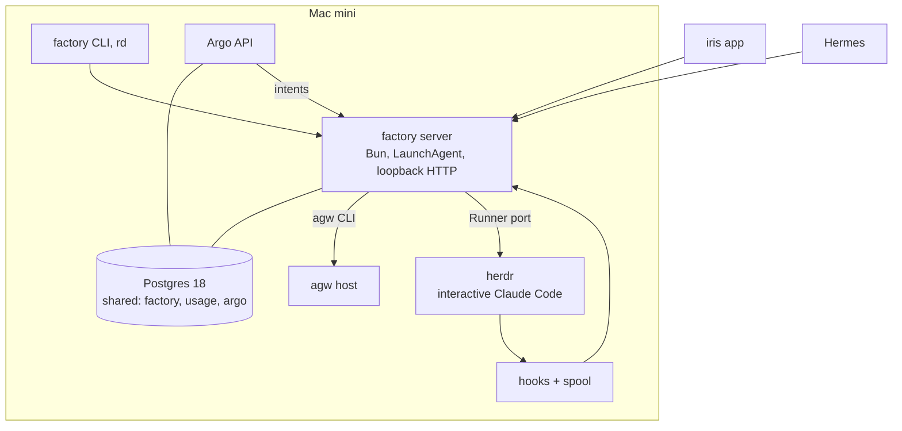
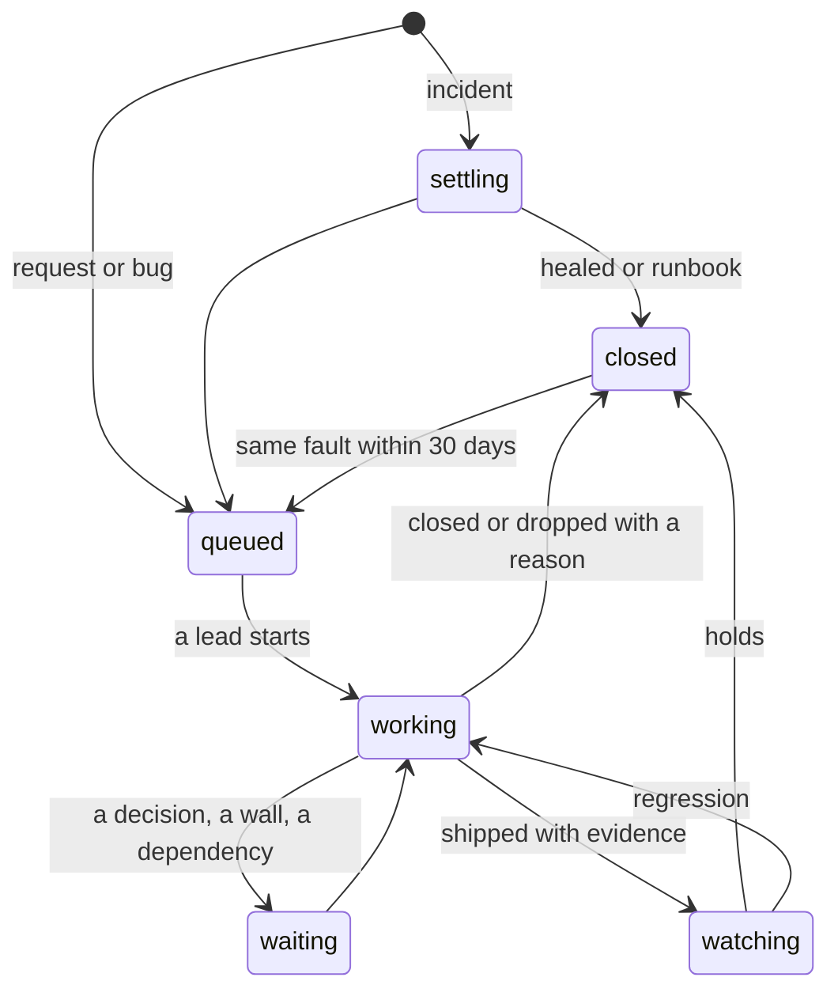

# Design

**TLDR.** One Bun server on the mini owns long-lived state in Postgres: sessions, the queue, capacity, later
Issues. Interactive Claude Code in herdr does all the thinking; `agw` workflows do every model call the
factory needs; plain code does the rest. Hooks report what sessions do as facts, the server derives state from
those facts when read, and every effect carries a deterministic key, so a replay never spawns, types or posts
twice. The fleet layer (§3) ships first and carries today's `/wave`. The Issue machine (§4) sits on top of it.

**This page wins over TDD v2.4 wherever they disagree.** The reasons behind each choice are in `docs/decisions.md`,
the build order is in `docs/program.md`. The code is plain TypeScript and zod (SF6).

## 1. Principles

A design choice that breaks one is wrong.

1. **The factory runs the lifecycle; Claude Code does the thinking.** What a script can decide, a script
   decides. Routine words and judgments (same symptom? which project? how big?) are `agw` workflows. Anything
   that needs understanding a problem or code goes to a lead.
2. **The factory never calls a model.** No SDK, no key. `agw` is its only model path, called like any client.
3. **Max reasons about code, API tokens do the routine.** Claude Code on the Max accounts is the only thing that
   diagnoses or changes a repo. A full pool means waiting, never spilling.
4. **Hand over the problem, not a conclusion.** A brief holds facts, evidence and verified history, never a
   cheaper model's guess at the cause.
5. **One lifecycle, no side doors.** Every piece of work enters as an Issue and leaves with evidence or a stated
   reason. Until F2, a wave is the unit and the same rule applies to its close-out.
6. **Facts are stored, state is derived.** The one stored exception: an Issue's lifecycle state (§4), written by
   one module with an event per transition. Liveness ("working", "stuck", "walled") is always computed on read.
7. **Done means observed in production.** A lead's "done" is a claim. The evidence and the factory's own
   `make verify` after the hold are the proof. Wrong in production means fix forward.
8. **A self-improving platform, as code.** A fix verified twice becomes a runbook or a job check. Rules, probes,
   thresholds and prompts live in repos and change through an Issue with evidence, the factory's own included.
9. **The owner decides business, nothing else.** Product direction, spend, irreversible data loss, other people,
   plus security policy. Anything else that reaches the owner is a defect. Everything written for the owner is
   short, verdict-first and free of internal names.

Fixed boundaries:

- **Network:** no public endpoint. The tailnet plus the owner's GitHub user is the security boundary.
- **Liveness:** no turn limits and no wall-clock ceilings on a lead. The stall rule (§6) is the one liveness rule.
- **Scope:** `~/SourceRoot` only; IuRoot stays outside.
- **Instructions:** `AGENTS.md` only, no `CLAUDE.md` in any repo.

## 2. Shape of the system



- **One process.** A LaunchAgent, deployed like agw: release directories, health check, rollback of its own
  release. A Postgres advisory lock makes a second copy exit. Running sessions never notice a restart; they live
  in herdr, and their hooks spool what the server cannot take.
- **The database.** One database named `shared` on the mini's Postgres 18, a schema per writer (`factory`,
  `usage`, `argo`). agw keeps `agent_workflows` and grants read-only roles. F1 does not wait for A1, so whichever
  ships first creates the database, idempotently, through a target both repos can run.
- **API.** Loopback HTTP. One schema defines each operation, and both the HTTP route and the CLI verb come from
  it, as in agw's capabilities. Reads for dashboards are views in the `factory` schema; live updates are
  `LISTEN/NOTIFY`. Writes from any surface are intents through the API, never direct table writes.
- **CLI.** agw's contract (`--format json|plain`, data on stdout, messages on stderr, the same exit codes, never
  prompts). The block agents see stays small: `factory status`, `factory issue …`, `factory session …`,
  `factory project check`. The rest exists for the owner, the orchestrator and Argo, documented once.
- **Ticks and wake-ups.** `NOTIFY` wakes the worker on a new row; a tick every 5 seconds catches the rest and
  handles deadlines. `issues.wake_at` is the one Issue timer; `resume_at` on a spawn request is the fleet's.
- **Effects.** Each outside effect goes through a port (`Runner`, `Agw`, `GitHub`, `Notify`) and has a key
  recorded before it happens. A replay finds the key and stops.
- **Every start reconciles.** Before any effect: replay the spool, then look at the world once (herdr, worktrees,
  GitHub) for each open session and Issue. Open deadlines move by the downtime. Missed job slots run once. There
  is no separate adopt mode.
- **Dependencies point one way.** factory → agw, herdr, GitHub, the intake sources. agw never knows the factory.
  `rd` and the account picker stay in dotfiles and become clients or adapters (§3).

## 3. The fleet layer (F1)

Deterministic babysitting of the sessions `/wave` and `rd` start today. It replaces `wave-watch.sh`,
`fleet-keepalive.sh` and the Hermes babysitter cron (FL8). Issues do not exist yet at this layer, and the layer
does not need them: `issue_id` on a session is nullable.

### Sessions and events

A **session** is one Claude Code process the factory or `rd` started, identified by its Claude session id, with
its pane, worktree, repo, role, account, model, effort and parent. `rd` sets `FACTORY_SESSION` at spawn; without
it every hook exits at once, so the owner's own sessions never see them. Hooks are installed for every account's
config directory.

| Hook | Event | Used for |
|-|-|-|
| `SessionStart` | `session_started` (with the matcher: `startup`, `resume`, `compact`, `fork`) | binds session id and transcript path to the spawn |
| `UserPromptSubmit` | `turn_started` | prompt delivery proof, "no new turn" in the watchdog |
| `Stop` | `turn_ended` | turn boundaries; the send-back rule |
| `StopFailure rate_limit` | `limit_stop` | the resume watchdog |
| `Notification quota_auto_resume_*` | `quota_resume` (`fired`, `stale`, `disabled`) | the resume watchdog |
| `Notification permission_prompt`, `idle_prompt` | `prompt_blocked`, `prompt_idle` | blocked sessions |
| `SessionEnd` | `session_ended` | closes the session |

`UserPromptSubmit` is an addition to FL5's list: a turn's start is the only proof that a typed prompt arrived.

**The hook never blocks a session.** It appends the event to a spool file first, then posts with a 300 ms
timeout, and exits. `SessionEnd` has a 1.5-second budget, so the append is the part that must fit. The server
replays the spool on start and on each tick. The key is session id plus event name plus turn number.

herdr is the backstop for what hooks cannot show. A tool call in progress produces no hook event, so silence alone
proves nothing; `stuck` needs herdr's agent status and the worktree's activity too. The witness loop reads herdr
every minute, records its server PID (a change is a herdr restart, an event) and the account in effect, and reports
dead panes.

### Derived session state

| State | Read from |
|-|-|
| `starting` | spawn recorded, no hook has spoken |
| `working` | latest `turn_started` has no `turn_ended` after it |
| `idle` | latest event is `turn_ended`, or `session_started` with no turn yet; no open wait |
| `waiting` | a declared wait is open (`factory session wait --on workers\|deploy\|owner`) |
| `walled` | a `limit_stop` or `quota_resume` with no later `turn_started`; a turn that ends after `quota_resume` fired stays `walled` |
| `blocked` | `prompt_blocked` with no later `turn_started` or `turn_ended` |
| `stuck` | `working`, herdr agrees, no commit or file change in the worktree for 45 minutes |
| `dead` | `session_ended`, or the pane is gone |

State reads from the latest `session_started`, so a resumed session starts clean. Hooks carry no token: they post
to a unix socket (mode 0600) that serves only events and waits, and fall back to the spool.

### The queue (FL1, FL3)

A **spawn request** is a row: repo, role, prompt, model and effort from the role table, a deterministic key, and
later the account, a `resume_at`, and the session it became. A spawn without capacity gets a `resume_at` and stays
in the table; nothing is dropped. The tick starts it when the time comes and admission says yes.

**Queue state** is `run`, `pace` or `drain`, set per scope: global, project, initiative. The most restrictive scope
that applies wins.

| State | Effect |
|-|-|
| `run` | admission decides |
| `pace` | lower concurrency; spends only toward weekly pace |
| `drain` | no new spawn. A running wave finishes its current wave; the chain stops at the boundary: its successor's spawn is held (`queued: drain`) and starts by itself when the drain lifts. Nothing is interrupted |

### Capacity and admission

- **Accounts come from the registry,** `dotfiles/config/claude-accounts.json`, never a constant. N accounts,
  today three. The picker stays in dotfiles; the factory calls `claude-account` through an adapter and stores
  each reading as a fact (`quota_readings`), so history survives and tests can inject a wall.
- **An account is eligible** if it is enabled, its auth is fine, and it keeps the owner's reserve: 15 % of the
  5-hour window and the last 5 % of the week, so new spawns stop at 95 %. A session already running there
  rotates at 94 % (below), one point earlier, so its successor can still be spawned elsewhere before the wall.
- **One active wave per repo,** across repos as many as capacity allows.
- **Never spill.** With every account walled the queue waits for the first reset.
- **A spawn holds its account** while queued or starting, and once started until a reading taken after its start
  shows it. A burst starts only as many spawns as there are open accounts; there is no per-spawn cost estimate. A
  spawn a rule holds back (`drain`, `pace`, one wave per repo, no capacity) stays queued with a hold reason.

### Rules that act

| Rule | Trigger | Action | Key |
|-|-|-|-|
| **Resume watchdog** (FL2) | a session is `walled`, its account's reset has passed, no new turn for 5 minutes | one delivery-checked "continue" | `resume:<session>:<reset_at>` |
| **Send-back** (FL5) | `Stop` with live child sessions and no declared wait, `stop_hook_active` false, the turn did not end on a limit | the hook exits 2 with one line | turn number |
| **Rotation** | a long-lived session's account reaches 94 % of its week | one note: write the handoff and rotate; the next rotation lands on another account | `rotate:<session>:<week>` |
| **Folder trust** | any spawn | pre-trust the path before starting the agent, for new repos as well as worktrees | none, idempotent |
| **Blocked** | `blocked` for 2 minutes | a line in `factory status`, and to the session's parent if it has one | event id |
| **Wake** | a session `waiting` on its workers, with child sessions, none unfinished (`dead`, or `idle` after a turn; a spawn without a session yet is unfinished) | one note listing the children and their states | `wake:<session>:<wait event id>` |
| **herdr restart** | the server PID changed | each affected session resumes by id, with a note that a turn was cut off | `restart:<pid>:<session>` |

The send-back counts only child sessions the factory knows. A background shell inside a session is invisible to
a hook; that gap stays until a measured failure says otherwise.

**The tick.** Four rules, each from a defect both spike arms shipped (`docs/spikes/2026-10-30-effect/verdict.md`):

- **Never call a port inside a transaction.** Claim the row and commit, call `Runner`, record the result in a new
  transaction. The key recorded at the claim is what makes a crash between the two safe.
- **Every port call has a timeout.** A hung `herdr` must fail the call, not stall the tick.
- **Attempts are capped.** A spawn out of attempts is `failed` with a reason and leaves the batch, so it cannot starve
  the ones behind it. The tick loop itself survives any single failure and logs it.
- **Eligibility is rechecked at start,** not only when the spawn is queued. A stored account is a hint.

**Prompt delivery.** `factory session note` is the one way anything types into a session. It records the prompt
under its id before typing, holds it while the session is `working` (a prompt typed into a busy session only
queues in Claude Code), types it at the next `turn_ended`, and marks it delivered on the next `turn_started`. No
`turn_started` within a minute: one retry, then a line in status. `rd say` becomes this.

**One space per repo (FL6).** A herdr space is keyed by path, resolved before anything is created. A new space
takes an explicit flag, for a separate plan or worktree.

**Test slots (FL7).** `factory slot run -- <cmd>` wraps `make check` and test runs in a host-wide semaphore: a
leased row, two slots to start and tuned from the load record, released on exit or lease expiry. It fails open: with the server down
or the wait over its limit, the command runs anyway, because a slot exists to reduce flakes and must never block
work.

**The role table (FL4).** One table for mother, lead, worker, mechanical and the subagent types, giving tier and
effort. `rd --role` and agent frontmatter read it; values move only on data from track U. Model ids stay in agw's
and dotfiles' route tables; this repo names tiers.

### `rd` becomes a client

`rd wave`, `fan`, `say` and `close` call the server when it answers and keep today's path when it does not. A dead
factory must never stop the waves that would repair it. The gate logic (`wave-gate.py`) stays until the server
covers each check. The verbs move under `factory` once F4 is running, and `rd` stays as an alias.

## 4. The Issue machine (F2)

An Issue lives for hours or days, so no run does: **each Issue is a state machine in Postgres, driven by an
inbox.** No DBOS and no Effect Cluster or Workflow (SF6). engrams' ADR 0119 states the rule ("the automation is
stateful; no run is"), and DBOS's version gating stranded their runs on deploy.



*Parked* is `waiting` with a reason. A stopped Issue is closed as dropped. Pausing is a flag on the project.

- **One writer.** `issues.state` changes in one module, a transition table over these states.
- **One inbox.** Everything that concerns an Issue is a row in `issue_inbox` with a unique key. A session event on
  a session with an `issue_id` is copied in by the same transaction that stores it.

| Event | Sent by | Key |
|-|-|-|
| `signal` | dedup: a repeat or regression | the source's event id |
| `admitted` | the admission tick | `admit:<issue>:<attempt>` |
| `phase`, `wait`, `ship`, `close`, `block`, `ask`, `drop` | the lead, via `factory issue` | `<issue>:<verb>:<call id>` |
| session events | hooks, live or from the spool | as in §3 |
| `hold_over`, `wake` | the tick, when `wake_at` passes | `hold:<issue>:<attempt>`, `wake:<issue>:<at>` |
| `note`, `stop`, `answer`, `prio`, `dep`, `retier`, `park` | the owner or the orchestrator | the intent's id |

- **One Issue at a time.** A worker takes an Issue's oldest unhandled rows under `FOR UPDATE SKIP LOCKED`.
- **Attach or start.** A lead's pane is `lead-<issue>-<attempt>`; spawning again attaches. A prompt id
  (`issue:<id>:<phase>:<n>`) is recorded before typing. A GitHub comment carries a marker, a card a key.
- **Claims.** `repo:<name>` admits as many leads as the manifest's `leads` allows (one by default) plus one urgent.
- **Finalize once,** from every exit path: terminal state, release the claim, remove the worktree, promote the next.
- **Ids survive a restore.** After a restore the sequence moves past every id in pane names and the spool. A lead
  reporting an Issue the dump lost gets it rebuilt from the spool, or parked.
- **Schedules.** A Postgres lease; `job_runs` is unique per (job, slot).
- **Tests.** A golden test pins each path's sequence of transitions and effects. A replay test crashes after every
  effect and replays, and must end with zero duplicates.

Reversal condition: the lifecycle module passes about 500 lines, or the replay test finds a race the per-Issue lock
cannot close.

## 5. The loop

| Step | Owner | Engine | Out |
|-|-|-|-|
| Intake | factory | a poller per source; requests skip to Classify | Signal |
| Dedup by symptom | factory | rules; the judge once trusted (§8) | a new Issue, or a Signal attached |
| Settle + runbook | factory | a grace timer; a runbook from `project.yaml` | healed and closed, or queued |
| Classify | factory | one `agw` workflow | project, kind, class, size; the lead's tier and effort |
| Queue + admit | factory | §3, §7 | an account, or a `resume_at` |
| Spawn | factory | `Runner`, in a worktree of the lead's own | a lead with the brief |
| Root cause → production | **lead** | Claude Code on Max, alone or with workers | shipped with evidence, closed, blocked or asking |
| Watch | factory | the hold, `make verify`, the probes | closed, or a regression back to the lead |
| Learn | factory | `agw` workflows, from the lead's report | known fix, labels, runbook candidates, changelog |

**Three ways in.** Signals from sources and jobs go through dedup. Requests go straight to Classify: Argo, Hermes,
`factory issue new`, a TickTick item tagged `#factory`, a GitHub issue labelled `factory`, a `/factory` comment by
the owner. A label starts work rather than authorship, because every agent on the mini acts as the owner's GitHub
user; an issue labelled `alert` is a signal. The factory never triggers on its own comments, and text it cannot parse
triggers nothing. Initiatives are requests too big for one lead; the orchestrator plans them into child Issues.

Every repo under `~/SourceRoot` takes requests, with or without a manifest.

### The lead's job

| Phase | The lead | With |
|-|-|-|
| Investigate | reproduces, reads logs and traces, finds the cause; merges or splits Issues when the cause says so | `/otel`, `make logs`, `factory issue show\|merge\|split` |
| Plan | picks the shape: alone, subagents, `rd fan` or a `/wave` chain | `/research`, the project's docs |
| Build | implements and writes the tests | `@implementer`, `rd fan` |
| Check | `make check`, `make test`, a review | `/check`, `/review` |
| Verify locally | sees it work | `@verifier` |
| Ship | merges by the manifest's `ship` rules, deploys by its `deploy.mode` | `make deploy`, `/ship` |
| Check production | the same evidence against the running system | `make verify`, `/otel`, screenshots |
| Report | `factory issue ship` with a three-line summary and the evidence | `factory` |

Production says no: the lead fixes forward, while it still holds the context. A revert is its call, never a factory
reflex.

### Done means evidence

The factory derives the evidence an Issue needs from what its merged commits touched, so a lead cannot pick a
lighter bar: `ship` is refused without it, and `close` is refused when the commits touch deployable paths. The
factory checks that the evidence exists and is fresh. Judging it stays with the lead and the review.

| Change | Evidence |
|-|-|
| UI | a production screenshot of the changed screen, at phone width if the page is used there |
| API or service | `make verify`; error rate and p95 of the changed endpoints, before and after |
| Infra or config | the service's status and logs after the change |
| Data or migration | the queries that show the data is right |
| Nothing deployed | the commit or the document, via `factory issue close` |

**No lead edits a probe within the Issue it ships.** Each deployable project lists a few user-journey probes, pass
or fail, never averaged. The factory runs them after every hold. Tests a model wrote for its own change can give
false confidence; the probes are the check that does not depend on it.

### The brief

- **The ask:** the owner's words, or what the signals saw: what, where, since when, how often.
- **Facts:** the raw signals, the commands that pull their logs and traces, recent deploys and commits. Alert and
  issue text is marked as data, never instructions.
- **History:** closed Issues that looked similar, with the verified cause and fix, marked *past, may not apply*.
- **The project:** make contract, deploy mode, how each path ships, production targets.
- **Done means:** the evidence table and the `factory` verbs.
- **Standing orders:** decide alone except the business classes; ask through `factory issue ask`; workers stay on
  Max. Identical in every brief, so they are a prompt-cache hit.

Classification sets labels and routing, never a cause. The brief shows just kind and class.

### Following a lead

- **A send-back keeps the lead honest.** On top of §3's rule, the `Stop` hook sends a lead back with one line
  (report `ship`, `close`, `block`, `ask` or `wait`) when nothing was reported since the last prompt, no wait is
  declared and the turn did not end on a limit. A turn answering the owner is never sent back. A second unreported
  stop parks the Issue with a line for the owner, never a card, and from F4 also wakes the orchestrator.
- **New facts go to the running lead.** A *possibly related* signal reaches it as a note, not a second session.
  The lead records whether it shares the cause; that answer is the judge's label.
- **The owner can step in at any time** by typing in the tab. The lead treats it like a note.
- **After ship** the lead stays open through the 30-minute hold, so a regression reaches a warm context. Once the
  hold, `make verify` and the probes are green, the factory closes the tab and removes the worktree.
- **Where a lead works.** A worktree per attempt on `factory/<issue>-<attempt>`, made the way `rd fan` does. It
  merges by rebase and push, or through a PR it reviews and merges itself where `ship` says `pr`.
- **The session id is the durable handle, not the pane.** At close the factory copies the attempt's transcripts
  into an archive (Claude Code deletes its own after 30 days). `factory issue resume` opens one with
  `--fork-session`. The transcript format is internal to Claude Code, so the factory stores, links and searches
  transcripts and never parses them for decisions.

## 6. The orchestrator (F4)

Under the factory's code run two kinds of agent, one level deep. The factory itself is the conveyor.

| Layer | Does | Lives |
|-|-|-|
| **Orchestrator** | what code cannot decide: plans an initiative into waves and reviews each; steers a stuck lead; sets priority or dependency in a conflict; looks over queue and accounts | one fresh session per event; reads `factory status`, never raw logs |
| **Lead** | one Issue, root cause to production evidence | spawn → end of the hold |

**Wakes:**

- an initiative to plan, or one of its waves shipped
- a stalled lead: two hours of work time with no commit, phase change or declared wait
- a second unreported stop
- a pane dying three times in ten minutes
- three failed production checks, or an Issue reopened twice
- a decision about to take its default
- 06:30 daily, for exceptions only

**It acts through `factory` only:** `issue prio|dep|note|retier|park`, split and merge, `project pause`, a card for
the business classes, an upkeep Issue for a policy change. It never writes code, touches a repo or starts work the
queue does not hold. Until F4 runs, the program lead does this job.

Queue order, first rule first: stop the line, urgent, dependencies, the orchestrator's priority within a class, age.

## 7. Capacity at Issue level (F4)

Extends §3. The scarce unit is the Max window.

| Class | Examples | Gets an account when |
|-|-|-|
| urgent | an owner app is down, data at risk | any account is eligible |
| normal | bugs, requests, initiative waves | an account is under its weekly pace |
| upkeep | upgrades, docs, code health, security | capacity would otherwise lapse at the next reset; every manifest repo still gets one a week |

- **5-hour headroom.** A lead starts on an account only if headroom covers a share per tier, set from measured
  session cost; leads admitted but not yet measured count against it.
- **Stop the line.** While a project's production is red, it gets only fixes.
- **Tier and effort.** xs and mechanical: Haiku, low. s–m: Sonnet, medium. l–xl, novel design, security: Opus,
  medium. A second attempt goes one tier up with its predecessor's notes. Values come from the role table.
- **Balance.** Every account's week ends close to full and work rarely changes account. Switching happens at spawn.
  One exception: a walled lead that would wait more than an hour resumes elsewhere if headroom exists, counted as a
  switch. The prompt cache is gone after such a wait anyway, and the accounts share one transcript store.

| Measure | Target |
|-|-|
| capacity unused at each weekly reset, per account | < 10 % |
| account changes of a running lead | walls only |
| minutes the owner's sessions waited on a wall | 0 |
| leads hitting a 5-hour wall mid-work | falling |
| Issues shipped per 1 % of weekly capacity | rising |

## 8. Dedup and learning (F3)

One cause should be one Issue, and a cause seen before should arrive with its verified fix. Deterministic grouping
scores F1 0.889 against 0.744 for the old system on a held-out set; v1's known-fix match scored 0.479, so "seen
before" stays unproven. Grouping is gated deterministically, with similarity beside the gate, not in it.

| Tier | Who | Asks |
|-|-|-|
| Symptom, at intake | rules; the judge once trusted | is this the same thing happening again? Never waits |
| Cause, during investigation | the lead | do these Issues share a cause? `factory issue merge\|split` with a reason |

- **Rules.** Stateful sources (Kuma, Beszel, containers): one episode per subject until healthy again. Stateless
  sources (CI, logs, `alert` issues): the same refined fingerprint within a window. Topology joins a container's
  failure to its host's.
- **The judge,** an `agw` workflow with an eval set, returns a probability on ambiguous pairs. At ≥ 0.8 it attaches
  them, at ≤ 0.2 it keeps them apart, and anything between is linked as *possibly related*. A failed call keeps
  them apart.
- **Off → shadow → trusted.** It logs verdicts and acts on none until merge precision is ≥ 0.95 over at least 30
  labelled pairs, with grouping F1 still ≥ 0.889. Below 0.95 over the last 30 pairs it returns to shadow. A wrong
  merge hides work and a missed merge costs one note, so precision is the gate.
- **Seen before.** Postgres full-text search over title, root cause and fix, ranked by project, subject and recency.
  No embeddings until full-text misses known fixes someone can name.

Learning keeps four things: labels (lead merges and splits are ground truth), known fixes, runbooks (a fix verified
twice becomes an upkeep Issue that adds it to `heal:`), thresholds (changed only by replaying labels and the frozen
golden set). Four monthly measures show whether it learns: missed-at-intake rate, wrong-join rate, seen-before hit
rate, runbook share. None improving over two months opens an Issue.

## 9. Projects

```yaml
apiVersion: factory/v2
name: weatherorb
deploy:
  mode: auto                 # auto: a push deploys · make · agentic · none
  targets: [{ name: prod, host: vps, verify: https://example.com/health }]
  hold: 30m
  migrations: [apps/api/drizzle/]
  probes:
    - { name: forecast-loads, http: https://example.com/api/forecast?q=berlin, expect: 200 }
ship:                        # first match wins; push or pr
  - { paths: ["**"], via: push }
signals:
  kuma: [weatherorb-web, weatherorb-api]
  hyperdx: { service: weatherorb-api }
heal:
  - { when: kuma.down, grace: 5m, runbook: make restart, max: 2 }
jobs: [deps, docs, code-health]
leads: 1
ticktick: { list: WeatherOrb }
```

- **v0 (F2):** name, `deploy`, `ship`, `leads`, hold, probes. **Later (F3):** signals, heal, jobs, ticktick.
- **A broken manifest** becomes an upkeep Issue; the factory keeps running on the last valid version.
- **Make contract:** `check`, `test`, `deploy`, `verify`, `restart`, `quality`, `logs`, `status`. `check`, `test` and
  `quality` take `BASE=<ref>`. Every target ends in a one-line verdict. A repo is onboarded when it first has signals
  or Issues, with the targets that path needs. The factory itself runs only `restart` and `verify`.
- **No manifest:** requests only, one lead, done means the commit or document.
- **Project key:** the repo's directory name under `~/SourceRoot`. `factory.projects` and the `usage` schema's
  normalised repos use the same slug (U4). No cross-schema foreign key until both exist.
- **TickTick** stays the list of things only the owner can do; `factory issue block --human` adds an item there.
- **The brain** keeps one page per project; the factory writes only its *Changelog* section.
- **homelab-private** stays self-contained: its manifest lives inside it, and nothing about it appears elsewhere.

## 10. Jobs

A job is a small TypeScript module with a schedule. Code does the looking, an `agw` workflow writes up and groups
what it found, a lead does whatever needs understanding. A green run spends zero tokens. A job never edits a repo;
anything that needs a change becomes an Issue.

| Job | Probe | Opens |
|-|-|-|
| deps | outdated packages, release age, changelogs | one upgrade Issue per group that moves together; majors wait ≥ 14 days |
| docs and agent setup | AGENTS.md drift and size, skill count, resident tool tokens | upkeep when drifted or over budget |
| code health | `make quality` over the week's changes | one batched upkeep Issue per project |
| infra | disks, certs, backup age, a weekly restore test, containers, memory | an incident with its runbook |
| briefing | the night's closed, stuck and waiting Issues, decisions, capacity | the morning briefing to iris |
| changelog | the day's lead summaries | an entry per change in the brain page and Argo's project page |
| scorecard | the factory's facts plus monitors, git and usage, never the leads' reports alone | numbers on Argo; a measure off target for two weeks opens an upkeep Issue |

Later jobs get built when they have a consumer: perf baselines after a regression reaches the owner, scorers and
tuning at 50 closed Issues, security audits per repo at about 2,000 changed lines.

## 11. Surfaces

| Surface | Talks to the factory | Gets |
|-|-|-|
| **iris** | factory API | the live glance at fleet, waves and quota; decision cards and push (APNs waits on the Apple developer enrolment; until then cards go through `ask-human.sh`) |
| **Hermes** | factory API | "do X" becomes `factory issue new`; "how is X going" reads the factory. It never implements |
| **Argo** | reads `factory` views directly, forwards intents to the API | depth: queue history, scorecard, cost per Issue |
| **Agents** | `factory` CLI | §2's small block |

Intake polls: Kuma, Beszel, Docker on the three hosts, HyperDX alerts and error clusters, GitHub issues and checks,
RollHook deploys, failed launchd jobs, CrowdSec, TickTick. Polling also catches a missed recovery on the next read.

**Dead-man.** The factory's health carries loop lag, last tick and a database write, and Kuma watches it through
its door (A3). Until that door exists, the factory pushes a heartbeat. Kuma alerts through its own channel, the one
alert outside the factory.

**Telemetry.** OpenTelemetry to ClickStack's authed tier, one trace per Issue. Usage stays in the `usage` schema.
`usage` owns the session entity for every lane; `factory.sessions` holds only what the factory started. They join on
the Claude session id, which gives cost per Issue without the factory writing usage rows.

**Backups.** A nightly `pg_dump` to the homelab and a weekly restore drill, from F1. Lead transcripts are archived to
the homelab.

**`agw` workflows the factory will need,** each with an eval set, built in agent-workflows when its station is
built: classify, dedup judge, brief wording, learnings, changelog, briefing. `agw llm classify` and `agw triage` exist
and are the starting points, not the answer.

## 12. Data model

Schema `factory`. Sessions and the queue land in F1, the rest in F2 and later; the spike builds a slice of the first
group.

| Table | Holds | Track |
|-|-|-|
| `sessions` | pane, worktree, Claude session id, transcript path, repo, role, parent, account in effect, model, effort, nullable `issue_id` | F1 |
| `session_events` | every hook and witness fact, unique key, payload, seen at | F1 |
| `spawn_requests` | key, repo, role, prompt, tier, effort, requested at, `resume_at`, account, resulting session | F1 |
| `queue_scopes` | scope, state (`run`, `pace`, `drain`), reason, who, when | F1 |
| `quota_readings` | account, 5-hour and weekly use, reset times, read at | F1 |
| `prompts` | prompt id, session, text, typed at, delivered at | F1 |
| `slots` | holder, lease, command | F1 |
| `projects` | every repo: synced `project.yaml` or defaults, pause flag | F1 (slug only), F2 |
| `issues`, `issue_deps` | kind, class, title, state, parent, root cause, fix, summary, `wake_at` | F2 |
| `issue_inbox` | every event for an Issue, key, handled at | F2 |
| `issue_links` | Signal → Issue, Issue → Issue, who, why, whether it acted | F2 |
| `claims` | key, holders, queued Issues | F2 |
| `events` | phases, notes, orchestrator actions, state changes | F2 |
| `evidence` | per Issue: kind, link or payload, at, from whom | F2 |
| `decisions` | question, options, default, expiry, answer, who, when | F2 |
| `artifacts`, `comments` | plan or report as path@sha, comment threads | F2 |
| `signals` | source, source time, subject, fingerprint, payload | F3 |
| `job_runs` | job, slot, result, tokens spent | F3 |

`working`, `stuck` and `waiting` never appear as columns. Argo reads views over these tables, so a table can change
behind a stable view.

## 13. How we know it works

Neither the owner nor an agent says the factory works. These do:

**The golden set.** 959 labelled events from the old system. Every dedup rule or threshold change replays it; grouping
F1 may not drop below 0.889.

**Gamedays,** on scratch targets, each a gate:

| Gameday | Track | Pass |
|-|-|-|
| the server is killed mid-spawn and while sessions work | F1 | sessions keep working; on restart it reconciles; no duplicate effect |
| a usage wall, injected through `quota_readings` | F1 | the watchdog resumes the session once; nobody types "continue" |
| `drain` during a multi-wave run | F1 | the current wave finishes, the next does not start |
| a spawn with no capacity | F1 | it waits with a `resume_at` and starts by itself |
| the database restored from last night's dump | F1 | reconciliation; ids move past running panes; no duplicate effect |
| a lead stops with its Issue open and nothing reported | F2 | the hook sends it back |
| a seeded bug passes CI but breaks production | F2 | the production check catches it, or `make verify` after the hold reopens the Issue |
| a container stops | F3 | restarted by its runbook within 5 minutes of the grace ending; nothing reaches the owner |
| the server is killed mid-runbook | F3 | the runbook runs once to its end |
| every account walled with an outage open | F4 | settle and runbooks run; leads wait; nothing spills |

F1's own gate: an overnight multi-wave run across two repos with an injected limit wall and one `drain` needs no
owner "continue".

**Six numbers,** from SQL views the loop cannot edit, over 14 days:

| KPI | Target |
|-|-|
| non-business items that reached the owner | 0 |
| notifications to the owner | ≤ 2 a week plus the briefing |
| shipped changes whose deployed version lacked the merged commit at close | 0 |
| change failure rate within 7 days | < 5 % |
| time to heal an incident, median / p90 | ≤ 0.5 h / ≤ 4 h |
| green job runs that spent tokens | 0 |

**Edge cases handled in code:**

| Case | Handling |
|-|-|
| The factory deploys itself | stop, swap the release, start, health check; a failed check starts the previous release. The one automatic revert, because a dead factory watches nothing |
| The mini was down | open deadlines move by the downtime; missed job slots run once |
| A second copy starts | the advisory lock makes it exit |
| The factory is down when a hook fires | the event goes to the spool, replayed on start |
| A hook fires in the owner's own session | it exits at once: no `FACTORY_SESSION` |
| A herdr restart moves a session to another account | the witness records the account in effect |
| A change edits its own checks | the review flags weakened tests; `make verify` and the probes run after the hold regardless |
| A merge absorbs an Issue in work | that lead pushes its work to a branch and drops the Issue as merged; its notes go to the surviving lead |
| Something else types into a `lead-*` pane | the factory alone owns them; `herdr-reap` skips them |
| A lead breaks a hook, the picker or `rd` | dotfiles and this repo carry a zero-token probe that runs each hook against a sample payload, so the break shows before the next lead starts |
