# Software Factory

Signals become Issues. A lead, an interactive Claude Code session, owns each Issue from root cause to verified production. One person decides only what a person must.

This guide explains one implementation of that loop through its own code and its own Issues. It is a lifecycle server on Bun and Postgres, built and run by one developer on one always-on machine.

## Position

**Dark for code, lit for decisions.** No person reviews a change before production. The lead's own review, the gates, a watch window and probes do that job.

What reaches the owner: product direction, spend, irreversible data loss, other people, security policy, rare big architecture and taste. The factory settles everything else. A touch of the owner that the factory should have avoided counts as friction.

The owner's attention is the scarce resource, and the factory measures it. `factory read friction` and `factory read kpis`, 2026-11-17, window of 7 days, all projects:

| Count | Value |
|-|-|
| Issues filed | 1,249 |
| Issues closed | 1,246 |
| Decisions the owner settled | 5 (0.4 per 100 Issues) |
| Avoidable touches | 76 (0.061 per Issue; the target is at most 0.07) |

The 76 touches are mostly notes (58) and cancels (11). A touch pattern that repeats becomes an Issue the friction loop files.

## The loop

1. **Signal.** A monitor, a GitHub issue, a lead's follow-up or the owner's words arrives as a signal with a kind, an origin and a trust level ([Signals and Triage](./signals.md)).
2. **Triage.** Rules decide first. An `agw` workflow decides where the rules are unsure. The outcome is one of five: a new Issue, a note on an open one, part of an incident, held, or dropped ([Signals and Triage](./signals.md)).
3. **Issue.** One repo, one branch, one ship. Its state is derived from stored events, and a total table decides every transition ([Issues](./issues.md)).
4. **Admission.** Accounts, windows, memory, load and per-repo claims decide when a lead may start. An Issue that waits says why. An edge to another Issue holds it ([Capacity](./capacity.md), [Chains and Plans](./chains.md)).
5. **Lead.** A Claude Code session in a herdr-core terminal builds the change, reviews its own work and asks the owner only through a checkpoint ([Leads](./leads.md), [Checkpoints](./checkpoints.md)).
6. **Review and merge guard.** The ship is refused unless the evidence holds: commits, review coverage, acceptance, green checks ([Gates](./gates.md)).
7. **Ship and deploy.** The lead lands the change and deploys it under a lock that fails closed ([Gates](./gates.md)).
8. **Verify and watch.** `make verify` and the probes end the watch. A change that breaks something goes back to its lead ([Gates](./gates.md)).

Loops run beside this path: friction, hygiene, selfwatch and the steward file signals and end stalls ([Loops](./loops.md)).

## Chapters

| Chapter | Claim |
|-|-|
| [Signals and Triage](./signals.md) | Anything that may become work arrives as a signal, and triage decides what it becomes before a lead spends a token. |
| [Issues](./issues.md) | An Issue is one row with one total transition table, and its state is derived from stored events. |
| [Leads](./leads.md) | A lead owns one attempt of one Issue and works from a brief that is a contract. |
| [Gates](./gates.md) | A gate is a machine check a lead cannot talk past, and a ship holds only on evidence. |
| [Capacity](./capacity.md) | Admission is a decision with numbers, and a waiting Issue always says why it waits. |
| [Chains and Plans](./chains.md) | What waits on what is a graph across repos, and a plan is rows not yet filed as Issues. |
| [Checkpoints](./checkpoints.md) | The factory stops for a person at a Decision, a Spec or an Errand, never at a merge. |
| [Loops](./loops.md) | A loop is a named recurring job with one way to act, and a replayed pass acts once. |
| [Learnings](./learnings.md) | What the factory measured about itself, and what changed because of it. |
| [Running a Factory](./running.md) | One host, one database, one deploy lock: what it takes to run this. |

## What this is not

- It is not a product. It is one implementation for one host, set up for its place. It shows the language, the patterns and how far the automation reaches.
- It is MIT licensed. Take the parts you want.
- Every claim in the guide links the code or the Issue that holds it.

Next: [Signals and Triage](./signals.md)
