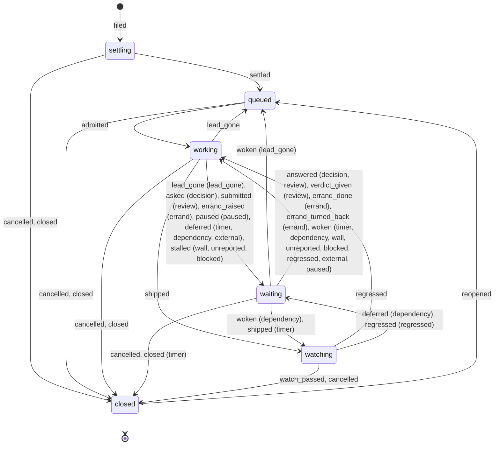

# The language

One word per thing, in code, CLI, events, screens and docs. Built on Warp's factory vocabulary and the owner's field
notes, signed 2026-11-07. A word in a **Retires** cell fails `make check` once the rewrite lands (the retired-word
check, `docs/architecture.md`).

## Core tier

The words to learn first; every other word in this file builds on them. Each links to its full row below.

| Core word | In one line |
|-|-|
| [Signal](#work) | Anything that arrives and may become work |
| [Issue](#work) | One unit of work: one repo, one branch, one ship |
| [Event](#events) | A fact recorded on an Issue; state is derived from events |
| [State](#work) | The stored name of where an Issue is; screens say Running, Paused, Ready, Held, Checking |
| [Settle](#work) | Triage and the chain finishing for an Issue, so it leaves `settling` |
| [Lead](#who-works) | The Claude Code session that owns one attempt of one Issue |
| [Seat](#work) | The tier, effort and role a lead runs on |
| [Allowance](#work) | How many leads the accounts may run at once |
| [Wait](#shipping) | A pause with a named exit; a **stall** is one whose cause is a machine's to end |
| [Checkpoint](#where-the-owner-comes-in) | Where the factory stops for a person: a Decision, a Concept or Spec, an Errand |
| [Judge](#who-works) | The agw workflow that tries to answer a Decision before the owner sees it |
| [Steward](#who-works) | The supervisor loop over stalled Issues |
| [Loop](#who-works) | A named recurring job; one run of it is a pass |
| [Gate](#shipping) | A machine check a lead cannot talk past |
| [Ship](#shipping) | Land and deploy; the **watch** follows, and **Verify** ends it |

Four words are easy to stretch, and each keeps one sense: **seat** is what a lead runs on, **hold** is to keep a
resource (a claim, a slot, a lock), **settle** is an Issue leaving `settling`, **class** is the group a host process
works for. Their other senses have words of their own (allowance, backoff, bench, quarantined signal, muted finder,
answer, the checkpoints loop, the heal pass, finder, fix cause, exclusive step, kind, resource), and the old phrases
fail the build.

## Work

| Word | Means | Retires |
|-|-|-|
| **Signal** | Anything that arrives and may become work. Has a kind, an origin and a trust level | Request as a concept of its own |
| **Triage** | Deciding what a signal becomes: a new Issue, an amendment to an open one, part of an incident, held, or dropped | Classify and dedup, as words a person meets |
| **Incident** | One root cause seen through many signals: the VPS is down, so HyperDX and Kuma all fire. Triage groups them under one Issue | An Issue per alert |
| **Amend** | Adding to an open Issue's scope or facts instead of filing a new one. The lead hears it as a note | |
| **Triage outcome** | What triage did with a signal: `filed`, `amended`, `incident`, `held` (quarantined, or a `down` waiting out its heal grace), `dropped`. Its detail says why: `new`, `matched`, `replayed`, `repeat`, `joined`, `regression`, `healed`, `quiet`, `unrouted`, `quarantined`, `promoted`; for a drop `work_repo`, `no_project`, `not_listened`, `loop_guard`, `no_repo`, `probe`, `settled` (the workflow found an Issue closed in the last day already covers it) | |
| **Settle** | Triage and the chain finishing for an Issue: it leaves `settling` (the event `settled`, `factory planning settle`). The word's one sense | Settle, for a Decision (answer), the loop that runs the Decision steps (the checkpoints loop), intake's pass that waits out a `down`'s grace (the heal pass), an ask a closed Issue already covers (covered), the watch's wait before its first check (grace) |
| **Quarantined signal** | Outside text the factory did not trust enough to turn into work. It waits in Needs you for the owner to promote or dismiss it. Two quarantined signals are not outside text: a lead's follow-up for a work repo, when its own Issue was owner-filed (the Judge never reads it), and a monitor that stayed down with no route and no home repo to place it in: its card says what fired, and promoting it with a repo sets the monitor's route and files the alert there | |
| **Promote** | A quarantined signal becomes work: the owner's or the Judge's call | |
| **Dismiss** | A quarantined signal the owner or the Judge turns away, with a reason; it files nothing and stays on record as `dismissed` | |
| **Screen** | The Judge looks at a quarantined signal (bar a work repo's; the `screen` loop, `factory-screen`) and promotes it, dismisses it with a reason (a duplicate names the open Issue) or leaves it quarantined (stored as `held`) with a recommendation the owner reads in Needs you. A signal is screened once; a failed call is retried with a backoff, five times at most | |
| **Probe** | A test signal a lead marks (`probe: true`) so it is stored dismissed and never held; its ack is `dropped`, detail `probe` | |
| **Door route** | The registry that says which repo a monitor files in. The owner's estate, kept by the factory, not by git | |
| **Work repo** | A repo no `project.yaml` describes, or whose `project.yaml` says `work: true`. The read token never sees its words | |
| **Issue** | One unit of work: one repo, one branch, one ship. Warp's work item | Item, task, ticket. A GitHub issue is a signal |
| **State** | The stored name of where an Issue is, never a word a screen shows (screens show the words of "Where work stands" below): `settling` (triage is not done; shown as Held), `queued` (no lead has started it; shown as Ready or Held by its queue reason), `working` (a lead is running now; shown as Running), `waiting` (a lead started and the Issue is paused on a named wait; shown as Paused), `watching` (shipped and deployed, the watch is on: the factory runs Verify and the probes, and the Issue closes when they pass; shown as Checking), `closed`. Every count is of Issues, never sessions | Phase, as a field |
| **Outcome** | How a closed Issue ended: `done`, `dropped` (its lead gave it up, with a reason), `healed` (an incident that went away before a lead started), `cancelled` (the owner's stop, or a filer's withdrawal of the Issue its own signal made before a lead took it) | |
| **Event** | A fact recorded on an Issue, stored with who sent it and what it did. State is derived from events, never the other way | |
| **Kind** | What an Issue is: feature, bug, chore, docs, incident. Intake files an owner's or agent's request as feature; triage may refine it when it settles the Issue. A failing check of a project's default branch is an incident, never a bug | |
| **Size** | Triage's judgment of how much work an Issue is: small, medium, large. Kept on the Issue when triage settles it; none for an Issue the rules settled | |
| **Light seat** | The role table's `light` row, the cheap seat a lead starts on when the Issue is mechanical: every hygiene finding, kind docs, a monitor with no route, and while the delivery tripwire is met, triage's `small` with no design choice, migration, security word or new surface. The filer's seat always wins, and is moved up like a light lead's only when it says `moveUp: true`. A light lead that struggles is **moved up**: the next lead starts on the `lead` row (`apps/server/src/domains/leads/light.ts`) | |
| **Origin** | Where it came from, in words a person uses: you, application, infrastructure, GitHub, feedback, factory | Tool names on screen (never "HyperDX") |
| **Project** | A repo the factory knows, described by its `project.yaml` (every key: `docs/project.md`). `signals:` says which automatic sources it listens to; a work repo listens to the owner only. `host:` names the host its alerts sit on (a key of `config/infra.json`'s hosts), so its Kuma and HyperDX alerts join that host's incident. `doctor: make doctor` is the project saying whether this host can run it: a read-only command of seconds that exits non-zero with one line per missing prerequisite and its fix; while it is red the project's Issues stay queued (kind `doctor`, with those lines) and hygiene skips its `check` probe | Manifest |
| **Plan** | A project's `docs/plan.yaml`: rows not yet filed (the format: `docs/plan.md`). A row may target another repo | Wave, track, initiative |
| **Chain** | The dependency graph of Issues and plan rows, across projects. What decides what can run at once | Linked Issues |
| **Replan** | An Issue whose lead proposes changes to a project's plan as a Spec with Decisions, and applies them on the owner's verdict (`factory issue replan`, gated on the approved Spec and the project's own Issues). Filed by the owner (`factory planning replan <project>`) or by the planning pass when a long wait has Issues behind it; one open per project | |
| **Queue state** | `run` (admission decides), `pace` (one lead per project), `drain` (no new lead), for the whole queue or one project. The more restrictive of the two applies | |
| **Queue reason** | Why a queued Issue stays queued, in one plain sentence that names the cause and its numbers. Its kind: `chain`, `line`, `finalizing`, `spec`, `unknown_project`, `drain`, `doctor`, `boot`, `load`, `memory`, `disk` (the repo's worktree, build output included, is learned to take more than the free disk less the headroom), `tests` (the test line is long: more steps wait for a slot than run, for longer than a step takes), `lane`, `claim`, `window`, `cap` | Hold (the memory and load hold) |
| **Claim** | A lead's place in its repo: `leads: N` (64 when the project states none: the host's fit is the limit, NL32) plus one for a fix. A wait that needs a person or a clock gives it back; the lead takes one again before it is told its wait is over | |
| **Lane** | A resource inside a repo (`apple`) that an Issue or plan row names; `lanes: {apple: 1}` in the repo's `project.yaml` caps how many leads of the lane run at once, within `leads`. An undeclared lane is unlimited (`docs/project.md` "Lanes") | |
| **Owed** | Working in a repo without a claim, because the wait that gave it up has ended. Owed Issues are served first, so a new lead never takes the place a resumed one waits for. Among themselves they are served by the earliest wait end, then the Issue number; an owed lead is held up only by those ahead of it in that order, never by itself or one behind it. An owed lead counts in the leads of the account it resumes on, and the account cap never refuses its resume. A note refused for a claim for 15 minutes while a claim would be granted to that lead now is a steward stall; a herd waiting its turn is not | |
| **Window** | An account's 5-hour or weekly reset | |
| **Account** | One Claude Code subscription the factory runs leads on. Whether it takes work, why not, when it opens again and the order of the open ones are `packages/accounts`' to decide (`claude-account status`, `GET /v1/accounts`); the factory adds only its allowance and the leads running on it. A mode (normal, drain, reserve, paused) can be set on it for a time | |
| **Quota used at reset** | The capacity-weighted mean of the weekly percent each account stood at when its weekly window reset, per week, from the reset ledger. What the accounts left unused shows as the rest | |
| **Line** | Stop the line: while a repo's alert is unsolved, only its fix is admitted | |
| **Allowance** | How many leads the accounts may run at once: `leads` per account, plus the bonus the host's idle minutes earn (`domains/capacity/allowance.ts`). It is idle while work is queued and fewer leads run than it allows | Seat, for this sense (seat bonus, idle seat, seat-hours, a free seat) |
| **Seat** | The tier, effort and role a lead runs on: the role table's row, or the one a filer or the owner set (`factory issue seat`, the event `seated`) | |
| **Test slot** | A lease on the host's test capacity that `factory slot run` takes for a `make check`, test or e2e step; it waits while the host is busy and records what the step cost | |
| **Bench** | A step kept on the mini after a run off it was red where the mini was green: an hour, doubling with each repeat within a week up to seven days, halved by a green run off the mini (`kernel/remote-bench.ts`) | Hold, for this place (remote hold) |
| **Reaper** | The loop that ends, by session key and worktree path, the processes a closed lead attempt left behind | |
| **Class** | The group a host process works for: `lead`, `step`, `tenant`, `factory`, `system`, `owner`, `other` (Memory by class on Throughput). The word's one sense | Class, for a kind of finding (finder), why a fix was needed (fix cause), a step one at a time host-wide (exclusive step), a refusal, error or heartbeat (kind), a lane (resource) |

## Where work stands

Five words and a sixth for what is not an Issue yet, defined once here and used on every surface: the Console strip, Flow, Chain, the project pages and digests, the Herdr bar and the sentence an Issue's summary carries. They count Issues, never sessions, and `Running + Paused + Ready + Held + Checking` is the number of open Issues. `workOf` (`packages/contract/src/work-words.ts`) puts each open Issue under exactly one word from its stored state, its wait and its queue reason; `scripts/vocabulary.ts` (in `make check`) fails when a screen's text names a state word instead.

| Word | Means | Retires |
|-|-|-|
| **Started** | The Issues a lead began: Running and Paused | |
| **Not started** | The Issues no lead has begun: Ready and Held. The trend shows them as one line | |
| **Running** | A lead works on it now: the Issue is in the working state and counts against the allowance. A lead standing in line for a test slot is still Running. The count is of Issues, not sessions: one Running Issue may have no session open for an instant between two sessions, and a Checking Issue's session is open without being counted here | |
| **Paused** | A lead began it and it waits on a named wait, no session running. Its split: on you (a Decision, a review, an Errand, or your own pause), on a timer, on another Issue (a dependency, or someone else's review of its pull request), stalled (the account's window, a lead that stopped without reporting, a block, a lost lead, a regression) | |
| **Ready** | No lead has begun it and nothing but capacity keeps it out: it starts when its turn and room in the allowance come. Its limit names what binds it: room in the allowance, the host (load, memory, boot, doctor), the repo's claims, the lane or the cap, or the account's window | |
| **Held** | No lead has begun it and it cannot start whatever the capacity: it waits for another Issue to close, its project's line is red, the queue is draining, a Spec it was filed with waits for the owner's verdict, or it is still being settled (triage, a finalizing attempt, a repo no project covers). It is not a quarantined signal | |
| **Checking** | Shipped and deployed: the watch is on, the factory runs Verify and the probes, and the Issue closes when they pass. Its own small count, in no other word | |
| **Planned** | A plan row not yet filed as an Issue: due to be filed, after another Issue, or not before a date. Never an Issue, so never part of the five | |

## Who works

| Word | Means | Retires |
|-|-|-|
| **Lead** | The Claude Code session that owns one attempt of one Issue: understand, build, review, ship, verify | Mother, worker |
| **Attempt** | Lead number *n* of an Issue | |
| **Session state** | What a lead's session is, derived from its hook events: `starting` (no hook yet), `working` (a turn is running), `idle` (its last turn ended), `compacted` (its context was just compacted, no turn since), `walled` (its account hit a limit), `gone` (its session ended or its terminal is gone) | |
| **Delivery** | What was typed into a lead: its brief, or a note. Keyed, so a replay types nothing twice | |
| **Defer** | The lead's verb for a wait it can name: until a time, until other Issues close, or on the review of its pull request (`--review`, which is the `external` wait) (`factory issue defer`). The event is `deferred` | The old verb `wait` |
| **Steward** | The supervisor loop over stalled Issues. Acts deterministically first (wake, re-check, requeue, deliver) and asks an agw workflow when a call needs judgment | "Never a model" |
| **Judge** | The agw workflow that tries to answer a Decision before the owner sees it | Ask judge |
| **Backoff** | The Judge's answer to a stall the steward asked about that says "wait for it": a timed wait instead of a wake, one hour, doubling per backoff of the attempt, at most twelve (`kernel/backoff.ts`) | Hold, for this answer (judge hold) |
| **Loop** | A named recurring job with a trigger, a budget and one way to act. Its judgment is an agw workflow with its own prompt, tools and skills | Scorer, babysitter |
| **Finder** | A kind of finding a loop files Issues for: the loop plus the finding's first key segment (a probe, a kind of judgment, a friction pattern group; stored as `loop_findings.class`). Mostly dropped or cancelled Issues **mute** it for 14 days, then it is on probation, one Issue at a time (`GET /v1/finders`, Improve) | Finding class, held class |
| **Pass** | One run of a loop. A pass claims, commits, calls, records: a replayed pass acts on what the first stored | |
| **Round** | The *n*th ask of a workflow about one subject. A subject has a limited number of rounds | |
| **Review** | The lead's own check of its change, once per ship range, standard or deep. Part of the lead's work, never a factory step | Light review, per-commit coverage |

## Where the owner comes in

| Word | Means | Retires |
|-|-|-|
| **Checkpoint** | Where the factory stops for a person: a Decision, a review of a Concept or Spec, an Errand. Never a merge | Taste gate |
| **Artifact** | What a lead hands to a person. One model, four kinds: Concept, Spec, Decision, Report. An Issue owns it, or none does (a standalone Report, `artifact new`); links name the other Issues it concerns; it may belong to one collection (a named set with one lead page, pinned or not) | Document |
| Concept | A direction for a whole product, UX or architecture, before building. Three or four per project, ever. Its result goes into the project's `DESIGN.md` | |
| Spec | A larger plan to review | |
| Decision | One question as a form: recommendation, what was checked, cost per option, what happens with no answer. Refused when incomplete; it reaches the owner only after the Judge saw it; a second ask on the open one amends it. Raised while its Concept or Spec waits for review, it is about that artifact and waits together with the review | Ask (noun), question, decision card |
| Report | For information, never waits. A spike is a Report with a verdict | |
| **Errand** | Something only the owner's hands can do: a portal step, a device run, a 1Password prompt. It reaches the owner only after the screen (rules, then `factory-errand`) passes it | Hands-only asks, the separate human queue |
| **Request** | An Errand no Issue raised (`factory errand request`, what `ask-human.sh` posts): no lead; it reaches the owner at once, except a request from `ask-human`, which passes the Errand screen first (one an agent can do is closed with the reason). It carries the command to run, where the hands must be (`macbook`, `iphone`, `portal`, `any`), a **check**, an expiry (7 days when it has no check), and a key that replaces an older open request with the same key | |
| **Check** | A shell command a request carries that exits 0 while the request is still needed. The `errands` loop runs it every hour (30 s, no model): exit 1 to 125 closes the request as `not_needed` with the output, anything that could not answer (missing command, timeout, signal) keeps it open with a note | |
| **Still-needed look** | The `factory-errand-needed` workflow reading a request that has no check, once a day from its first day: only a `not_needed` with a reason closes it. Closures by the check, the look, the expiry or a newer request are the "Errands closed without you" band of the next since read | |
| **Back at desk** | The Needs-you view (`?mode=desk`) of the open Errands by where the hands must be, each with its command to copy and Done and Not needed buttons | |
| **Auto-run** | The MacBook gate's verb that runs a command with no dialog when it is exactly a catalogue class the owner granted once (`dotfiles` `config/macbook-auto-classes.tsv`, his local consent file; first class `secrets-seed`). `ask-human.sh push` tries it before the dialog, so an Issue's Errand and an `ask-human` request take the same path; a command no granted class covers keeps its dialog. It closes the Errand through the orchestrator's done with the evidence `ask-human: auto-run class <class>`, which the factory reads as "ran by itself" (`errands_auto_run_share`, beside the KPI `errands_reached_per_100`) | Pre-approved command, standing consent |
| **Turn away** | An Errand the screen refuses because a token or CLI could do it: the Issue's errand wait ends and the lead hears the reason | |
| **Turn back** | The owner's or the orchestrator's verb that ends an Errand wait without doing it (`factory errand turn-back <id> --note ...`, the Console's Turn back button): the Errand closes `turned_back` and the lead hears the note as its next turn | |
| **Review wait** | The `external` wait: the Issue's pull request waits on a required review by someone else (a lead's `defer --review`, or an Errand that asks the owner to approve or merge a pull request, which the screen turns away). The `reviews` loop reads it every 15 minutes through `gh` or `glab` and wakes the lead on an approval, a request for changes, a new review comment, a merge or a close. It is never in Needs you | An Errand to approve one's own pull request |
| **Desk pass** | The `desk` loop's one pass over every open Errand when the owner returns (a Console read after two hours or more away, the MacBook answering after it was unreachable, or his button "Push what waits to my MacBook"; each starts it at once) and every six hours otherwise: each check runs (the resolved ones close and wake their lead), the rest are screened again, and the MacBook commands are pushed through `ask-human.sh push`, every pending one oldest first on a return and one while he is away | |
| **Verdict** | The answer on an artifact: Looks good, With notes, Changes, No longer applies. Every verdict says who gave it (`by`): the `owner`; the `factory` for him (the default after 24 hours, a Spec screen pass, a withdrawal); or the `orchestrator`, his delegate, on a Spec that is no owner gate, which he reopens with his own verdict. The last two are never read as his | |
| **Owner gate** | An Issue filed with the checkpoint `gate`: it owes the same Spec as `spec`, but only the owner's own verdict ends its wait. No default after 24 hours, no Spec screen pass. A gate holds what needs its answer: after two hours with work behind it a Replan frees the rest (what stands under every answer and a revert undoes), and what needs the answer is released by him alone. Only a filer sets it, never triage | |
| **Taste pass** | The weekly retro's reading of the owner's verdict notes and comments: a preference seen twice becomes a rule in the repo's `AGENTS.md` or `DESIGN.md` | |
| **Worth asking** | The owner's flag on an answered Decision. Feeds the ledger; the Judge's precedent does not read it | |
| **Spec screen** | The look a Spec revision passes before it reaches the owner: rules, then `factory-spec-screen` with the owner's newest needed-me marks as precedents. It passes what is his (a screen or look he has not seen, product direction, spend, security policy, other people or company data, a change that cannot be undone, defaults that lead to materially different work) and answers the rest with the factory's looks_good and its reason (stored as the outcome `settled`), so the lead builds at once | |
| **Needed me** | The owner's one-click mark on a verdict of a Spec or Report: did it need him. The newest marks teach the Spec screen and triage the next time; "Specs at the owner not needed" counts the no's | |
| **Ask** | The lead's verb that raises a Decision (`factory issue ask`) | |
| **Take the default** | The lead's verb that answers its own open Decision with the default it named, once it went on with that option (`factory decision take-default <id> --attempt <n>`). Recorded as answered by `default`, the source saying the lead took it; the Decision no longer holds the Issue, so a ship is not refused for the rest of its wait (a review wait or another open Decision still holds it) | |
| **Answerer** | Who answered a Decision, in the order tried: `judge`, `default`, `owner`; or `orchestrator`, answering for the owner. Stored as `settled_by`, a column name kept | Settler |
| **Decision status** | `open`, `answered`, or `withdrawn` (the Issue no longer waits for it: it closed or was cancelled) | |
| **Revision** | One version of an artifact's content. A Decision has one; a Concept or Spec gains one with each `revise` | |
| **Annotation** | A comment anchored by a quote and a path on one revision. If the quote is gone from a later revision it sits in "Unanchored" | |
| **Page** | One message on the owner's line (ntfy). It carries a checkpoint, is never sent twice, and goes on until the checkpoint is answered | |
| **Needs** | What waits on the owner right now: open Decisions, artifacts awaiting a verdict, open Errands, quarantined signals, long waits | Needs you, as a page title only |

## Shipping

| Word | Means | Retires |
|-|-|-|
| **Gate** | A machine check a lead cannot talk past. **Evidence** is what a gate reads | |
| **Ship** | Land and deploy | |
| **Ship refused** | The gate's answer to a ship that does not hold; recorded, and counted as friction. A review never refuses a ship: it is recorded as evidence | |
| **Watch** | The window after a ship (its length is the `project.yaml` key `deploy.hold`, a name kept) | Hold, for the watch |
| **Review status** | Of a ship's review: `covered`, `not_required`, `uncovered`, `unknown`. Recorded with its reason, never a refusal | |
| **Verify** | The check that ends the watch: `make verify`, probes | |
| **Wait** | A pause with a named exit | |
| **Stall** | A wait with a machine cause, the steward's to end | Park |
| **Pause** | The owner's verb for a started Issue that is to wait: the `paused` wait, which only his word (`factory issue note <id> --wake`) or the time he gave (`factory issue pause <id> --reason "..." [--until <iso>]`) ends. The steward, the Judge and the lead leave it alone; the lead hears it once. A stall or a timer is replaced by it; a dependency, a review of its pull request or a person's wait is not, and an Issue no lead has started cannot be paused. Shown as Paused, on you, and not as a need. The event is `paused` | A note that says "keep paused" |
| **Dormant** | A lead whose Issue waits for a person, a timer or another Issue and whose `claude` the factory **quiesced** (ended); its attempt, worktree and session stay, and the wake **revives** the session. Not a stall: nothing is wrong | |
| **Touch** | The owner acting on an Issue | Zero-touch |
| **Avoidable touch** | A touch the factory should have handled: a Decision answered and not marked worth asking, an owner note, wake, cancel or reopen. Not the first note of a filing, a verdict on a Concept or Spec, or a done Errand | |
| **Friction** | Any counted waste: an avoidable touch, a refusal, an undelivered note | |
| **Not measured** | A KPI with no figure: nothing was counted in the window, fewer samples than the floor of three stand under a share or a duration, or the source is not there (the usage schema). It never reads as zero, and its card says which. A friction count is read against the window of the same length just before it | |
| **Refusal** | An Issue event the state machine refused, or a ship the gate refused. Counted as friction | |
| **Regressed** | A shipped change that failed its watch: Verify or a probe found it broken after the ship. The lead goes back to work twice, the third time it is a stall | |
| **Verified** | A shipped change whose watch passed: it is live and Verify and the probes found nothing broken. The "Since you were here" band counts these as Shipped and verified, one per Issue | |
| **Filed** | An Issue that came into being: the owner's request, an agent's, or a signal triage turned into one. The band's New Issues counts them once each and names where they came from | |
| **Closed without you** | An Errand that ended with no action from the owner: its check found it no longer needed, it expired, a newer request replaced it, the factory ran its MacBook command through a fixed verb, or his MacBook ran it by itself from a class he granted (an auto-run). Nothing to do, and its title says which | |
| **Visit** | The owner's run of Console reads with no gap of 30 minutes. The "Since you were here" band counts what happened since the visit before it ended (the first ever looks back 24 hours), so a page reload inside a visit shows the same band | |
| **First verification pass** | A first watch (the window after an Issue's first ship) that ended passed, not regressed. The share of those is a KPI | |
| **Fix commit** | A commit that fixes something that went wrong, sorted by its **fix cause** (`docs/product.md` "Fix causes") by rule by the fix-causes loop and counted per week | Fix class |
| **Cycle** | The time from an Issue filed to closed | |
| **Queue wait** | The time from an Issue filed or reopened to admitted (a lead started); settling and the chain are part of it | |
| **Window point** | A point of the five-hour Max window that an Issue's sessions used, per Issue | |
| **Cost** | Dollars the usage schema priced for an Issue's sessions, joined at read, never copied | |
| **Long wait** | An Issue in a timed wait of an hour or more with other open Issues waiting behind it. It appears in Needs you until the wait ends | |
| **Stale** | A Needs you item that has waited more than 24 hours | |
| **Surface** | Console, Herdr, Iris, Argo, ntfy | |
| **Caller** | Who a request comes from, decided by its token: `owner`, `orchestrator` (the owner's delegate agent: the owner's rights bar eight routes, its own actor in the log), `agent` (a lead session), `machine` (the alert door), `signal` (Hermes, which files the owner's words), `read` (the surfaces) | |
| **Flow** | The read model of Issues by state over time (`GET /v1/flow`), shown on the Overview; **Chain** is its graph | Board, for Flow or any view of state columns |
| **Overview** | The Console's home screen (`/`): what needs the owner, production, what shipped in a day, the host and the queue's binding reason, then the flow's counts and trend. It was the Flow screen | |
| **Change** | One row of the change stream: a kind, ids and states, never words. Its **cursor** (`<txid>.<seq>`) resumes the stream without losing or doubling a change | |

## The host

The figures Throughput leads with, read once a minute from the host (`top`, `vm_stat`, `sysctl`). A figure the host could not read is a dash, never zero.

| Word | Means | Retires |
|-|-|-|
| **CPU busy** | The share of all the host's cores that were working (user plus system time), percent, from `top`. 100 % is every core fully used, the rest is idle. It says how much of the machine is in use, where **Load** says how many threads wanted it. What to do: near 100 % for many minutes while Issues are Ready means the host is the limit; read Load next, and wait rather than start more | |
| **Memory used** | The RAM in use, in GB of the RAM installed, as Activity Monitor's Memory Used counts it: app memory plus wired plus compressed. Cached files are not in it, so a high figure is real use, not a full cache. GB here is 1024 x 1024 x 1024 bytes. What to do: nothing at normal pressure; read Memory pressure before acting on a high figure | |
| **Swap used** | The part of the swap file the host has written memory out to, in GB of the swap's current size (macOS grows it on demand, so the size is not a limit). Swap stays full after its cause is gone, so a high figure alone is not a fault: swap that keeps growing is the alarm, and admission turns new leads away above 75 % of the RAM in swap or a fast rate of swapouts. What to do: if it keeps growing, read Memory by class on Throughput to find what writes memory out; a full but steady swap needs nothing | |
| **Memory pressure** | The kernel's own verdict on memory: normal, warning or critical. It is the one memory figure that says the host is struggling now: a host can hold 90 % of its RAM at normal pressure. What to do: at warning or critical, read Memory by class on Throughput to see what holds the memory; no new lead is admitted until it is normal again | |
| **Load** | The number of threads that wanted a core, averaged over the last minute (the 1-minute load average). It is a count, not a percentage, and it is not CPU busy: on 12 cores load 4 is a third of the cores' worth of threads, load 12 is one thread for every core, and above that threads wait. It also counts threads waiting on the disk, so it can be high with the CPU quiet. Admission uses load because a storm of waiting processes (git, tests) starves everything on the host whatever the CPU percent says. What to do: above the load ceiling nothing new starts, so wait it out; read CPU busy to tell real work from threads stuck on the disk | |
| **Load ceiling** | The load above which no new lead is admitted, stored with every minute so the page reads the ceiling that was in force. Under the throughput rule it is 3 per core. What to do: minutes above it are minutes Ready Issues waited; a ceiling that is crossed every day is the next improvement to file | |

## The figures on a card

Every number on a Console card has a word here or in a table above, and its definition says what the figure counts and, after "What to do:", what to do about it. `apps/console/test/copy.test.ts` fails on a card with no such word.

| Word | Means | Retires |
|-|-|-|
| **Active time** | How long a lead worked on this Issue, summed over its attempts. Time spent waiting on a person, a timer or another Issue is not in it. What to do: when elapsed time is far above active time, read the Activity tab to see what it waited on | |
| **Turns** | How many times a lead was prompted and worked until it stopped: the brief, each note, each wake. What to do: many turns on a small Issue means the lead was steered a lot; read the notes in Activity | |
| **Tokens out** | The tokens a lead's sessions wrote, from the usage data, summed over the attempts; the tokens read in and the cache are beneath it. What to do: a high figure on a small Issue is a lead that rewrote a lot; compare the attempts | |
| **Cache read share** | The share of prompt tokens a lead read from the cache instead of fresh. What to do: higher is cheaper; a low share on a long attempt means the context was rebuilt, so look in Activity for a restart or a compaction | |
| **Issues per hour** | How many Issues of a project shipped in each hour of the last 7 days, against the 7 days before. What to do: a drop while Issues are Ready or Held may mean something holds them; open Work and read the reason on each | |
| **Shipped this week** | How many Issues closed done in the last 7 days across all projects, against the 7 days before. What to do: a fall while Issues are Ready means something holds them; open Throughput and read what keeps Issues from starting | |
| **Binding reason** | The queue reason that kept Issues waiting for the most hours in the window, with how many Issues it held. What to do: it is the limit worth lifting; open the Issues it names and read their reason | |
| **Issues closed** | How many Issues closed in the window, whatever the outcome, as the cycle KPI counts them, with the mean per UTC day. What to do: a fall while Issues are Ready means something holds them; read Idle allowance-hours and Binding reason next. | |
| **Idle allowance-hours** | The hours the allowance stood unused while Issues were queued: per minute the allowance less the leads running, counted only where an Issue waited, over 60. The hours behind a drained queue are left out, because the owner stopped admission. What to do: many hours with the load low mean a limit is too tight; Binding reason names which, and the settings in force show its value. | |
| **Test slot wait** | How long a step waited for a test slot before it ran: the median over the window and its 90th percentile. What to do: a 90th percentile past 10 minutes with the load low means the base slots are too few; raise them in the settings in force. | |
| **Avoidable cost** | The open improvement that costs the factory most, in minutes of queue wait or MiB over the memory budget; without one, the standing tenants' memory against its budget. What to do: it is the next thing worth fixing; open the improvement's Issue | |

## Events

Every event an Issue takes (`apps/server/src/domains/work/events.ts`). An event naming an attempt, a watch, a wait or a
checkpoint is for that one only: a late one the factory sent is ignored, and a late one a lead sent is refused.

| Event | Means | Sent by |
|-|-|-|
| `filed` | Triage made it an Issue; it begins `settling` | factory, owner |
| `settled` | Triage and the chain are done; it may be queued. Carries the refined Kind when triage corrected an owner's or agent's request, and `checkpoint: spec` when triage flagged it, and the size triage judged (`small`, `medium`, `large`) | factory |
| `admitted` | Capacity lets a lead start: the next attempt | factory |
| `lead_started` | The attempt's lead runs in its terminal, on the seat it records (tier, effort and the role row: `lead`, `light`, or the filed seat's), and the reviewer row its reviews were assigned (`reviewer` or `reviewer-cheap`; none on the attached path of a crash replay) | factory |
| `lead_gone` | The attempt's lead failed to start or ended; twice a new attempt, the third time a stall | factory |
| `seated` | The owner set the seat (tier and effort, or a role of the table, resolved now) the next lead starts on; taken while the Issue is `settling` or `queued`, refused once a lead has started | owner, orchestrator |
| `noted` | An amend or a note reaches the lead | owner, factory, steward, judge |
| `asked` | A Decision is raised and the Issue waits for its answer; during a review wait the lead's ask is added to that wait (same `since`, same `told`) | lead, steward (from a stall only) |
| `answered` | A Decision got its answer; one raised during a review wait leaves the wait's list, and the wait ends with the last item. The Judge's answer to a steward's Decision that reads as a backoff carries the time it ends (stored under the key `hold`): the Issue then waits for it (a `timer` wait) instead of going back to its lead | owner, judge, factory |
| `submitted` | A Concept or Spec is handed over for review | lead |
| `verdict_given` | The owner's Verdict on it; with Decisions still open the wait goes on until the last answer, and the lead hears verdict and answers in one note. The factory sends it for a Concept or Spec nobody answered in 24 hours, flagged Issue or not (the lead goes on with its defaults) and to withdraw a review its Issue moved past; his delegate sends it for a Spec that is no owner gate | owner, orchestrator, factory |
| `errand_raised` | The lead needs the owner's hands | lead |
| `errand_done` | The owner did the Errand (or his delegate, the orchestrator, closed it on its operator's confirmation: `confirmedBy`, never an approval Errand), or something ended its wait without his hands: the screen turned it away (`turnedAway`: the reason; with `awaits` the Issue then waits on that pull request's review), or the desk pass found its check no longer needed (`resolved`) | owner, orchestrator, judge, factory |
| `errand_turned_back` | The owner or the orchestrator turned the Errand back: not done, and `note` says what to do instead; the lead hears it as its next turn | owner, orchestrator |
| `deferred` | The lead waits until a time, or until other Issues close; the steward defers a working or watching Issue behind a queued Issue of its repo that waits for the claim it holds, and says why | lead, steward (behind Issues only; until a time only for a repeated `blocked` stall after a backoff) |
| `stalled` | A machine cause stopped the work: `wall`, `unreported`, `blocked`; a lead's block may say it is out of its depth (`depth`) | factory, lead (`blocked`) |
| `moved_up` | A light lead struggled (a second stall, a block out of its depth, a second refused ship, a regression of its first watch): its attempt ends and the Issue queues again for a lead on the `lead` row; never twice | factory |
| `woken` | A wait that needs no person ended; it names the wait | factory, steward, owner |
| `shipped` | The lead landed and deployed: the watch begins | lead |
| `watch_passed` | Verify ended the watch green | factory |
| `regressed` | The change broke something; the lead goes back to work twice, the third time it is a stall | factory |
| `reopened` | A closed Issue opens again within 30 days | owner, factory |
| `cancelled` | The owner's stop; or the filer's withdrawal (`issue withdraw`), sent by the factory with `by` naming the source | owner, orchestrator, factory |
| `closed` | Ended without a watch: done or dropped by its lead, healed before a lead started | lead, factory |

## Also separated

- **Cancel** is the owner's stop of an Issue; **withdraw** is the filer's take-back of an Issue only its own signals made, while no lead has it. "Stop" stays Claude Code's hook.
- **Review level** (standard, deep) is not **model tier** (haiku, sonnet, opus).
- **The owner's call** (product direction, spend, irreversible data loss, other people, security policy, big architecture)
  is not a triage field.
- Deleting code in git is not irreversible data loss.

## Warp, mapped

| Warp | Here | Difference |
|-|-|-|
| Work item | Issue | Same: a reply continues it, a repeat does not duplicate it |
| Foreman | Steward and Judge | A model in every path there; code first here, a workflow only to decide |
| Triage, spec, implement, review agents | One lead with subagents | A handoff between agents costs context |
| Checkpoints: spec, question, merge | Decision, Concept or Spec, Errand | No merge; specs are rare |
| Inbox | Needs you | |
| Self-improvement, scorers | The friction loop | Counting first, a model past a threshold |
| Factory as code | `project.yaml`, roles, prompts, agw workflows | |
| Human touches per PR | Avoidable touches per Issue | Minus the touches the owner wants |
| Factory and product engineering | The same words | |
| Ends at a mergeable PR | Ends at production evidence | |

## The Issue, as the code has it

Generated from `TABLE` (`apps/server/src/domains/work/table.ts`); `make check` fails when it is stale.

<!-- issue-machine:start (generated by apps/server/scripts/issue-diagram.ts from TABLE) -->

| Wait | Exit | Stall | Ends |
|-|-|-|-|
| `timer` | no person | no | woken by the clock at the time the lead deferred to, or the end of a backoff the factory gave it |
| `dependency` | no person | no | woken by the chain once every Issue it is after has closed |
| `wall` | no person | yes | woken when the account's window opens again |
| `unreported` | no person | yes | woken by the lead's next turn or the steward |
| `blocked` | no person | yes | woken by the steward after it re-checks the cause |
| `lead_gone` | no person | yes | woken by the steward: a new attempt |
| `regressed` | no person | yes | woken by the steward, or turned into a Decision |
| `decision` | a person | no | answered by the Judge, a default, or the owner |
| `review` | a person | no | verdict given on the Concept or Spec by the owner, and every Decision the lead raised about it answered |
| `errand` | a person | no | errand done by the owner's hands (or the orchestrator's, with evidence), or turned back with a note |
| `external` | no person | no | woken by the review poll when the pull request is approved, gets changes requested or a new review comment, merges or closes |
| `paused` | a person | no | the owner's word (a note with wake), or the time it was paused until; the steward never ends it |

Outcomes of `closed`: `done`, `dropped`, `healed`, `cancelled`.

<!-- issue-machine:end -->
