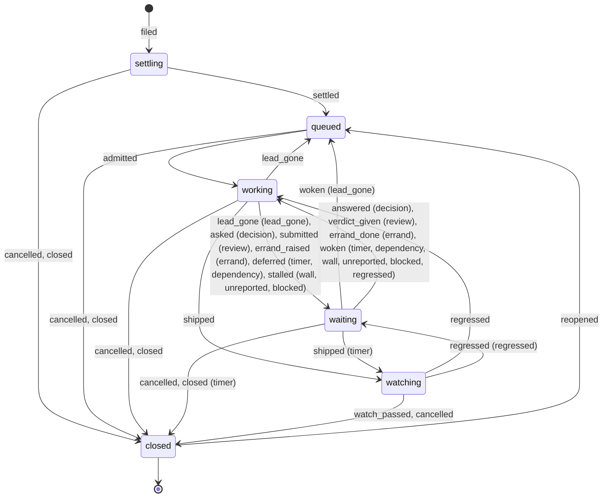

# The language

One word per thing, in code, CLI, events, screens and docs. Built on Warp's factory vocabulary and the owner's field
notes, signed 2026-11-07. A word in a **Retires** cell fails `make check` once the rewrite lands (the retired-word
check, `docs/architecture.md`).

## Work

| Word | Means | Retires |
|-|-|-|
| **Signal** | Anything that arrives and may become work. Has a kind, an origin and a trust level (below) | Request as a concept of its own |
| **Triage** | Deciding what a signal becomes: a new Issue, an amendment to an open one, part of an incident, held, or dropped | Classify and dedup, as words a person meets |
| **Incident** | One root cause seen through many signals: the VPS is down, so Beszel, HyperDX and Kuma all fire. Triage groups them under one Issue | An Issue per alert |
| **Amend** | Adding to an open Issue's scope or facts instead of filing a new one. The lead hears it as a note | |
| **Triage outcome** | What triage did with a signal: `filed`, `amended`, `incident`, `held` (quarantined, or a `down` waiting out its heal grace), `dropped`. Its detail says why: `new`, `matched`, `replayed`, `repeat`, `joined`, `regression`, `healed`, `quiet`, `unrouted`, `quarantined`, `promoted`; for a drop `work_repo`, `no_project`, `not_listened`, `loop_guard`, `no_repo` | |
| **Promote** | A held signal becomes work: the owner's or the Judge's call | |
| **Door route** | The registry that says which repo a monitor files in. The owner's estate, kept by the factory, not by git | |
| **Work repo** | A repo no `project.yaml` describes. The read token never sees its words | |
| **Issue** | One unit of work: one repo, one branch, one ship. Warp's work item | Item, task, ticket. A GitHub issue is a signal |
| **State** | Where an Issue is: `settling` (triage is not done), `queued`, `working` (a lead runs), `waiting` (a named wait), `watching` (the watch is on), `closed`. The only field a person reads to know what an Issue is doing | Phase, as a field |
| **Outcome** | How a closed Issue ended: `done`, `dropped` (its lead gave it up, with a reason), `healed` (an incident that went away before a lead started), `cancelled` (the owner's stop) | |
| **Event** | A fact recorded on an Issue, stored with who sent it and what it did. State is derived from events, never the other way (the table below) | |
| **Kind** | What an Issue is: feature, bug, chore, docs, incident. Intake files an owner's or agent's request as feature; triage may refine it when it settles the Issue | |
| **Origin** | Where it came from, in words a person uses: you, application, infrastructure, GitHub, feedback, factory | Tool names on screen (never "HyperDX", "Beszel") |
| **Project** | A repo the factory knows, described by its `project.yaml`. `signals:` says which automatic sources it listens to; a work repo listens to the owner only | Manifest |
| **Plan** | A project's `docs/plan.yaml`: rows not yet filed. A row may target another repo | Wave, track, initiative |
| **Chain** | The dependency graph of Issues and plan rows, across projects. What decides what can run at once | Linked Issues |
| **Queue state** | `run` (admission decides), `pace` (one lead per project, spending toward the weekly pace), `drain` (no new lead), for the whole queue or one project. The more restrictive of the two applies | |
| **Queue reason** | Why a queued Issue stays queued, in one plain sentence that names the cause and its numbers. Its kind: `chain`, `line`, `finalizing`, `unknown_project`, `drain`, `load`, `memory`, `claim`, `window`, `cap` | Hold (the memory and load hold) |
| **Claim** | A lead's place in its repo: `leads: N` plus one for a fix. A wait that needs a person or a clock gives it back; the lead takes one again before it is told its wait is over | |
| **Owed** | Working in a repo without a claim, because the wait that gave it up has ended. Owed Issues are served first, so a new lead never takes the place a resumed one waits for | |
| **Window** | An account's 5-hour or weekly reset | |
| **Line** | Stop the line: while a repo's alert is unsolved, only its fix is admitted | |

## Who works

| Word | Means | Retires |
|-|-|-|
| **Lead** | The Claude Code session that owns one attempt of one Issue: understand, build, review, ship, verify | Mother, worker |
| **Attempt** | Lead number *n* of an Issue | |
| **Session state** | What a lead's session is, derived from its hook events: `starting` (no hook yet), `working`, `idle`, `compacted`, `walled` (its account hit a limit), `gone` | |
| **Delivery** | What was typed into a lead: its brief, or a note. Keyed, so a replay types nothing twice | |
| **Defer** | The lead's verb for a wait it can name: until a time, or until other Issues close (`factory issue defer`). The event is `deferred` | The old verb `wait` |
| **Steward** | The supervisor loop over stalled Issues. Acts deterministically first (wake, re-check, requeue, deliver) and asks an agw workflow when a call needs judgment | "Never a model" |
| **Judge** | The agw workflow that tries to settle a Decision before the owner sees it | Ask judge |
| **Loop** | A named recurring job with a trigger, a budget and one way to act. Its judgment is an agw workflow with its own prompt, tools and skills | Scorer, babysitter |
| **Pass** | One run of a loop. A pass claims, commits, calls, records: a replayed pass acts on what the first stored | |
| **Round** | The *n*th ask of a workflow about one subject. A subject has a limited number of rounds | |
| **Review** | The lead's own check of its change, once per ship range, standard or deep. Part of the lead's work, never a factory step | Light review, per-commit coverage |

## Where the owner comes in

| Word | Means | Retires |
|-|-|-|
| **Checkpoint** | Where the factory stops for a person: a Decision, a review of a Concept or Spec, an Errand. Never a merge | Taste gate |
| **Artifact** | What a lead hands to a person. One model, four kinds: | Document |
| Concept | A direction for a whole product, UX or architecture, before building. Three or four per project, ever. Its result goes into the project's `DESIGN.md` | |
| Spec | A larger plan to review | |
| Decision | One question as a form: recommendation, what was checked, cost per option, what happens with no answer. Refused when incomplete; it reaches the owner only after the Judge saw it; a second ask on the open one amends it | Ask (noun), question, decision card |
| Report | For information, never waits. A spike is a Report with a verdict | |
| **Errand** | Something only the owner's hands can do: a portal step, a device run, a 1Password prompt | Hands-only asks, the separate human queue |
| **Verdict** | The owner's answer on an artifact: Looks good, With notes, Changes, No longer applies | |
| **Worth asking** | The owner's flag on an answered Decision. Feeds the ledger and the Judge's precedent | |
| **Ask** | The lead's verb that raises a Decision (`factory issue ask`) | |
| **Settler** | Who settled a Decision, in the order tried: `policy`, `judge`, `default`, `owner` | |
| **Decision status** | `open`, `answered`, or `withdrawn` (the Issue no longer waits for it: it closed or was cancelled) | |
| **Revision** | One version of an artifact's content. A Decision has one; a Concept or Spec gains one with each `revise` | |
| **Annotation** | A comment anchored by a quote and a path on one revision. If the quote is gone from a later revision it sits in "Unanchored" | |
| **Page** | One message on the owner's line (ntfy). It carries a checkpoint, is never sent twice, and goes on until the checkpoint is settled | |
| **Needs** | What waits on the owner right now: open Decisions, artifacts awaiting a verdict, open Errands | Needs you, as a page title only |

## Shipping

| Word | Means | Retires |
|-|-|-|
| **Gate** | A machine check a lead cannot talk past. **Evidence** is what a gate reads | |
| **Ship** | Land and deploy | |
| **Ship refused** | The gate's answer to a ship that does not hold; recorded, and counted as friction. A review never refuses a ship: it is recorded as evidence | |
| **Watch** | The window after a ship | Hold, in all three meanings |
| **Review status** | Of a ship's review: `covered`, `not_required`, `uncovered`, `unknown`. Recorded with its reason, never a refusal | |
| **Verify** | The check that ends the watch: `make verify`, probes | |
| **Wait** | A pause with a named exit | |
| **Stall** | A wait with a machine cause, the steward's to end | Park |
| **Touch** | The owner acting on an Issue. **Avoidable touch**: one the factory should have settled | Zero-touch |
| **Friction** | Any counted waste: an avoidable touch, a refusal, an undelivered note | |
| **Surface** | Console, Herdr, Iris, Argo, ntfy | |
| **Caller** | Who a request comes from, decided by its token: `owner`, `agent` (a lead session), `machine` (the alert door), `read` (the surfaces) | |
| **Flow** | The read model of Issues by state over time; **Chain** is its graph | |
| **Change** | One row of the change stream: a kind, ids and states, never words. Its **cursor** (`<txid>.<seq>`) resumes the stream without losing or doubling a change | |

## Events

Every event an Issue takes (`apps/server/src/domains/work/events.ts`). An event naming an attempt, a watch, a wait or a
checkpoint is for that one only: a late one the factory sent is ignored, and a late one a lead sent is refused.

| Event | Means | Sent by |
|-|-|-|
| `filed` | Triage made it an Issue; it begins `settling` | factory, owner |
| `settled` | Triage and the chain are done; it may be queued. Carries the refined Kind when triage corrected an owner's or agent's request | factory |
| `admitted` | Capacity lets a lead start: the next attempt | factory |
| `lead_started` | The attempt's lead runs in its terminal | factory |
| `lead_gone` | The attempt's lead failed to start or ended; twice a new attempt, the third time a stall | factory |
| `noted` | An amend or a note reaches the lead | owner, factory, steward, judge |
| `asked` | A Decision is raised and the Issue waits for its answer | lead, steward (from a stall only) |
| `answered` | A Decision got its answer | owner, judge, factory |
| `submitted` | A Concept or Spec is handed over for review | lead |
| `verdict_given` | The owner's Verdict on it | owner |
| `errand_raised` | The lead needs the owner's hands | lead |
| `errand_done` | The owner did the Errand | owner |
| `deferred` | The lead waits until a time, or until other Issues close | lead |
| `stalled` | A machine cause stopped the work: `wall`, `unreported`, `blocked` | factory, lead (`blocked`) |
| `woken` | A wait that needs no person ended; it names the wait | factory, steward, owner |
| `shipped` | The lead landed and deployed: the watch begins | lead |
| `watch_passed` | Verify ended the watch green | factory |
| `regressed` | The change broke something; the lead goes back to work twice, the third time it is a stall | factory |
| `reopened` | A closed Issue opens again within 30 days | owner, factory |
| `cancelled` | The owner's stop | owner |
| `closed` | Ended without a watch: done or dropped by its lead, healed before a lead started | lead, factory |

## Also separated

- **Cancel** is the owner's stop of an Issue. "Stop" stays Claude Code's hook.
- **Review level** (standard, deep) is not **model tier** (haiku, sonnet, opus).
- **Owner class** (product direction, spend, irreversible data loss, other people, security policy, big architecture)
  is not a classification field.
- Deleting code in git is not irreversible data loss.

## Warp, mapped

| Warp | Here | Difference |
|-|-|-|
| Work item | Issue | Same: a reply continues it, a repeat does not duplicate it |
| Foreman | Steward and Judge | A model in every path there; code first here, a workflow only to decide |
| Triage, spec, implement, review agents | One lead with subagents | A handoff between agents costs context |
| Checkpoints: spec, question, merge | Decision, Concept or Spec, Errand | No merge; specs are rare |
| Inbox | Needs you | |
| Self-improvement, scorers | The friction loop | Counting first, a model past a threshold |
| Factory as code | `project.yaml`, roles, prompts, agw workflows | |
| Human touches per PR | Avoidable touches per Issue | Minus the touches the owner wants |
| Factory and product engineering | The same words | |
| Ends at a mergeable PR | Ends at production evidence | |

## The Issue, as the code has it

Generated from `TABLE` (`apps/server/src/domains/work/table.ts`); `make check` fails when it is stale.

<!-- issue-machine:start (generated by apps/server/scripts/issue-diagram.ts from TABLE) -->

| Wait | Exit | Stall | Ends |
|-|-|-|-|
| `timer` | no person | no | woken by the clock at the time the lead deferred to |
| `dependency` | no person | no | woken by the chain once every Issue it is after has closed |
| `wall` | no person | yes | woken when the account's window opens again |
| `unreported` | no person | yes | woken by the lead's next turn or the steward |
| `blocked` | no person | yes | woken by the steward after it re-checks the cause |
| `lead_gone` | no person | yes | woken by the steward: a new attempt |
| `regressed` | no person | yes | woken by the steward, or turned into a Decision |
| `decision` | a person | no | answered by standing policy, the Judge, a default, or the owner |
| `review` | a person | no | verdict given on the Concept or Spec by the owner |
| `errand` | a person | no | errand done by the owner's hands |

Outcomes of `closed`: `done`, `dropped`, `healed`, `cancelled`.

<!-- issue-machine:end -->
