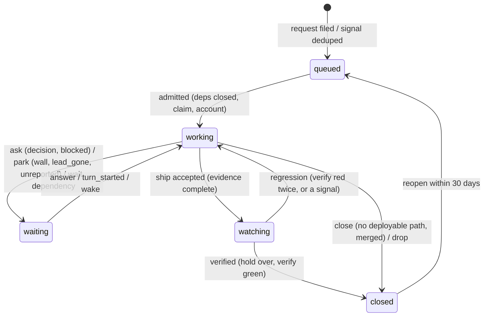

# Design v3: one Issue, one lead, one loop

**Status:** draft for the owner's review, 2026-11-05. Builds on `report.html` (the strategy) and replaces the parts of
`docs/design.md` it names. Checked against the code at `c39f76b` and challenged by an adversarial review (§14 lists what
it changed). "Exists" means read in the code; "new" means a change.

**Verdict.** An Issue is the only unit of work. One lead session runs one attempt of it in one visible Herdr tab, works
through subagents, and reports with the `factory issue` verbs. The factory stays deterministic: it files, orders, admits,
opens the tab, watches the hooks, checks the evidence and closes. One lead per repo at a time, as many repos in parallel as
the accounts allow. v3 is mostly subtraction; the additions are dependencies that admission respects, parks that can end,
and a health line that shows a stuck lead.

## 1. Words

One word per thing, in code, CLI, docs and the sidebar. "Wave" retires as a runtime word.

| Word | Means | Not |
|-|-|-|
| **Signal** | An observation from a source: a Kuma monitor down, a HyperDX alert, a failed job, a red check | work you asked for |
| **Request** | Work someone asked for: `factory issue new`, a planner's plan, a GitHub issue labelled `factory` | an observation |
| **Issue** | One unit: one repo, one branch, one review, one ship | a ticket across repos |
| **Plan** | Issues a planner filed, linked with `--after` | a chain of terminals |
| **Lead** | The Claude Code session running one attempt of one Issue, in its own tab | an orchestrator of leads |
| **Attempt** | Lead number *n* of an Issue; a new attempt after a lost lead or a reopen | a retry of a start |
| **Ask** | A question for the owner, with options and a default: `decision` and `blocked` waits | a machine failure |
| **Park** | A wait for a machine reason (`wall`, `lead_gone`, `unreported`): on the health line, never an ask | normal flow |
| **Evidence** | What the ship gate checks: commits landed, review covered, verify green, the owner's confirmation | a lead's claim |
| **Planner** | The owner's own session in a space, where plans are made | a factory role |

## 2. The loop

The states and their one writer exist (`issues/lifecycle.ts`). Three changes:

- **What reaches the owner.** `decision` and `blocked` are asks. `wall`, `lead_gone` and `unreported` are parks.
  `wait` and `dependency` are normal flow: neither an ask nor a park.
- **New: every park can end.** Today `lead_gone`, `unreported` and `parked` leave `waiting` only by `stop`, which drops the
  Issue (`lifecycle.ts:101-109`). v3: the lead's own `turn_started` ends `unreported`; `lead_gone` starts the next
  attempt, at most two, then the Issue parks with a health line and one notification.
- **New: dependencies are respected.** `issue_deps` exists, but nothing writes it from the CLI and admission ignores it
  (`issues/admission.ts:39-55` admits each project's lowest id). v3 adds `factory issue new --after <id>` (written in the
  create transaction) and `NOT EXISTS (open dependency)` to the admission query.

## 3. The lead

**Placement.** One tab per attempt, named `#<id> <short title>`, in its repo's space. Worktree
`factory/<id>-<attempt>` (exists, `names.ts`, `leadtree.ts`).

**One lead per repo first (RS5).** The project claim with `leads: 1` (exists, today's default) serialises a repo: one branch
merges and deploys at a time, review ranges stay clean, `make deploy` never runs twice. Parallelism is across repos, capped
by the accounts. **Parallel leads in one repo are the goal** and come once this loop runs stably (row 17): `leads: N`, review
ranges from the merge-base instead of the cut sha, and a deploy lock that fails closed.

**Model.** `lead` becomes Sonnet high (`config/roles.json` says Opus high today). Opus for a lead only when the planner
names the reason in the Issue, and only after measuring it.

**Subagents only.** The lead's subagents and their seats live in the dotfiles agent files, not the role table: Explore
(Haiku high, per call), implementer (Sonnet medium), reviewer and review-verifier (seat from `agw review prepare`). The lead
opens no terminals: no `rd fan`, no `rd wave`, no hidden children.

**New: background work and Stop.** The Stop hook's send-back (`issues/sendback.ts`) is skipped while the Stop input's
`background_tasks` lists a running subagent. A lead that ends its turn to wait for its implementers is waiting, not silent.

**Context.** `autoCompactWindow` is 600k. The brief and `factory issue show <id>` are the state; a `SessionStart(compact)`
hook re-injects "re-read the brief and the Issue". An Issue too big for one context is a planning error: split it.

**The operating contract**, the brief's fixed part (`brief.ts`):

1. You own Issue #id from cause to verified production. The brief quotes the original request; never rewrite it.
2. Decide yourself. Take the reversible default and record it: `factory issue phase <id> --phase <name> --note "<decision, why>"`.
3. Ask only for product direction, spend, irreversible data loss, other people or security:
   `factory issue ask <id> --question "…" --option … --default …`. Asking again replaces the question.
4. Stop by impact, not effort. A broken caller contract or a needed redesign is `factory issue block <id>` with a pushed
   draft branch and the reason; many files or failing tests are not.
5. Reading and writing go to subagents; your context is for decisions.
6. Ship: static gate green → `/review` → fix → `factory issue ship <id>`. A refusal names what is missing.
7. After a restart: check git, the PR and production before repeating anything that left the machine.

## 4. Review

Proven in the POC (`report.html` §3): `/review` calls `agw review prepare --context "<intent>"`, copies `seat.model` and
`seat.effort` into the `reviewer` subagent call, submits, and the lead fixes or disposes every finding. Rules only:

| Tier | When | Seat |
|-|-|-|
| none | docs only (`docs/**`, `.md/.mdx/.txt`), REVIEW.md `none` globs, renames | — |
| light | tests only, small or default code, a manifest, agent instructions (AGENTS.md, SKILL.md, rules, agents) | Sonnet medium |
| deep | a REVIEW.md sensitive path, > 800 production lines, > 3 packages | Sonnet high + one verifier per important finding |

The code keeps the `standard` name with the light seat for ledger compatibility. At most 2 rounds per Issue; the ship gate
reads `agw review covered` over the Issue's range. The factory's review transport and its hidden sessions are deleted.

## 5. The ship gate

The factory knows no pipeline; it runs what `project.yaml` declares (exists, `packages/contract/src/projects.ts`):

| `deploy.mode` | Ship means | Example |
|-|-|-|
| `none` | merged on `origin/<default>` | brain, docs repos |
| `auto` | merged; a push deploys; each target's `verify` green within the hold | iris server, RollHook apps |
| `make` | merged, `make deploy` run by the lead, `make version` matches, `make verify` green | software-factory, agent-workflows |
| `agentic` | merged, deployed by the lead's own steps, targets' `verify` green | one-off infra |

**New: a red verify is re-run once** before it counts as a regression; the third regression of one Issue parks it.

**Apple apps are verified on the mini (RS7).** The iOS and Mac apps are deployed to the owner's devices, but their `verify`
runs on the mini: simulator and Mac app runs under the test slot, checked visually by the `verifier` agent with screenshots
(`make verify-apple` or the repo's own target). No owner-verify ask.

**The make contract** every repo keeps: `check`, `test`, `deploy`, `verify`, `version`, `logs`. A repo without them is
`deploy.mode: none` until it has them; the audit is one Issue per repo.

## 6. The health line

**New.** One line per Issue that needs attention without needing a decision, on `factory status`, the sidebar and `GET
/fleet`:

- a park, with its reason and age;
- a lead with no hook event for 20 minutes while `working`;
- an Issue `working` longer than the budget for its size (s 2 h, m 6 h, l 1 day);
- a regression count of 2.

The health line never becomes an ask. A Kuma heartbeat on "the tick advanced and the queue moved within 30 minutes" covers
the factory itself; `make rollback` swaps back to the previous release.

## 7. Admission

Exists: per-account limits (85 % of the 5 h window, 95 % of the week, never spill), `drain|pace|run`, the per-project
claim. **New:** dependencies (§2) and a lead cap per account, `FACTORY_LEADS_PER_ACCOUNT` (start 2), counted over live
lead sessions. Deleted: the `wave` hold and the review holds (`review_slots`, `deep_cap`). Priority is derived from the
latest `prio` event; **new:** `factory issue prio <id> <n>` writes it (the event exists, no producer does).

## 8. Herdr layout

The owner wants every space in a fixed place with a planner tab ready. **New: `~/.config/factory/spaces.json`**, an
ordered list of `{name, path}`, written by dotfiles `make setup`. On start and every ten minutes the factory reconciles: a
space per entry keyed by real path (exists), in that order, with a first tab carrying `factory.key=plan:<repo>` (a login
shell; the owner starts the planner there). A repo not in the list gets a space on first use, appended. The factory never
closes a `plan:` tab and never touches a tab without a `factory.key`: those are the owner's own sessions.

## 9. Closing

Finalize exists: release the claim, close the lead's terminal, archive the transcripts as evidence, remove a clean
worktree. v3 makes it the only closer. Deleted: the fleet reaper, hc-reap's agent rules (it keeps only orphaned shells older
than 7 days and `claude --bg` leftovers), `rd close` for factory tabs. A kept worktree of a closed Issue is a health line.
`factory issue resume <id>` (exists) forks the archived session into a new tab to read or continue by hand; it reports
nothing to the Issue.

## 10. Intake, dedup and order (Step 3, its own plan)

From v2.4 §4 and §8, after the loop above runs:

- **Sources:** Kuma, HyperDX, GitHub issues labelled `factory` and red checks, failed launchd jobs; the door (exists) for
  pushes. A label starts work, never authorship.
- **Settle:** a grace timer and the manifest's `heal:` runbook before any lead (today `heal:` is accepted and dropped,
  `projects.ts:84`).
- **Dedup:** symptom at intake by rules (one episode per subject for stateful sources, a fingerprint window for stateless
  ones); cause in the lead (`factory issue merge|split`). A judge on Haiku high runs in shadow only when the rules leave
  enough ambiguous pairs to matter, measured against the golden set (`docs/evidence/golden/`).
- **Order:** stop the line, urgent, dependencies, priority, age.

## 11. Telemetry

Facts stay facts. **New: `factory.issue_facts`**, a SQL view over `issues`, `issue_events`, `evidence`, `decisions` and
`sessions`, one row per attempt: timestamps (filed, admitted, first commit, shipped, verified, closed), outcome, asks, parks
by reason, review tier and rounds, verify first pass, reopened, the lead's session ids. Argo joins it with usage-tracker's
`usage.session_window_share` by session id; the factory never reads `usage.*`.

| KPI | Target |
|-|-|
| Owner asks per Issue | ≤ 0.05 |
| Issues verified with zero owner touch | ≥ 90 % |
| Verify green on the first hold | ≥ 80 % |
| Window points per Issue, by role and size | tracked; the optimisation target |

## 12. What goes

| Repo | Deleted | Kept |
|-|-|-|
| software-factory | `fleet/` triage, act, undo, probes, presence, away, since, window, digest, transcript, reaper; `review/` transport and limits; placement `child` and `hidden`; holds `wave`, `review_slots`, `deep_cap`; then roles `mother`, `wave`, `worker`, `mechanical`, `deep`; then the tables `fleet_digest*`, `fleet_triage_log`, `fleet_ask_seen`, `fleet_acts`, `fleet_presence_acts`, `fleet_seen`, `fleet_windows`, `review_outcomes` and `spawns.review_*` | tick, runner, hooks, spool, witness, sessions, queue, admission, quota, roles `lead` and `reviewer`, slots, prompts, Issues, evidence, hold, finalize, resume, projects, door, notify, a slim `GET /fleet` (Issues, leads, asks, health line) |
| dotfiles | `rd wave`, `rd fan`, `rd merge` for factory work and their hc fallback; `wave-gate.py`; hc-reap's agent rules; the `/wave` skill as a terminal chain | `rd` as a thin `factory issue new`; the `/wave` skill rewritten as the lead's playbook; `ask-human.sh`; the board on the slim `/fleet` |
| agent-workflows | `agw review request` (the hidden-session path) | `review route|prepare|submit|dispose|covered`, `factory-classify` |

Expand, then contract: callers go first (dotfiles), then the server code, then one migration drops tables and columns.
Rollback is the tag `pre-reset-2026-11` plus `make rollback`.

## 13. Build order

Each row is one Issue. Rows 0–4 are built by leads the current way; from row 5 the factory builds itself under v3.

| # | Issue | After |
|-|-|-|
| 0 | Cutover: finish or stop in-flight work; Issue 51 closed, 52–55 dropped or re-filed (`queue set drain` only when no loop of its own runs through the queue) | — |
| 1 | Step 0: no false failure for a live terminal, confirmed delivery, machine failures never asks, ask expiry | — (built tonight) |
| 2 | Review: router recalibration, one verifier, `omitClaudeMd` (agw + dotfiles) | — (built tonight) |
| 3 | Dependencies: `--after`, admission respects `issue_deps`; `factory issue prio` | 0 |
| 4 | Parks end: `turn_started` ends `unreported`; `lead_gone` → next attempt (≤ 2); send-back skipped while background tasks run; re-run a red verify once, third regression parks | 1 |
| 5 | Lead contract in `brief.ts`; `lead` → Sonnet high; lead cap per account (roles kept) | 2, 3, 4 |
| 6 | Asks vs parks in `/fleet` and the sidebar; the health line; the factory heartbeat | 4 |
| 7 | dotfiles: `rd` thin client, `/wave` → lead playbook, hc-reap trimmed, `wave-gate.py` gone | 5 |
| 7b | Machine budget (RS10): one fail-closed test slot for every check on the mini (`make check`, `agw check`, `xcodebuild`, IuRoot), worker caps on test runners, a booted simulator shut down after its verify, production LaunchAgents niced | — |
| 8 | Delete fleet triage/presence/away/digest/reaper, the review transport, placement modes, holds, roles (code); a health line about something finished ends after 72 h | 6, 7 |
| 9 | Contract migration: drop the deleted tables and columns | 8 |
| 10 | Apple verify on the mini (simulator and Mac app, screenshots by `verifier`) | 5, 7b |
| 11 | Herdr layout and the `plan:` tabs | 5 |
| 12 | `issue_facts` view; its Argo page | 6 |
| 13 | Repo contract audit: `project.yaml` and make targets, one Issue per repo | 5 |
| 14 | Intake: sources, settle, rule dedup, order (its own plan) | 12, 13 |
| 15 | Surfaces: Iris pushes and chat, ntfy for machines, Hermes off Slack, Slack retired | 14 |
| 16 | Docs and skills sweep under `rules/writing-for-agents.md` | 8 |
| 17 | Parallel leads in one repo: `leads: N`, merge-base review ranges, a fail-closed deploy lock | 9, a stable week |

## 14. What the adversarial review changed

| Finding | Change |
|-|-|
| `--after` and dependency admission do not exist | row 3, before anything is filed as a plan |
| Parks never leave `waiting` except by drop; background subagents trigger `unreported` | row 4; send-back reads `background_tasks` |
| Removing roles first breaks `rd`, which builds the later rows | roles go in row 8, after dotfiles (row 7) |
| The "deploy slot" is a fail-open shared pool; `leads: N` breaks review ranges | one lead per repo; slot and `leads: N` cut |
| `verify: owner` cannot ask from `watching` and would hold the claim | finalize at ship, claimless owner check, no default |
| A flaky verify loops forever | re-run once, third regression parks |
| Nothing shows a stuck lead | the health line, §6 |
| No cutover or rollback | row 0, the heartbeat, `make rollback` |
| `issue_facts` reading `usage.*` breaks the one-way dependencies | Argo joins |
| A `priority` column is stored state | derived from the latest `prio` event |
| A `plan` tab without a key would be duplicated by the reconcile | `factory.key=plan:<repo>` |

## 15. Decisions (owner, 2026-11-05)

Recorded as RS1–RS9 in `docs/decisions.md`: one lead per repo first and parallel leads in one repo later (row 17); the
`plan:` tab is a shell and the spaces are always there and clean; Apple apps are verified on the mini, not by an owner
ask; Issue 51 closes, 52–55 are dropped; learnings are captured on the way.
